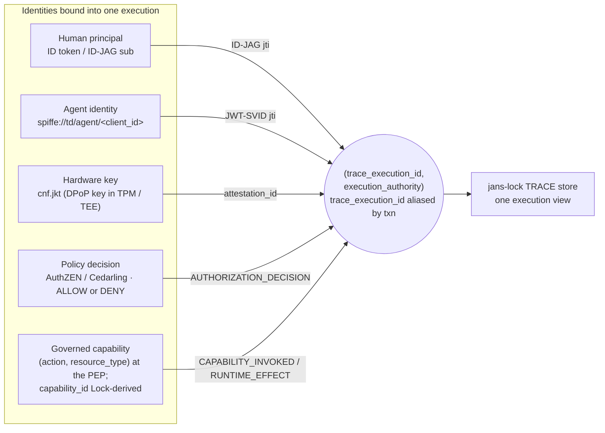
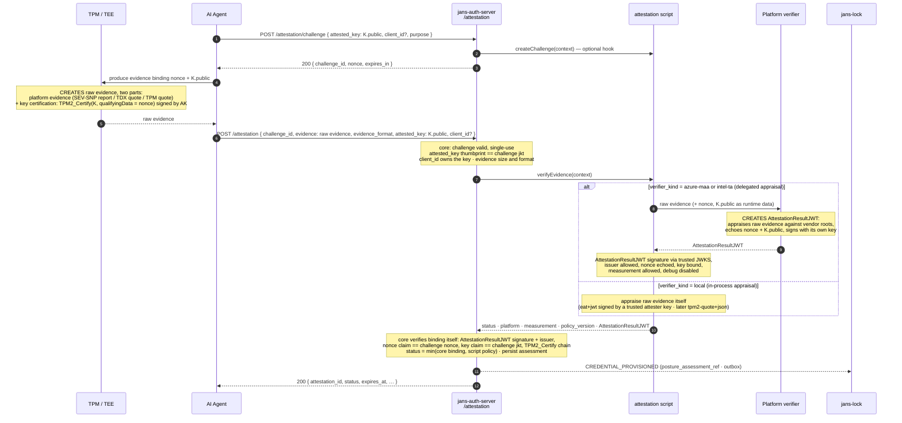
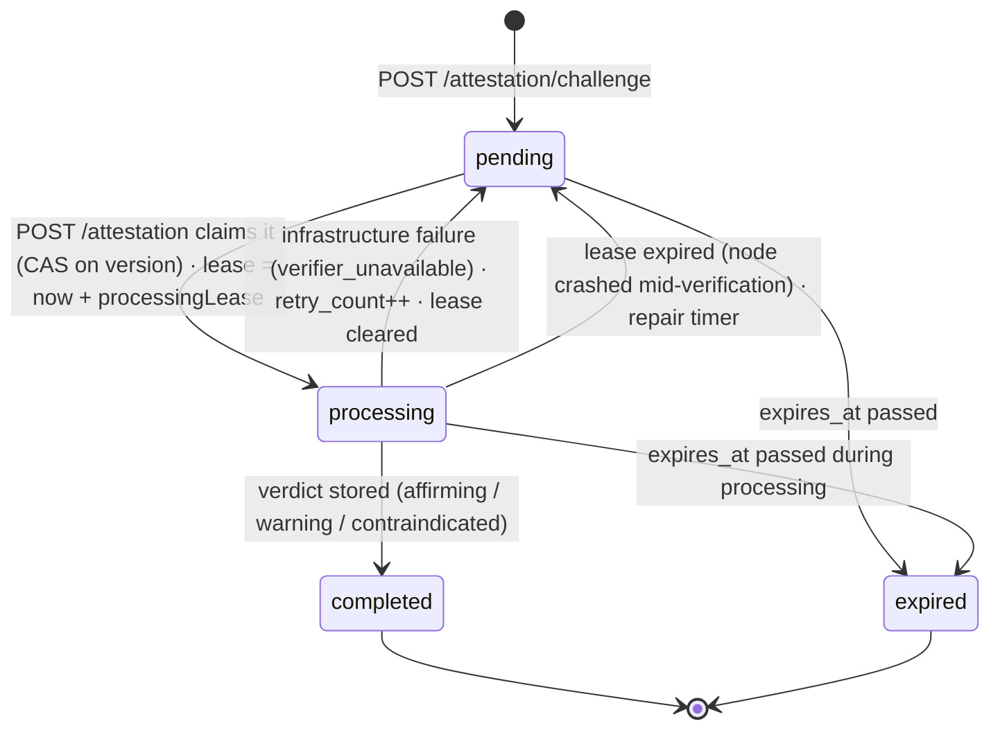
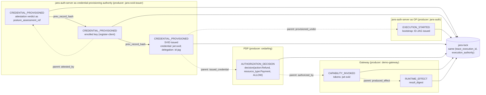
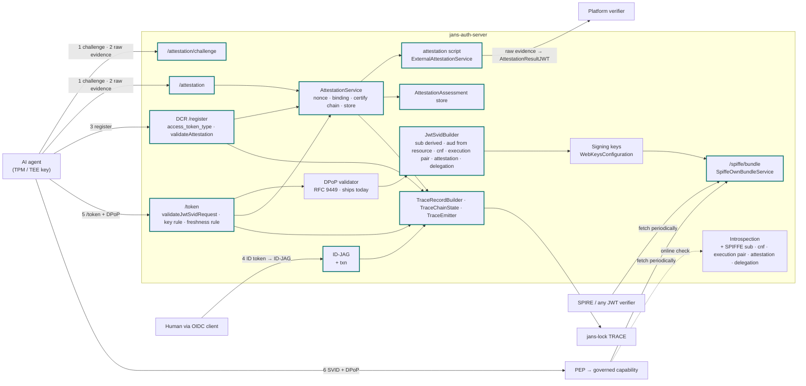

---
tags:
  - administration
  - auth-server
  - oauth
  - feature
  - spiffe
  - agent
  - attestation
  - trace
  - govops
  - design
---

# Hardware-Anchored Agent Identity with TRACE Evidence (Design Plan)

> **Status: design plan, not yet implemented.** This page is the single plan for giving AI agents
> a hardware-anchored identity in jans-auth-server and for producing TRACE evidence about how that
> identity is used. It supersedes and absorbs the earlier
> [Agent Identity via JWT-SVID](./agent-identity-jwt-svid.md) design: everything from that page
> that is still needed is restated here, nothing there is implemented, and this page is the one to
> build from. It follows the
> [Hardware-Anchored Agent Identity Demo Plan](https://github.com/JanssenProject/jans/wiki/Hardware%E2%80%90Anchored-Agent-Identity-Demo-Plan)
> and aligns with the OWASP GovOps architecture (capability as the unit of governance; access
> decisions visible, measurable, accountable). The scope is **jans-auth-server**; changes other
> components need are listed in one short section (section 12) as dependencies.

## 1. The goal in one paragraph

An operator enrolls an AI agent with jans-auth-server. The agent's keypair lives in a hardware
secure element (TPM, TEE, confidential VM) and never leaves it. jans-auth-server **attests** that
key through a dedicated attestation endpoint, binds it to the agent's registration, assigns the
agent a SPIFFE ID, and from then on mints short-lived **JWT-SVIDs** pinned to that key via `cnf`.
Before every issuance the server checks that the hardware passed policy *recently enough*, not only
at enrollment. jans-auth-server publishes its signing keys as a **SPIFFE trust bundle**, so any
relying party, SPIRE or plain JWT verifier, checks the token offline. When a human stands behind the
agent, the human's identity enters through an ID-JAG and is carried into the SVID. Every step the
server takes (appraisal, enrollment, delegation, issuance) is emitted as a signed, hash-chained
**TRACE record**. Appraisal and enrollment are **lifecycle** records that precede, and serve many,
executions, so they keep their own identifiers; delegation and issuance carry the execution's
`(trace_execution_id, execution_authority)` pair, and the lifecycle records are linked in by
`parent_record_ids` (see §3). Correlated that way, a third party can later tie together the human,
the agent, the hardware key, the authorization decision and the invocation of a governed
capability. The SVID itself is checkable offline against the published bundle; correlating a full
execution view is an online query against jans-lock in the initial (Phase-1) integration, and
becomes fully offline-verifiable only with the later Phase-4 Evidence Packet (see §11.1 for the
phase mapping).

## 2. The trust chain at a glance

Each link answers one question a relying party or an auditor implicitly asks. Break any link and
trust stops there; the chain makes explicit what each party vouches for.

| # | Link | Who | What happens | Artifact |
|---|------|-----|--------------|----------|
| 1 | ROOT | TPM / TEE hardware | Non-exportable keypair; vendor-signed raw evidence over it | Raw evidence (quote / report) |
| 2 | ATTEST | `/attestation` + script | Single-use challenge; **jans** sends the raw evidence to the platform verifier and receives its `AttestationResultJWT`; measurement policy applied; **assessment stored with a validity window** | `attestation_id` (server-side assessment), `AttestationResultJWT` (verifier's) |
| 3 | ENROLL | DCR `/register` | Registration accepted only with a fresh `affirming` assessment for the registered key; `client_id` ↔ `jkt` ↔ `attestation_id` persisted; SPIFFE ID assigned | `spiffe://td/agent/<client_id>` |
| 4 | DELEGATE | Token exchange (ID-JAG) | Human's ID token exchanged for an ID-JAG naming the agent; the `(trace_execution_id, execution_authority)` pair is minted (execution id aliased by `txn`) | ID-JAG with the canonical correlation claims |
| 5 | ISSUE | `/token` + DPoP | `client_credentials` or JWT bearer with ID-JAG; DPoP key must equal the enrolled key **and** have an assessment younger than the maximum age; else `attestation_required` | JWT-SVID with `cnf.jkt`, the `(trace_execution_id, execution_authority)` claims, `attestation` |
| 6 | PUBLISH | `/spiffe/bundle` | Signing keys served in SPIFFE bundle format at a stable HTTPS URL | JWKS, `use: jwt-svid` |
| 7 | DECIDE | PDP (AuthZEN / Cedarling) | May agent A (for human H) invoke capability C? | `AUTHORIZATION_DECISION` record |
| 8 | PRESENT & INVOKE | Agent → PEP → capability | SVID + fresh DPoP proof; PEP verifies via the bundle, enforces the decision | `CAPABILITY_INVOKED`, `RUNTIME_EFFECT` records |
| 9 | RECORD & VERIFY | jans-auth-server, PDP, PEP → jans-lock | Each producer signs and chains its records; Lock verifies, receipts, correlates by execution id | One correlated execution view (queried online against Lock; fully offline-verifiable only with the Phase-4 Evidence Packet — see §11.1) |

Links 1 to 3 happen once per agent deployment (and link 2 repeats on the attestation cadence).
Links 4 to 9 repeat continuously; tokens live 5 to 15 minutes, so possession of the hardware key,
not any long-lived secret, is the durable credential.

## 3. The correlation model

An **execution** is one unit of agent work: a task a human delegated, or an autonomous run. It is
identified by the canonical correlation **pair** `(trace_execution_id, execution_authority)` that
every TRACE record carries (see `Lock-Server-TRACE-MVP-Design.md` §7.1 and `design.md`: Audit
Context Propagation Profile). The two values **always travel together** — `execution_authority`
scopes the execution id, and a bare id is not resolvable without it.

jans stamps the pair into the tokens it issues using the canonical token claims, and continues to
set `txn` (RFC 8417 §2.2; jans already uses `txn` in transaction tokens) as an **application-level
alias** for the execution id so the existing transaction-token machinery keeps working:

| Carried value | Canonical token claim | Also as |
|---------------|-----------------------|---------|
| `trace_execution_id` | `https://jans.io/trace/execution_id` | `txn` (same value; the application alias jans already understands) |
| `execution_authority` | `https://jans.io/trace/execution_authority` | — (jans's issuer / configured authority) |

Everyone downstream (PDP, PEP, capability) reads the **pair** — never `txn` alone — and copies both
into its own records' `trace.trace_execution_id` and `trace.execution_authority` fields; a host,
sidecar, PEP, or gateway translates the applicable carrier (the canonical HTTP headers
`Audit-Trace-ID` / `Audit-Execution-Authority`, OTel baggage `audit.trace_id` /
`audit.execution_authority`, or the signed token claims above) into Cedarling's normalized input
model, since Cedarling does not parse tokens, headers, or baggage itself. Unsigned headers and
baggage are correlation hints; the signed token claims are the authoritative binding. Correlation
is then structural: an auditor queries one `(execution_authority, trace_execution_id)` and gets the
whole chain.

**What the shared execution id proves — and what it does not.** The pair groups records into one
execution; it is a **correlation** key, not an **operation** binding. Records that share a
`trace_execution_id` are asserted to belong to the same unit of work, but sharing it does **not**
prove that two records describe the *same operation*: an `AUTHORIZATION_DECISION` permitting
"transfer $50 to A", a `CAPABILITY_INVOKED` mediating "transfer $5000 to B", and a `RUNTIME_EFFECT`
confirming some transfer can all carry the same execution id and still be three different
operations. Proving *same-operation* requires the operation-binding commitments
(`request_digest` / `input_digest` / `tool_call_digest` / `result_digest`) and proof-of-possession
binding that `design.md` defines — which are a **Phase-3** feature (see the §11.1 phase mapping),
not delivered by this plan. Until then a consumer MUST treat a shared execution id as "these
records are claimed to belong to one execution," never as "these records provably refer to one
operation"; Lock does not infer causation from a shared id or close timestamps, and producers
express a causal relationship explicitly with `parent_record_ids`. This plan emits the signed
`(action, resource_type)` facts and the `parent_record_ids` edges that the Phase-3 binding check
consumes, but the binding assessment itself is deferred.

Execution scope is defined independently of credential lifetime:

| Scope | Identifier | Opened by | Closed by |
|-------|------------|-----------|-----------|
| **Execution** | `(trace_execution_id, execution_authority)` — `trace_execution_id` value `exe_…`, aliased by `txn` | The ID-JAG exchange (human-delegated), or the first `/token` call of an autonomous agent that carries no execution id; the server mints the pair and returns it in the token response (the canonical claims, plus the `txn` alias) so the agent reuses it | `traceExecutionMaxAgeSeconds` (default 24 h), or an explicit `txn_close=true` on a token request |
| **Token lifetime** | SVID `jti` | Each issuance | `exp` (minutes) |
| **Key lifecycle** (attestation, enrollment) | `attestation_id`, `client_id` | Before any execution exists | Key rotation / client removal |

A renewal inside an execution presents the same execution id (as the ID-JAG's
`https://jans.io/trace/execution_id` claim / `txn` alias, or the `txn` request parameter); the
server accepts it while the execution is open **and** belongs to the same `client_id`, and refuses
foreign or expired values with `invalid_request` (`txn_unknown`). The reissued token carries the
same `(trace_execution_id, execution_authority)` pair, so one execution spans many token renewals
and tokens never fragment it. Attestation and enrollment
records are **not** execution records: they happen before any execution and serve many later
ones. They keep their own identifiers, and every execution record that relies on them points at
them through `parent_record_ids` (section 11.2).



All five rows use the authoritative record schema: identities live in the `subject` object
(`workload_id`, `workload_instance_id`, `human_sponsor`) and in `attestation_ref`, never in ad-hoc
`agent` / `principal` / `hardware` sub-objects, and the hardware binding is carried as an
attestation reference rather than a signed capability label.

| Identity | Carried in | Bound by | Recorded as |
|----------|-----------|----------|-------------|
| Human | ID-JAG (`sub`, `email`, `acr`, `amr`, `auth_time`, `sid`) | OIDC login at the IdP (gated phishing-resistant by default, §10.9); token exchange at jans | `subject.human_sponsor` with achieved `acr`/`amr`; `sid` ties the execution to the browser session a later `AUTHENTICATION_EVENT`/`FIDO_CEREMONY` resolves; `tokens[]` entry `token_type=id-jag` |
| Agent | JWT-SVID `sub` | Derived from `client_id` under the server's trust domain; never client-supplied | `subject.workload_id` (the SPIFFE ID); `tokens[]`/`credential_fingerprint` entry for the `jwt-svid` |
| Hardware key | JWT-SVID `cnf.jkt`; DPoP proof on every request | Attestation assessment binds `jkt` to platform + measurement | `attestation_ref` (verifier, `result_status`, `appraised_at`) and `posture_assessment_ref` (`jkt`, `attestation_id`, `platform`, `measurement`) |
| Policy decision | AuthZEN response | PDP evaluates agent + principal against the action/resource | `AUTHORIZATION_DECISION` signing `decision { action, resource_type, outcome }` (never a `capability_id`) by the PDP |
| Capability invocation | PEP log | PEP validates SVID + DPoP, checks decision, invokes | `CAPABILITY_INVOKED` signing `invocation { action, resource_type, outcome }` by the PEP; `RUNTIME_EFFECT` by the capability |

jans-auth-server produces the records for the first three rows. The last two are produced by the
PDP and the PEP; this plan only fixes what they must copy — the correlation pair
(`trace_execution_id` + `execution_authority`, carried as the `txn`-derived execution id) and
token `jti`s. Neither producer signs a `capability_id`: both sign `(action, resource_type)` facts,
and Lock resolves the governance label from them (section 11.5).

## 4. What jans-auth-server already has

This plan is smaller than it looks, because most of the machinery shipped with earlier features.

| Capability | Where | Reused for |
|------------|-------|------------|
| Inbound SPIFFE client auth (draft-ietf-oauth-spiffe-client-auth) | `SpiffeIdUtil`, `SpiffeBundleService` (fetch, cache, stale-serving, negative cache), `SpiffeJwtSvidAssertion`, `spiffe_id` / `spiffe_bundle_endpoint` client metadata, `spiffeTrustDomains` config, `SPIFFE_CLIENT_AUTH` flag | Trust-domain grammar; the bundle consumer doubles as the integration test for the bundle we will serve |
| DPoP (RFC 9449) | `DpopService.getDPoPJwkThumbprint()`, `ExecutionContext.setDpop()`, `cnf.jkt` stamping in `fillPayloadOfAccessTokenJwt()`, `ClientAttributes.dpopBoundAccessToken`, introspection returns `cnf` | Key binding at issuance; assessments are keyed by the DPoP thumbprint |
| JWT access-token minting | `AuthorizationGrant.createAccessToken()` → `createAccessTokenAsJwt()` → `fillPayloadOfAccessTokenJwt()`; `JwtSigner` over `WebKeysConfiguration` | SVID minting branches here |
| DCR + interception scripts | `RegisterCreateAction` / `RegisterUpdateAction`, `RegisterService.updateClientFromRequestObject()`, `ExternalDynamicClientRegistrationService`, `ClientRegistrationType.createClient()` / `updateClient()` (runs after request mapping, before `clientService.persist()`; `false` → `invalid_client_metadata`) | Enrollment gate |
| DCR attestation evidence plumbing | `RegisterRequestParam.EVIDENCE`, `ClientAttributes.evidence`, `AppConfiguration.dcrAttestationEvidenceRequired`, `RegisterValidator.validateEvidence()`, `RegisterErrorResponseType.STALE_EVIDENCE` with `nonce`, `DynamicClientRegistrationContext.getEvidence()` / `createStaleEvidenceWebApplicationException(nonce)` | One-step enrollment; model for the token endpoint's `attestation_required` error |
| Custom script framework | `CustomScriptType`, `BaseExternalType`, `External*Service` pattern, `CdiUtil` | New `attestation` script type |
| ID-JAG (draft-ietf-oauth-identity-assertion-authz-grant) | `IdJagService`, `IdJagValidatorService`, `TokenExchangeService`, `JwtGrantService`, `ExternalIdentityAssertionService`, `identity_assertion_authz_grant` flag | Human identity into the agent flow; `txn` minted here |
| AuthZEN | `AccessEvaluationRestWebServiceImplV1` (`/access/v1/evaluation`), `ExternalAccessEvaluationService` | Decision source when jans is the PDP |
| Introspection (RFC 7662) | `IntrospectionWebService` | Online verification path |
| Feature flags, endpoint registration, config revision | `ErrorResponseFactory.validateFeatureEnabled()`, `ResteasyInitializer`, `Conf.revision` | New endpoints; `spiffe_sequence` |
| Transaction id | `TxTokenService` sets `txn` | Same claim name reused as execution id |
| Audit | `OAuth2AuditLog`, `ApplicationAuditLogger` | Operational log stays; TRACE is a separate signed channel |

## 5. Lifecycle

```mermaid
sequenceDiagram
    autonumber
    participant TEE as TPM / TEE
    participant Agent as AI Agent
    participant Human as Human (OIDC client)
    participant AS as jans-auth-server<br/>(trust domain op.example.org)
    participant Verifier as Platform verifier<br/>(Azure Attestation / Intel TA)
    participant Lock as jans-lock<br/>TRACE store
    participant PEP as PEP / Relying Party

    Note over TEE,AS: ① ATTEST + ENROLL — once per deployment
    Agent->>TEE: generate non-exportable keypair K
    TEE-->>Agent: K.public (private half never leaves)
    Agent->>AS: POST /attestation/challenge { attested_key: K.public }
    AS-->>Agent: { challenge_id, nonce }
    Agent->>TEE: produce evidence binding nonce + K.public
    Note over TEE: TEE / TPM CREATES raw evidence<br/>(quote / report, signed by vendor-rooted platform key)
    TEE-->>Agent: raw evidence
    Agent->>AS: POST /attestation { challenge_id, evidence: raw evidence, evidence_format, attested_key: K.public }
    Note over AS: core: nonce single-use, attested key == K == challenge key<br/>then attestation script runs
    AS->>Verifier: raw evidence (script calls the verifier)
    Verifier-->>AS: AttestationResultJWT
    Note over Verifier: platform verifier CREATES AttestationResultJWT<br/>(its signed appraisal of the raw evidence · echoes nonce + K.public)
    Note over AS: core: AttestationResultJWT signature + issuer under the verifier profile,<br/>nonce echoed, key bound, TPM2_Certify chain · script: measurement policy<br/>core: persist assessment
    AS-->>Lock: CREDENTIAL_PROVISIONED (attestation verdict as posture_assessment_ref)
    AS-->>Agent: { attestation_id, status: affirming, expires_at }
    Agent->>AS: DCR /register { jwks: key, access_token_type: JWT-SVID, attestation: attestation_id }
    Note over AS: bind client_id ↔ jkt ↔ attestation_id<br/>assign spiffe://td/agent/#lt;client_id#gt;
    AS-->>Lock: CREDENTIAL_PROVISIONED (enrolled key · register-client)
    AS-->>Agent: client_id

    Note over AS,PEP: ② PUBLISH — on the bundle's own clock
    PEP->>AS: GET /spiffe/bundle (periodic, or via SPIRE federates_with)
    AS-->>PEP: { keys[use: jwt-svid], spiffe_sequence, spiffe_refresh_hint }

    Note over Human,AS: ③ DELEGATE — when a human starts an execution
    Human->>AS: token exchange: ID token → requested_token_type=id-jag, audience=AS
    AS-->>Lock: EXECUTION_STARTED (token-exchange bootstrap · ID-JAG issued)
    AS-->>Human: ID-JAG { sub: alice, client_id: agent,<br/>execution_id + execution_authority (txn alias) }
    Human->>Agent: hand ID-JAG to the agent

    Note over TEE,AS: ④ ISSUE — every few minutes
    Agent->>TEE: sign DPoP proof (+ private_key_jwt)
    TEE-->>Agent: signatures (key never leaves)
    Agent->>AS: POST /token grant=jwt-bearer assertion=ID-JAG (or client_credentials)<br/>DPoP proof · resource=#lt;PEP#gt;
    Note over AS: jkt = thumbprint of the DPoP proof public key (K.public)<br/>jkt must be a registered key of client_id<br/>authoritative KeyAttestationState read by (client_id, jkt)<br/>status must be affirming and appraised_at within max age;<br/>issuance commits under CAS on the row's revision,<br/>else 400 attestation_required { nonce }
    AS-->>Lock: CREDENTIAL_PROVISIONED (SVID issued · posture_assessment_ref)
    AS-->>Agent: JWT-SVID { sub: spiffe id, aud, exp +10m, cnf.jkt,<br/>execution_id + execution_authority (txn alias), attestation, delegation }

    Note over TEE,PEP: ⑤ PRESENT & VERIFY — per request
    Agent->>TEE: fresh DPoP proof for the PEP
    TEE-->>Agent: proof
    Agent->>PEP: request + JWT-SVID + DPoP proof
    Note over PEP: Authorization: DPoP <SVID> + DPoP: <proof><br/>local: signature via bundle, sub, aud, exp<br/>full RFC 9449 DPoP proof (htm, htu, iat/age, jti-replay,<br/>required ath==hash(SVID), nonce when used) · proof key ↔ cnf.jkt<br/>· PDP decision · copy the pair (trace_execution_id + execution_authority)
    PEP-->>Lock: CAPABILITY_INVOKED / RUNTIME_EFFECT
    PEP-->>Agent: 200
```

Steps 1 to 14 establish the hardware binding; if the appraisal is not `affirming` no identity is
ever assigned. Steps 15 to 16 run on the bundle's refresh cadence, never per token. Steps 17 to 20
put a human at the root of the execution. Steps 21 to 30 are the steady state: every token is
short-lived, pinned to the hardware key via `cnf`, stamped with the assessment it was issued
under, and recorded. Every call into the TPM / TEE returns only a public key, a signature or a
piece of evidence; the private half of `K` never crosses that boundary.

Reading the arrows: a **solid** arrow is a request the sender initiates and waits for; a
**dashed** arrow is either the reply to the solid arrow above it, or a one-way notification the
sender does not wait for (the records jans and the PEP send to jans-lock go through an outbox,
section 11.3). `K` is **a** hardware keypair of the agent: its private half signs the DPoP proofs
and the `private_key_jwt` client assertion, its public half (`K.public`) is the `attested_key` in
the challenge, a key in the registration `jwks`, and the thumbprint in the SVID's `cnf.jkt`. In the
steady state an agent uses one key; but a client's `jwks` MAY legitimately hold **more than one**
attested key during a rollover, and each key is independently attested, assessed, and bound. Which
key a given issuance talks about is fixed per request by the DPoP proof's thumbprint — attestation,
enrollment, and issuance always name a specific `jkt`. The full multiplicity, rotation, and
recovery rules are section 9.9.

## 6. Verification: how and where

Three offline-capable paths. In all three the answer to "does the verifier call the auth server?"
is: only periodically for the bundle, never per token.

| Path | Who it's for | How it works |
|------|--------------|--------------|
| **SPIRE federation** | Relying parties in a SPIFFE/SPIRE ecosystem | SPIRE server adds `federates_with` pointing at the jans bundle endpoint (`https_web` profile), fetches on the refresh-hint cadence, distributes to its agents; workloads validate via `ValidateJWTSVID` |
| **Direct bundle fetch** | Ordinary services, gateways | The bundle is a JWKS. Any JWT library verifies the signature and checks `sub`, `aud`, `exp` |
| **Introspection** | High-assurance checks and debugging | RFC 7662 at jans-auth-server for a live answer; the closest thing to revocation the short-TTL model offers |

SPIRE configuration on the relying party side (the entire integration):

```hcl
server {
    trust_domain = "rp-company.example"
    federation {
        federates_with "op.example.org" {
            bundle_endpoint_url = "https://op.example.org/jans-auth/restv1/spiffe/bundle"
            bundle_endpoint_profile "https_web" {}
        }
    }
}
```

**Bearer vs. bound.** Signature + claims checks alone treat the token as bearer. A verifier that
wants the hardware guarantee additionally demands a fresh DPoP proof signed by the key in `cnf`.
Plain SPIFFE verifiers ignore `cnf`, the `https://jans.io/trace/*` correlation claims, `txn`,
`attestation` and `delegation` (unknown claims are additive), so the token stays spec-valid for
both audiences. **A plain JWT-SVID validator that ignores `cnf` is bearer-only**: it gains no
hardware guarantee, and a stolen SVID works at it until `exp`. The hardware binding is only
realized by a PEP that performs the full proof-of-possession check below; this is why a
high-value RP MUST be `cnf`-checking and SHOULD require DPoP, not merely validate the JWT.

**Normative PEP DPoP-presentation requirements (RFC 9449).** "Fresh DPoP proof" is not a
single check. A PEP that relies on the hardware binding MUST, on **every** request, verify the
`DPoP` header proof as a complete RFC 9449 presentation — comparing the proof key to `cnf.jkt` is
necessary but far from sufficient:

| Check | Requirement |
|-------|-------------|
| Proof signature | The DPoP proof JWT (`typ: dpop+jwt`) verifies under the public key in its own `jwk` header, and that key's RFC 7638 thumbprint **equals the SVID's `cnf.jkt`** — this is the possession check, not the whole check |
| `htm` | Equals the HTTP method of the request the proof accompanies (e.g. `POST`) |
| `htu` | Equals the request URI with query and fragment removed, compared after normalization — the proof is bound to **this** endpoint, so a proof captured at one resource cannot be replayed at another |
| `iat` / proof age | Within a small configured window (seconds–low minutes) of now, rejecting both stale proofs and proofs from the future beyond allowed clock skew |
| `jti` + replay cache | Unique; the PEP keeps a **replay cache** of recently-seen `jti`s (at least the proof-age window) and rejects a repeat, so a single proof cannot be reused |
| `nonce` (when used) | When the PEP issues a DPoP nonce (`DPoP-Nonce` / `use_dpop_nonce` challenge), the proof's `nonce` MUST equal the most recently issued value; a missing/stale nonce is rejected with a fresh challenge. A PEP under replay pressure SHOULD require a server-provided nonce rather than rely on `iat`/`jti` alone |
| `ath` (**required** at the resource) | The proof **MUST** contain `ath`, and its value **MUST** equal the base64url-encoded SHA-256 of the presented access token (the SVID), binding this proof to this exact token. This is mandatory when a DPoP-bound access token is presented to a resource server (RFC 9449 §7.1), **not** optional: a proof with a missing or mismatched `ath` is rejected. (`ath` is absent only in the *token-request* proof at `/token`, where there is no access token yet — not here at the resource.) |
| audience | The SVID's `aud` MUST equal this PEP/resource (the ordinary JWT-SVID check), so a token minted for another resource is refused regardless of a valid proof |

The SVID is presented with the **DPoP** authorization scheme, not `Bearer`, so the resource sees
both the token and its bound proof on the request:

```text
POST /payments/transfer HTTP/1.1
Host: payments.example.com
Authorization: DPoP <JWT-SVID>
DPoP: <proof JWT: typ=dpop+jwt, htm=POST, htu=https://payments.example.com/payments/transfer,
       iat, jti, ath=base64url(SHA-256(JWT-SVID)), nonce when challenged>
```

A PEP that performs only the `cnf.jkt` thumbprint comparison and skips `htm`/`htu`/age/`jti`-replay/
`ath`/`nonce` is **not** sender-constrained in practice: a captured proof could be replayed against
a different method, a different endpoint, with a different token, or more than once. These
requirements are the same RFC 9449 checks jans already applies at its own DPoP-protected endpoints
(`DpopService`), restated here as the PEP's obligation; a PEP SHOULD reuse an RFC 9449 library
rather than re-implement them. The demo gateway's PEP implements the full table, and
`JwtSvidRoundTripHttpTest` exercises the negative cases (wrong `htu`, wrong `htm`, stale `iat`,
replayed `jti`, **missing `ath`, wrong `ath`**, and missing required `nonce`).


| Claim | Check | Roots in |
|-------|-------|----------|
| signature | verifies against a `jwt-svid` key | bundle cached from `/spiffe/bundle` |
| `sub` | `spiffe://op.example.org/agent/3f9c` authorised here? | relying party's identity policy |
| `aud` | equals this service | the service's own identifier |
| `iat`/`exp` | fresh (≤ 15 min) | clock |
| `cnf.jkt` | Full RFC 9449 DPoP presentation: proof signature, `htm`, `htu`, `iat`/age, unique `jti` against a replay cache, `nonce` when used, a **required** `ath` matching the presented SVID, **and** the proof-key thumbprint equals `cnf.jkt` (see "Normative PEP DPoP-presentation requirements" above) — not the thumbprint comparison alone | the hardware key, attested |
| `attestation` | `status=affirming`, `appraised_at` recent, `measurement` acceptable to *this* verifier | the appraisal, re-checkable in Lock |
| `delegation` | which human delegated, through which credential, at what authentication strength (`acr`/`amr`) and in which session (`sid`) | ID-JAG, recorded in Lock; the `sid` resolves to the Auth Server `AUTHENTICATION_EVENT` / FIDO `FIDO_CEREMONY` (§10.9) |

Checks 1 to 4 are standard SPIFFE JWT-SVID validation. Check 5 is the hardware binding. Checks 6
and 7 are optional and give a verifier the hardware state and the human behind the request without
any call to jans — **and they are present only when this audience's disclosure profile includes
them** (section 10.10). The minimized default SVID omits `attestation` and `delegation` entirely,
and discloses `delegation.principal_sub` as a pairwise identifier unless the audience is authorized
for the raw subject; an audience that needs the hardware state or the human identity is the one
configured to receive it, and no other RP does.

## 7. Access token type selection: `access_token_type` replaces `access_token_as_jwt`

No new `grant_type`. A grant type answers "on what basis is the client authorised to receive a
token"; for the agent flow that basis is unchanged (`client_credentials`, or JWT bearer with an
ID-JAG). Only the *format* of the issued token changes, and format is a registration-time client
property, the same model jans uses today to choose between bearer and JWT access tokens.

| `access_token_type` | Issued access token |
|---------------------|---------------------|
| `OPAQUE` | opaque reference token; **default** when absent |
| `JWT` | JWT access token; equivalent of today's `access_token_as_jwt=true` |
| `JWT-SVID` | SPIFFE JWT-SVID |

The value names the **serialization**, not the presentation: `OPAQUE` rather than `BEARER`,
because a JWT is also presented as a bearer token unless DPoP binds it, and `token_type` in the
token response (`Bearer` / `DPoP`) already says how a token is presented.

Rules:

- `access_token_type` present always wins over `access_token_as_jwt`; absent → fall back
  (`JWT` if `true`, else `OPAQUE`). Existing clients are unaffected.
- `access_token_as_jwt` is deprecated, removal in the next major release. Both are documented in
  swagger (all three client-metadata schema occurrences) during the window; config-api and TUI
  follow (outside this plan).
- `JWT-SVID` constraints at registration and update (`RegisterParamsValidator.validateAccessTokenType()`,
  `400 invalid_client_metadata`): `SPIFFE_SVID_ISSUANCE` flag enabled; `grant_types` ⊆
  {`client_credentials`, `urn:ietf:params:oauth:grant-type:jwt-bearer`}; asymmetric
  `token_endpoint_auth_method` (`private_key_jwt`, `tls_client_auth`, `self_signed_tls_client_auth`);
  `dpop_bound_access_token` not explicitly `false` (it is forced `true`); `jwks` or `jwks_uri`
  present; a valid `attestation` (section 9.5); a non-empty `allowed_resources` list (the
  audiences this agent may request SVIDs for, section 10.2); and a DPoP proof on the registration
  request signed by the attested key (section 9.5).

Implementation: `io.jans.as.model.common.AccessTokenType` enum (`fromString` accepts `JWT-SVID`
and `JWT_SVID`, case-insensitive); `RegisterRequestParam.ACCESS_TOKEN_TYPE`;
`ClientAttributes.accessTokenType` (stored in `jansAttrs`, no schema change);
`Client.getResolvedAccessTokenType()` / `isAccessTokenJwtFormat()` used everywhere the format is
decided (`AuthorizationGrant.createAccessToken()`, `AbstractAuthorizationGrant.getAccessTokenLifetimeInSeconds()`,
every other `isAccessTokenAsJwt()` reader); `RegisterRequest.accessTokenType` kept as a raw
`String` so an unknown value is rejected rather than ignored; `RegisterJsonService` echoes the
resolved value.

## 8. SPIFFE bundle endpoint (publish)

`GET /jans-auth/restv1/spiffe/bundle`, gated by `FeatureFlagType.SPIFFE_SVID_ISSUANCE`
(`spiffe_svid_issuance`, sibling of `SPIFFE_CLIENT_AUTH`).

```json
{
  "keys": [
    { "kty": "EC", "crv": "P-256", "x": "…", "y": "…", "kid": "7f3a", "alg": "ES256", "use": "jwt-svid" }
  ],
  "spiffe_sequence": 42,
  "spiffe_refresh_hint": 300
}
```

- `SpiffeOwnBundleService` (`@ApplicationScoped`) builds the bundle from
  `WebKeysConfiguration.getKeys()`: keep `use == SIGNATURE` keys with an asymmetric `alg` (never
  HMAC, never `enc`), apply the same `jwksAlgorithmsSupported` filter as `JwkRestWebServiceImpl`
  (extract to a shared helper), emit a minimal RFC 7517 JWK per key (`kty`, `kid`, `alg`,
  `use: "jwt-svid"`, `n`/`e` or `crv`/`x`/`y`; no jans-specific members). `spiffe_sequence` =
  `Conf.revision` (new `ConfigurationFactory.getLoadedRevision()`), `spiffe_refresh_hint` =
  `spiffeBundleRefreshHintSeconds`. An empty key list is a valid bundle.
- `SpiffeBundleRestWebService` / `Impl` in `io.jans.as.server.spiffe.ws.rs`, registered in
  `ResteasyInitializer`; headers `Cache-Control: public, max-age=<refresh hint>`.
- Discovery member `spiffe_bundle_endpoint` (OpenID configuration, client
  `OpenIdConfigurationResponse`, swagger), gated on the same flag.
- **Decision:** reuse the OIDC signing keys for v1 (relabelled `use: jwt-svid` only in the bundle
  output); SVID rotation stays coupled to OIDC rotation. A dedicated key set is a follow-up. During
  rotation the bundle serves old + new keys and bumps `spiffe_sequence`.
- **Trust domain:** `spiffeOwnTrustDomain` is permanent. `getSpiffeOwnTrustDomain()` returns the
  raw configured value; `getEffectiveSpiffeOwnTrustDomain()` applies the issuer-host fallback.
  `SpiffeTrustDomainService.pinTrustDomainIfNeeded()` (from `AppInitializer`) writes the derived
  value into `Conf` on first start with issuance enabled, logs a `WARN` that it is now permanent,
  logs an `ERROR` and continues if no valid trust domain can be derived, and adopts a value another
  node pinned first.
- Dogfood test: a second jans instance's existing `SpiffeBundleService` must accept this bundle.

Configuration: `spiffeOwnTrustDomain` (String), `spiffeBundleRefreshHintSeconds` (300),
`spiffeSvidLifetimeSeconds` (600), `spiffeSvidMaxLifetimeSeconds` (3600). All `@DocProperty`.

## 9. New: the attestation endpoint

### 9.1 Why an endpoint and not only a DCR script

A DCR script proves the key was in hardware *once*. The demo plan asks for "recent attestation for
issuance": the platform must have passed policy recently enough for *this* token. That needs a
challenge that can be issued and consumed outside DCR, an assessment with a validity window that
the token endpoint can look up, and a verdict that is itself evidence. A dedicated endpoint gives
all three; the DCR gate and the token-endpoint rule become callers of one service, so enrollment
and issuance apply exactly one policy.

### 9.2 Flow



The script never sees the nonce lifecycle, the key-binding check or persistence; those are core
and identical for every platform.

Reading the arrows: **solid** = a request the sender waits for; **dashed** = the reply to it, or a
one-way notification (the TRACE record to jans-lock is queued, not awaited). The `alt` box shows
the two appraisal backends a script can implement; which one runs is script configuration
(`verifier_kind`), not something the agent chooses.

**The agent never talks to the platform verifier.** Only jans-auth-server does, from inside the
attestation script, during `POST /attestation`. The agent's job ends at "ask the hardware for raw
evidence over the nonce and hand it to jans". Reasons:

- *Trust anchors stay server-side.* Which verifier is trusted, under which issuer and JWKS, with
  which API credentials, is jans configuration. An agent that could pick the verifier could pick a
  verifier it controls.
- *The verifier's answer is bound to the request jans made.* jans supplies the nonce and
  `K.public` as runtime data when it calls the verifier, so the `AttestationResultJWT` it gets back
  is about exactly the challenge it issued; there is no window in which an agent can swap results.
- *One credential set.* Intel Trust Authority needs an API key; Azure Attestation may need a
  tenant-specific endpoint. Those live in the script configuration, never on agent hosts.
- *Complete evidence trail.* jans sees, stores (digest and, by default, the full
  `AttestationResultJWT`) and records both the raw evidence and the verifier's appraisal, so an
  auditor can re-verify the verifier's signature later.
- *Simpler agents.* An agent needs one HTTP client and one hardware API, regardless of platform.

#### Who creates what: the RATS roles in this flow

RFC 9334 names three roles. Mapping them makes clear what the `evidence` parameter carries and who
signed it.

| RATS role | Played by | Creates | Signed with |
|-----------|-----------|---------|-------------|
| **Attester** | The hardware (TPM / TEE firmware / CPU) on the agent's host, driven by the agent process | **Raw evidence**, always two parts: (1) **platform evidence** (SEV-SNP report, TDX quote, or TPM `TPM2_Quote` over PCRs) and (2) **key certification**: a `TPM2_Certify` attestation over `K` with `qualifyingData = nonce`, signed by the attestation key (AK) that the platform evidence vouches for (section 9.3a). Bare SEV-SNP / TDX deployments without a vTPM put `SHA-256(nonce ‖ thumbprint(K.public))` in `REPORT_DATA` / `REPORTDATA` **and** must certify `K` by another platform mechanism; report data alone names bytes, it does not certify a key | A platform key rooted in the vendor: TPM / vTPM AK (certified by the EK CA or, on Azure CVMs, by the SEV-SNP report through HCL runtime data), AMD VCEK / VLEK, Intel PCK |
| **Verifier** (delegated, `verifier_kind=azure-maa` / `intel-ta`) | Azure Attestation or Intel Trust Authority, **called by jans-auth-server's attestation script** | **`AttestationResultJWT`**: a JWT stating "I verified this raw evidence against the vendor roots; the platform measured X; the report carried nonce N and key K.public" | The verifier's own published JWKS |
| **Verifier** (in-process, `verifier_kind=local`) | jans-auth-server's attestation script | The same appraisal, done locally over the raw evidence (`eat+jwt` signed by a trusted attester key; later `tpm2-quote+json`) | n/a; the verdict is signed by jans below |
| **Relying Party** | jans-auth-server core (`AttestationService`, then DCR and `/token`) | **Assessment** (server-side record, section 9.6): "I accept this verdict for key K until `expires_at`"; surfaced to others through the SVID `attestation` claim and the TRACE record | Not a separate token; the SVID and the TRACE record carry jans's signature |

So the request parameter named `evidence` always carries RATS *Evidence* (raw, hardware-signed);
the name matches the shipped DCR `evidence` parameter. *Attestation Results* exist in two layers
and are named to keep them apart: the platform verifier's **`AttestationResultJWT`** (obtained and
validated by jans, stored with the assessment, never seen by the agent unless jans chooses to echo
it) and jans's own **assessment**, a server-side record identified by `attestation_id` (section
9.6; no token is minted for it). The agent never creates evidence or results: it asks the
hardware for raw evidence and relays it. The agent's only cryptographic contribution to
attestation is owning `K`.

#### Why two requests: challenge first, evidence second

Remote attestation is a **challenge-response** protocol (RFC 9334 §8.1, "freshness"). The
verifier must prove that the evidence it receives was produced *after* it asked for it, by *this*
hardware, about *this* key; otherwise an attacker records one good attestation and replays it for
ever. The only way to get that property is for the verifier to pick an unpredictable value, hand
it to the attester, and require the hardware to sign over it. The hardware does exactly this:
a TPM `TPM2_Quote` / `TPM2_Certify` takes `qualifyingData`, a bare SEV-SNP report takes 64 bytes
of `REPORT_DATA`, a TDX quote takes `REPORTDATA`, and Azure Attestation / Intel Trust Authority
echo the nonce they find in the evidence into their `AttestationResultJWT`. In every case the
nonce has to exist before the evidence can be generated, so one HTTP request cannot carry both.

Freshness and key certification are two different properties, carried by two different signed
structures (section 9.3a): the nonce proves *when*, the key certification proves *where the
private key lives*. Report data alone does neither for an application key.

What each request does:

| | `POST /attestation/challenge` | `POST /attestation` |
|---|---|---|
| Who speaks | Agent asks, jans answers | Agent presents, jans judges |
| Input | The public key that will be attested, optionally `client_id` and `purpose` | The challenge id, the evidence, its format, the same public key |
| jans does | Generates ≥ 128 random bits, stores `{ nonce, jkt, client_id, purpose, expires_at }` under `challenge_id`, returns nonce + accepted formats | Consumes the challenge (single use), checks the key matches the challenge, runs the script, checks the script's answer, persists the assessment, signs the result token, emits the TRACE record |
| Agent does next | Asks its hardware to produce raw evidence with the nonce in the report data | Uses `attestation_id` at DCR; nothing at `/token` (looked up by `(client_id, jkt)`) |
| jans does behind the scenes | nothing external | For delegated backends the script calls the platform verifier with the raw evidence and validates the returned `AttestationResultJWT` |
| Binds | nonce ↔ key ↔ (client) ↔ purpose | evidence ↔ nonce ↔ key, plus the verdict |

Why the challenge is bound to the key and not only random: the evidence proves "this platform
holds key K and saw nonce N". If the challenge were not tied to K, an attacker with any attested
machine could request a challenge, attest *its own* key K′ and present the result for a
registration whose `jwks` contains K. The core check `key named in the verifier result ==
challenge.jkt == registered key` closes that gap and is deliberately outside the script
(section 9.3b).

Why `/attestation` is separate from `/register` and `/token` even though both call it:

- The same assessment is needed in two places (enrollment and every issuance) and by two kinds of
  caller (an unregistered agent and a registered one). One endpoint, one service, one policy.
- An agent can attest ahead of time, before the first `/token` of a burst, and re-attest on a
  timer, so attestation latency (which includes a round trip to a platform verifier) stays off
  the token path.
- The verdict is evidence in its own right. Negative verdicts must be recorded too; folding them
  into a `400` from `/register` would lose them.
- Operators can gate `/attestation` differently (rate limits, IP allowlists, a WAF rule for 64 KB
  bodies) from the OAuth endpoints.

The one-step DCR path (section 9.5) is the same protocol with the roles of the two messages played
by the `stale_evidence` error and the retried registration: the first `/register` without evidence
*is* the challenge request, the error body *is* the challenge, the second `/register` *is* the
evidence submission. It exists for compatibility with the shipped `evidence` parameter; new agents
should use the explicit endpoint.

### 9.3 Request and response definitions

Base path `/jans-auth/restv1/attestation`. Gated by new `FeatureFlagType.ATTESTATION`
(`attestation`). Both operations are `POST` with `application/json` and are rate-limited per source
IP and per `jkt` like `/register`.

**Authentication requirement, and why it is conditional.** A first-time attestation (no
`client_id`, `purpose=enroll`) needs **no** OAuth client authentication — the caller is not yet
registered, which is the whole point. But a submission that names an existing `client_id` must not
be allowed to affect that client's standing on anonymous input: an authenticated-negative verdict
(`measurement_not_allowed`, `nonce_mismatch`, `key_not_certified`, …) **supersedes** the client's
valid approvals (section 10.4), so if anyone who merely knows the public `client_id` and `K.public`
could drive a `contraindicated` result, replaying stale evidence would be a **denial-of-service**
against the agent. Therefore:

- **Proof of possession of `K` gates supersession.** A submission carrying a `client_id` MUST
  include a **DPoP proof signed by the attested key** (`htm=POST`, `htu=<attestation endpoint>`,
  fresh `iat`, unseen `jti`; validated by the existing `DpopService`), with the proof-key
  thumbprint equal to `attested_key`'s `jkt` and to a registered key of that `client_id` — the same
  proof the DCR gate already requires (section 9.5). Possession of `K` is what distinguishes the
  legitimate agent from a third party who only learned its public identifiers.
- A submission with a `client_id` but **no valid proof of possession** is still processed and its
  verdict is still **recorded as evidence** (negative verdicts are evidence), but it is marked
  **non-superseding**: it is stored with `supersedesEligible=false` in the `AttestationAssessment`
  evidence log and is **never written through to the authoritative `KeyAttestationState` row**
  (section 9.7). Because it never touches that single row, it can **never** overwrite a standing
  `affirming` state and can **never** block issuance for that client, even when it is the newest
  observation. The
  `attestationChallenge`'s `client_id` binding plus this proof requirement together mean "only the
  holder of `K` can cause a negative verdict to count against this client."
- A submission with **no** `client_id` (pre-enrollment) binds only to the key it attests; it has no
  client whose approvals it could supersede, so it needs no client authentication. It still cannot
  affect any *other* client, because an assessment is keyed to the `(client_id, jkt)` it was
  actually bound to (section 10.4, `key_mismatch` row).

Rate limiting (per source IP, per `jkt`) remains, but it is a throughput control, not an
authorization control — it does not decide whose approvals a verdict may invalidate; proof of
possession of `K` does.

#### `POST /attestation/challenge`

```json
{
  "attested_key": { "kty": "EC", "crv": "P-256", "x": "…", "y": "…" },
  "client_id": "3f9c…",
  "purpose": "enroll"
}
```

| Field | Required | Meaning |
|-------|----------|---------|
| `attested_key` | yes; JWK **or** `jkt` string | Public key the evidence will be about. Core computes the RFC 7638 thumbprint; everything downstream is keyed by it |
| `client_id` | no | Re-attesting an existing client. Core checks the key is one of the client's `jwks` / `jwks_uri` keys (same lookup as section 10.3) |
| `purpose` | no | `enroll` (default without `client_id`) or `issue`; lets the script pick a stricter policy for issuance |

Response `200`:

```json
{
  "challenge_id": "c0a8d4…",
  "nonce": "qH3kZ9…",
  "expires_in": 300,
  "evidence_formats_supported": ["azure-cvm-sev-snp+json", "tpm2-quote+json", "eat+jwt"]
}
```

Nonce ≥ 128 bits random, stored as a persistent `AttestationChallenge` entry (section 9.3c) with
`{ jkt, client_id, purpose, state: pending, expires_at }` under `challenge_id`
(TTL `attestationChallengeLifetimeSeconds`). A script may add response members via
`modifyChallengeResponse`.

Errors (`400`): `invalid_request` (malformed key), `invalid_client` (unknown `client_id`),
`key_not_registered`.

#### `POST /attestation`

```json
{
  "challenge_id": "c0a8d4…",
  "evidence": {
    "snp_report": "<base64url SEV-SNP attestation report>",
    "hcl_runtime_data": "<base64url HCL runtime data (contains the vTPM AK public key)>",
    "vcek_chain": "<base64url PEM chain>",
    "key_certification": {
      "certify_info": "<base64url TPMS_ATTEST from TPM2_Certify over K, extraData = nonce>",
      "signature": "<base64url TPMT_SIGNATURE by the AK>",
      "key_public": "<base64url TPMT_PUBLIC of K>",
      "ak_public": "<base64url TPMT_PUBLIC of the AK>"
    }
  },
  "evidence_format": "azure-cvm-sev-snp+json",
  "attested_key": { "kty": "EC", "crv": "P-256", "x": "…", "y": "…" },
  "client_id": "3f9c…"
}
```

| Field | Required | Meaning |
|-------|----------|---------|
| `challenge_id` | yes | From `/attestation/challenge`; consumed on use |
| `evidence` | yes | **Raw evidence from the hardware**, opaque to core: a JSON document with the platform evidence **and** the key certification (section 9.3a) for `azure-cvm-sev-snp+json` and `tpm2-quote+json`; a compact JWT for `eat+jwt`; base64url CBOR for `eat+cwt`. Never a verifier result: the agent does not talk to verifiers. Max `attestationMaxEvidenceBytes` |
| `evidence_format` | yes | Names the hardware evidence type and therefore which certification mechanism applies; must be in `attestationEvidenceFormatsSupported`. Which appraisal backend handles it (Azure Attestation, Intel Trust Authority, in-process) is script configuration, not a request choice |
| `attested_key` | yes | Must thumbprint to the challenge `jkt` |
| `client_id` | conditional | Must equal the challenge's `client_id` when one was given |

Core, before the script: flag; challenge exists, unexpired, and moves `pending → processing`
atomically (section 9.3c); thumbprint equals challenge `jkt`; `client_id` consistency; size and
format. Then `verifyEvidence(context)`, which returns the `AttestationResultJWT` (or, for
`verifier_kind=local`, the attester-signed EAT) plus the script's policy verdict. Core, after the
script, **verifies the binding itself** (section 9.3b): result signature against the server-
configured verifier profile, issuer and `exp`, nonce claim equals the challenge nonce, key claim
equals the challenge `jkt`, and the key certification chain. The final status is the minimum of
core's binding verdict and the script's policy verdict; a script cannot raise it. The challenge
then moves to `completed`.

Response `200` (also for negative verdicts; the verdict is the payload):

```json
{
  "attestation_id": "att_7b1e…",
  "status": "affirming",
  "attested_jkt": "9XKt…",
  "platform": "azure-cvm-sev-snp",
  "measurement": "sha384:c9e4…",
  "policy_version": "agent-tpm-policy-2026-09",
  "appraised_at": 1790000000,
  "expires_at": 1790000900,
  "verifier": "https://sharedeus.eus.attest.azure.net",
  "verifier_result_digest": "sha256:…",
  "reasons": [],
  "trace_record_id": "rec_01J…"
}
```

| Field | Meaning |
|-------|---------|
| `attestation_id` | Primary key of the stored assessment; used in DCR and `/token` (`attestation` parameter) and in TRACE |
| `status` | RATS EAR vocabulary (draft-ietf-rats-ar4si; same as TRACE `appraisal.status`): `affirming`, `warning`, `contraindicated`. Only `affirming` satisfies enrollment and issuance unless `attestationAcceptWarning=true` |
| `attested_jkt` | RFC 7638 thumbprint of the attested key as **core** extracted it from the verifier result and the key certification (never script-supplied) |
| `platform` | TRACE `runtime.platform` value (`tpm2`, `azure-cvm-sev-snp`, `intel-tdx`, `amd-sev-snp`, `aws-nitro`, `software-only`, …) |
| `measurement` | `sha256:…` / `sha384:…` (TPM PCR composite, TDX MRTD, SEV launch measurement) |
| `policy_version` | Identifier of the measurement / platform policy the script applied |
| `appraised_at`, `expires_at` | Validity window; length `attestationAssessmentLifetimeSeconds` unless the script shortens it |
| `verifier` | URI of the party that appraised the raw evidence: the platform verifier the script called, or this issuer for in-process appraisal |
| `verifier_result_digest` | SHA-256 of the `AttestationResultJWT` the script received (absent for in-process appraisal). The JWT itself is stored with the assessment (`attestationStoreVerifierResult`, default `true`) and is not returned to the agent unless `attestationEchoVerifierResult=true` |
| `reasons` | Stable codes for `warning` / `contraindicated` / `none`: `measurement_not_allowed`, `evidence_expired`, `nonce_mismatch`, `key_mismatch`, `untrusted_verifier`, `debug_enabled`, `verifier_unavailable`, … |
| `trace_record_id` | `record_id` of the `CREDENTIAL_PROVISIONED` TRACE record (carrying this verdict as its `posture_assessment_ref`) when emission is enabled |

Errors (`400`): `invalid_challenge` (unknown / expired / used; body carries a fresh `challenge_id`
+ `nonce` for a one-round-trip retry), `invalid_request`, `unsupported_evidence_format`,
`evidence_too_large`. `503 verifier_unavailable` when the script could not reach the platform
verifier (timeout, 5xx, TLS failure): no verdict about the hardware is implied, the challenge is
**not** consumed so the agent can retry with the same evidence, and a `CREDENTIAL_PROVISIONED`
record whose `posture_assessment_ref.status=none`, reason `verifier_unavailable`, is still emitted.
`500` is never used for a negative verdict.

### 9.3a Key certification: proving that `K` is a hardware-protected key

A key *named* in attestation evidence is not thereby a hardware key. Writing
`SHA-256(nonce ‖ thumbprint(K.public))` into a report's `REPORT_DATA` binds those 64 bytes to the
report; it says nothing about where the private half of `K` was generated or whether it can be
exported. The design therefore requires a **separate, platform-specific certification** of `K`
and treats the result as the hardware binding. The checks are performed by **core** (section
9.3b), not by the script; the script's role is to obtain the verifier result and apply measurement
policy.

#### The vendor-neutral binding contract (what every platform must satisfy)

The certification mechanism differs by platform, but the design does **not** hard-code any one
cloud's chain. Instead every platform profile — Azure, a bare TPM, Google, AWS, Oracle, or a future
one — must satisfy the **same three abstract obligations**, and the profile (section 9.3b) declares
*how* each is located in that vendor's attestation result. Core checks the obligations abstractly;
the profile supplies the claim paths:

| Obligation | What it proves | What the profile declares |
|------------|----------------|---------------------------|
| **Platform authenticity + measurement** | The hardware evidence is genuine and the runtime measured an acceptable image, with debug/TCB in policy | The verifier/issuer/JWKS that appraises the hardware evidence, and the claim paths to the measurement and the debug / TCB flags |
| **Freshness** | The evidence was produced *after* this challenge, for *this* key | The RATS freshness mechanism and where the challenge nonce is echoed (a result claim, or the key-certification `extraData`) |
| **Key certification** | The private half of `K` was generated in, and cannot be exported from, the hardware the measurement describes | The certification mechanism, the claim path to the attester/AK, and the certification artifact core must verify |

A platform's `key_binding_strength` records *how strongly* the third obligation is met, because it
genuinely differs across hardware and the difference is load-bearing for a relying party:

- **`certified`** — a hardware key (vTPM/TPM) `TPM2_Certify`s `K` as non-exportable; the guarantee
  is "the private half of `K` lives in and cannot leave this hardware."
- **`measured_guest`** — no TPM certifies an application key; a *measured, trusted guest image*
  reports it holds `K` (the key is bound to `REPORT_DATA`/`user_data`, not certified). Weaker, and
  stated as such; usable only where the measured image is itself trusted to protect `K`.

`key_binding_strength` is stored on the assessment and surfaced in `platform`/`posture_assessment_ref`,
so an auditor and the PDP can tell a TPM-certified key from a merely-measured one **across clouds**.

#### Platform profiles (each an instance of the contract)

Each row is a profile instance; the **Status** column is non-normative until the profile carries
the citations and conformance vectors required below. **The exact vendor claim paths in the Azure
and other cloud rows are documented best-effort and are not yet substantiated by captured vectors
in this repository — treat them as `experimental` pending validation (see "Platform references and
conformance vectors").**

| Platform (`evidence_format`) | Appraisal | Key certification / `key_binding_strength` | Status |
|------------------------------|-----------|---------------------------------------------|--------|
| **Azure confidential VM, SEV-SNP with vTPM** (`azure-cvm-sev-snp+json`), the demo platform | Delegated to Azure Attestation (`verifier_kind=azure-maa`) | `TPM2_Certify` of `K` by the vTPM AK with `qualifyingData = nonce` → `certified`. Azure's HCL is documented to place the vTPM AK in the SNP report runtime data (`REPORT_DATA = SHA-256(hcl_runtime_data)`), AMD signs the report with the VCEK, and MAA is documented to return the AK in `x-ms-runtime.keys`. On Azure CVMs the guest cannot choose `REPORT_DATA`, so freshness comes from the `TPM2_Certify` `extraData`, not the SNP report. **Claim paths per Azure MAA docs; pending captured vectors.** | experimental |
| **Physical / generic TPM 2.0** (`tpm2-quote+json`) | In-process (`verifier_kind=local`), vendor-neutral | Same `TPM2_Certify` by an AK → `certified`. AK certified by a privacy CA, or bound to the EK via `TPM2_MakeCredential` / `TPM2_ActivateCredential` with the EK certificate chaining to the manufacturer CA | experimental |
| **Google Cloud Confidential VM / Confidential Space** (`gcp-confidential-space+jwt`) | Delegated to the Confidential Space attestation service (`verifier_kind=gcp-cs`), which issues an OIDC-style token | Where a vTPM is present, `TPM2_Certify` → `certified`; otherwise the measured-image model → `measured_guest`. Profile declares the token issuer/JWKS and the claim paths to the image/submod measurement and the echoed nonce. **Claim paths per GCP Confidential Space docs; pending captured vectors.** | experimental |
| **AWS Nitro Enclaves** (`aws-nitro+cbor`) | In-process (`verifier_kind=aws-nitro`): verify the COSE_Sign1 attestation document against the pinned AWS Nitro Attestation PKI root | No vTPM → `measured_guest`: the document's `public_key` / `user_data` carries `K`'s thumbprint and the `nonce` field carries freshness; PCRs are the measurement. **Structure per AWS Nitro docs; pending captured vectors.** | experimental |
| **Oracle Cloud (OCI) confidential VM** (`oci-cvm-sev-snp+json`) | Delegated or in-process per the OCI offering; same SEV-SNP/TDX substrate | `certified` when the OCI instance exposes a vTPM that certifies `K`; otherwise `measured_guest`. **Per OCI confidential-computing docs; pending captured vectors.** | experimental |
| **EAT** (`eat+jwt` / `eat+cwt`) — the preferred interop envelope | Delegated or in-process (`verifier_kind=local`); any platform able to emit an EAT | The EAT's `cnf.jwk`/`cnf.ckt` asserted by the trusted attester key, with `eat_nonce` for freshness. `key_binding_strength` is whatever the EAT's measurements justify (`certified` if it carries a hardware key-certification claim, else `measured_guest`); in CI with the test JWKS it is `software-only` and establishes **no** hardware guarantee | experimental (CI: software-only) |

Core's concrete checks for a **`certified`** (TPM) profile are: (1) the verifier result is valid
under the profile (issuer, signature, `exp`), the platform/attestation-type claim is as the profile
expects, the launch/image measurement is in policy, and debug is disabled; (2) the attester/AK in
the result equals the AK that signed the certification; (3) the AK signature over the certify
structure verifies; (4) the certification's `extraData`/nonce equals the challenge nonce; (5) the
certified key name equals `Name(key_public)`; (6) `key_public` attributes mark it non-duplicable
(`fixedTPM`, `fixedParent`, `sensitiveDataOrigin`, `sign`, not `restricted`/`decrypt`-duplicable);
(7) the key material inside `key_public` equals `attested_key`. For a **`measured_guest`** profile,
(5)–(7) are replaced by "the measured guest image is in policy and the report binds
`SHA-256(nonce ‖ thumbprint(K.public))`", and the assessment records `key_binding_strength=measured_guest`.
These are the vendor-neutral checks; the Azure/TPM instance is the one with captured vectors
targeted first (section 13, PR 3).

What a `certified` profile establishes, in words a relying party can rely on: *"The private half of
`K` was generated inside, and cannot be exported from, hardware whose launch/image measurement the
named verifier appraised at time T."* It does not establish which process inside that runtime is
allowed to use `K`; see the guarantee statement in section 15. A `measured_guest` profile
establishes the weaker "a measured, trusted guest image reports it holds `K`."

#### Platform references and conformance vectors

Because the repository does not yet contain authoritative vendor material for these claim paths, a
profile is **not** normative — and MUST ship as `maturity: experimental` (section 9.3b) — until it
carries both:

- **Vendor citations.** Each profile names the authoritative source for every claim path and
  structure it relies on: the MAA `x-ms-*` result schema and the AMD SEV-SNP ABI (`REPORT_DATA`,
  `PLATFORM_INFO`) for Azure; the TPM 2.0 spec for `TPM2_Certify` / `TPMS_ATTEST` / `TPMT_PUBLIC`;
  the GCP Confidential Space attestation-token schema; the AWS Nitro attestation-document / PKI
  spec; the OCI confidential-computing attestation docs. An uncited claim path is unverified by
  definition and blocks `validated`.
- **Captured interoperability vectors, positive and negative.** A recorded *positive* vector (real
  evidence + verifier result that core's checks accept) and a set of *must-fail* vectors — wrong
  nonce, wrong/forged attested key, debug-enabled, measurement-not-allowed, tampered AK signature,
  expired verifier result — that core MUST reject. These follow the positive/negative/must-fail
  discipline of the TRACE accountability-conformance work and live beside the profile as test
  fixtures. Only when a profile has citations **and** passing positive/negative vectors is it
  promoted to `maturity: validated`; a deployment MAY refuse `experimental` profiles for a
  high-risk capability.

**Platform-state caveat (SNP).** A conformant attestation result has no field for SNP
`PLATFORM_INFO` (SMT enabled, the BadRAM DRAM-alias-check completion, ECC, ciphertext hiding), so a
verifier reading a conformant result cannot appraise those even where the producer checked them
(`research/trace-spec.txt`, LIMITATIONS). A profile that cares about those conditions MUST assert
them explicitly in its measurement policy rather than assume the result covers them.

### 9.3b Division of trust: what core verifies, what the script decides

The script is admin-installed code and is trusted to make **policy** decisions. It is not trusted
to assert **binding** facts, because a permissive or buggy script would otherwise be able to mint
an `affirming` verdict for a key the evidence never named. Core therefore validates the signed
material itself and derives the binding from it; the script only hands the material over.

| Concern | Who | How |
|---------|-----|-----|
| Call the platform verifier; choose endpoint, credentials, request shape | Script | `callVerifier()` |
| `AttestationResultJWT` signature, `iss`, `exp`, `nbf` | **Core** | Against a server-configured **verifier profile** (`attestationVerifierProfiles`, below), never against script-supplied keys |
| Extract nonce and attested key from the result | **Core** | Claim paths come from the verifier profile (per-vendor, e.g. Azure: `x-ms-runtime.keys`, nonce via the certify structure; Intel TA: `nonce`, `cnf`; GCP/AWS/OCI per their profiles — see 9.3a); the script cannot redirect them |
| Nonce equals the challenge nonce | **Core** | Compared to the persisted challenge |
| Attested key equals the challenge `jkt` and a registered key of `client_id` | **Core** | RFC 7638 thumbprint of the key core extracted |
| Key certification chain (`TPM2_Certify` parse, AK match, signature, `extraData`, name, attributes) | **Core** | `TpmCertifyVerifier` in `io.jans.as.server.attestation` (small, self-contained TPM 2.0 structure parsing; no external library) |
| Platform measurement allowlist, TCB / firmware policy, debug flag, `policy_version`, `platform` label | Script | Reads the already-verified result claims through `context.getVerifiedResultClaims()` |
| Final `status` | **Core** | `min(coreBinding, scriptPolicy)`: `affirming` only when both are; a script may lower to `warning` / `contraindicated`, never raise |

`attestationVerifierProfiles` (`AppConfiguration`, list). Each entry is **one instance of the
vendor-neutral binding contract** (section 9.3a): it names the verifier trust anchor and the
per-vendor claim paths, declares the `keyBindingStrength` it achieves (`certified` /
`measured_guest`), and carries a `maturity` (`experimental` default, `validated` only once the
profile has vendor citations and passing positive/negative conformance vectors — section 9.3a). A
deployment MAY refuse `experimental` profiles for a high-risk capability. **Adding a cloud is a new
profile entry plus its claim-path map and vectors — not a core change**; prefer the standards-based
`eat+jwt` / `eat+cwt` envelope where a platform can emit one, so only the trust anchor and claim
paths are per-deployment.

```json
[
  {
    "kind": "azure-maa",
    "jwksUri": "https://sharedeus.eus.attest.azure.net/certs",
    "issuers": ["https://sharedeus.eus.attest.azure.net"],
    "evidenceFormats": ["azure-cvm-sev-snp+json"],
    "measurementClaimPath": "x-ms-sevsnpvm-launchmeasurement",
    "debugClaimPath": "x-ms-sevsnpvm-is-debuggable",
    "akClaimPath": "x-ms-runtime.keys",
    "platform": "azure-cvm-sev-snp",
    "keyBindingStrength": "certified",
    "maturity": "experimental"
  },
  {
    "kind": "gcp-cs",
    "jwksUri": "https://confidentialcomputing.googleapis.com/.well-known/jwks",
    "issuers": ["https://confidentialcomputing.googleapis.com"],
    "evidenceFormats": ["gcp-confidential-space+jwt"],
    "measurementClaimPath": "submods.container.image_digest",
    "nonceClaimPath": "eat_nonce",
    "platform": "gcp-confidential-space",
    "keyBindingStrength": "measured_guest",
    "maturity": "experimental"
  },
  {
    "kind": "aws-nitro",
    "trustAnchor": "aws-nitro-attestation-pki-root",
    "evidenceFormats": ["aws-nitro+cbor"],
    "measurementClaimPath": "pcrs",
    "keyClaimPath": "public_key",
    "nonceClaimPath": "nonce",
    "platform": "aws-nitro",
    "keyBindingStrength": "measured_guest",
    "maturity": "experimental"
  },
  {
    "kind": "local",
    "jwksUri": "https://ci.example.org/attester-jwks.json",
    "issuers": ["https://ci.example.org/attester"],
    "evidenceFormats": ["eat+jwt"],
    "nonceClaimPath": "eat_nonce",
    "keyClaimPath": "cnf.jwk",
    "platform": "software-only",
    "keyBindingStrength": "measured_guest",
    "maturity": "experimental"
  }
]
```

`measurementClaimPath` / `debugClaimPath` / `akClaimPath` / `keyClaimPath` / `nonceClaimPath` are
the contract's three obligations expressed as this vendor's claim paths; `trustAnchor` names a
pinned root for in-process (`local` / `aws-nitro`) appraisal where there is no JWKS to fetch. Core
reads only these declared paths — a script cannot redirect them (9.3b) — so a new cloud is onboarded
by configuration and fixtures, not by editing core.

The script's `verifier_kind` must name a profile; a script result whose `AttestationResultJWT`
does not verify under that profile is `contraindicated` with `untrusted_verifier` regardless of
what the script reported. With this split the statement "a script cannot mint `affirming` for a
key the evidence does not name" holds by construction: every binding input is a signature core
checked against configuration the script cannot touch.

### 9.3c Challenge lifecycle: an atomic state machine

A challenge is a persistent entry (`AttestationChallenge`, `jansAttestChallenge`) rather than a
cache item, because the transitions below need compare-and-set semantics across cluster nodes.



Rules:

- `pending → processing` is a conditional update on the entry's version; the loser of a race
  gets `400 invalid_challenge` with reason `challenge_in_progress` and **no** fresh challenge
  (so a replay attempt cannot farm new nonces).
- `completed` is terminal: a second submission gets `invalid_challenge`, reason `challenge_used`,
  plus a fresh challenge for the legitimate retry case.
- `processing → pending` happens only for infrastructure failures that produced no verdict
  (`verifier_unavailable`, script runtime error), at most `attestationChallengeMaxRetries` (3)
  times; the original nonce and `expires_at` are kept so the agent can resubmit the **same**
  evidence. Beyond the limit the challenge is `expired`.
- A node that crashes in `processing` leaves a lease (`attestationProcessingLeaseSeconds`, 30);
  the repair timer (same pattern as Lock's receipt repair timer) returns leased-out entries to
  `pending` with `retry_count++`.
- A verdict and the transition to `completed` are written in one operation; the assessment carries
  the `challenge_id`, so "which challenge produced this verdict" is always answerable.
- Expired entries are removed by the ORM TTL.

### 9.4 The interception script: `attestation`

New `CustomScriptType.ATTESTATION("attestation", "Attestation", AttestationType.class, …)` in
jans-core with `io.jans.model.custom.script.type.attestation.AttestationType` and
`DummyAttestationType`; `ExternalAttestationService` in jans-auth-server following the
`ExternalAccessEvaluationService` pattern (script selected by `attestationScriptName`, or enabled
scripts tried in `level` order until one claims the `evidence_format`).

```java
public interface AttestationType extends BaseExternalType {

    /** Optional: customise the challenge (nonce encoding, TTL, extra response members). */
    boolean createChallenge(Object attestationContext);

    /** Mandatory: appraise evidence; fill AttestationResult on the context. Return false to reject outright. */
    boolean verifyEvidence(Object attestationContext);

    /** Optional: add/remove members of the /attestation response. */
    boolean modifyResponse(Object responseAsJsonObject, Object attestationContext);
}
```

`AttestationContext` (`io.jans.as.server.service.external.context`) exposes `httpRequest`,
`appConfiguration`, `script` (`configurationAttributes`), `challenge` (nonce, `jkt`, `client_id`,
`purpose`), `client` (nullable), `evidenceFormat`, `evidenceRaw`, `evidenceJwt` (parsed for
`*+jwt`), `evidenceJson`, `getVerifiedResultClaims()` (the `AttestationResultJWT` claims after
core verified them under the profile; `null` until the script has set `verifierResultJwt` and
called `context.verifyResult()`), and a mutable `AttestationResult` (`status` as the script's
**policy** verdict, `verifierResultJwt`, `platform`, `measurement`, `policyVersion`, `verifier`,
`reasons`, `lifetimeSeconds`, `claims` copied into the SVID `attestation` claim). There are no
`attestedJwk` / `nonceVerified` / `keyCertified` setters: binding facts are computed by core
(9.3b), not reported by the script. Helpers:
`callVerifier(url, body, headers, timeoutMs)` (outbound HTTPS with the server's trust store, size
and time bounded, no redirects; throws `VerifierUnavailableException`, which core maps to `503
verifier_unavailable`), `verifyJwtAgainstJwks(jwt, jwksUri)`, `thumbprint(jwk)`, `cacheGet` /
`cachePut`. The script is the **only** place in jans-auth-server that talks to a platform
verifier; core never does, and the agent never does.

Reference script `docs/script-catalog/attestation/AgentAttestation.py` (+ `.md`):

| Attribute | Purpose |
|-----------|---------|
| `formats` | Comma list of `evidence_format` values handled, e.g. `azure-cvm-sev-snp+json` |
| `verifier_kind` | Names an `attestationVerifierProfiles` entry and selects how `verifyEvidence` appraises: `azure-maa` / `intel-ta` / `gcp-cs` (call the cloud's attestation service), `aws-nitro` / `local` (verify in-process against a pinned root or trusted JWKS). Adding a cloud adds a backend here and a profile entry (9.3b) — not a core change |
| `verifier_url` | Attestation endpoint of the platform verifier, for the delegated kinds (e.g. `https://<tenant>.attest.azure.net/attest/SevSnpVm?api-version=…`, `https://api.trustauthority.intel.com/appraisal/v1/attest`, the GCP Confidential Space attestation endpoint); unused for in-process kinds (`local`, `aws-nitro`), which verify against a pinned `trustAnchor` |
| `verifier_api_key` | Credential for verifiers that need one (Intel TA). Stored as an encrypted script property; never logged, never returned, redacted in TRACE records |
| `verifier_timeout_ms` | Outbound call timeout; default `5000` |
| `trusted_verifier_jwks_uri` | JWKS used to validate the returned `AttestationResultJWT` (Azure Attestation `…/certs`, Intel TA JWKS). For `verifier_kind=local` with `eat+jwt`: the trusted attester key set (the test JWKS in CI) |
| `trusted_verifier_issuers` | Allowed `iss` values in the `AttestationResultJWT` |
| `nonce_claim_path`, `attested_key_claim_path`, `measurement_claim_path`, `platform_claim_path` | Dotted claim paths in the `AttestationResultJWT`; verifiers differ (Azure: `x-ms-runtime.keys`, `x-ms-sevsnpvm-launchmeasurement`; Intel TA: `tdx_mrtd`, `nonce`) |
| `allowed_measurements` | Allowlist; empty means "record, do not enforce" → `warning`, never `affirming` |
| `policy_version` | Echoed into the result; bump when the allowlist changes |
| `require_debug_disabled` | SEV-SNP `debug` flag, TDX `debug` attribute |

Delegate, don't parse: v1 ships `verifier_kind=azure-maa` and `intel-ta`, which forward the raw
evidence and verify the returned `AttestationResultJWT`, plus `verifier_kind=local` for `eat+jwt`
(used in CI). In-process TPM 2.0 quote verification (`tpm2-quote+json` under `local`) is a second
script, after v1. Additional cloud backends (`gcp-cs`, `aws-nitro`, OCI) are **further profile
instances of the same contract** (section 9.3a), added as configuration + fixtures without a core
change and shipping `experimental` until their vectors exist. In all cases the script runs inside
jans-auth-server during `POST /attestation`; the agent is never on the path to the verifier.

### 9.5 Where the gate is enforced

**At DCR.** Attestation is required when any of: `access_token_type=JWT-SVID`;
`dcrAttestationEvidenceRequired=true` (existing property, now meaning "every registration"); the
request carries `attestation` or `evidence`. Two equivalent paths end in
`AttestationService.verifyForEnrollment()`:

- *Two-step (preferred).* Agent calls `/attestation/challenge` + `/attestation`, then registers
  with new `RegisterRequestParam.ATTESTATION` (`attestation`: the `attestation_id`) **and a
  `DPoP` header** carrying a proof signed by `K` (`htm=POST`, `htu=<register endpoint>`, fresh
  `iat`, unseen `jti`; validated by the existing `DpopService` logic).
  `RegisterValidator.validateAttestation()` (next to `validateEvidence()`) requires
  `status=affirming`, `expires_at` in the future, `purpose=enroll`, `attested_jkt` equal to the
  thumbprint of one key in `jwks` / `jwks_uri`, **and** the DPoP proof key thumbprint equal to
  `attested_jkt`. The proof is what ties the registrant to the key: a public key plus an
  `attestation_id` proves only that someone saw both, and without it a third party who learned
  an `attestation_id` could register a client around a key it does not control and hijack the
  assessment's `clientId` binding. The assessment is bound to the new client only after the
  proof verifies.
- *One-step (existing `evidence`).* First request without evidence gets `400 stale_evidence` with
  `nonce` **and** `challenge_id` (existing error, one member added); the second request carries
  `evidence` + `evidence_format` and is routed through `AttestationService.verify()` exactly like
  `/attestation`, then continues as above.

On success: `ClientAttributes.attestation = { attestationId, jkt, platform, measurement,
policyVersion, appraisedAt }`; `clientId` set on the assessment; `dpopBoundAccessToken` forced
`true`; enrollment TRACE record emitted. Existing `ClientRegistrationType` scripts still run after
the gate and can read `context.getAttestationAssessment()`. `updateClient` re-runs the gate when
`jwks` / `jwks_uri` change: each **newly added** key needs its own fresh `affirming` assessment
(else `invalid_client_metadata`, `attestation_required_for_new_key`), and — outside the
administrative recovery paths — the update must be **old-key-authorized**, i.e. signed by a
proof over a key already trusted for the client, so only the current key holder can add or remove
a key. The full multiplicity, dual-key rollover, and destroyed-key / emergency recovery rules are
section 9.9.

**At `/token`** (section 10.4).

### 9.6 The assessment is a server-side record, not a token

jans does **not** issue a signed "assessment token" of its own. The verdict lives in three places
that already exist, and each consumer has one of them:

| Consumer | How it learns jans's verdict |
|----------|------------------------------|
| The agent | The `/attestation` response (`attestation_id`, `status`, `reasons`, `expires_at`) |
| DCR | The `attestation` parameter is the `attestation_id`; the server reads its own store |
| `/token` | Looks the assessment up by `(client_id, jkt)` (10.4); an `attestation_id` is only needed for the inline retry path |
| Relying parties | The issued SVID's `attestation` claim, signed with the SVID |
| Auditors | The `CREDENTIAL_PROVISIONED` TRACE record, signed with the producer key, whose `posture_assessment_ref` holds `verifier_result_digest` and `evidence_digest` |

One signed object remains in the attestation flow, the platform verifier's
**`AttestationResultJWT`** (obtained and validated by jans, stored with the assessment, digest in
the response and in TRACE; not given to the agent unless `attestationEchoVerifierResult=true`).
A portable, jans-signed assessment becomes useful only when another system must consume the
verdict independently of jans (for example a second authorization server accepting this server's
appraisal). That is not a requirement of this plan; if it appears, the natural shape is an EAT
(RFC 9711) with `eat_nonce`, `cnf`, `measurements` and an EAR `status`, and it can be added as a
new response member without changing anything above.

#### The `status` vocabulary and why a verdict is not a boolean

`status` uses the RATS Attestation Results for Secure Interactions vocabulary
(draft-ietf-rats-ar4si, "EAR"), which is also what TRACE puts in `appraisal.status`. jans uses
three of its values; the fourth exists in the vocabulary and is listed for completeness.

| `status` | Meaning | Produced when | At DCR / `/token` | Recorded |
|----------|---------|---------------|-------------------|----------|
| `affirming` | Evidence verified **and** every policy check passed: trusted verifier signature, nonce echoed, `K` certified as a hardware key (9.3a) and equal to the challenge key, measurement in `allowed_measurements`, debug disabled | All checks green | Accepted | Yes |
| `warning` | Evidence verified and key-bound, but policy could not be fully applied or a non-fatal condition exists: `allowed_measurements` empty (no measurement policy configured), measurement allowed but `firmware_version` below a recommended level, verifier result close to its own expiry | Script reports a soft finding | Rejected by default; accepted when `attestationAcceptWarning=true` (demo and staging). Introspection and the SVID `attestation` claim show `warning`, so a relying party can still apply its own stricter rule | Yes |
| `contraindicated` | Evidence rejected: untrusted or invalid signature, expired, nonce missing or wrong, attested key differs from the challenge key, key not certified, measurement not allowed, debug enabled | Any hard failure; core's binding checks (`untrusted_verifier`, `nonce_mismatch`, `key_mismatch`, `key_not_certified`) apply regardless of the script's verdict | Rejected, always | Yes |
| `none` | No appraisal happened: the platform verifier could not be reached (`verifier_unavailable`), or the script returned no status (`no_verdict`) | Infrastructure failure, not a judgement about the hardware; the HTTP response is `503 verifier_unavailable` and the challenge is kept for a retry | Rejected | Yes (so outages are visible in the evidence trail) |

`reasons` carries the stable codes behind a `warning` or `contraindicated`, so an operator can tell
"wrong policy" from "wrong hardware" from "replay" without reading logs.

Why keep a status instead of returning `200` only for success:

- **Negative verdicts are evidence.** The demo plan's accountability story is "this token was
  issued after this key and environment passed this policy at this time". The complementary story,
  "this environment was refused at this time for this reason", is equally important for an
  auditor and for an operator debugging an agent that cannot get tokens. A `400` is not
  recordable in the same way as a signed, stored verdict.
- **Policy and cryptography are different failures.** `warning` separates "the hardware is real
  and the key is bound, but you have not told me which measurements to accept" from "the evidence
  is forged". Collapsing both into "false" hides a misconfiguration behind a security error.
- **Relying parties see it.** The SVID carries `attestation.status`; introspection returns it; the
  TRACE record carries it. A payments PEP can refuse `warning` while a logging PEP accepts it,
  without jans knowing either policy.
- **It is the industry vocabulary.** EAR, Azure Attestation's and Intel Trust Authority's result
  tokens, and TRACE all speak in appraisal statuses. Using the same words means the attestation
  result token maps one-to-one into `appraisal.status` of an agentrust record and needs no
  translation table.

The gates themselves stay simple: enrollment and issuance require `affirming` (or `warning` when
explicitly allowed); everything else is a refusal with the `reasons` list in the response.

### 9.7 Persistence

Attestation state is split into **two entities with different jobs**: an append-only **evidence
log** of every verdict ever appraised, and a **single authoritative state row per
`(client_id, jkt)`** that issuance reads and that supersession writes. The split is what makes the
concurrency guarantee hold: there is exactly one row whose revision serializes rejection against
issuance, so there is no multi-entry update to make atomic and no cross-entry ordering to tie-break.

**`AttestationAssessment` — the evidence log (append-only, never mutated).** New entity
(`ou=attestations`, `jansAttest`): `attestationId` (primary), `jkt` (indexed), `clientId` (indexed,
nullable until enrollment), `status`, `platform`, `measurement`, `policyVersion`, `verifier`,
`verifierResultJwt` (the `AttestationResultJWT`, stored when `attestationStoreVerifierResult=true`,
default), `verifierResultDigest`, `evidenceFormat`, `evidenceDigest`, raw evidence only when
`attestationStoreEvidence=true`, `keyCertified` (core-computed, 9.3b), `challengeId`, `appraisedAt`,
`expiresAt` (ORM TTL attribute, as tokens), `supersedesEligible` (whether this verdict was entitled
to change authoritative state — `true` only when the submission carried a valid DPoP proof of
possession of the attested key, section 9.3), `traceRecordId`, `reasons`. Once written, a row is
**immutable**: it is a dated observation, not a mutable status. Appraising a new verdict never
rewrites an earlier one. Lookups: `byId`, `byKey(clientId, jkt)` (for the evidence trail and
introspection).

**`KeyAttestationState` — the authoritative state (one row per key, mutated under CAS).** New
entity (`ou=keyAttestationStates`, `jansKeyAttestState`): primary key is the pair
**`(clientId, jkt)`** (one row per attested key — not one per attempt); `revision` (a monotonic
counter, the single source of order for this key); `status` (the current authoritative verdict:
`affirming` / `warning` / `contraindicated` / `none`); `appraisedAt`, `expiresAt` (copied from the
assessment that set this state); `assessmentId` (the evidence-log row that produced the current
state); `consumed` / `consumedByJti` (for `attestationRequireFreshPerIssuance`); `reasons`. There
is no `supersededBy`/`supersededAt` and no cross-entry `(appraisedAt, version)` tie-break anymore:
supersession is simply the next CAS that overwrites this one row, and `revision` is a total order by
construction. Schema in `jans-linux-setup`, ORM entries for all backends, alongside
`AttestationAssessment`. Lookups: `getKeyState(clientId, jkt)` (section 10.4), and the evidence
trail joins the log's `attestationId` to this row's `assessmentId`.

Every state transition is an **optimistic compare-and-set (CAS) on `revision`** of this single row
— the same mechanism the challenge state machine already uses (section 9.3c), and the only kind of
atomicity all backends offer (LDAP and Couchbase have no multi-entry transaction):

| Transition | Who writes it | The CAS |
|------------|---------------|---------|
| Record a new authoritative verdict (section 10.4 write side) | `/attestation`, only for a `supersedesEligible == true` appraisal | Read the row at `revision = r` (or absent). Write `status`, `appraisedAt`, `expiresAt`, `assessmentId`, reset `consumed = false`, **conditioned on `revision` still being `r`**, setting `revision = r + 1`. First write for a key is an insert conditioned on absence. A `contraindicated`/`warning` that lands this way *is* the supersession: it overwrites the single authoritative row, so there is nothing else to mark. |
| Claim the state for one issuance (section 10.4 read/commit side) | `/token`, when `attestationRequireFreshPerIssuance` | CAS `consumed = false → true, consumedByJti = :svidJti` **conditioned on `revision` still being the `r` the issuance evaluated**. Succeeds for exactly one concurrent `/token`; a loser (another issuance, or a rejection that bumped `revision`) gets `attestation_required`. |

CAS on one entry is uniformly available: a SQL `UPDATE … WHERE revision = :r`, an LDAP modify with
a `revision`-assertion control (RFC 4528) or delete-old/add-new value edit, or a Couchbase mutate
with the document CAS token. A lost CAS means another node advanced the row first; the loser
re-reads and re-evaluates against the new state rather than overwriting it. Because there is only
one row per key, `revision` is a genuine total order — the earlier `(appraisedAt, version)`
tie-break across separate assessment entries, which was **not** a total order (two entries could
share both fields), is gone.

### 9.8 Configuration and discovery

| Property | Default | Meaning |
|----------|---------|---------|
| `attestationChallengeLifetimeSeconds` | 300 | Challenge TTL |
| `attestationAssessmentLifetimeSeconds` | 900 | Default `expires_at - appraised_at` |
| `attestationMaxAgeForIssuanceSeconds` | 300 | Oldest `appraised_at` accepted at `/token`; a client attribute `attestationMaxAgeSeconds` may lower it |
| `attestationRequireFreshPerIssuance` | `false` | Every issuance consumes an assessment |
| `attestationAcceptWarning` | `false` | Accept `warning` verdicts |
| `attestationEvidenceFormatsSupported` | `["azure-cvm-sev-snp+json","tpm2-quote+json","eat+jwt"]` | Advertised and enforced |
| `attestationMaxEvidenceBytes` | 65536 | |
| `attestationStoreEvidence` | `false` | Keep raw evidence |
| `attestationStoreVerifierResult` | `true` | Keep the `AttestationResultJWT` with the assessment |
| `attestationEchoVerifierResult` | `false` | Also return the `AttestationResultJWT` to the agent |
| `attestationScriptName` | — | Pin one script |
| `attestationVerifierProfiles` | `[]` | Server-side verifier trust anchors and claim paths (9.3b); a script's `verifier_kind` must match a profile |
| `attestationChallengeMaxRetries` | 3 | `processing → pending` transitions allowed per challenge (9.3c) |
| `attestationProcessingLeaseSeconds` | 30 | Lease a node holds on a `processing` challenge |
| `traceExecutionMaxAgeSeconds` | 86400 | Open-execution lifetime (section 3) |
| `traceOutboxMaxEntries` / `traceOutboxMaxAgeSeconds` | 100000 / 604800 | Outbox bounds (11.3) |
| `traceOutboxFullPolicy` | `fail-closed` | `fail-closed` or `fail-open` when the outbox is full |
| `traceCheckpointIntervalSeconds` | 300 | Idle checkpoint record cadence per producer chain (11.1) |

Discovery members (gated on the flag): `attestation_endpoint`, `attestation_challenge_endpoint`,
`attestation_evidence_formats_supported`.

### 9.9 Key lifecycle: multiplicity, rotation, and recovery

An agent is not "one key forever." Keys are destroyed with their hardware, rotated for hygiene, and
replaced after compromise, and a rollover inherently needs two live keys at once. The design
therefore treats a client's key set as a small, attested, per-key-assessed collection, not a
singleton, and specifies the transitions.

#### Multiple keys are allowed, and each is bound on its own

`jwks` / `jwks_uri` MAY contain more than one key. The model is **per-key**, not per-client:

- Every key the client presents for SVID use must have its **own** authoritative `affirming` state
  (there is one `KeyAttestationState` row per `(client_id, jkt)`, section 10.4) — a fresh
  assessment for key A does not vouch for key B. `updateClient` runs the DCR attestation gate (section 9.5) for each
  **newly added** key and rejects any added key that lacks a fresh `affirming` assessment
  (`invalid_client_metadata`, `attestation_required_for_new_key`).
- Issuance is always about the single key that signed the request's DPoP proof. A `jwks` with two
  keys means the agent *may* present either; it does not weaken the binding, because the
  `(client_id, jkt)` assessment and the `cnf.jkt` on the issued SVID both name the exact key used.
- An operator MAY cap the set with `clientMaxAttestedKeys` (default 2 — enough for a rollover
  overlap, not an unbounded fan-out); an update exceeding it is rejected.

So "exactly one key" is the common runtime state, not an invariant the server enforces; what the
server enforces is that **every** usable key is independently attested and that no key enters the
set without passing the gate.

#### Rotation is old-key-authorized (dual-key overlap)

A planned rotation never drops the old key before the new one is trusted:

1. The agent generates `K2` in hardware and attests it (`/attestation`, `purpose=enroll`), getting
   an `affirming` assessment for `jkt(K2)`.
2. The agent calls `updateClient` adding `K2` to `jwks` **while `K1` is still present**, and the
   request is authenticated by a `private_key_jwt` / DPoP proof signed by **`K1`** (the existing
   trusted key). This is the **old-key-authorized** step: the party that controls the current key
   is the only one who can enroll an additional key, so a stolen `attestation_id` or a third party
   who attested some unrelated key cannot graft a key onto the client (the same proof-of-possession
   principle as section 9.3's supersession gate).
3. Both keys are now usable; the agent migrates its issuance to `K2` at its own pace.
4. The agent calls `updateClient` removing `K1`, again authenticated by a proof over a still-trusted
   key (`K1` or `K2`). Removing `K1` immediately stops new issuance under it; outstanding
   `K1`-bound SVIDs expire within their minutes-long TTL.

Lock's producer-side `IDENTITY_ROTATED` lifecycle event (where TRACE emission is enabled) records
the rotation, linking the old and new `jkt`s, so the key change is itself evidence.

#### Recovery when the old key cannot authorize the new one

Old-key-authorized rotation assumes `K1` is still usable. The destroyed-hardware and compromise
cases break that assumption and are handled by an **administrative** path, never by anonymous
self-service (which would reintroduce the hijack the old-key rule prevents):

| Situation | What happened to `K1` | Recovery |
|-----------|----------------------|----------|
| **Destroyed / lost TPM** (hardware failure, decommissioned node) | `K1`'s private half is gone; no proof over it is possible | An operator (admin scope) authorizes a **re-enrollment**: the agent attests a fresh `K2` and an administrative `updateClient` (not old-key-authorized — the admin is the authority) binds `K2` and removes the dead `K1`. Recorded as `IDENTITY_ROTATED` with reason `key_lost`, so the break in key continuity is explicit rather than silent |
| **VM rebuild / re-image** (same logical agent, new runtime instance) | A new vTPM means a new key and a new `workload_instance_id` | Treated as re-enrollment of the same logical `client_id` with a new attested key and instance; the `workload_instance_id` change is visible in the evidence (and is exactly why instance binding is a separate assessment — section 15). No old-key authorization is possible or expected |
| **Suspected compromise / emergency replacement** | `K1` may still be usable, but must not be trusted | An operator **revokes** `K1` out of band: an administrative action overwrites the `(client_id, K1)` `KeyAttestationState` row to `contraindicated` under CAS (`supersedesEligible=true`, admin-authorized) and removes `K1` from `jwks`, so issuance under `K1` stops at once and outstanding SVIDs die within the TTL. A fresh `K2` is enrolled by the normal attested path. Recorded as `IDENTITY_ROTATED` reason `emergency` |

#### Clone and snapshot detection (a limit, stated honestly)

A VM snapshot/clone can carry a *copy* of the runtime but, for a non-exportable hardware key,
**not** a copy of `K`'s private half — so a clone cannot produce DPoP proofs for `K1` and simply
has no usable key until it enrolls its own, which goes through the gate. Where the key lives in a
**vTPM whose state is included in a snapshot**, that protection is only as strong as the platform's
snapshot handling; this plan does not detect two live instances sharing one `jkt` beyond what the
platform measurement and the per-instance `workload_instance_id` surface. Detecting concurrent use
of one key from two runtimes is a behavioural / instance-binding concern (section 15, Phase-4
instance binding), explicitly out of scope here and stated so rather than implied.

#### Client lifecycle: suspension, transfer, decommission, and tombstones

Keys rotate under the rules above, but the **enrolled client** — the agent identity itself — also
has a lifecycle, and leaving it implicit is the gap the key rules alone do not close. The client
carries an explicit `agentLifecycleState` (a `ClientAttributes` field), and issuance consults it on
every `/token` the same way it consults the attestation freshness rule (section 10.4):

```text
          ┌─────────── suspend ──────────┐
          ▼                              │
active ──────────── suspend ──────────► suspended ──── resume ──┐
  │                                        │                    │
  │ decommission                           │ decommission       │ (back to active)
  ▼                                        ▼                    │
decommissioned ─────────── (terminal) ◄────┘◄───────────────────┘
  │
  │ retention window elapses
  ▼
tombstoned (terminal; identity preserved, no issuance ever)
```

| State | Issuance at `/token` | How it is entered | Notes |
|-------|----------------------|-------------------|-------|
| `active` | Allowed (subject to the attestation and lifecycle checks) | Enrollment; `resume` from `suspended` | The normal operating state |
| `suspended` | **Refused** (`403 client_suspended`); outstanding SVIDs die within their minutes-long TTL | Admin action, or an automated risk/SSF signal (a later phase) | **Reversible.** Keys and assessments are retained; a `resume` returns the client to `active` without re-enrollment. Used for "stop this agent now, decide later" |
| `decommissioned` | **Refused** (`403 client_decommissioned`), permanently | Admin action when the agent is retired | **Terminal for issuance.** Keys are removed from `jwks` so no proof can be produced; the `client_id` is **not** reused. The record of the client and its history is retained |
| `tombstoned` | Refused, permanently | Automatic, once a decommissioned client's retention window elapses | A **tombstone**: the operational client entity is reduced to its stable identity plus a retention marker, but the `client_id` remains permanently reserved so it is never re-issued to a different agent and historical evidence stays resolvable |

Two rules make transfer and reuse safe:

- **Owner transfer is an attributed administrative action, never a silent re-bind.** Handing an
  agent to a new operator/owner changes the client's ownership metadata through the admin path and
  is recorded (an `IDENTITY_ROTATED`-adjacent lifecycle note with reason `owner_transfer`); it does
  **not** rotate the SPIFFE `sub` (still derived from `client_id`) and does not, by itself, grant
  the new owner the ability to issue — the key rules (section 9.9) still apply, so a transfer
  typically pairs with an old-key-authorized or admin re-enrollment.
- **`client_id` is never recycled.** A decommissioned or tombstoned `client_id` is permanently
  reserved. Reuse would let new activity inherit an old agent's evidence trail — the recycled-NHI
  hazard — so the identity is preserved as a tombstone rather than freed.

Expiry is the time-bounded form of this: a client MAY carry an `agentExpiresAt`, after which
issuance is refused exactly as for `suspended` (configurable whether expiry suspends or
decommissions), so a short-lived agent cannot keep minting tokens past its intended life.

#### Retention of evidence and trust material after assessment expiry

An assessment's `expiresAt` (section 9.7) bounds how long it can **authorize issuance**; it does
**not** bound how long the assessment, its verifier result, and the key material needed to
*verify past records* are kept. These are different clocks, and conflating them would make old
evidence unverifiable:

- An expired, superseded, or consumed `AttestationAssessment` is **retained** (not TTL-deleted
  while any record references it) so an auditor can later resolve a `CREDENTIAL_PROVISIONED`
  record's `posture_assessment_ref`/`attestation_id` and re-check the stored
  `AttestationResultJWT`. The ORM TTL that expires an assessment *for issuance* is distinct from
  its *retention* lifetime (`attestationRetentionSeconds`, default long — e.g. the evidence
  retention policy of the deployment).
- A **retired producer key or hardware key** (rotated out, revoked, or belonging to a
  decommissioned client) is kept available for **historical verification** of records it signed,
  independent of whether it may still be *used* — the same "a later revocation never retroactively
  invalidates an already-verified record" discipline the TRACE design applies to producer keys.
  The SPIFFE bundle stops serving a rotated-out *signing* key for new verification once it ages out,
  but the key's thumbprint and the records' signatures remain verifiable from the retained evidence.
- A **tombstoned client** keeps its stable identity and the evidence/trust material bound to it for
  the retention window, so "what did this agent do, under what posture, before it was retired?"
  stays answerable after the client can no longer issue anything.

The rule, stated once: **authorization lifetime ≠ evidence lifetime.** Issuance is gated by the
short clocks (assessment `expiresAt`, lifecycle state); verifiability is gated by the long
retention clock, and the two never share a timer.

#### Configuration

| Property | Default | Meaning |
|----------|---------|---------|
| `clientMaxAttestedKeys` | 2 | Maximum attested keys in a client's `jwks` (one steady-state key plus a rollover overlap) |
| `attestationAllowAdminReEnrollment` | `true` | Whether the admin re-enrollment / revocation recovery path is enabled |
| `agentExpiryAction` | `suspend` | Whether reaching `agentExpiresAt` moves the client to `suspended` or `decommissioned` |
| `clientTombstoneAfterSeconds` | — (long) | Retention window after `decommissioned` before the client is reduced to a `tombstoned` identity marker; the `client_id` stays reserved forever |
| `attestationRetentionSeconds` | — (long) | How long an expired/superseded `AttestationAssessment` and its stored verifier result are kept for historical verification — distinct from the issuance-freshness TTL |

## 10. JWT-SVID issuance at `/token`

### 10.1 Request

```text
POST /jans-auth/restv1/token
DPoP: <proof JWT signed by the hardware key>

grant_type=client_credentials
&client_id=3f9c…
&client_assertion_type=urn:ietf:params:oauth:client-assertion-type:jwt-bearer
&client_assertion=<private_key_jwt signed by the hardware key>
&resource=https://rp.example.com
```

or, with a human behind the agent:

```text
grant_type=urn:ietf:params:oauth:grant-type:jwt-bearer
&assertion=<ID-JAG>
&resource=https://rp.example.com
```

### 10.2 Validation

In `TokenRestWebServiceImpl.requestAccessToken()` after `validateGrantType`, when
`client.getResolvedAccessTokenType() == JWT_SVID`, call new
`TokenRestWebServiceValidator.validateJwtSvidRequest(gt, client, request, dpopJkt, auditLog)`:

| Check | Error |
|-------|-------|
| `gt` not `client_credentials` or JWT bearer | `400 unsupported_grant_type` |
| `SPIFFE_SVID_ISSUANCE` disabled | `400 invalid_request` |
| No `resource`, or a value is not an absolute URI without fragment (RFC 8707 §2) | `400 invalid_target` (new `TokenErrorResponseType.INVALID_TARGET`) |
| A `resource` value is not permitted for this client: not in `ClientAttributes.allowedResources` (exact match, or prefix match when an entry ends with `/`) | `400 invalid_target`. A well-formed URI is not an authorisation to mint a token for that service; the operator decides at registration which audiences an agent may address, and an update-token or client-registration script may narrow (never widen) the list |
| No DPoP thumbprint | already `invalid_dpop_proof` because `dpopBoundAccessToken` is forced |
| DPoP key not a registered key (10.3) | `400 invalid_dpop_proof` |
| Client `agentLifecycleState` not `active` (suspended / decommissioned / tombstoned, or past `agentExpiresAt`) — see section 9.9 | `403 client_suspended` / `403 client_decommissioned` |
| No fresh affirming assessment for `(client_id, dpopJkt)` (10.4) | `400 attestation_required` |

`resource` is read with `request.getParameterValues("resource")` (as `TokenExchangeService` does)
and carried on `ExecutionContext` (new `List<String> resources`).

### 10.3 Key binding rule

New `DpopService.validateDpopKeyIsRegistered(Client, String jkt)`: load the client's JWKS with
`CommonUtils.getJwks(client)` (handles `jwks` and `jwks_uri`, as `MTLSService` does), compute
`JSONWebKey.getJwkThumbprint()` for each key, require the proof thumbprint to be one of them, else
`400 invalid_dpop_proof` ("DPoP proof key is not a registered key of this client"). This is what
makes "the DPoP key equals the enrolled key" true; the attestation gate then proves that same key
lives in hardware.

### 10.4 Attestation freshness rule

Issuance reads the **single authoritative state row** for the key (`KeyAttestationState`, one per
`(client_id, jkt)`; section 9.7), capturing its `revision`, and commits the issuance with a CAS
conditioned on that same `revision`. The CAS is the linearization point: a rejection takes effect
against an issuance if, and only if, it advances the row's `revision` before that issuance's commit
lands.

```text
state = attestationService.getKeyState(client_id, dpopJkt)   // the ONE authoritative row, or null
r     = state?.revision                                      // the revision this issuance evaluates against
maxAge = min(attestationMaxAgeForIssuanceSeconds, client.attestationMaxAgeSeconds)

// --- evaluate the gate against the authoritative state ---
if state == null
   or state.status == none                                   // never a real verdict, or last write was an outage
   or state.status == contraindicated                        // the authoritative verdict is a rejection
   or (state.status == warning && !attestationAcceptWarning)
   or state.expiresAt <= now                                 // the state's own validity window has closed
   or state.appraisedAt < now - maxAge                       // older than the issuance freshness bound
   or (attestationRequireFreshPerIssuance && state.consumed)
then
   return 400 attestation_required

// --- commit, conditioned on the state not having changed since it was read ---
if attestationRequireFreshPerIssuance:
   // claim this state for exactly one issuance AND confirm no rejection slipped in
   ok = attestationService.compareAndConsume(client_id, dpopJkt, r, svidJti)
        // atomic on the single row:
        //   WHERE clientId = :c AND jkt = :j AND revision = :r AND consumed = false
        //   SET consumed = true, consumedByJti = :svidJti, revision = r + 1
else:
   // no per-issuance consume, but still confirm the evaluated revision is current
   ok = attestationService.stillCurrent(client_id, dpopJkt, r)
        // atomic read-check: the row still exists at revision = :r
if not ok:
   return 400 attestation_required   // a rejection or a competing issuance advanced revision; re-attest/retry
```

Both an expired state (`expiresAt <= now`) and one older than the issuance freshness bound
(`appraisedAt < now - maxAge`) are rejected — the two are distinct: `expiresAt` is the validity
window the appraisal was stored with (section 9.7), `maxAge` is the stricter per-issuance bound,
and either closing is sufficient to require re-attestation.

**When a rejection takes effect relative to an in-flight issuance.** A rejection (a
supersession-eligible `contraindicated`/`warning`) takes effect the instant its write commits the
CAS that advances the key's `revision` from `r` to `r + 1` (section 9.7). Relative to an issuance
that read the state at `revision = r`:

- If the rejection's `r → r + 1` commits **before** the issuance's final CAS, the issuance's CAS
  (which still names `revision = r`) **fails** and the issuance returns `attestation_required`. The
  rejection wins.
- If the issuance's CAS commits **first**, it advances the row to `r + 1` itself; the rejection's
  CAS (also naming `r`) then fails, re-reads, and re-applies against `r + 1`, landing as the
  authoritative verdict for every subsequent issuance. That one in-flight SVID was issued against
  the then-current approval; its short TTL bounds the exposure, and the recorded rejection stops the
  next issuance.

When `attestationRequireFreshPerIssuance` is on there is **no** window in which an issuance reads an
approval, a rejection commits, and the issuance still succeeds against the stale read — the issuance
does not succeed on the read, it succeeds on the `revision` CAS, and that CAS and the rejection
contend for the *same single row*, so a rejection that commits first makes the issuance fail. With
the flag off, the commit is a `stillCurrent(r)` read-check rather than a mutating CAS, so a
rejection landing in the sliver between that check and the mint can let **one** already-evaluated
issuance through; that single SVID is bounded by its short TTL and the rejection stops every
subsequent issuance. In both modes the key guarantee holds — a rejection is authoritative for all
issuance that has not already passed its commit point, and no issuance can resurrect an approval the
row no longer holds. This is the guarantee the previous per-assessment-entry CAS could not give at
all: updating several assessment entries one at a time left the window open even under
`attestationRequireFreshPerIssuance` (a reader passed on entry A while a writer marked entry A
superseded), and separate entries sharing `(appraisedAt, version)` were not even totally ordered.
One row, one `revision`, one CAS closes both gaps.

**Recorded observation vs. authoritative issuance state.** The denial-of-service defence rests on
the same single-row model, split from the evidence log:

- An appraisal with `supersedesEligible == false` (an anonymous submission naming someone else's
  `client_id`, no proof of possession of `K`; section 9.3) is written **only to the
  `AttestationAssessment` evidence log**. It **never touches `KeyAttestationState`** — the write
  side skips the state CAS entirely for a non-eligible verdict (section 9.7). So it cannot change
  the authoritative `status`, cannot advance `revision`, and therefore can neither supersede a
  standing approval nor, by its mere existence as the newest record, cause a
  `400 attestation_required`. A third party who knows only the public `client_id`/`K.public` writes
  a dated observation and nothing more.
- Only a `supersedesEligible == true` appraisal is written **through to `KeyAttestationState`**: it
  overwrites the single authoritative row under CAS, which *is* the supersession — a
  supersession-eligible `contraindicated`/`warning` replaces the prior approval in place, so there
  are no other entries to mark.

**Authoritative, not latest-affirming.** Because there is one authoritative row, an agent just
refused by an eligible `contraindicated` cannot fall back to an older approval still inside the age
window: the older approval no longer exists as state — it was overwritten. The evidence log still
holds both the old approval and the new rejection for the auditor, but issuance reads only the one
authoritative row. An anonymous replay of stale evidence by a third party is recorded in the
evidence log and is inert against that row. Which outcomes overwrite the authoritative row with a
rejection (all conditional on `supersedesEligible == true`):

| Outcome of a new attestation attempt | Authenticated? | Effect on the key's authoritative `KeyAttestationState` row |
|--------------------------------------|----------------|-----------------------------------------------------------|
| `contraindicated` with `measurement_not_allowed`, `debug_enabled`, `untrusted_verifier` (verifier rejected the platform), `key_not_certified` | Yes: a verifier-signed or hardware-signed statement about **this** platform and key | **Overwritten to `contraindicated`** under CAS. Issuance stops immediately; the agent must obtain a new `affirming` appraisal |
| `contraindicated` with `nonce_mismatch`, `evidence_expired` | Partly: valid evidence, wrong challenge (replay or a stale report) | **Overwritten to `contraindicated`.** A replay attempt against this key is a signal; the legitimate agent can simply re-attest |
| `contraindicated` with `key_mismatch` (evidence is about some other key) | About a different key | **No change**; the verdict is logged against the key the evidence named, not against this `jkt`, so it never reaches this row. Prevents a third party from knocking out an agent by attesting an unrelated key under its `client_id` |
| `none` with `verifier_unavailable` | No: nothing was appraised | **No change, and not extended either** — a `none` outage is logged as evidence but is **not** written through to the state row, so the prior `affirming` row stands until its own `expiresAt`. The outage is visible in the evidence trail |
| `warning` | Yes | **Overwrites** the row as the current verdict; accepted at issuance only with `attestationAcceptWarning` |
| `supersedesEligible == false` (any status, no proof of possession) | No | **No change**; written to the evidence log only, never to the state row (section 9.7). This is the DoS guard |
| `invalid_challenge`, `invalid_request`, `unsupported_evidence_format` (HTTP `400`) | No appraisal | No assessment stored; no effect |

The DCR gate (9.5) reads the same single `KeyAttestationState` row, and `updateClient`
re-evaluates it when keys change.

```json
{
  "error": "attestation_required",
  "error_description": "No affirming attestation younger than 300 seconds for the DPoP key.",
  "challenge_id": "c0a8d4…",
  "nonce": "qH3kZ9…",
  "expires_in": 300
}
```

How the server finds the state: the token request carries **no** `attestation_id`. The DPoP proof
carries the public key; its RFC 7638 thumbprint is `jkt`. That `jkt` was the challenge key at
`/attestation`, is the primary key of the `KeyAttestationState` row together with `client_id`, and
the enrollment bound the same key to `client_id`. So `(client_id, jkt)` names exactly one
authoritative row: the server reads it directly and never needs the agent to name an assessment.
The `attestation_id` recorded on that row (`assessmentId`, pointing at the evidence-log entry that
set the state) is stamped into the SVID's `attestation.id` so verifiers and auditors can reference
the appraisal that backed issuance; the inline paths below let an agent supply an `attestation_id`
it just obtained so the write-through and this read happen in one round trip.

New `TokenErrorResponseType.ATTESTATION_REQUIRED("attestation_required")`. The agent satisfies it
in one of three ways, in order of preference:

1. Re-attest out of band (`/attestation/challenge` with `client_id`, `purpose=issue`, then
   `/attestation`), retry `/token`; the assessment is found by `(client_id, jkt)`.
2. Inline `attestation=<attestation_id>` on the token request, for an agent that attested a
   moment ago on another node and does not want to depend on replication lag; verified exactly
   as at DCR, and the assessment's `jkt` must equal the DPoP proof key.
3. Attest-and-issue in one call: `evidence`, `evidence_format` and the `challenge_id` from the
   error on the token request; core runs `AttestationService.verify()` inline. This keeps the
   "fresh assessment for every issuance" mode at two round trips.

### 10.5 Minting

`AuthorizationGrant.createAccessToken()` branches on the resolved type:

```java
JwtSigner jwtSigner = null;
switch (getClient().getResolvedAccessTokenType()) {
    case JWT:      jwtSigner = createAccessTokenAsJwt(accessToken, context); break;
    case JWT_SVID: jwtSigner = jwtSvidBuilder.build(this, accessToken, context); break;
    default:       /* OPAQUE */
}
```

New `io.jans.as.server.model.token.JwtSvidBuilder` produces, **for an audience whose disclosure
profile opts into the full claim set** (the minimized default is in section 10.10):

```json
{
  "iss": "https://op.example.org",
  "sub": "spiffe://op.example.org/agent/3f9c…",
  "aud": "https://rp.example.com",
  "iat": 1790000100,
  "exp": 1790000700,
  "jti": "svid_…",
  "cnf": { "jkt": "9XKt…" },
  "https://jans.io/trace/execution_id": "exe_01J9…",
  "https://jans.io/trace/execution_authority": "https://op.example.org",
  "txn": "exe_01J9…",
  "attestation": {
    "id": "att_7b1e…",
    "status": "affirming",
    "platform": "azure-cvm-sev-snp",
    "measurement": "sha384:c9e4…",
    "policy_version": "agent-tpm-policy-2026-09",
    "appraised_at": 1790000000
  },
  "delegation": {
    "principal_iss": "https://idp.example.com",
    "principal_sub": "ppid:7Qd2…",
    "credential_type": "urn:ietf:params:oauth:token-type:id-jag",
    "credential_id": "550e8400-…"
  }
}
```

The **minimized default SVID** (what an ordinary audience receives) carries only
`iss`, `sub`, `aud`, `iat`, `nbf`, `exp`, `jti`, and `cnf` — the claims a plain SPIFFE/PEP
verifier needs. The `attestation`, `delegation`, and correlation claims above are **opt-in per
audience** (section 10.10), and `delegation.principal_sub` is a **pairwise** identifier
(`ppid:…`) unless the audience is authorized for the raw subject — so no two unrelated relying
parties receive a value they can use to correlate the human across services.

| Part | Value | Rule |
|------|-------|------|
| header `alg`, `kid`, `typ: JWT` | client `access_token_signing_alg` if asymmetric else `defaultSignatureAlgorithm`; key from `WebKeysConfiguration` (the set the bundle publishes); HMAC rejected at registration and defensively here | existing `JwtSigner` |
| `iss` | `appConfiguration.getIssuer()` | |
| `sub` | `SpiffeIdUtil.buildAgentSpiffeId(trustDomain, clientId)` → `spiffe://<td>/agent/<client_id>`. The trust-domain grammar is validated first, so a `/` in the configured domain cannot silently become path segments. | **Derived** by the server, never taken from the `spiffe_id` client attribute (which means the opposite thing — an external identity the client authenticates *in* with). Spoofing and collisions are therefore structurally impossible. |
| `aud` | exactly the validated `resource` values; `removeClaim` first so neither `client_id` nor `additionalAudience` leak in | **required**; the reverse of the inbound validator where `aud` must equal our issuer |
| `iat`, `nbf`, `exp` | from `accessToken`; lifetime per 10.6 | |
| `jti` | `context.getTokenReferenceId()` | |
| `cnf.jkt` | `context.getDpop()` | always present here |
| `https://jans.io/trace/execution_id` + `https://jans.io/trace/execution_authority` | The canonical correlation **pair** (§3). `execution_id` is the ID-JAG's execution id for a JWT-bearer grant; otherwise the `txn` request parameter when it names an open execution of this `client_id`; otherwise freshly minted. `execution_authority` is this server's configured authority (its issuer by default). Both are returned in the token response so renewals reuse them. | *Role:* the authoritative correlation binding PDP/PEP read. *Rule:* the two MUST travel together — one pair per execution, not per token. *Disclosure (§10.10):* raw only to a same-domain audience; a cross-domain audience gets a pairwise/opaque reference, never the global id. |
| `txn` | Same value as `execution_id`, kept for the existing transaction-token machinery. | An application alias for `execution_id`, not a separate correlation key. Shares the execution id's per-audience disclosure rule (§10.10). |
| `attestation` | The assessment that satisfied 10.4 — the hardware state the token was issued under. | *Disclosure (§10.10):* default is `status`-only (`{status, appraised_at}`). `platform` / `measurement` / `policy_version` / `id` go only to an audience whose profile is `full`, since raw measurements are fingerprinting material. |
| `delegation` | *Contains:* `principal_iss` / `principal_sub` from the ID-JAG, `credential_type` (the ID-JAG token-type URI), and `credential_id` (the ID-JAG `jti`). Omitted for pure `client_credentials`. | *Role:* ties the human to the agent inside the token. *Why not `act`:* RFC 8693 `act` names the *current actor* acting for `sub` (that would read as "Alice acts for the agent"), and `may_act` names a party allowed to *become* an actor — neither means "the principal who delegated." So the SPIFFE agent stays `sub`, and the delegator is a separate, explicit reference to the credential that carried the delegation. *Disclosure (§10.10):* omitted unless the audience opts in; `principal_sub` is **pairwise** per `(audience, human)` unless the audience is authorized for the raw subject, so unrelated RPs cannot correlate the human. The raw identity otherwise lives only in access-controlled TRACE evidence, resolved by `sid`. |
| `client_id`, `scope`, `token_type` | as today | harmless additive claims |

Everything else in `createAccessToken()` (`externalUpdateTokenService.modifyAccessToken()`,
`statusListService`, `TokenEntity` persistence, stats) is unchanged, so introspection, revocation
and the update-token script keep working. The update-token script may add claims to an SVID, but
`iss`, `sub`, `aud`, `exp`, `jti`, `cnf`, the `https://jans.io/trace/execution_id` and
`https://jans.io/trace/execution_authority` claims, `txn`, `attestation` and `delegation` are **protected**:
core snapshots them before `modifyAccessToken()` runs and re-applies the snapshot afterwards, so
a script can neither remove nor alter them; an attempt is logged at `WARN` with the claim names
and the script name, and the issuance proceeds with the protected values. A script that needs a
different audience or lifetime uses the inputs that feed those claims (`allowed_resources`,
`getAccessTokenLifetimeInSeconds`) rather than the output.

### 10.6 Lifetime

`AbstractAuthorizationGrant.getAccessTokenLifetimeInSeconds()`: for `JWT_SVID` start from
`spiffeSvidLifetimeSeconds` instead of `accessTokenLifetime`, honour the client-specific lifetime
and the update-token override, clamp to `spiffeSvidMaxLifetimeSeconds`, and keep the
key-regeneration adjustment (an SVID must not outlive its signing key's presence in the bundle).

### 10.7 Response and introspection

Token response shape is unchanged: `access_token` = the SVID, `token_type: DPoP`, `expires_in`, no
refresh token. `IntrospectionWebService` returns `sub` = the SPIFFE ID, `cnf.jkt`, the
`https://jans.io/trace/execution_id` / `https://jans.io/trace/execution_authority` pair (with the
`txn` alias), `attestation` and `delegation` for SVID grants. The token response for an SVID also
carries top-level `execution_id` + `execution_authority` members (and the `txn` alias) so an agent
that did not supply an execution learns the pair it is in and reuses both on renewal.

### 10.8 The execution pair in the ID-JAG and the execution registry

`IdJagService` stamps the canonical correlation pair on every ID-JAG it issues — the
`https://jans.io/trace/execution_id` claim (fresh unless the exchange request carries `txn` /
`execution_id` naming an open execution of the same client) and
`https://jans.io/trace/execution_authority` (this server's configured authority), with `txn` set to
the same execution-id value as the compatibility alias. The two claims travel together. This puts
the human's login at the root of the execution: the ID-JAG `jti` appears in `tokens[]` and its
`sub` in `subject.human_sponsor` of every later record.

Open executions are tracked in a small persistent registry (`jansTraceExecution`: `txn`,
`clientId`, `principal`, `sid`, `sessionIssuer`, `acr`, `amr`, `openedAt`, `expiresAt`, `closed`)
so that `/token` can validate a presented `txn` (same client, not closed, not expired) and so that
an auditor can list executions per client. Entries expire by ORM TTL at
`traceExecutionMaxAgeSeconds`.

### 10.9 Human assurance: establish it, don't just correlate it

The ID-JAG names a human (`sub`), but naming is not assurance: a `sub` claim alone does not say
*how* that human authenticated, and nothing in the agent flow re-verifies it. The agent's hardware
posture (sections 9, 15) and the human's authentication strength are **independent** assurances,
and this plan must not let a strong hardware binding paper over a weak human login. Three things
make the human side explicit.

**1. A configurable human-assurance policy, phishing-resistant by default.** The ID-JAG is only
issued when the subject token's authentication meets a configured bar. Following AIMS §10.4.1
("Users SHOULD be authenticated using phishing-resistant authentication mechanisms such as a
passkey"), the default bar requires a phishing-resistant `amr` (a WebAuthn/passkey method), and an
operator may set a minimum `acr` and an allowed `amr` set per deployment or per capability risk
tier:

| Property | Default | Meaning |
|----------|---------|---------|
| `idJagRequirePhishingResistant` | `true` | The subject token's `amr` must include a phishing-resistant method (passkey / WebAuthn) for the ID-JAG to issue |
| `idJagMinAcr` | — | Minimum achieved `acr` the subject authentication must carry |
| `idJagAllowedAmr` | — | Allowed `amr` values; empty means "any that satisfies `idJagRequirePhishingResistant`" |

A subject token that does not meet the bar is refused the ID-JAG (`invalid_grant`,
`human_assurance_insufficient`), so a human-delegated execution cannot start under an authentication
weaker than policy — the gate is at delegation time, not discovered later at audit.

**2. The achieved assurance is carried and recorded, not inferred.** The ID-JAG carries the
subject authentication's `acr`, `amr`, and `auth_time`, and the `sid` (OIDC session id) and session
issuer of the browser session the human authenticated in. These travel into `subject.human_sponsor`
and the execution registry (`sid`, `sessionIssuer`, `acr`, `amr` above), and the `EXECUTION_STARTED`
bootstrap records them, so an auditor sees the *strength and session* of the human login behind an
execution, not merely that some `sub` was present. The `sid` is the join key: it is the same
session identifier an `id_token` carries, so the execution ties to a **specific web-browser
session**, and a later `AUTHENTICATION_EVENT` / `FIDO_CEREMONY` for that `sid` (the Auth Server and
FIDO Server producers) resolves *which ceremony, with which authenticator* established it.

**3. Synced vs device-bound passkeys are materially different, and the distinction is preserved.**
Jans FIDO supports hardware security keys, platform authenticators, and **synchronized** passkeys
(`research/fido-docs.txt`), and a synced passkey (copied across a vendor cloud) carries weaker
device-binding assurance than a device-bound authenticator. This plan does not collapse them: the
`amr`/`acr` and the referenced `FIDO_CEREMONY` carry the authenticator properties
(`authenticator_attachment`, and — in the FIDO full design — attestation/MDS trust detail), so a
high-risk capability's policy can demand a device-bound or enterprise-attested authenticator while a
low-risk one accepts a synced passkey. The grading is the verifier's / PDP's to apply from the
recorded facts; this plan's job is to carry them honestly, never to assert "MFA" generically.

**What is in scope here vs. deferred to the companions.** This plan establishes and records the
human-assurance *inputs* at delegation: the policy gate, the `acr`/`amr`/`auth_time`, and the
`sid`/`sessionIssuer` that tie the execution to a browser session. It does **not** itself produce
the signed human-authentication evidence — the `AUTHENTICATION_EVENT` is the Auth Server producer's
record (`auth-server-trace-design.md`) and the `FIDO_CEREMONY` is the FIDO Server producer's record
(`fido-trace-design.md` / `fido-trace-design-MVP.md`), both **deferred past the Lock MVP** (the MVP
catalog is three kinds and defers authentication/FIDO events). Likewise, **human credential
recovery and revocation** — lost/replaced passkey, backup authenticator, synced-vs-device-bound
policy, and the effect of revoking a human credential on in-flight ID-JAGs and executions — are the
FIDO/Auth Server lifecycle concern, not this plan's; this plan bounds the blast radius only through
the ID-JAG's short lifetime and the execution's `traceExecutionMaxAgeSeconds`. The honest statement
is: this plan makes the human assurance *checkable and recorded*, and gates delegation on it; the
*signed ceremony evidence* and *credential-lifecycle* for the human are the companion producers'
deferred work, correlated back to this execution by `sid`.

### 10.10 Privacy: claim minimization and audience-specific disclosure

An SVID is a bearer-presentable JWT that **every** relying party the agent calls can read. If it
embeds the human's issuer/subject, the raw platform measurement, and one long-lived cross-service
correlation id, then every unrelated service the agent touches learns who the human is, what the
agent runs on, and a handle that links all the agent's activity together — exactly the exposure
AIMS §10.9 warns against (minimize claims, prefer audience-restricted/short-lived/opaque tokens,
use down-scoped tokens across services, and keep delegated user identity away from unrelated
services). The TRACE evidence is the second surface, but it is access-controlled and
evidence-domain-scoped, so its bar is "minimize and scope," not "stop disclosing." This section
fixes both.

#### The SVID is minimized by default; the rich claims are opt-in per audience

The default SVID carries only what a plain SPIFFE/PEP verifier needs: `iss`, `sub`, `aud`,
`iat`/`nbf`/`exp`, `jti`, `cnf`. Everything else — `attestation`, `delegation`, and the
correlation pair/`txn` — is emitted **only to an audience whose disclosure profile opts into it**.
Because a plain SPIFFE verifier ignores unknown claims, minimizing the default costs nothing for
interop (section 6, bearer-vs-bound): the token stays spec-valid, and only a `cnf`-checking
high-assurance RP that is *authorized* for the richer claims ever receives them.

The disclosure profile hangs off the audiences an agent is already restricted to
(`ClientAttributes.allowedResources`, section 10.2). Each `resource` entry MAY carry a profile:

```json
{
  "resource": "https://payments.example.com",
  "disclose": {
    "attestation": "full",        // status_only (default) | full | none
    "delegation":  "pairwise",    // none (default) | pairwise | raw
    "execution_id": "same_domain" // none | same_domain (default) | always
  }
}
```

| Claim | Default | `none` | middle | widest |
|-------|---------|--------|--------|--------|
| `attestation` | `status_only` → `{status, appraised_at}` | omitted | `status_only` | `full` adds `platform`/`measurement`/`policy_version`/`id` (fingerprinting material — only for an audience that must apply its own measurement policy) |
| `delegation` | `none` (omitted) | omitted | `pairwise` → `principal_sub` is a PPID per `(audience, human)`, `principal_iss` omitted or generalized | `raw` → the real `principal_iss`/`principal_sub` (only for an audience explicitly authorized for the human's identity) |
| execution id / `txn` | `same_domain` | omitted | `same_domain` → raw id only when the audience is in the execution's own trust domain | `always` (discouraged; see cross-domain rule) |

An operator sets these per audience; an update-token or client-registration script may **narrow**
a profile (never widen it), the same monotonic rule `allowed_resources` already follows.

#### Pairwise human subject: unrelated services cannot correlate the human

When `delegation` is disclosed at `pairwise`, `principal_sub` is a **pairwise pseudonymous
identifier** derived per `(audience, human)` (reusing jans's existing OIDC PPID machinery), so two
unrelated RPs that both receive a delegation claim still cannot tell they concern the same human.
The **raw** human identity (`iss`/`sub`/`email`) is disclosed in an SVID only to an audience set to
`raw`, and otherwise lives only in the **access-controlled TRACE evidence**, where it is resolved
from the execution via `sid` (section 10.9) rather than copied into every token and every
downstream record. This is the AIMS rule — "user identity information delegated to agents is not
exposed to unrelated services" — made concrete.

#### The correlation id does not become a global cross-service tracker

A single `trace_execution_id` in a bearer SVID handed to every service is the
"one identifier through independent domains" risk `design.md` calls out (Privacy of a
globally-propagated correlation id / Privacy-Preserving Cross-Domain Correlation). So:

- Within one trust/evidence domain the raw pair propagates as section 3 describes — correlation
  there is intended and acceptable.
- For an audience **outside** the execution's domain, the SVID carries a **pairwise/opaque
  per-domain execution reference**, not the raw `trace_execution_id`; the raw-to-reference binding
  lives in the `TRUST_BOUNDARY_CROSSED` record's `boundary_correlation` (the `design.md`
  privacy-preserving boundary profile), visible only to a party the domains authorize. An
  unrelated downstream service therefore cannot use the correlation id to link the agent's activity
  across domains.

#### TRACE evidence: minimize and commit, never duplicate in the clear

The evidence surface reuses the design's existing privacy discipline rather than inventing one:

- The human identity is carried **once**, in the access-controlled Auth Server authentication
  evidence, and referenced elsewhere by `sid`/pairwise subject — not re-emitted in plaintext in
  every `CREDENTIAL_PROVISIONED`/decision/invocation record.
- Low-entropy or sensitive values that must appear (a human `sub`/`email`, a raw `measurement`)
  SHOULD be carried by **salted commitment / detached reference** where a profile allows, so an
  evidence reader — and, especially, any external anchor — cannot guess-check them (`design.md`:
  Operation Binding Digests' `salted_commitment`/`selective_disclosure`; Anchor only
  confidentiality-safe commitments).
- Evidence-domain isolation already prevents one domain's records from being read or correlated by
  another; the pairwise cross-domain execution reference extends that to the correlation id itself.

#### Configuration

| Property | Default | Meaning |
|----------|---------|---------|
| `svidDefaultClaims` | `iss,sub,aud,iat,nbf,exp,jti,cnf` | The minimized default claim set; richer claims are opt-in per audience |
| `svidPairwiseHumanSubject` | `true` | `delegation.principal_sub` is a pairwise PPID per audience unless the audience's profile is `raw` |
| `svidAttestationDisclosureDefault` | `status_only` | Default `attestation` granularity when an audience profile does not override it |
| `svidExecutionIdDisclosureDefault` | `same_domain` | Default execution-id disclosure; a cross-domain audience gets a pairwise reference |

None of this changes what Lock stores or how the SVID is verified; it changes only **which claims
reach which audience**, so the hardware guarantee and the correlation model are intact while the
disclosure is minimized.

## 11. TRACE evidence from jans-auth-server

### 11.1 Producer model

jans-auth-server becomes a TRACE **producer** towards jans-lock.

> **Lock-side dependency, not reused infrastructure.** This plan targets the TRACE ingestion,
> verification, producer-key registry, receipt ledger, and execution-retrieval design specified in
> `design.md` and `Lock-Server-TRACE-MVP-Design.md` — **none of which ships on the current branch.**
> The Lock source today exposes only the ordinary audit endpoints (`/audit/health`, `/audit/log`,
> `/audit/telemetry` and their `/bulk` variants); there is no `/api/v1/audit/trace` ingestion or
> retrieval, no TRACE record store or verifier, no producer-key API, and no receipt ledger. Those
> are **implementation dependencies this plan assumes Lock will add** (tracked in section 12's
> dependency table), not completed components to call. The producer work below (sign, chain,
> outbox, emit) can be built and unit-tested against the record schema independently, but the
> end-to-end flow is gated on Lock delivering that subsystem.

#### What each TRACE phase delivers, and what this plan may claim

The TRACE subsystem is delivered in phases (`phased-implementation-plan.md`). The emission work
here spans several of them, so this plan must not describe the Phase-1 integration as if it already
produced Phase-4 assurance. The mapping:

| This plan's feature | TRACE phase | What it delivers |
|---------------------|-------------|------------------|
| Signed record ingestion, producer-key registration, producer chains, the Lock receipt **hash** chain, correlation by `(evidence_domain_id, execution_authority, trace_execution_id)`, ingestion-time integrity flags, `AUTHORIZATION_DECISION` / `CAPABILITY_INVOKED` / `RUNTIME_EFFECT` facts, record/execution retrieval | **Phase 1 (MVP)** | Attributable, tamper-evident, correlatable evidence — a *submitted claim* Lock received and signature-checked |
| Lock-signed **settlement**, signed **receipt checkpoints**, trust-tier assignment, `kid`-rotation/revocation handling | **Phase 2** | Lock standing behind a record as *settled*, and a ledger commitment a verifier can check |
| `CREDENTIAL_PROVISIONED` posture/`attestation_ref`, token enrichment, operation-binding, evidence-origin classification, execution **completeness** (incl. AIMS), capability resolution | **Phase 3** | Context and completeness over the Phase-1 facts |
| RATS **attestation binding** + the **instance-binding assessment**, the **`EXECUTION_STARTED` token-exchange bootstrap**, the **WIMSE Agent Identifier / credential-lifecycle** features (`CREDENTIAL_PROVISIONED` as a lifecycle kind, `workload_authentication`), **authenticated lineage checkpoints / full-history validation**, **Evidence Packets** and external anchoring | **Phase 4** | End-to-end, cross-domain, independently (offline) verifiable assurance |

Consequences this plan honours:

- The **initial integration is a Phase-1 producer**: it signs and ships records that Lock
  *receives, verifies, chains, and correlates*. That is attributable, tamper-evident, correlatable
  evidence — **not** settled, complete, or independently offline-verifiable evidence.
- Several record shapes this plan emits (`CREDENTIAL_PROVISIONED` with `posture_assessment_ref` /
  `attestation_ref`, the `EXECUTION_STARTED` token-exchange bootstrap, WIMSE/credential-lifecycle
  metadata) are **Phase 3/4 features**. A producer MAY emit them earlier for forward-compatibility,
  but their *assurance value* — RATS instance binding, lineage completeness, portable offline
  verification — does not exist until Lock delivers those phases. Emitting the field is not the
  same as delivering the guarantee.
- "Offline-verifiable" and "without calling the server" describe the **Phase-4 end state**
  (Evidence Packets carrying producer-key authorization statements, capability mappings, and
  checkpoints), not what the Phase-1 integration produces. Until then, verifying a full execution
  view is an online query against Lock, and only the **SVID itself** is offline-verifiable (against
  the SPIFFE bundle, section 6).
- The agent's hardware attestation is about the agent's **credential**, not about the **producers**
  that sign the evidence (`jans-auth`, `jans-svid-issuer`, Cedarling, the PEP — all different keys
  from the agent's `K`). Attested-tier assurance for a *record* is the Phase-4 **instance-binding
  assessment** (`design.md`: Deployment-Instance Binding Assessment), which requires an
  instance-bound producer key and Lock confirming the attested-instance ↔ `workload_instance_id` ↔
  producer-key ↔ record chain. This plan emits the `attestation_ref`/`posture_assessment_ref`
  inputs but does not deliver that assessment; see the guarantee statement in section 15.

**Which profile this plan emits, and why.** Records are emitted under the **Lock/Jans profile**
`eat_profile: tag:jans.io,2026:trace-v1` — the profile Lock itself accepts and verifies
(`design.md`: Token Modeling / Alignment with TRACE v0.2). That is a **distinct, deliberate
choice**, not a default:

- It is **not** the base agentrust profile `tag:agentrust-io.com,2026:trace-v0.2`. The Jans profile
  *extends* v0.2 (a verifier declares the profiles it accepts, v0.2 §3.3); interop with a plain
  v0.2 verifier is by the field mapping in `design.md`'s Alignment section, not by emitting v0.2
  directly.
- It is **not** the OWASP GovOps profile `tag:govops.owasp.org,2026:trace-v1`. GovOps is a
  **separate, vendor-neutral** EAT profile (`govops-trace-profile.md`) describing the same
  capability-governance *shape* without naming Jans/Lock components. This plan targets a concrete
  jans-auth-server → jans-lock deployment, so it emits the Jans/Lock profile Lock verifies; the two
  are schema-compatible siblings (same envelope, same event kinds, same signed-facts/collector-
  derived split), and a record is tagged with exactly one profile — this one. A deployment that
  must emit GovOps-tagged records instead would change only the `eat_profile` tag and any
  GovOps-specific field names, not the architecture here.

The profiles are **never mixed in one record**: every record this plan emits carries
`tag:jans.io,2026:trace-v1` and nothing else.

Under that profile: event kinds `AUTHORIZATION_DECISION`,
`CAPABILITY_INVOKED`, `RUNTIME_EFFECT`, `CREDENTIAL_PROVISIONED`, `EXECUTION_STARTED`; envelope
`producer`, `kid`, `record_id`, `trace`, `producer_chain`, `parent_record_ids`, `signature`;
Ed25519 producer keys registered administratively (the planned `/api/v1/audit/trace` admin key
API). Records are signed with **dedicated Ed25519 producer keys** (not the OIDC keys: producer
keys are to be registered and revoked in Lock's registry, with revocation anchored to chain
position). jans-auth-server registers **two** such producer identities and keys — one per role (see
the next subsection) — and each node keeps a separate chain per role (`producer_instance_id` = node
id, monotonic `sequence_number`, `prev_record_hash`, zero hash first).

#### Two producer roles, two keys — the Auth Server does not sign credential-provisioning evidence under its authentication key

jans-auth-server plays **two distinct TRACE producer roles**, and the design's key-separation rule
(a key is authorized only for the `event_kind`s its Producer-Key Authorization Statement names)
means they get **two separately registered producer identities and keys**, not one widened key:

| Producer identity | Role | `authorized_event_kinds` | Emits |
|-------------------|------|--------------------------|-------|
| `jans-auth` | The OP resolving human authentications and originating executions — the role `auth-server-trace-design.md` specifies | `["AUTHENTICATION_EVENT", "EXECUTION_STARTED"]` | `AUTHENTICATION_EVENT` (human auth, not in this plan's scope) and the `EXECUTION_STARTED` token-exchange bootstrap (human delegation, link 4) |
| `jans-svid-issuer` | jans-auth-server acting as a **WIMSE / SPIFFE credential-provisioning authority** — the `design.md` "provisioning authority" role for `CREDENTIAL_PROVISIONED` (the SPIFFE server / WIMSE issuer / credential-provisioning service) | `["CREDENTIAL_PROVISIONED"]` | The attestation-appraisal, enrollment, and SVID-issuance records (links 2, 3, 5) |

This **intentionally does not widen** the `jans-auth` key's authorized set. `auth-server-trace-design.md`
states that `AUTHENTICATION_EVENT` and `EXECUTION_STARTED` are the only kinds the Auth Server
authentication producer emits, and nothing here changes that — a `CREDENTIAL_PROVISIONED` record
signed under the `jans-auth` key would be correctly rejected by `producer_authorized_for_claim`.
Instead, credential provisioning is a **separate role with its own key**, matching both
`design.md`'s definition of the provisioning authority and the design's mandatory key-separation
discipline (the same reason a PDP and a co-located PEP sign with different keys). The two roles may
run in the same process and even on the same node; they are distinct *producers* because they hold
distinct, separately-authorized keys and chains. Each role keeps its own chain
(`producer_instance_id` = node id, monotonic `sequence_number`, `prev_record_hash`, zero hash
first); the two chains are independent.



The two Auth-Server producers keep **separate `prev_record_hash` chains** — `jans-svid-issuer`
chains E1→E2→E4, `jans-auth` chains its own `EXECUTION_STARTED`/`AUTHENTICATION_EVENT` records —
and cross-role causality (e.g. the delegated SVID in E4 pointing at the bootstrap E3) is expressed
as a `parent_record_ids` edge across producers, never as a hash-chain link spanning two producers.

Reading the diagram: **solid** arrows are the per-producer hash chain (`prev_record_hash`) that
Lock verifies; **dashed** arrows are `parent_record_ids` cross-references between producers,
which Lock stores and shows but which carry no ordering guarantee of their own. Everything
sharing one `(trace_execution_id, execution_authority)` pair (the `trace_execution_id` aliased by
`txn`) is claimed to belong to one execution — a *correlation*, not a proof that any two of those
records describe the same *operation* (that needs the Phase-3 operation-binding commitments; see
the same-operation caveat in §3).

What the hash chain does and does not prove: within the records Lock holds, it detects any
reordering, removal or insertion between two retained records (`chain_link_failure`) and any
gap in sequence numbers (`coverage_gap`). It does **not** by itself prove that the producer
emitted a record for every event, nor that the newest records were not withheld: a producer that
silently stops at record *n* leaves a chain that verifies perfectly up to *n*. Two measures narrow
that gap: (1) each producer emits a **checkpoint record** at a fixed cadence
(`traceCheckpointIntervalSeconds`, default 300) even when idle, so a withheld tail becomes a
missing checkpoint that Lock's lateness check flags; (2) the fail-closed rule in 11.3 makes
`JWT-SVID` issuance impossible without a committed record, so "event without record" cannot
happen for the actions this plan governs. Proving completeness against a dishonest producer
beyond that requires an external anchor (SCITT, section 19), which is out of scope.

### 11.2 Records emitted

Every record uses the authoritative GovOps/Jans record schema, not a bespoke shape: `subject`
carries `workload_id` / `workload_instance_id` / `human_sponsor` (never the ad-hoc
`agent` / `principal` / `hardware` sub-objects of an earlier draft), hardware/appraisal evidence
travels in `attestation_ref` and `posture_assessment_ref`, and **no record signs a
`capability_id`** — that label is Lock-derived from the signed facts (section 11.5). The four
server events map onto existing event kinds rather than inventing one:

Note on credentials vs. `tokens[]`: `CREDENTIAL_PROVISIONED` carries **no** `tokens[]` — the
credential it provisions is named in `event.credential_fingerprint`, and any related credential
(e.g. the ID-JAG behind a delegated SVID) is referenced through `parent_record_ids`. Only the
`EXECUTION_STARTED` bootstrap carries `tokens[]` (the source ID-JAG / ID token of the exchange).

Note on producer: the three `CREDENTIAL_PROVISIONED` records are signed by the
**`jans-svid-issuer`** credential-provisioning producer key; the `EXECUTION_STARTED` bootstrap is
signed by the **`jans-auth`** OP producer key (the two-role split above). The key scope is enforced
per record, so a `CREDENTIAL_PROVISIONED` can only be accepted under the `jans-svid-issuer` key and
the bootstrap only under the `jans-auth` key.

| Event | `event_kind` | Producer | Signed facts | Credential / tokens | `subject` + scope |
|-------|--------------|----------|--------------|---------------------|-------------------|
| Attestation appraised | `CREDENTIAL_PROVISIONED` (`provisioning_kind=initial_issuance`, no credential yet bound; the appraisal is carried as `posture_assessment_ref` + `attestation_ref`) | `jans-svid-issuer` | `posture_assessment_ref { attestation_id, status, platform, measurement, policy_version, verifier, verifier_result_digest, evidence_digest }`, `assessment_policy` | no `tokens[]`; no `credential_fingerprint` yet (bare-key appraisal) | `workload_id` (the enrolling client where known; absent for a bare key appraisal), `attestation_ref`. **Lifecycle record**: `trace_execution_id = "att:" + attestation_id` |
| Client enrolled | `CREDENTIAL_PROVISIONED` (`provisioning_kind=initial_issuance`) | `jans-svid-issuer` | `workload_id`, `validity_period`, `provisioning_authority`, `posture_assessment_ref`, `credential_attributes { trust_domain, spiffe_id }` | `credential_fingerprint` = the enrolled key `jkt`; no `tokens[]` | `workload_id`, `attestation_ref`. **Lifecycle record**: `trace_execution_id = "enroll:" + client_id`; `parent_record_ids → attested_by` the appraisal |
| Human delegated | `EXECUTION_STARTED` (token-exchange bootstrap form) | `jans-auth` | `bootstrap { source_token_fingerprint, initial_capability_constraints }` | `tokens[]`: `id-jag` (`jti`), `id_token` (`fingerprint`) | `workload_id` (agent), `human_sponsor`. Opens the execution `txn` |
| SVID issued | `CREDENTIAL_PROVISIONED` (`provisioning_kind=initial_issuance` or `renewal`) | `jans-svid-issuer` | `workload_id`, `validity_period`, `provisioning_authority`, `posture_assessment_ref`, `credential_attributes { audiences }` | `credential_fingerprint` = `jwt-svid` (`jti`/`fingerprint`, `cnf_key_thumbprint`); the ID-JAG is linked via `parent_record_ids`, not `tokens[]` | `workload_id`, `human_sponsor`, `attestation_ref`. Correlated to the execution `txn` |

The SVID-issuance decision ("may this agent receive this credential?") is a genuine policy
decision, but it is recorded the way AIMS §8 models credential provisioning: the authority signs
*that it provisioned a credential under an evaluated posture*, with the attestation verdict carried
as the posture assessment, rather than a synthetic `AUTHORIZATION_DECISION` whose `(action,
resource_type)` would be a made-up capability. Where a deployment genuinely wants a separate
decision record for the issuance policy, it emits an `AUTHORIZATION_DECISION` signing a real
`decision { action, resource_type, outcome }` (e.g. `action = Jans::Action::"IssueSvid"`,
`resource_type = Jans::AgentCredential`) and links it to the `CREDENTIAL_PROVISIONED` by
`parent_record_ids` — it never signs a `capability_id`.

SVID issuance record (`CREDENTIAL_PROVISIONED`; the attestation verdict is the posture assessment,
`provisioning_authority` is this server as the SPIFFE/SVID issuer):

```json
{
  "producer": "jans-svid-issuer",
  "kid": "jans-svid-issuer-trace-2026q4",
  "record_id": "rec_01J9…",
  "trace": {
    "eat_profile": "tag:jans.io,2026:trace-v1",
    "event_kind": "CREDENTIAL_PROVISIONED",
    "signed_at": 1790000100,
    "trace_execution_id": "exe_01J9…",
    "execution_authority": "https://op.example.org",
    "subject": {
      "workload_id": "spiffe://op.example.org/agent/3f9c…",
      "workload_instance_id": "04bbe9ef-…",
      "human_sponsor": "alice"
    },
    "attestation_ref": {
      "binding_kind": "attestation_result",
      "attester": "spiffe://op.example.org/agent/3f9c…",
      "verifier": "https://sharedeus.eus.attest.azure.net",
      "result_digest": { "scheme": "plain_digest", "algorithm": "sha-256", "value": "sha256:…" },
      "result_status": "affirming",
      "appraised_at": 1790000000,
      "freshness": { "mechanism": "nonce", "freshness_limit_seconds": 300 }
    },
    "runtime": { "pdp_id": "https://op.example.org" },
    "event": {
      "provisioning_kind": "initial_issuance",
      "workload_id": "spiffe://op.example.org/agent/3f9c…",
      "credential_fingerprint": {
        "credential_type": "jwt_svid",
        "jti": "svid_…",
        "cnf_key_thumbprint": "9XKt…"
      },
      "validity_period": { "valid_from": 1790000100, "valid_until": 1790000700 },
      "provisioning_authority": "https://op.example.org",
      "posture_assessment_ref": {
        "attestation_id": "att_7b1e…",
        "status": "affirming",
        "platform": "azure-cvm-sev-snp",
        "measurement": "sha384:c9e4…",
        "verifier": "https://sharedeus.eus.attest.azure.net",
        "verifier_result_digest": "sha256:…"
      },
      "assessment_policy": { "policy_version": "agent-tpm-policy-2026-09", "bundle_hash": "sha256:…" },
      "credential_attributes": {
        "trust_domain": "op.example.org",
        "audiences": ["https://rp.example.com"]
      }
    }
  },
  "producer_chain": {
    "producer_id": "jans-svid-issuer",
    "producer_instance_id": "node-a",
    "producer_chain_id": "jans-svid-issuer/node-a/2026q4",
    "sequence_number": 4182,
    "prev_record_hash": "sha256:…"
  },
  "parent_record_ids": [
    { "producer_id": "jans-svid-issuer", "record_id": "rec_attest…", "relationship_type": "attested_by" },
    { "producer_id": "jans-svid-issuer", "record_id": "rec_enroll…", "relationship_type": "enrolled_as" },
    { "producer_id": "jans-auth", "record_id": "rec_idjag…", "relationship_type": "delegated_by" }
  ],
  "signature": "…"
}
```

The `attested_by` and `enrolled_as` parents are `jans-svid-issuer` records (the same provisioning
producer, earlier in its chain); the `delegated_by` parent is the `jans-auth` `EXECUTION_STARTED`
bootstrap — a cross-producer `parent_record_ids` edge, which is exactly why each entry names its
own `producer_id`.

`CREDENTIAL_PROVISIONED` carries **no** `tokens[]`, `capability_ids`, or `trace.policy` (those are
not applicable to the kind — see `design.md`: Event-Kind-Specific Schemas); the credential it
provisions is named by `event.credential_fingerprint`, and the SVID's own `jti` appears there, not
in a `tokens[]` decision context. The ID-JAG the human delegation used is referenced through the
`EXECUTION_STARTED` bootstrap and `parent_record_ids`, not by presenting it as a token here.

`bundle_hash` is the SHA-256 of the RFC 8785 canonical JSON of **every input that can change
whether this issuance is accepted**, so that any such change shows up as a policy change:

| Input group | Members |
|-------------|---------|
| Server configuration | `attestationMaxAgeForIssuanceSeconds`, `attestationRequireFreshPerIssuance`, `attestationAcceptWarning`, `attestationEvidenceFormatsSupported`, `spiffeSvidLifetimeSeconds`, `spiffeSvidMaxLifetimeSeconds`, `spiffeOwnTrustDomain`, the relevant feature flags |
| Verifier trust configuration | The full `attestationVerifierProfiles` entry used (`kind`, `jwksUri`, `issuers`, claim paths, `platform`) and the SHA-256 of the JWKS document fetched from it at the time |
| Attestation script | `name`, `revision` (the `CustomScript.revision` jans increments on every save), SHA-256 of the script source, and all `configurationAttributes` (`allowed_measurements`, `policy_version`, `require_debug_disabled`, `verifier_url`, …; `verifier_api_key` is replaced by its SHA-256) |
| Update-token and client-registration scripts in force for this client | `name` + `revision` + source digest of each |
| Client overrides | `attestationMaxAgeSeconds`, `allowedResources`, `accessTokenLifetime`, `accessTokenSigningAlg` |

This digest is carried as the `assessment_policy` of the `CREDENTIAL_PROVISIONED` record (its
`policy_version` is the script's `policy_version` for readability; its `bundle_hash` is the
authoritative identity of the issuance ruleset). It is the posture-assessment policy the credential
was provisioned under, not a `trace.policy` block — `CREDENTIAL_PROVISIONED` carries no
`trace.policy`. Credential fingerprints never carry token material, only `jti` or a SHA-256
`fingerprint`, as Lock's validator enforces.

### 11.3 Emission path

New package `io.jans.as.server.trace`:

- `TraceRecordBuilder`: envelope, RFC 8785 canonicalisation, Ed25519 signature, and
  `content_digest` — all produced by the **shared `jans-trace-core`** library, not a jans-local
  reimplementation. Canonicalization/signing/digest are exactly the deterministic operations that
  crate owns (`jans-trace-core-mvp-design.md`), and the production path uses it directly (via its
  Java/JNI binding) or, if native packaging is unacceptable for a deployment, a Java implementation
  that **passes `jans-trace-core`'s normative cross-language test vectors byte-for-byte** — the same
  conformance bar Lock's own ingestion is held to, so a record this producer signs and a record
  Lock verifies canonicalize and digest identically. "Move Lock's `JcsCanonicalizer`" is therefore
  *not* the plan: the plan is to **depend on `jans-trace-core`** (or prove vector-identical output),
  so there is one canonical implementation, not two that can drift. The builder selects the
  producer key by **role**: the
  `jans-svid-issuer` key alias (`trace-svid-issuer`) for `CREDENTIAL_PROVISIONED` records, and the
  `jans-auth` key alias (`trace-producer`) for the `EXECUTION_STARTED` bootstrap (and, in the
  companion Auth Server design, `AUTHENTICATION_EVENT`). Both are dedicated producer keys from
  `AuthCryptoProvider`, generated at startup when missing and rotated manually; neither is an OIDC
  signing key. The builder never signs a `CREDENTIAL_PROVISIONED` with the `jans-auth` key or vice
  versa — the role→key mapping is fixed.
- `TraceChainState`: per-node chain position `{ producer_id, chain_id, sequence_number, prev_record_hash }`,
  **one chain per producer role** (`jans-svid-issuer` and `jans-auth` keep independent chains on a
  node). The **authoritative** chain lives in the outbox: the entry that holds record *n* also holds
  its producer, sequence number, and the hash of record *n-1*, and the unique index on
  `(producer_id, chain_id, sequence_number)` is the single source of truth for which positions are
  taken. A per-chain **tail pointer** is a derived cursor over that truth, kept only to make the
  next position O(1); it is never trusted on its own — it can be rebuilt from the outbox at any time,
  and a stale tail cannot corrupt the chain because the unique index rejects a duplicate position.
  How the sequence number and predecessor hash are chosen under concurrency is the append protocol
  below, not an implicit side effect of "insert".

#### The outbox append protocol (how concurrent writers do not collide)

Each `(producer_id, chain_id)` is **one serial chain per node**; `chain_id` is the node id, so two
nodes never share a chain and a record's position is only ever contended by threads of the *same*
node. The protocol makes that contention safe:

- **Uniqueness constraint.** `jansTraceOutbox` has a unique index on
  `(producer_id, chain_id, sequence_number)`. The backend rejects a second insert at the same
  position: a SQL unique constraint, an LDAP `add` whose RDN includes the sequence number (add
  fails if the entry exists), or a Couchbase `insert` keyed by `producer::chain::seq` (fails if the
  key exists). Two threads that both compute sequence *n* cannot both commit — at most one insert
  survives.
- **Serialized allocation with a fencing token.** A per-`(producer_id, chain_id)` **tail pointer**
  (`jansTraceChainTail`, one entry per chain) carries `{ next_sequence, tail_record_hash, epoch }`.
  A writer advances it with a **CAS**: read `{ next_sequence = n, tail_record_hash = h, epoch = e }`,
  build the record with `sequence_number = n` and `prev_record_hash = h`, then CAS the tail to
  `{ n+1, hash(record_n), e }` **conditioned on the tail still reading `(n, h, e)`**. The CAS and
  the outbox insert are ordered: **insert the outbox entry first** (its unique index is the source
  of truth for "position *n* is taken"), **then** CAS the tail. A writer that loses the tail CAS
  but already inserted has still produced a valid, unique record; a writer that loses the unique
  insert discards its record and retries at the re-read tail. `epoch` is the **fence**: an operator
  repair (tail rebuild after corruption, forced truncation) bumps `epoch`, so a zombie thread
  holding a stale `(n, h, e-1)` can never CAS the tail forward — its write is rejected as
  fenced-off, not silently forked onto the chain.
- **Retry behavior.** On a lost CAS or a lost unique insert, the writer re-reads the tail and
  retries with the new `(n, h, e)`, bounded by a small attempt cap (default 5) and jittered backoff.
  Exhausting the cap is treated exactly like an outbox-write failure: `503 evidence_unavailable`
  for a `fail-closed` client (the action is refused, nothing is half-written), or the `fail-open`
  drop-with-`coverage_gap` path otherwise. Because the unique index is authoritative, a retry can
  never duplicate a position even if a previous attempt's insert actually committed before the
  process saw the result — the retry's insert fails on the constraint and the writer adopts the
  already-inserted record rather than writing a second one.
- **Recovery without a separate write.** If `jansTraceChainTail` is lost or stale, it is rebuilt by
  scanning the outbox for the highest `sequence_number` on the chain and reading that entry's hash;
  the outbox (with its unique index) remains the single source of truth, and the tail is only a
  fast cursor. Rebuild bumps `epoch`.
- `TraceEmitter`: durable outbox (`jansTraceOutbox`) + timer posting to Lock's planned
  `POST /api/v1/audit/trace` ingestion endpoint (a Lock dependency, not a current endpoint — see
  section 11.1) with a `trace.write` client-credentials token from this server; retry with backoff;
  never drops silently. `traceEmissionMode=inline` posts before the HTTP response (demo mode) — but
  only after the commit point, never before (the staging rule in the durability subsection applies
  to both modes).

#### Durability: the commit relationship between an action and its record

Two facts must not be conflated, and the protocol keeps them separate:

- **Credential persisted** — the action's own entity (`TokenEntity`, enrolled `Client` key,
  `AttestationAssessment` + its `KeyAttestationState` write-through) is durably committed. This is
  what a `CREDENTIAL_PROVISIONED` record attests: *"the issuer committed this credential."*
- **Response received by the client** — the agent actually got the token in the HTTP response. The
  server **cannot** observe this (the response can be lost in flight), so no record ever claims it.
  A persisted-but-never-delivered credential is a real, benign outcome: the credential is valid, the
  agent simply retries and may receive the same or a fresh one. The record's truth is "persisted,"
  not "delivered."

The invariant the plan guarantees is therefore stated over *persistence*, not delivery: **no
persisted issuance, enrollment or appraisal exists without a durable, eventually-delivered record of
it; and no `CREDENTIAL_PROVISIONED` is delivered to Lock unless the credential it names was
persisted.** Both directions matter — the first is completeness (no silent issuance), the second is
**no false success evidence** (no signed "provisioned" record for a credential that was never
committed).

To get the second direction, the signed record is **built and staged but held undelivered until the
credential's own commit is established.** An outbox entry has three states:

| State | Meaning | Deliverable to Lock? |
|-------|---------|----------------------|
| `staged` | Record signed, outbox row inserted (chain position taken, append protocol above), but the credential entity is not yet confirmed committed | **No.** The emitter never posts a `staged` entry |
| `committed` | The credential entity's commit is confirmed, so the record is now true | **Yes.** Eligible for the emitter |
| `delivered` | Lock accepted it (`202` or idempotent replay) | terminal |

| Step | Order | Why |
|------|-------|-----|
| 1 | Build the record *as if the action succeeds* (`credential_fingerprint` is the SVID `jti`, known because `tokenReferenceId` is generated before persistence) and sign it | The record content must not depend on anything written later; signing early does **not** publish it |
| 2 | Insert the outbox entry `state=staged` via the append protocol (unique position, tail CAS, fence) | Allocates the durable chain position. If it fails after the retry cap, the action is refused `503 evidence_unavailable` and nothing else is written |
| 3 | Persist the action's own entity (`TokenEntity` / `Client` / `AttestationAssessment`+`KeyAttestationState`) **and the `IssuanceLog` marker keyed by `record_id`** together | On SQL, steps 2–3 are **one transaction**, so the entry is born `committed` and the `IssuanceLog` is atomic with it. On LDAP / Couchbase (no multi-entry transaction) the entity and `IssuanceLog` are written before the step-4 flip, so recovery can read the marker |
| 4 | **Promote the entry `staged → committed`** once step 3 is confirmed durable. On SQL this is implicit in the shared transaction; on LDAP / Couchbase it is a CAS flip on the outbox row *after* the entity write returns success | **This is the commit point for delivery.** Only now may the record reach Lock. A crash before this leaves a `staged` entry that is never delivered |
| 5 | Return the HTTP response | The client may or may not receive it; the record already says only "persisted," so a lost response changes nothing |
| 6 | Emitter posts `committed` entries to Lock, marks `delivered` on `202` **or** on an idempotent-replay acceptance (Lock already has `record_id`) | At-least-once; Lock is keyed by `record_id`, so duplicates are idempotent. A `409` (same `record_id`, different content) is never expected and is surfaced as an error, not treated as delivered |

So a `staged` entry whose entity write never committed is **never published** — the false-success
window is closed. The cost is one extra state flip on the two-write backends; the SQL path pays
nothing because the flip is the transaction commit itself.

Crash recovery: on startup the emitter **resolves every `staged` entry before delivering anything**.
For each `staged` entry it checks whether the named credential actually committed — not by token
presence (see below) but by a **durable issuance-fact marker** written in the same step-3
transaction/write: an `IssuanceLog` row keyed by the record's `record_id` (and carrying the SVID
`jti`, `client_id`, `jkt`, and `issued_at`). The `IssuanceLog` is **not** the token and does **not**
share the token's TTL; it is retained for `issuanceLogRetentionSeconds` (default ≥ the longest
reconciliation interval, independent of SVID lifetime). Resolution:

- `IssuanceLog` present → the entity committed; promote `staged → committed` and deliver. (This
  recovers the LDAP/Couchbase crash between step 3 and step 4.)
- `IssuanceLog` absent → the entity write did not commit; the `staged` entry is a record for an
  action that never happened. It is **discarded** (moved to `voided`, retained for audit), never
  delivered. No compensating "provisioned" record is emitted, because nothing was provisioned.

This replaces the earlier, incorrect test. Token **absence at reconciliation is not proof of failed
issuance**: a short-lived SVID can be issued, persisted, delivered, and then **expire or be deleted
by TTL/revocation** long before a nightly job runs, so "introspection does not know this `jti`"
cannot distinguish *never issued* from *issued and since gone*. The `IssuanceLog` marker is the
positive, TTL-independent record of "this credential was committed," and it is what reconciliation
reads. A genuine orphan (a `committed`/`delivered` record whose `IssuanceLog` is somehow missing —
e.g. a partial write on a non-transactional backend that slipped past step 4) is corrected with a
compensating, separately-signed `CREDENTIAL_PROVISIONED` (`provisioning_kind=rotation`,
`supersedes_credential_fingerprint` pointing at the orphan, `credential_attributes` marking it
never-activated, reason `not_persisted`) with a `parent_record_ids` link to the orphan — the
original record is never rewritten, and the compensation is a new provisioning fact rather than a
misused `AUTHORIZATION_DECISION` DENY.

Outbox exhaustion: the outbox is bounded (`traceOutboxMaxEntries`, default 100 000, and
`traceOutboxMaxAgeSeconds`). When full, behaviour follows `traceOutboxFullPolicy`:

- `fail-closed` (default for `access_token_type=JWT-SVID` clients): the action is refused with
  `503 evidence_unavailable`; accountability is a precondition of issuance for agents.
- `fail-open` (default for other traffic when `traceRecordAllIssuance=true`): the action proceeds,
  the record is dropped, a `trace_outbox_dropped` metric and an `ERROR` log line are raised, and
  the next successfully emitted record carries a `GapDisclosure`-style `coverage_gap=true` marker
  so Lock flags the chain rather than silently showing it as complete.

`traceEmissionMode=inline` moves the Lock post (step 6) to **before** the HTTP response (step 5),
but **not** before the commit point: inline mode still waits for step 4 (`staged → committed`), so
it posts only a committed, true record. It changes delivery timing, not the staging-before-commit
rule. If the inline post fails, the entry stays `committed` in the outbox and the timer delivers it
later — inline is a latency optimization, never a weakening of the hold-until-commit guarantee.
- Hooks: `AttestationService.verify()`, `RegisterCreateAction` / `RegisterUpdateAction` (attested
  clients), `IdJagService`, `TokenRestWebServiceImpl.requestAccessToken()` for `JWT-SVID` clients
  (both outcomes). Other OAuth traffic produces no records unless `traceRecordAllIssuance=true`.

| Property | Default | Meaning |
|----------|---------|---------|
| `traceEnabled` | `false` | Master switch |
| `traceLockServerUrl` | — | Lock base URL |
| `traceAuthProducerId` | `jans-auth` | Lock `producer_id` for the **OP role** (`EXECUTION_STARTED` bootstrap, `AUTHENTICATION_EVENT`); scoped `authorized_event_kinds: ["AUTHENTICATION_EVENT", "EXECUTION_STARTED"]`; must be allowed by Lock's `clientDomainBindings` |
| `traceAuthProducerKeyAlias` | `trace-producer` | Keystore alias for the `jans-auth` producer key |
| `traceSvidIssuerProducerId` | `jans-svid-issuer` | Lock `producer_id` for the **credential-provisioning role** (`CREDENTIAL_PROVISIONED`); scoped `authorized_event_kinds: ["CREDENTIAL_PROVISIONED"]`; separately registered |
| `traceSvidIssuerProducerKeyAlias` | `trace-svid-issuer` | Keystore alias for the `jans-svid-issuer` producer key, distinct from the `jans-auth` key |
| `traceEvidenceDomainId` | — | Lock evidence domain |
| `traceClientId` | — | Client used to obtain `trace.write` tokens |
| `traceEmissionMode` | `outbox` | `outbox` or `inline`; `inline` posts after the commit point, never before (11.3) |
| `traceRecordAllIssuance` | `false` | Also record non-SVID issuance |
| `traceEmitIssuanceDecision` | `false` | Also emit a separate `AUTHORIZATION_DECISION` (real `(action, resource_type)`) alongside the `CREDENTIAL_PROVISIONED`, for deployments that want an explicit issuance-policy decision record |
| `traceOutboxAppendMaxRetries` | 5 | Append-protocol attempts (lost tail CAS or unique-insert collision) before the write is treated as failed (11.3) |
| `issuanceLogRetentionSeconds` | 2592000 (30 d) | How long the TTL-independent `IssuanceLog` marker is kept; MUST be ≥ the longest reconciliation interval and is independent of SVID lifetime (11.3) |

### 11.4 Mapping to the agentrust TRACE v0.2 record

Lock's profile is an event model; the agentrust Trust Record is a per-run summary. A gateway that
publishes an agentrust record for a run reads one Lock execution and fills: `subject` ←
`subject.workload_id`; `cnf.jwk` ← the attested key; `runtime.platform` / `measurement` /
`nonce` and `appraisal.*` ← the `CREDENTIAL_PROVISIONED` `posture_assessment_ref` /
`attestation_ref`; `policy.bundle_hash` ← the PDP decision's `trace.policy`;
`tool_transcript.hash` ← digest over the ordered `CAPABILITY_INVOKED` records;
`references[rel=authorized-intent]` ← the PDP decision record; `references[rel=approval-outcome]`
← the ID-JAG (`jti`, IdP as resolver); `delegation.credential_id` ← the ID-JAG `jti`;
`transparency` ← Lock receipt URI. Export concern, not auth-server code; listed so the demo can
show both views from one set of facts.

### 11.5 Capability resolution is Lock-derived, never signed

No record this server emits signs a `capability_id`, and neither do the PDP and PEP. Producers sign
the **facts** — a `CREDENTIAL_PROVISIONED` provisioning event, an `AUTHORIZATION_DECISION` signing
`decision { action, resource_type, outcome }`, a `CAPABILITY_INVOKED` signing
`invocation { action, resource_type, outcome }`. Lock resolves the governance label
`capability_id` from `(policy_store_id, policy_store_version, action, resource_type)` against the
versioned capability mapping in the policy store and stores it as the Lock-derived
`capability_resolution`, outside the signed assertion (see `govops-trace-profile.md` §9 and
`design.md`: Capability Resolution). This plan therefore does **not** define
`urn:jans:capability:*` values as signed fields; where this server acts as the PDP for an issuance
policy and wants a decision record, it signs a real `(action, resource_type)` pair (e.g.
`Jans::Action::"IssueSvid"` / `Jans::AgentCredential`) and lets Lock map it to a capability. The
earlier draft's record-level `capability_ids` arrays and `urn:jans:capability:*` identifiers are
removed for this reason.

## 12. What's new inside jans-auth-server



Reading the diagram: boxes with the thick outline are new in this plan; **solid** arrows are
request paths inside the server, calls the agent and human make to it, and the one outbound call
jans makes (the attestation script to the platform verifier); the **dashed** arrow is a relying
party's optional online check at introspection. The agent has no edge to the platform verifier.

Deliberately absent: a CA or X.509-SVID issuance; the SPIFFE Workload API (agents are ordinary
OAuth clients over HTTPS); in-process parsing of SEV-SNP / TDX quotes; any dependency on agentrust
SDKs.

### Dependencies outside jans-auth-server

| Component | Change | Needed by |
|-----------|--------|-----------|
| jans-core | `CustomScriptType.ATTESTATION`, `AttestationType`, `DummyAttestationType`; a binding to the shared **`jans-trace-core`** canonicalization/signing/digest library (its Java/JNI binding, or a Java implementation that passes its normative vectors), **not** a jans-local canonicalizer — so producer and Lock outputs are byte-identical | PR 1, PR 6 |
| jans-lock | Accept the existing `CREDENTIAL_PROVISIONED` and `EXECUTION_STARTED` (bootstrap) event kinds this plan emits — no new event kind is introduced (the earlier `ATTESTATION_APPRAISED` proposal is dropped in favor of `CREDENTIAL_PROVISIONED` carrying the attestation verdict as `posture_assessment_ref`/`attestation_ref`); confirm the `POST /api/v1/audit/trace` submit (`202`, idempotent replay) and `GET /api/v1/audit/trace/executions/{id}` read endpoints (these are a Lock dependency, not reused — only the admin REST class exists on this branch) | PR 6, demo |
| jans-linux-setup | Schema for `jansAttest`, `jansKeyAttestState` (§9.7), `jansTraceChain`, `jansTraceOutbox` (unique index on `(producer_id, chain_id, sequence_number)`, §11.3), `jansTraceChainTail`, `jansIssuanceLog` (§11.3); register **both** producer keys + chains in Lock when enabled — `jans-auth` scoped `["AUTHENTICATION_EVENT", "EXECUTION_STARTED"]` and `jans-svid-issuer` scoped `["CREDENTIAL_PROVISIONED"]`, each with its own Producer-Key Authorization Statement; ship the reference script | PR 1, PR 6 |
| jans-config-api, jans-cli-tui, Admin UI | `access_token_type`, attestation and trace properties | after PR 2 |
| PDP / PEP (Cedarling, demo gateway) | Copy the correlation pair (`trace_execution_id` + `execution_authority`) and token `jti`s into their records, and sign `(action, resource_type)` facts — **never** a `capability_id` (Lock resolves it, section 11.5); PEP validates the SVID via the bundle **and** performs the full RFC 9449 DPoP presentation check (`htm`/`htu`/`iat`-age/`jti`-replay/`nonce`-when-used/`ath`, plus proof-key = `cnf.jkt`; §6) — the thumbprint comparison alone is not sender-constrained | demo |
| Auth Server / FIDO Server human-authentication evidence | The signed `AUTHENTICATION_EVENT` (`auth-server-trace-design.md`) and `FIDO_CEREMONY` (`fido-trace-design.md` / `fido-trace-design-MVP.md`) that resolve the human login behind an execution, correlated by `sid` (§10.9). **Deferred past the Lock MVP** (authentication/FIDO events are not in the three-kind MVP catalog); this plan only carries the `acr`/`amr`/`sid` inputs and gates delegation on them | later phase |

## 13. Implementation phases and pull requests

Each PR updates `jans-auth-server/docs/swagger.yaml` and the docs it touches in the same change.

| # | PR | Scope |
|---|----|-------|
| 1 | `access_token_type` | Section 7: enum, `RegisterRequestParam`, `ClientAttributes.accessTokenType`, resolver, validator (without the attestation row), swagger deprecation of `access_token_as_jwt`, `RegisterRequest` client support |
| 2 | Bundle endpoint | Section 8: `SPIFFE_SVID_ISSUANCE` flag, `SpiffeOwnBundleService`, endpoint, discovery member, trust-domain pinning, config properties, swagger path + `SpiffeBundle` schema |
| 3 | Attestation endpoint | Section 9: `ATTESTATION` flag, `/attestation/challenge`, `/attestation`, `AttestationService`, challenge state machine, the **vendor-neutral binding contract** + verifier profiles (`maturity`/`keyBindingStrength`) + `AttestationResultVerifier`, `TpmCertifyVerifier`, entity + schema, verifier HTTP client, script type + `ExternalAttestationService`, reference script, discovery members, swagger. **Ship the Azure + generic-TPM profiles with vendor citations and captured positive/negative conformance vectors (promoting them to `validated`); other cloud profiles (GCP/AWS/OCI) ship `experimental` until their vectors exist (section 9.3a)** |
| 4 | DCR gate | Section 9.5: `attestation` parameter, DPoP proof on `/register`, `validateAttestation()`, `stale_evidence` + `challenge_id`, one-step `evidence` routing, `ClientAttributes.attestation` and `allowedResources` (`allowed_resources` metadata), `updateClient` re-gate, attestation row in the `JWT-SVID` validator, swagger client-metadata schemas |
| 5 | Issuance | Section 10: `validateJwtSvidRequest`, `invalid_target`, key rule, freshness rule + `attestation_required`, inline `attestation` / `evidence` / `challenge_id` parameters, `JwtSvidBuilder`, lifetime, introspection, `txn` in ID-JAG, `TokenRequest` client support (`setResource`, `setAttestation`), swagger token endpoint |
| 6 | TRACE emission (Phase-1 producer) | Section 11: producer key, chain state, outbox, emitter, record builders, configuration, setup step. Scope is a **TRACE Phase-1 producer** — attributable, correlatable records Lock receives/verifies/chains; it is gated on Lock shipping the TRACE subsystem, and the settlement, completeness, RATS/instance-binding, lineage, and Evidence-Packet assurances the records are forward-compatible with are later TRACE phases (see §11.1 phase mapping), not delivered here |
| 7 | Interop and demo | SPIRE federation test (docker-compose recipe, manual before releases); end-to-end demo on one hardware platform; the wiki's failure demonstrations; agentrust export (11.4) |

### Hardware platform for the demo

Pick one and document its exact guarantee. Recommendation: **Azure confidential VM (AMD SEV-SNP
with vTPM)** with **Azure Attestation** as verifier, called by the attestation script
(`verifier_kind=azure-maa`). The verifier returns an `AttestationResultJWT` (one script
branch, no quote parsing); the result covers the SEV-SNP launch measurement and the vTPM-held key
(`x-ms-runtime.keys`), so `platform=azure-cvm-sev-snp`; the agent key is generated in the vTPM
with `fixedTPM | fixedParent | sensitiveDataOrigin` and certified to the AK with `TPM2_Certify`
(section 9.3a). What it proves: the private half of `K` is inside the vTPM of a VM whose launch
measurement Azure's verifier appraised, and the appraisal is no older than the configured maximum
at each issuance. What it does not prove: which process inside the VM asked the vTPM to sign (the
demo plan's stated limitation; see the guarantee statement in section 15). Fallback: a plain
**TPM 2.0** host (`platform=tpm2`), which needs the in-process quote script and an AK certificate
chain to a manufacturer CA.

## 14. Test design

Project rules apply: TestNG + Mockito, `@Listeners(MockitoTestNGListener.class)`, `lenient()` for
shared stubs, a test class is named after the class under test plus `Test`, all `@Test` methods
above helpers, no section-divider comments. Third parties never appear in unit tests
(`WebKeysConfiguration`, `AppConfiguration`, `ConfigurationFactory`, `AbstractCryptoProvider`,
`CommonUtils` are mocks or `mockStatic`).

| Test class | Covers |
|------------|--------|
| `AccessTokenTypeTest` (model) | `fromString` variants; unknown → `null`; wire values |
| `ClientTest` (common, extend) | precedence matrix of `getResolvedAccessTokenType()` |
| `RegisterParamsValidatorTest` (extend) | every `JWT-SVID` constraint; type wins over `access_token_as_jwt`; `dpopBoundAccessToken` forced |
| `SpiffeOwnBundleServiceTest` | enc / HMAC excluded; `use` relabelled; no jans-specific members; `kty`/`alg` as strings; `spiffe_sequence` = revision; empty → `keys: []` |
| `SpiffeBundleRestWebServiceImplTest` | flag disabled; headers |
| `SpiffeTrustDomainServiceTest` | pin on first start; adopt another node's value; invalid domain → `ERROR`, no exception |
| `SpiffeIdUtilTest` (extend) | `buildAgentSpiffeId`; trust domain with `/` rejected |
| `AttestationServiceTest` | challenge TTL and single use; `key_mismatch`; `nonce_mismatch`; `key_not_certified` when the script omits `key_certified`; `client_id` ↔ key ownership; `warning` only with the flag; **single-row state model:** there is exactly one `KeyAttestationState` per `(client_id, jkt)` and a supersession-eligible `contraindicated` **overwrites** it in place under CAS on `revision` (no `supersededBy`, no cross-entry tie-break); `revision` is strictly monotonic per key; the state past its own `expiresAt` is rejected even inside `maxAge`, and one past `maxAge` is rejected even before `expiresAt`; **rejection-vs-in-flight-issuance race (the core fix):** given an issuance that read the row at `revision = r`, a `contraindicated` committing `r → r+1` before the issuance's commit makes the issuance's `compareAndConsume(... revision = r ...)` / `stillCurrent(r)` **fail** → `attestation_required`; if the issuance's CAS commits first, the rejection's CAS loses, re-reads `r+1`, and re-applies — no interleaving lets an issuance succeed on a stale-approval read after a rejection commits; a `contraindicated` **without** proof of possession is written to the evidence log with `supersedesEligible=false` and **never reaches `KeyAttestationState`**, so it overwrites nothing, never becomes authoritative, and does not block issuance even as the newest observation (the DoS guard); `attestationRequireFreshPerIssuance` consume is a CAS on `(revision, consumed)` of the one row that succeeds for exactly one of two concurrent `/token` calls, the loser gets `attestation_required`; a `none` outage is logged but not written through to the row; `key_mismatch` logged against the other key, state row for this `jkt` unchanged |
| `AttestationRestWebServiceImplTest` | flag disabled; `invalid_challenge` carries a fresh challenge; no `500` for a verdict; `503 verifier_unavailable` keeps the challenge; a submission with a `client_id` and no/invalid DPoP proof is accepted-and-recorded but `supersedesEligible=false`; a `client_id` submission with a valid proof over `K` is `supersedesEligible=true`; pre-enrollment (no `client_id`) needs no proof |
| `ExternalAttestationServiceTest` | selection by `evidence_format`; `false` → rejected; result copied; `VerifierUnavailableException` → `status=none` |
| `VerifierHttpClientTest` | `callVerifier`: timeout, size bound, no redirects, server trust store, API key header never logged |
| `RegisterValidatorTest` (extend) | `validateAttestation` by id; expired; wrong purpose; key not in `jwks`; missing DPoP proof on `/register`; proof key ≠ attested key; `allowed_resources` empty for `JWT-SVID`; `stale_evidence` has `challenge_id`; **multi-key / rollover (9.9):** a `jwks` with two attested keys is accepted and each key needs its own `affirming` assessment; adding a key without a fresh assessment → `attestation_required_for_new_key`; adding/removing a key requires an old-key-authorized proof outside the admin path; exceeding `clientMaxAttestedKeys` is rejected; the admin re-enrollment / revocation path binds a new key or revokes `K1` without old-key authorization |
| `TokenRestWebServiceValidatorTest` (extend) | grant type; flag; `invalid_target` for malformed, fragment, and not-in-`allowed_resources` (exact and prefix); freshness rule none / stale / fresh; inline paths; `attestation_required` body; **lifecycle gate (§9.9):** issuance refused for `suspended` (`403 client_suspended`) and `decommissioned`/`tombstoned` (`403 client_decommissioned`), allowed again after `resume`, and refused once past `agentExpiresAt` per `agentExpiryAction` |
| `AuthorizationGrantTest` (extend) | protected SVID claims re-applied after `modifyAccessToken()` alters or removes them; `WARN` logged; additive claims kept |
| `DpopServiceTest` (extend) | `validateDpopKeyIsRegistered`: match, mismatch, no JWKS, `jwks_uri` |
| `JwtSvidBuilderTest` | `sub` derivation; `aud` = resources only; `cnf.jkt`; the `https://jans.io/trace/execution_id` + `https://jans.io/trace/execution_authority` pair is always present together, sourced correctly, and reused across renewals, with `txn` carrying the same execution-id value; `attestation`; `delegation` present / absent; HMAC rejected; `iss`, `jti`, `exp`, `nbf` |
| `TpmCertifyVerifierTest` | `TPMS_ATTEST` parse; AK signature; `extraData` mismatch; name mismatch; attribute policy; key material equals JWK |
| `AttestationResultVerifierTest` | profile lookup by `verifier_kind`; signature / issuer / `exp`; claim-path extraction; script-supplied JWKS ignored |
| `AttestationChallengeServiceTest` | `pending → processing` CAS and the losing racer; `completed` terminal; retry after `verifier_unavailable` keeps nonce; retry limit; lease expiry repair |
| `TraceExecutionRegistryTest` | open / validate / close; foreign `client_id` refused; expiry |
| `AbstractAuthorizationGrantTest` (extend) | SVID lifetime source, cap, key-regeneration interaction |
| `IntrospectionWebServiceTest` (extend) | SPIFFE `sub`, `cnf`, `txn`, `attestation`, `delegation` |
| `IdJagServiceTest` (extend) | `txn` minted; continuation only with the flag; **human-assurance gate (§10.9):** ID-JAG refused (`human_assurance_insufficient`) when `idJagRequirePhishingResistant=true` and the subject `amr` has no phishing-resistant method, or when `acr` is below `idJagMinAcr`, or `amr` is outside `idJagAllowedAmr`; `acr`/`amr`/`auth_time`/`sid`/`sessionIssuer` copied from the subject token onto the ID-JAG and the execution registry |
| `TraceRecordBuilderTest` | envelope; **canonicalization, signature, and `content_digest` are byte-identical to `jans-trace-core`'s normative vectors** (run the shared vectors through this producer's path and assert equality with the Rust/Lock output — the cross-language conformance bar); signature verifies; **role→key selection** (`CREDENTIAL_PROVISIONED` signed with the `jans-svid-issuer` key, `EXECUTION_STARTED` with the `jans-auth` key; a `CREDENTIAL_PROVISIONED` is never signed with the `jans-auth` key); records carry `eat_profile: tag:jans.io,2026:trace-v1` only; no token material in `tokens[]`; `bundle_hash` changes when any listed input changes (server config, verifier profile or its JWKS, script revision / source / attributes, client overrides) and is stable otherwise; `verifier_api_key` appears only as a digest |
| `TraceChainStateTest` | **append protocol (§11.3):** two concurrent writers computing the same sequence — exactly one unique-insert survives, the loser re-reads the tail and retries at the next position (no duplicate `(producer_id, chain_id, sequence_number)`, no fork); tail CAS loser that already inserted keeps its valid record; `prev_record_hash` links; zero hash first; **fence:** a stale-`epoch` writer's tail CAS is rejected, not forked onto the chain; tail rebuilt from the outbox's highest sequence after loss and `epoch` bumped; retry cap exhaustion → `evidence_unavailable` / `fail-open` path; the `jans-svid-issuer` and `jans-auth` chains advance **independently** and never share a chain position |
| `TraceEmitterTest` | **hold-until-commit (§11.3):** a `staged` entry is **never posted**; only `committed` entries are delivered; on SQL the entry is born `committed` in the shared transaction, on LDAP/Couchbase the `staged → committed` flip follows a confirmed entity write; **crash recovery:** a `staged` entry with a present `IssuanceLog` is promoted and delivered, one with an **absent** `IssuanceLog` is `voided` and never delivered (no false success); inline mode posts after the commit point, never before; outbox retry; `202` and idempotent-replay both mark delivered; a `409` (same `record_id`, different content) surfaces as an error and is **not** treated as delivered; full-outbox `fail-closed` / `fail-open`; `coverage_gap` marker |
| `IssuanceReconciliationTest` | token **absence is not treated as failed issuance** — an SVID whose `IssuanceLog` is present but whose `TokenEntity` has expired/been deleted is **not** flagged (it was issued and aged out); only a `committed`/`delivered` record with a **missing** `IssuanceLog` is an orphan and draws a compensating `CREDENTIAL_PROVISIONED` (`not_persisted`, `supersedes_credential_fingerprint`, `parent_record_ids`); the `IssuanceLog` outlives the SVID TTL by `issuanceLogRetentionSeconds` |

Integration tests (`jans-auth-server/client`, disabled by default in `testng.xml` like the SPIFFE
client-auth suite, enabled in the CI profile that provisions the prerequisites): the hardware is
the static test keystore already used by the DPoP tests (public keys hosted at `clientJwksUri`);
the platform verifier is replaced by the same reference script in `verifier_kind=local` with
`formats=eat+jwt` and `trusted_verifier_jwks_uri = clientJwksUri`, the test signing the EAT JWT
itself (it plays the attester; no outbound call is made); SPIRE is replaced by a
**self-federation round trip** (`spiffeTrustDomains` lists the server's own trust domain and
bundle URL, so an SVID issued to agent A is accepted by the shipped inbound validator as a
`jwt-spiffe` `client_assertion` for client B); the SPIFFE-native relying party is the test itself
verifying against the fetched bundle. Classes: `SpiffeBundleEndpointHttpTest`,
`AccessTokenTypeRegistrationHttpTest`, `AttestationHttpTest`, `AttestedRegistrationHttpTest`,
`JwtSvidIssuanceHttpTest` (including `attestation_required`, attest-and-issue, introspection),
`JwtSvidRoundTripHttpTest`, `TraceEmissionHttpTest` (against a Lock instance in the CI profile).
Nothing in the suite calls a host the project does not control.

## 15. Failure modes

**The guarantee, stated narrowly.** A JWT-SVID issued under this plan proves exactly two things,
and relying parties and auditors should expect no more:

1. **Recent appraisal of specified platform properties.** At a time no older than
   `attestationMaxAgeForIssuanceSeconds` before issuance, a trusted verifier confirmed that the
   platform holding `K` had an acceptable launch measurement, acceptable TCB / firmware versions,
   debug disabled, and (where measured) acceptable runtime PCRs, under the policy named by
   `policy_version`.
2. **Possession of the enrolled key.** The caller, at the moment of each DPoP proof, could obtain
   a signature from the hardware-certified key `K` that was bound to this `client_id` at
   enrollment.

It does **not** prove that the process invoking the signing operation is the intended agent code,
that the agent's memory or prompts are intact, or that no other process on the same platform can
use `K`. Those need runtime measurement of the agent itself or behavioural evidence, which this
plan records (TRACE) but does not attest.

**A hardware-bound credential is not an attested TRACE producer.** The hardware binding proved
above is a property of the agent's *credential*: the agent's key `K` lives in a secure element,
and DPoP proofs and the SVID presentation demonstrate possession of it. The TRACE **evidence
records**, by contrast, are signed by entirely different keys — the `jans-auth` and
`jans-svid-issuer` producer keys, Cedarling's producer key, the PEP's enforcement-point key — none
of which is `K`, and none of which the agent's attestation says anything about. So the SVID's
`attestation` claim and a record's `attestation_ref` describe the *agent runtime*, not the runtime
of the producer that signed the record. By itself that gives those records **no** attested-producer
assurance: per `design.md`'s **Deployment-Instance Binding Assessment**, attested-tier uplift
requires Lock to confirm the full four-way chain

```text
attested instance  ↔  subject.workload_instance_id  ↔  producer signing key  ↔  the record
```

— i.e. that the *attested* instance is the one the record *names*, that the *producer signing key*
is bound to *that instance* (not merely to the logical producer), and that the record verified
under that key. Until an instance-bound producer-key registration and that Lock-side
`instance_binding` assessment exist, the chain's `producer signing key ↔ instance` link is
`indeterminate`, Lock grants no attestation-derived uplift, and the records carry only the
`trust_tier` their producer key class and collection path already justify. Concretely:

- The attestation this plan produces establishes the **agent's** platform posture and the
  **credential's** hardware binding; it does **not** establish that the Auth Server, the PDP, or
  the PEP ran in an attested runtime when they signed their evidence.
- Making the evidence itself attested-tier is the Phase-4 **RATS attestation binding +
  instance-binding assessment** (see the §11.1 phase mapping and `design.md`: Attestation Binding
  (RATS) / Deployment-Instance Binding Assessment). It needs each producer to attest *its own*
  runtime and register an **instance-bound** signing key, so Lock can tie that key to the
  `workload_instance_id` the record names. This plan does not deliver that; it emits the
  `attestation_ref`/`posture_assessment_ref` fields that a later phase's instance-binding
  assessment consumes, nothing more.
- Where this plan wants the *agent's* attestation to raise assurance for a *producer's* record, the
  producer and the agent would have to be the same attested runtime holding an instance-bound
  producer key — which, for the Auth Server and a separate PEP/PDP, they are not. Treat the
  hardware posture as assurance about the credential, and the record's trust tier as a separate,
  producer-key-and-instance-binding question.

| Event | Outcome |
|-------|---------|
| JWT-SVID stolen in transit or from a log | Replay fails at any PEP that performs the full RFC 9449 presentation check (§6): no valid DPoP proof without the hardware key. At a **bearer-only** verifier that ignores `cnf` it works until `exp`, which is why the TTL is minutes and a high-value RP MUST be `cnf`-checking and require DPoP |
| Captured DPoP proof replayed (different method/endpoint, or reused) | Rejected by the PEP's `htm`/`htu` binding and its `jti` replay cache (§6); a proof is bound to one method, one endpoint, and one use, and a nonce challenge closes the window further. A PEP that only compares the proof-key thumbprint to `cnf.jkt` and skips these is not sender-constrained — the §6 requirements are normative for that reason |
| Agent host compromised, key exfiltration attempted | Key is non-exportable; the attacker can only ask the hardware to sign while resident. Proof freshness windows and short SVID TTLs bound the abuse; disabling the client ends it. **Re-attestation does not by itself detect this**: a compromised process can keep calling the vTPM while the VM's launch measurement stays acceptable (see the guarantee statement below). Detection needs something that measures the agent runtime (PCR extension of the agent image, IMA, confidential containers) included in `allowed_measurements`, or behavioural evidence in the TRACE chain |
| Evidence replayed from an earlier session | Challenge is single-use and bound to `jkt`; `nonce_mismatch` → `contraindicated`; the negative appraisal is itself recorded |
| Attacker submits stale/forged evidence under a victim's `client_id` to force a `contraindicated` and knock the agent offline | Blocked: a submission naming a `client_id` is written through to the authoritative `KeyAttestationState` row only when it carries a valid DPoP proof of possession of `K` (section 9.3). Without the proof the verdict is logged (`supersedesEligible=false`) but never reaches that single row, so it overwrites nothing and — even as the newest observation — is never authoritative and blocks no issuance. Knowing the public `client_id`/`K.public` is not enough to deny service; only the holder of `K` can drive a counting negative verdict |
| Evidence about a different key than the DPoP / registration key | Core extracts the attested key from the verifier result and the certify structure, compares it to the challenge `jkt` and to the registered keys; `key_mismatch`; the script has no input into this comparison |
| Platform state changes after enrollment (measurement no longer allowed, debug enabled, TCB downgraded) | Re-attestation yields `contraindicated`, which **overwrites** the key's authoritative state row at once (10.4); issuance stops with `attestation_required` immediately, not when the old approval ages out; outstanding SVIDs die within the TTL; introspection shows the stale `attestation`. Only properties the platform actually measures are covered |
| Agent receives `contraindicated`, retries `/token` hoping an older approval still counts | Refused: the one authoritative `KeyAttestationState` row now reads `contraindicated`; the old approval was overwritten in place, not left alongside. A racing `/token` on another node either reads the new state or has its commit CAS on `revision` fail (10.4), so it can never settle on the overwritten approval. The agent must obtain a new `affirming` appraisal |
| Platform verifier unreachable from jans | `/attestation` returns `503 verifier_unavailable`, keeps the challenge for a retry, and records `status=none`; existing assessments stay valid until `expires_at`, so issuance continues inside the window, then stops with `attestation_required`. Lengthening the window is visible as a new `bundle_hash`. The agent never needed network access to the verifier, so nothing changes on the agent side. **How this resolves is the capability-risk tier's choice (§16.9):** `critical` fails closed once no fresh appraisal remains; `low` MAY proceed under a recorded degraded posture if its policy opts in |
| Agent suspended, decommissioned, or expired | The client's `agentLifecycleState` gates issuance (§9.9): `suspended` refuses `/token` reversibly (`403 client_suspended`), `decommissioned` refuses permanently and removes the keys, and reaching `agentExpiresAt` does one or the other per `agentExpiryAction`. In all cases outstanding SVIDs die within the TTL and introspection reports `active: false`. The `client_id` is never recycled; a decommissioned client becomes a `tombstoned` identity after `clientTombstoneAfterSeconds`, with its evidence retained |
| Agent's hardware key `K` destroyed, lost, or compromised | No old-key-authorized rotation is possible, so recovery is the administrative path (section 9.9): an operator authorizes re-enrollment of a fresh attested key (destroyed/lost) or revokes `K` and enrolls a replacement (compromise). Issuance under `K` stops at once; a VM rebuild additionally changes `workload_instance_id`, which stays visible in the evidence. Recorded as `IDENTITY_ROTATED` (`key_lost` / `emergency`) |
| Agent VM cloned or snapshotted | A clone cannot export the non-exportable `K`, so it holds no usable key and must enroll its own through the gate; detecting two live runtimes sharing one `jkt` (vTPM-in-snapshot case) is a Phase-4 instance-binding concern, out of scope here and stated so (section 9.9) |
| Bundle endpoint unreachable | Verifiers keep their cached bundle (SPIRE natively; jans's own `SpiffeBundleService` serves stale with negative cache). Degrades only after cached keys rotate out. **SLO:** bundle reachable at least once per `spiffeBundleRefreshHintSeconds`; a `critical`-tier RP MAY cap the accepted cached-bundle age tighter (§16.9) |
| Signing key rotated | Bundle serves old + new for an overlap window and bumps `spiffe_sequence`; only an emergency rotation that drops the old key immediately invalidates in-flight tokens, by design |
| Client registers its own SPIFFE ID or a foreign trust domain | Impossible by construction: `sub` is derived from `client_id` under jans's own trust domain; the inbound `spiffe_id` attribute plays no role in issuance |
| jans-lock unreachable | Records queue in the outbox; auth continues. In `inline` mode the request fails, which is correct for a demo of accountability |
| TRACE producer key compromised (`jans-auth` or `jans-svid-issuer`) | Revoke the affected role's key via Lock's planned producer-key admin API (a Lock dependency, section 11.1/12); later records under that key rejected; rotate that alias. The two roles' keys are independent, so revoking one does not disturb the other |
| Attestation script accepts everything | Core verifies the `AttestationResultJWT` against the server-configured verifier profile, extracts nonce and key itself, verifies the `TPM2_Certify` chain, and caps the status at its own binding verdict (9.3b); a permissive script can only make policy looser, never name a different key or skip the nonce |
| ID-JAG stolen | Audience- and client-bound, short-lived (existing); the SVID carries `delegation.credential_id` and the records show which agent used it |
| Outbox full or evidence store unavailable | `JWT-SVID` issuance refused with `503 evidence_unavailable` (`fail-closed`); other traffic per `traceOutboxFullPolicy`, with a `coverage_gap` marker on the next record so the chain is visibly incomplete rather than silently short |
| Crash between record staging and credential persistence | The outbox entry is `staged`, not `committed`, and the credential's `IssuanceLog` marker was never written. On recovery the emitter finds the absent `IssuanceLog`, **voids** the `staged` entry, and **never delivers** it — so no false "provisioned" evidence reaches Lock (11.3). Only a genuinely orphaned *delivered* record (missing `IssuanceLog` despite delivery) draws a compensating, superseding `CREDENTIAL_PROVISIONED` |
| SVID issued, persisted, then expired or revoked before reconciliation | **Not** flagged as a failed issuance. Token absence is not failure evidence; the TTL-independent `IssuanceLog` marker (retained `issuanceLogRetentionSeconds`) records the commit, so reconciliation sees a real past issuance that simply aged out, not an orphan (11.3) |
| Auditor doubts jans itself | Every claim is a signed record in a hash chain with Lock receipts (**once Lock ships the TRACE subsystem — see section 11.1**); the appraisal is traceable to the platform verifier's own signature (the stored `AttestationResultJWT`, its digest in the record), and with `attestationStoreEvidence=true` the raw evidence can be re-submitted to the verifier independently. The chain proves integrity and order of what Lock holds and, via checkpoints, that the tail is not silently withheld for longer than one interval; it does not prove that a dishonest producer emitted every event (11.1) |

### 15.1 Residual trust assumptions

The limits above are stated where each mechanism is defined; this table consolidates them so the
**trust surface is auditable at a glance**. Each row is something a relying party or auditor must
*assume* (or separately verify) because this plan does not prove it. "Mitigation / where detailed"
points at the section that bounds or addresses it.

| # | What must be trusted / is not proven | Why it is residual | Mitigation / where detailed |
|---|--------------------------------------|--------------------|-----------------------------|
| 1 | **The platform verifier** (Azure MAA, Intel TA, GCP CS, …) appraises honestly and its signing keys are uncompromised | jans delegates appraisal of raw hardware evidence to it; a dishonest verifier could affirm a bad platform | Verifier trust anchors are server config (`attestationVerifierProfiles`); core re-checks the result signature/issuer/nonce/key binding (9.3b); raw evidence can be re-appraised independently when stored (§15, "Auditor doubts jans") |
| 2 | **The named platform claim paths are correct** (e.g. Azure HCL→AK→`x-ms-runtime.keys`) | Not substantiated by captured vectors in-repo | Profiles ship `experimental` until citations + positive/negative vectors promote them to `validated` (9.3a) |
| 3 | **The right process inside the attested runtime uses `K`** | Attestation proves the platform and key custody, not which process signs (and not that agent memory/prompts are intact) | Needs agent-runtime measurement (IMA, confidential containers) in `allowed_measurements`, or behavioural TRACE evidence (§15 guarantee) |
| 4 | **A `measured_guest` key is actually protected by its guest image** | On bare SEV-SNP/TDX/Nitro without a vTPM, `K` is reported-by-a-measured-image, not TPM-certified | `key_binding_strength` records `measured_guest` vs `certified` so a verifier can tell them apart (9.3a) |
| 5 | **The relying-party PEP performs the full RFC 9449 check** | A `cnf`-ignoring (bearer-only) or thumbprint-only PEP gets no hardware guarantee | Normative PEP presentation requirements; high-value RPs MUST be `cnf`-checking and require DPoP (§6) |
| 6 | **SNP `PLATFORM_INFO` conditions** (SMT, BadRAM alias check, ECC) | A conformant attestation result has no field for them, so a verifier cannot appraise them | A profile that cares MUST assert them in its measurement policy explicitly (9.3a) |
| 7 | **The TRACE evidence producers ran in an attested runtime** | The agent's attestation binds its *credential*, not the Auth Server / PDP / PEP producer runtimes | Attested-tier evidence is the Phase-4 RATS + instance-binding assessment, not delivered here (§15, "A hardware-bound credential is not an attested TRACE producer") |
| 8 | **Lock and its operator are honest about completeness** | A producer chain + receipts prove order/integrity of what Lock holds, not that every event was emitted or the tail not withheld; and Lock is a dependency, not yet shipped | Checkpoints bound tail-withholding to one interval; full collusion-resistance needs external SCITT anchoring (Phase 4, out of scope); Lock subsystem status (§11.1) |
| 9 | **A shared `trace_execution_id` does not prove same-operation** | It is a correlation key, not an operation binding | Phase-3 operation-binding commitments prove same-operation; until then treat as correlation only (§3) |
| 10 | **The human authenticated as strongly as policy intends** | The ID-JAG names a human; its strength depends on the gate and the IdP | Phishing-resistant gate by default, `acr`/`amr`/`sid` recorded; signed `AUTHENTICATION_EVENT`/`FIDO_CEREMONY` are deferred companion evidence (§10.9) |
| 11 | **Current revocation / non-staleness** cannot be established offline | Signature validity is permanent; a since-revoked key still verifies offline | Short SVID TTL + client disable + introspection; key/client revocation is administrative (9.9); offline verification reports non-revocation as "not checked" |
| 12 | **The clock is roughly correct** | Freshness windows depend on time agreement | `allowedClockSkewSeconds` bounds every window; the challenge nonce — not a timestamp — carries the actual replay guarantee (16.4) |
| 13 | **Deployment/operational controls are in place** | Verifier egress, quotas, per-backend durability, metrics, policy-store lifecycle are the operator's | Specified as normative operational requirements (§16) |

Rows 7, 8, 9, and the attested-producer uplift are **phase-gated**: they become provable as the
later TRACE phases ship (§11.1 phase mapping). The rest are inherent trust anchors a deployment
accepts or verifies out of band; none is hidden, and each is surfaced in the evidence rather than
silently assumed.

## 16. Operational requirements

The sections above specify the protocol; this one collects the **deployment and operational
requirements** a production rollout must satisfy. They are gathered here so they are not scattered
or implied. Each is normative for a production deployment; a demo MAY relax the ones marked
*demo-relaxable*.

### 16.1 Key sets, rotation, and compromise

- **Dedicated key sets, never the OIDC keys.** The SVID *signing* keys (the bundle's `jwt-svid`
  keys) and the two TRACE *producer* keys (`jans-auth`, `jans-svid-issuer`, section 11.1) are
  distinct key sets from each other and from the OP's OIDC token-signing keys. v1 relabels the OIDC
  signing keys in the bundle output for expedience (section 8), but a production deployment SHOULD
  provision a **dedicated SVID key set** so SVID and OIDC rotation are decoupled and a compromise of
  one does not implicate the other. The agent hardware key `K` is a fourth, separate thing (the
  credential, not a signing key).
- **Rotation.** Bundle/SVID signing keys rotate with an overlap window (old + new served, section
  8); TRACE producer keys rotate via Lock's producer-key admin path with an `IDENTITY_ROTATED`
  record; the agent key `K` rotates old-key-authorized (section 9.9). Each rotation is independent.
- **Compromise response.** A compromised SVID signing key is removed from the bundle immediately
  (emergency rotation, which invalidates in-flight SVIDs by design); a compromised TRACE producer
  key is revoked in Lock's registry so later records under it are rejected while historical records
  stay verifiable; a compromised agent key is revoked administratively (section 9.9). Each path is
  specified in its own section; this is the index.

### 16.2 Cryptographic agility and canonicalization migration

- Every digest and signature carries an explicit algorithm (`sha256:`/`sha384:` prefixes; Ed25519
  for producer keys; the SVID's `alg`). A migration to a new hash or signature algorithm, or a new
  canonicalization, is a **new TRACE protocol profile** (a new `eat_profile` tag), never an
  in-place change to `tag:jans.io,2026:trace-v1` — the `jans-trace-core` versioning rule (section
  11.3) governs this, so existing records keep verifying under the profile they were signed with.
- Historical verification material (retired keys, old profile vectors) is retained per section 9.9,
  so records signed under a superseded algorithm remain checkable after migration.

### 16.3 Verifier egress hardening

The attestation script is the only component that calls a platform verifier (section 9.2). A
production deployment MUST bound that outbound path:

- **Egress allowlist.** Outbound calls go only to the verifier URLs named in the configured
  `attestationVerifierProfiles` (section 9.3b); the script's HTTP client refuses other hosts, with
  no redirects (DNS-rebinding / SSRF containment).
- **Circuit breaker + timeouts.** `verifier_timeout_ms` bounds each call; repeated verifier
  failures trip a circuit breaker so a slow/flapping verifier does not exhaust attestation threads —
  a tripped breaker surfaces as `503 verifier_unavailable` (status `none`), the same honest-outage
  path as a single failure (section 9.3).
- **Quotas and cost control.** Per-source-IP and per-`jkt` rate limits (section 9.3) plus a
  global/tenant quota bound verifier call volume and cost; the unauthenticated challenge/attestation
  endpoints additionally enforce body-size limits before parse.

### 16.4 Clock-skew policy (first-class)

Several freshness windows depend on time agreement: the challenge TTL (9.3c), assessment
`appraisedAt`/`expiresAt` and `maxAge` (10.4), the DPoP `iat`/proof-age (section 6), the SVID
`iat`/`exp`, and verifier-result `exp`. A single configured **`allowedClockSkewSeconds`** (default
small, e.g. 30–60 s) applies to every "within a window of now" comparison on both sides (past and
future), and the attestation challenge nonce — not a timestamp — is what actually establishes
freshness for the hardware evidence, so clock skew never weakens the replay guarantee, only the
acceptance windows. Producers and verifiers SHOULD run NTP; a deployment with untrusted clocks
tightens the windows rather than widening them.

### 16.5 Cedarling / PDP integration

When Cedarling is the PDP, the deployment MUST configure:

- **Trusted issuers.** The Jans SVID issuer and the ID-JAG issuer are registered as trusted issuers
  in Cedarling's policy store, so an SVID/ID-JAG is validated (signature, `exp`, status) before its
  claims become policy input.
- **Claim-to-entity mapping.** A mapping from the SVID/ID-JAG claims this plan mints — the SPIFFE
  `sub`, `delegation`/`human_sponsor`, `attestation`/`posture_assessment_ref`, `cnf`, the
  `(action, resource_type)` of the request, and the execution pair — to the Cedar entities and
  context the policies evaluate. Unknown additive claims are **not** automatically policy input;
  only mapped claims are.
- **DPoP handling.** Whether the PEP validates the DPoP presentation (section 6) and passes an
  already-authenticated principal to Cedarling, or Cedarling is handed the verified thumbprint, is
  fixed per deployment; either way the full RFC 9449 check (section 6) happens at the PEP, not
  inside policy evaluation.

### 16.6 Policy-store lifecycle

The issuance-policy inputs digested into `bundle_hash` (section 11.2) and any Cedarling policy
store MUST have a defined **activation, rollback, and stale-policy** behavior: a policy/bundle
change is staged and activated atomically (a version bump, not a mutate-in-place), a rollback
re-activates a prior version, and a producer/PDP that cannot confirm it loaded the current version
records the version it *did* use (so a decision is always attributable to a concrete policy
version) and fails closed for high-risk capabilities rather than evaluating against a stale store.
This plan owns only the jans-auth-server issuance ruleset (expressed as `bundle_hash`); the
Cedarling/AuthZEN policy-store lifecycle is the PDP's, referenced here so the requirement is not
lost.

### 16.7 Per-backend durability and fault tests

The CAS/lease mechanisms (challenge state 9.3c, the single-row `KeyAttestationState` revision CAS
for supersession and issuance 9.7/10.4) and the outbox-before-action commit (11.3) MUST be
validated on **every supported backend** — SQL, LDAP, Couchbase, and clustered deployments —
because their transactional semantics differ (SQL has multi-entry transactions; LDAP/Couchbase use
single-entry CAS, which is all this design needs because all attestation state for a key lives in
one row). Fault tests MUST cover: a node crash between the outbox write and entity persistence
(reconciliation emits the compensating record, 11.3); the **rejection-vs-in-flight-issuance race**
— a `contraindicated` and a concurrent `/token` contending for the same `(client_id, jkt)` row,
asserting the issuance's `revision` CAS fails when the rejection commits first and that no
interleaving issues an SVID against an overwritten approval (10.4); a lost supersession/consume CAS
under concurrency (retry converges against the new `revision`, 10.4); a node crash mid-`processing`
on a challenge (lease repair, 9.3c); and Lock unreachable (outbox backlog, then at-least-once
delivery, 11.3).

### 16.8 Operational metrics

The deployment SHOULD expose metrics so the honest-failure paths are observable rather than silent:

| Metric | Why it matters |
|--------|----------------|
| Verifier call latency and error class (timeout / 5xx / TLS / breaker-open) | Detects a failing platform verifier before it starves issuance |
| Stale-appraisal use / `attestation_required` rate | How often agents hit the freshness wall; a spike signals a verifier or policy problem |
| DPoP replay-cache rejections | Replayed proofs at the PEP — an attack or a buggy client |
| Bundle age at verifiers / `spiffe_sequence` skew | A relying party verifying against an aged bundle after rotation |
| Outbox depth and oldest-entry age | TRACE delivery falling behind; approaching `traceOutboxFullPolicy` |
| Coverage-gap / chain-link-failure / equivocation counts | Chain-integrity findings surfaced by Lock |
| Revocation-to-remediation lag | Time from a key/client revocation to issuance actually stopping — the window an attacker still has |
| Native `jans-trace-core` self-test / load failures | Fails closed for ingestion (11.3); must be alerted, not silent |

### 16.9 Availability posture: SLOs and fail-open/closed per capability-risk tier

A verifier, bundle, or Lock outage must not silently turn accountability or posture into stale
trust. The failure mechanisms are defined in section 15 (verifier-unavailable → `503`, status
`none`; bundle-unavailable → cached-bundle serving; Lock-unavailable → outbox backlog); **which way
each resolves is not global — it is a per-capability-risk-tier policy.** This subsection makes that
policy concrete.

**Capability-risk tiers.** Each governed capability is assigned a risk tier (the operator's
classification, the same tier the PDP/PEP already reason about). A convenient default set:

| Tier | Example | Posture requirement |
|------|---------|---------------------|
| `critical` | payments, privilege changes, data exfiltration-capable tools | Strictest: only a currently-fresh `affirming` appraisal and a live, `cnf`-checking PEP; no degraded path |
| `standard` | ordinary business actions | Fresh appraisal required; bounded tolerance for a transient verifier outage within the assessment's own window |
| `low` | read-only / logging / telemetry | May proceed under a degraded posture (e.g. `warning`, or a recently-expired-but-not-stale appraisal) if the operator opts in |

**Availability SLOs (the budget the windows encode).** The freshness windows already *are* an
availability budget, and the tier chooses how much of it may be spent:

- The **attestation verifier** may be unreachable for up to the assessment's remaining validity
  without blocking issuance — existing `affirming` assessments stay usable until `expiresAt` /
  `attestationMaxAgeForIssuanceSeconds`, so a verifier outage shorter than that window is invisible
  to issuance (section 15, "Platform verifier unreachable"). A `critical` capability MAY set a
  *tighter* per-issuance max age (even `attestationRequireFreshPerIssuance`), spending less of the
  budget and tolerating a shorter outage, in exchange for stronger freshness.
- The **bundle** may be unreachable for up to the relying party's cache lifetime / refresh hint
  (`spiffeBundleRefreshHintSeconds`); SPIRE and jans's own `SpiffeBundleService` serve the stale
  bundle with a negative cache, so verification degrades only after cached keys rotate out (section
  15, "Bundle endpoint unreachable"). The SLO is therefore "bundle reachable at least once per
  refresh-hint interval," not per request.
- **Lock** may be unreachable for up to the outbox bound (`traceOutboxMaxEntries` /
  `traceOutboxMaxAgeSeconds`); records queue and deliver at-least-once on recovery (section 11.3).

**How each outage resolves per tier.** The operator's tier policy picks a column:

| Outage | `low` (fail-open allowed) | `standard` | `critical` (fail-closed) |
|--------|---------------------------|------------|--------------------------|
| **Verifier unavailable**, existing appraisal still inside its window | Issue | Issue | Issue (unless a tighter max age has already expired it) |
| **Verifier unavailable**, no fresh appraisal left | MAY issue under `warning`/degraded **only if** the capability's policy opts in; recorded as degraded | `attestation_required` (fail closed) | `attestation_required` (fail closed) |
| **Bundle unreachable** at the RP | Accept a stale-but-cached bundle within the refresh hint | Accept within the refresh hint | Accept within the refresh hint; reject once cached keys are older than a tier-set max bundle age |
| **Lock (TRACE) unavailable** | Proceed; record queues in the outbox | Proceed; outbox | **Fail closed**: no committed evidence record → no SVID (`503 evidence_unavailable`), because a `critical` action must be accountable before it happens (section 11.3 `fail-closed`, the default for `JWT-SVID`) |

Two rules keep this honest:

- **The default is fail-closed; fail-open is an explicit per-capability opt-in, never a global
  switch.** A capability with no tier assigned is treated as `critical`.
- **A degraded issuance is recorded as degraded.** When a `low`-tier capability proceeds under a
  `warning` posture or a bundle/Lock outage, the condition is visible in the evidence (the SVID's
  `attestation.status`, a `coverage_gap` marker on the next record, section 11.3), never silently
  upgraded to a clean result — so "we proceeded despite an outage" is an auditable fact, not a
  hidden one.

Configuration:

| Property | Default | Meaning |
|----------|---------|---------|
| `capabilityRiskTierDefault` | `critical` | Tier applied to a capability with no explicit assignment — fail-closed by default |
| `capabilityRiskTiers` | — | Per-capability (or per-`allowed_resources` audience) tier assignments and whether each may fail open on a verifier/bundle/Lock outage |
| `bundleMaxCachedAgeSeconds` (per tier) | — | For a `critical`-tier RP, the maximum age of a cached bundle it will still verify against before rejecting (tighter than the refresh hint) |

The availability tier reuses the capability-risk classification the PDP/PEP already hold; this plan
does not introduce a second risk taxonomy, it consumes the existing one to choose the outage
resolution.

## 17. Specs to follow

| Spec | Role | Status in jans |
|------|------|----------------|
| SPIFFE JWT-SVID, Trust Domain & Bundle, Federation (`https_web`) | Token format; bundle format; how SPIRE federates with us | Validated / consumed inbound; **new**: issue and serve |
| RFC 9449 DPoP | Proof of possession at issuance and presentation | **Implemented** |
| RFC 7800 `cnf`, RFC 7638 thumbprint | Key binding | Thin layer over DPoP |
| RFC 8707 Resource Indicators | `resource` carries the SVID audience | New usage |
| RFC 9711 EAT, RFC 9334 RATS, draft-ietf-rats-ar4si (EAR) | Evidence envelope, roles, `status` vocabulary | **New** (attestation endpoint) |
| draft-ietf-oauth-attestation-based-client-auth | Where IETF is heading for presenting attestation to an AS; align the `attestation` parameter and result-token shape as it stabilises; also the WIT-SVID prerequisite | Track |
| draft-ietf-wimse-s2s-protocol (WIT) | **Not** what this plan issues. A WIT has `typ: wit+jwt`, no `aud`, a mandatory `cnf` and mandatory proof of possession (WPT or mTLS); a JWT-SVID has `aud`, no `typ` requirement and bearer semantics for plain SPIFFE verifiers. The two are different token profiles even though both bind a workload identity to a key | Track; a separate `access_token_type=WIT` is possible later; verify the current draft text before designing it |
| draft-ietf-oauth-identity-assertion-authz-grant (ID-JAG) | Human → agent delegation | **Implemented**; `txn` added |
| RFC 8417 §2.2 `txn` | Execution correlation claim | New usage |
| RFC 8693 §4.1 `act` / §4.4 `may_act` | Considered and **not** used for the delegator (semantics are current actor / future actor, not delegating principal); a dedicated `delegation` claim is used instead | Not used |
| RFC 7662 Introspection | Online verification | **Implemented**; new claims |
| OpenID AuthZEN 1.0 | Decision API the PEP calls | **Implemented** |
| TRACE v0.2 (agentrust) | Base record semantics, `references` registry, RFC 8785 canonicalisation, Ed25519 | This plan emits the **Lock/Jans profile `tag:jans.io,2026:trace-v1`**, which *extends* v0.2 (not emitted as base v0.2); the Lock TRACE subsystem is **designed, not yet shipped** (section 11.1); v0.2 export is a gateway concern |
| `jans-trace-core` | Shared canonicalization / Ed25519 signing / `content_digest` library and its **normative cross-language vectors** | Producer path depends on it (JNI) or passes its vectors byte-for-byte (section 11.3); one canonical implementation, no jans-local fork |
| OWASP GovOps | Vendor-neutral sibling profile `tag:govops.owasp.org,2026:trace-v1` (same shape: `subject.workload_id`, signed `(action, resource_type)` facts, collector-derived `capability_id`), capability-catalogue naming | This plan emits the Jans/Lock profile, **not** the GovOps tag (section 11.1); the two are schema-compatible, and records carry exactly one profile |

## 18. Resolved decisions and open questions

### Resolved

- **No new `grant_type`.** Token format is orthogonal to authorization basis.
- **Format is a client property**, `access_token_type=JWT-SVID`; `access_token_as_jwt` deprecated.
- **Bundle keys = OIDC signing keys** for v1, relabelled in the bundle output; dedicated key set is
  a follow-up.
- **`accessTokenType` and `attestation` live in `ClientAttributes`** (`jansAttrs`), no client
  schema change.
- **Proof of possession of `K` gates negative-verdict supersession.** `/attestation` needs no OAuth
  auth for a pre-enrollment caller, but a submission naming an existing `client_id` only
  invalidates that client's standing approvals (section 10.4) when it carries a valid DPoP proof of
  possession of the attested key (section 9.3). An anonymous negative verdict is recorded in the
  `AttestationAssessment` evidence log but marked `supersedesEligible=false`, which keeps it out of
  issuance state entirely: it is **never written through to the authoritative `KeyAttestationState`
  row**, so it neither overwrites a standing approval nor becomes the current verdict. Knowing a
  victim's public `client_id`/`K.public` cannot deny it service.
- **A shared execution id is correlation, not same-operation proof.** Records sharing
  `(trace_execution_id, execution_authority)` are claimed to belong to one execution; this does
  **not** prove two of them describe the same operation. Same-operation proof is the Phase-3
  operation-binding commitments (`request_digest`/`input_digest`/`tool_call_digest`/`result_digest`
  + proof-of-possession) in `design.md`, not delivered here; this plan emits the signed
  `(action, resource_type)` facts and `parent_record_ids` edges those checks consume, and Lock
  never infers causation from a shared id or close timestamps (§3).
- **Profile and canonical implementation are fixed.** Records are emitted under the Lock/Jans
  profile `tag:jans.io,2026:trace-v1` only — an extension of agentrust v0.2, and a deliberate
  sibling of (not the same tag as) the vendor-neutral GovOps profile `tag:govops.owasp.org,2026:trace-v1`;
  the profiles are never mixed in a record (§11.1). Canonicalization, signing, and `content_digest`
  come from the shared `jans-trace-core` library (or a Java implementation proven byte-identical
  against its normative vectors), so producer and Lock outputs cannot drift (§11.3) — there is no
  jans-local canonicalizer fork.
- **The hardware guarantee requires the full RFC 9449 PEP check, not a thumbprint comparison.** A
  PEP that relies on the `cnf` binding MUST verify every DPoP presentation completely —
  `htm`, `htu`, `iat`/proof-age, a unique `jti` against a replay cache, `nonce` when the PEP issues
  one, a **required** `ath` matching the presented SVID (RFC 9449 §7.1, mandatory at the resource),
  and the proof-key thumbprint equal to `cnf.jkt` (§6). A plain JWT-SVID
  validator that ignores `cnf` is bearer-only and gains no hardware guarantee, so a high-value RP
  MUST be `cnf`-checking and require DPoP.
- **Privacy: the SVID is minimized and disclosed per audience.** The default SVID carries only the
  claims a plain SPIFFE/PEP verifier needs (`iss`/`sub`/`aud`/`iat`/`nbf`/`exp`/`jti`/`cnf`);
  `attestation`, `delegation`, and the correlation id are opt-in per audience via a disclosure
  profile on `allowedResources`. `delegation.principal_sub` is pairwise per audience unless the
  audience is authorized for the raw subject, `attestation` defaults to `status`-only (raw
  measurement is `full`-only), and a cross-domain audience gets a pairwise execution reference, not
  the global `trace_execution_id` — aligning with AIMS §10.9 and `design.md`'s privacy-preserving
  cross-domain correlation. The raw human identity otherwise lives only in access-controlled TRACE
  evidence, resolved by `sid` (section 10.10).
- **Human assurance is gated and recorded, not just correlated.** The ID-JAG issues only when the
  subject authentication meets a configurable bar — phishing-resistant (passkey/WebAuthn) by
  default per AIMS §10.4.1, with optional `acr`/`amr` floors (`idJagRequirePhishingResistant`,
  `idJagMinAcr`, `idJagAllowedAmr`). The achieved `acr`/`amr`/`auth_time` and the `sid` are carried
  into `human_sponsor` and the execution, so the execution ties to a specific browser session; the
  signed `AUTHENTICATION_EVENT`/`FIDO_CEREMONY` evidence and human credential recovery/revocation
  are the Auth/FIDO companion producers' deferred work, correlated back by `sid` (section 10.9).
- **The client (agent identity) has an explicit lifecycle, and evidence outlives authorization.**
  A client carries `agentLifecycleState` — `active` → `suspended` (reversible) → `decommissioned`
  (terminal for issuance, keys removed) → `tombstoned` (identity permanently reserved) — consulted
  on every `/token` (§9.9, §10.2). `client_id` is never recycled; owner transfer is an attributed
  admin action, not a silent re-bind. Separately, **authorization lifetime ≠ evidence lifetime**: an
  assessment's `expiresAt` bounds issuance, while the assessment, its verifier result, and retired
  keys are kept for the longer `attestationRetentionSeconds` so past records stay verifiable (§9.9).
- **A client may hold more than one attested key, and key lifecycle is specified.** "Exactly one
  key" is the common runtime state, not an enforced invariant; `jwks` MAY hold up to
  `clientMaxAttestedKeys` (default 2) for a rollover overlap, each key independently attested and
  assessed. Planned rotation is **old-key-authorized** (a proof over a trusted key adds/removes a
  key); destroyed-key, VM-rebuild, and compromise cases use an **administrative** re-enrollment /
  revocation path, recorded as `IDENTITY_ROTATED`. Clone/snapshot detection beyond "a clone has no
  usable key" is a Phase-4 instance-binding concern, out of scope. See section 9.9.
- **Two TRACE producer roles, two keys.** jans-auth-server registers a `jans-auth` producer
  (`["AUTHENTICATION_EVENT", "EXECUTION_STARTED"]`, matching `auth-server-trace-design.md` exactly)
  and a separate `jans-svid-issuer` credential-provisioning producer (`["CREDENTIAL_PROVISIONED"]`,
  the `design.md` provisioning-authority role). The authentication key's authorized set is **not**
  widened to cover `CREDENTIAL_PROVISIONED`; credential provisioning is a distinct role with its
  own key and chain, so the two companion documents stay consistent and the design's key-separation
  rule holds.
- **Attestation is an endpoint + script**, not a DCR script alone; DCR and `/token` call the same
  service.
- **Delegate, don't parse**: v1 forwards raw evidence to a platform verifier and validates its
  `AttestationResultJWT`; TPM quotes in-process later.
- **Attestation is vendor-neutral: one binding contract, per-cloud profiles.** Every platform
  satisfies the same three obligations — platform authenticity + measurement, freshness, and key
  certification — and a verifier profile (9.3b) declares that vendor's claim paths; core checks the
  obligations abstractly. Azure, generic TPM 2.0, GCP Confidential Space, AWS Nitro, OCI, and the
  preferred standards-based EAT envelope are profile instances, so adding a cloud is configuration
  + fixtures, not a core change (section 9.3a).
- **Platform claim paths are unverified until cited and vectored.** The exact vendor claim paths
  (Azure `x-ms-*`/HCL/AK, and the GCP/AWS/OCI equivalents) are documented best-effort and are
  **not** substantiated by captured vectors in this repository. A profile ships `maturity:
  experimental` until it carries vendor citations **and** passing positive/negative conformance
  vectors, at which point it is `validated`; PR 3 does this for Azure + generic TPM first, and a
  deployment MAY refuse `experimental` for a high-risk capability (section 9.3a).
- **`key_binding_strength` is recorded per platform.** `certified` (a vTPM/TPM `TPM2_Certify`s a
  non-exportable `K`) vs. `measured_guest` (a measured image reports it holds `K`) is stored on the
  assessment and surfaced across clouds, so a relying party can tell them apart (section 9.3a).
- **Only jans talks to the platform verifier**, from the attestation script during
  `POST /attestation`. The agent sends raw hardware evidence to jans and nothing anywhere else.
- **No jans-signed assessment token.** The assessment is a server-side record referenced by
  `attestation_id`; jans's acceptance is communicated by the SVID `attestation` claim and the
  TRACE record. The only signed attestation object is the verifier's `AttestationResultJWT`.
- **Core verifies binding, the script decides policy.** Verifier trust anchors are server
  configuration (`attestationVerifierProfiles`); the script cannot assert nonce or key facts.
- **Execution scope is independent of token lifetime.** One `txn` per execution, reused across
  renewals, held in an execution registry; attestation and enrollment records are lifecycle
  records referenced by `parent_record_ids`, not execution records.
- **Delegator is a dedicated `delegation` claim**, not RFC 8693 `act` / `may_act`.
- **Challenges are a persistent state machine** (`pending → processing → completed`), not a
  cache entry.
- **Evidence before action**: the outbox entry is the durable commitment and allocates the chain
  position; the action's own entity is written after it; `JWT-SVID` issuance fails closed when
  evidence cannot be committed.
- **Availability posture is per-capability-risk tier, fail-closed by default.** A verifier, bundle,
  or Lock outage resolves per the capability's risk tier (`critical` / `standard` / `low`): the
  default is fail-closed, fail-open is an explicit per-capability opt-in, an untiered capability is
  treated as `critical`, and any degraded issuance is recorded as degraded rather than silently
  upgraded. The freshness windows (assessment max age, bundle refresh hint, outbox bound) are the
  availability budget each tier spends (§16.9).
- **Trust domain is pinned** on first start and never derived again.
- **Update-token script may add but not remove** the SVID's identity, binding and correlation
  claims.

### Open

- **Attestation freshness defaults.** `attestationMaxAgeForIssuanceSeconds=300`,
  `attestationRequireFreshPerIssuance=false`. Per-issuance attestation doubles token-endpoint
  latency on Azure Attestation; decide per capability class via the client attribute.
- **Execution closing.** Executions close by age or by an explicit `txn_close`. Whether a PDP or
  PEP should be able to close one (end of task observed downstream) is open.
- **`resource` multiplicity.** RFC 8707 allows several; `aud` then becomes an array. Restrict to
  one value in v1 unless relying parties confirm array `aud` is fine.
- **Discovery member name.** `spiffe_bundle_endpoint`; confirm against SPIFFE Federation
  terminology before shipping (renaming later breaks consumers).
- **SPIFFE ID path shape.** `spiffe://<td>/agent/<client_id>`. If operators need
  human-meaningful paths, allow an admin-approved segment while keeping the `client_id` suffix
  mandatory.
- **Separate issuance-decision record.** Resolved: issuance is recorded as `CREDENTIAL_PROVISIONED` (the attestation verdict is its `posture_assessment_ref`); no new `ATTESTATION_APPRAISED` kind is introduced and there is no `AUTHORIZATION_DECISION` fallback. Open only whether a deployment also emits a *separate* `AUTHORIZATION_DECISION` (signing a real `(action, resource_type)`) for the issuance policy — gated by `traceEmitIssuanceDecision`, default off.
- **Storing raw evidence.** SEV-SNP / TDX reports can contain platform identifiers; default off,
  digest always stored.
- **Revocation story.** Short TTL + disable client + introspection for *token* revocation, plus the
  administrative key revocation / re-enrollment path for a compromised or lost **key** (section
  9.9). Confirm this is acceptable before promising anything stronger (e.g. SSF/CAEP push).

## 19. What this plan deliberately excludes

- **X.509-SVID issuance / a CA.** JWT-SVIDs cover the agent use case. Revisit only with a concrete
  mTLS-between-agents requirement.
- **The SPIFFE Workload API.** Agents fetch tokens over HTTPS from `/token`; we do not replace
  SPIRE Agent.
- **A jans-hosted verifier for raw SEV-SNP / TDX / Nitro evidence.** The script forwards raw
  evidence to a platform verifier and validates its `AttestationResultJWT`; TPM 2.0 quotes are
  the one in-process exception, after v1.
- **Coupling to agentrust-io.** We target the IETF standards it profiles (EAT / RATS) and jans-lock's
  TRACE profile; the agentrust record is an export (11.4). An agent manifest could later be one
  accepted *input* at enrollment, never a protocol dependency.
- **Node / workload attestation plugins à la SPIRE.** EAT plus platform verifiers is the single
  envelope.
- **Changes to PDP / PEP record formats** beyond copying the correlation pair (`trace_execution_id` + `execution_authority`) and token `jti`s; they sign `(action, resource_type)` facts, and Lock derives `capability_id`.
- **SCITT transparency logging.** Lock's receipt chain is the anchor for now; a receipt URI can be
  added to records later without changing producers.

## 20. FAQ: review questions and how the plan answers them

Questions raised in review, each with the change made in this document.

**Q1. A key named in attestation evidence is not automatically a hardware-protected key. Putting
`SHA-256(nonce ‖ key-thumbprint)` into report data binds those bytes to the report, but the design
must separately establish that the private key was generated and remains protected by the
TPM / vTPM. What is the exact certification mechanism for the chosen platform?**

Accepted. The plan now separates *freshness* (the nonce) from *key certification* (where the
private key lives) and requires both before a verdict can be `affirming`:

- Section 9.3a defines the certification mechanism per platform. For the demo platform (Azure
  confidential VM, SEV-SNP with vTPM) it is `TPM2_Certify` of `K` by the vTPM attestation key with
  `qualifyingData = nonce`; the AK is chained to the SEV-SNP report through Azure's HCL runtime
  data and surfaced by Azure Attestation in `x-ms-runtime.keys`. The script checks AK identity,
  the certify signature, `extraData == nonce`, `attested.name == Name(K)`, the
  `fixedTPM | fixedParent | sensitiveDataOrigin` attributes, and that the certified key material
  equals the `attested_key` JWK. Physical TPM 2.0 (EK / privacy CA) and bare SEV-SNP / TDX
  (weaker, not v1) are listed with their own rows.
- The evidence format for the demo platform is `azure-cvm-sev-snp+json` and carries both parts:
  platform evidence (`snp_report`, `hcl_runtime_data`, `vcek_chain`) and `key_certification`
  (`certify_info`, `signature`, `key_public`, `ak_public`). Section 9.3 example and field table
  updated.
- Key certification is verified by **core** (`TpmCertifyVerifier`, section 9.3b), and the
  assessment stores the outcome as `keyCertified`; `affirming` is impossible without it
  (sections 9.4 and 9.6 status table). The RATS roles table (9.2) and the lifecycle diagram note
  describe raw evidence as "two parts".
- Corrected an error in the earlier text: on Azure CVMs the guest cannot choose the SNP
  `REPORT_DATA` (HCL owns it), so freshness comes from the `TPM2_Certify` `extraData`, not from
  the report. Report-data binding is no longer presented as certification of an application key.

**Q2. Fresh attestation does not necessarily detect a compromised agent. A compromised process may
retain access to signing operations while the VM's launch measurement remains acceptable. State
the narrower guarantee.**

Accepted. Section 15 now opens with the guarantee stated narrowly: (1) recent appraisal of
specified platform properties (launch measurement, TCB / firmware, debug flag, measured runtime
PCRs where present) under a named `policy_version`, and (2) possession of the enrolled key at each
DPoP proof. It states explicitly that this does not prove which process invoked the signing
operation, that agent memory or prompts are intact, or that no other process on the platform can
use `K`. The "agent host compromised" failure-mode row no longer claims that re-attestation
detects this; it points to agent runtime measurement in `allowed_measurements` or behavioural
TRACE evidence as the detection paths. The hardware recommendation (section 13) repeats the
limitation.

**Q3. `latestAffirming()` can ignore a newer rejection. An agent could receive `contraindicated`
and keep obtaining tokens with an earlier, still-fresh positive assessment. Use the latest
relevant assessment and define which failures invalidate prior approval; a verifier outage should
have different semantics from an authenticated measurement failure.**

Accepted, and strengthened to a **single authoritative state row per `(client_id, jkt)`**
(`KeyAttestationState`) with a monotonic `revision`, separate from the append-only
`AttestationAssessment` evidence log (section 9.7). The current verdict for a key is that one row,
not "the newest among many assessment entries" — the earlier `latestRelevant` ordering by
`(appraisedAt, version)` was **not** a total order (two entries could share both fields) and the
earlier per-assessment-entry CAS could **not** serialize rejection against issuance (a `/token`
could pass its read of an approval while a writer marked that approval superseded, and still
issue). Now a `contraindicated`/`warning` **overwrites** the single row under CAS on `revision`
(that overwrite *is* the supersession — there are no sibling entries to mark), and issuance commits
with a CAS conditioned on the `revision` it evaluated, so a rejection that commits first makes the
issuance's CAS fail. The linearization point and the precise rejection-vs-in-flight-issuance
semantics are stated in section 10.4. The freshness check also rejects a state whose own
`expiresAt` has passed, independently of the per-issuance `maxAge` bound, and
`attestationRequireFreshPerIssuance` claims the row for exactly one issuance with the same
`revision` CAS (now also toggling `consumed`). Section 10.4 contains the rule and a table of
outcomes:

- authenticated platform rejections (`measurement_not_allowed`, `debug_enabled`,
  `untrusted_verifier`, `key_not_certified`) and replay signals (`nonce_mismatch`,
  `evidence_expired`) invalidate prior approval;
- `key_mismatch` is stored against the key the evidence named, so attesting an unrelated key
  cannot knock out an agent;
- `none` from `verifier_unavailable` neither invalidates nor extends prior approval, so an outage
  is distinguishable from a measurement failure and remains visible as a `none` record;
- malformed requests store nothing.

The DCR gate uses the same rule; the lifecycle diagram note at the token step, the tests
(`AttestationServiceTest`) and two failure-mode rows ("platform state changes" and "agent retries
after `contraindicated`") were updated to match.

**Q4. Core does not independently enforce the evidence binding: it compares a script-provided
`attested_jkt` and trusts the script's `nonceVerified` boolean. A permissive script can supply
both, so "a script cannot mint `affirming` for a key the evidence does not name" is unsupported.
Either treat the adapter as trusted security code or have core validate the signed verifier result
and binding.**

Accepted; core now validates. New section 9.3b splits the work: the script calls the verifier and
applies measurement policy; **core** verifies the `AttestationResultJWT` signature, issuer and
expiry against a server-configured verifier profile (`attestationVerifierProfiles`, with the claim
paths for nonce and key), compares the nonce to the persisted challenge, derives the attested key
itself, verifies the `TPM2_Certify` chain (`TpmCertifyVerifier` in core), and sets the final
status to the minimum of its own binding verdict and the script's policy verdict. The script
result API lost its `attestedJwk`, `nonceVerified` and `keyCertified` setters; it exposes the
core-verified claims read-only. Section 9.3a's check column is now labelled "core checks", the
9.2 diagram note and the "script accepts everything" failure-mode row were rewritten, and two
unit-test classes (`TpmCertifyVerifierTest`, `AttestationResultVerifierTest`) were added.

**Q5. Attestation and enrollment cannot share every execution id: they occur before execution
starts and may support many later executions. Keep their own record identifiers and have
execution records reference them. A fresh `txn` per autonomous token issuance also fragments one
execution across renewals. Define execution scope independently of credential lifetime.**

Accepted. Section 3 now defines three scopes (execution, token lifetime, key lifecycle) with their
own identifiers, and the execution is identified by the canonical pair
`(trace_execution_id, execution_authority)` (with `txn` as an application alias for the execution
id), carried in tokens as `https://jans.io/trace/execution_id` /
`https://jans.io/trace/execution_authority`. An execution is opened by the ID-JAG exchange or by
the first `/token` call of an autonomous agent that carries no execution id; the server mints the
pair, returns it in the token response, and accepts it on later renewals while the execution is
open and belongs to the same client (`jansTraceExecution` registry, `traceExecutionMaxAgeSeconds`,
section 10.8). Attestation
and enrollment records are lifecycle records with their own `trace_execution_id` scope
(`att:<attestation_id>`, `enroll:<client_id>`); every issuance record references them, and the
ID-JAG record, through `parent_record_ids` (`attested_by`, `enrolled_as`, `delegated_by`),
section 11.2. The open questions on `txn` minting and continuation are resolved and removed.

**Q6. The human in `act` reverses the delegation meaning: with the agent as `sub`, Alice in `act`
says Alice is the current actor acting for the agent. `may_act` is not a generic delegator field
either. Preserve the SPIFFE agent subject and define a separate, explicit delegation reference.**

Accepted. `act` is removed. The SVID keeps the SPIFFE ID as `sub` and carries a dedicated
`delegation` claim: `principal_iss`, `principal_sub`, `credential_type` (the ID-JAG token type
URI) and `credential_id` (the ID-JAG `jti`), so the delegator is an explicit reference to the
credential that carried the delegation, not an actor assertion. Sections 6, 10.5, 10.7, the
update-token restriction, the tests, the failure modes and the specs table were updated; the
specs table records that RFC 8693 `act` / `may_act` were considered and not used, with the reason.

**Q7. The challenge lifecycle contradicts itself: core consumes the challenge before calling the
verifier, but a verifier outage supposedly leaves it unconsumed. Specify an atomic state machine
with controlled retry after infrastructure failure.**

Accepted. Section 9.3c replaces the cache entry with a persistent `AttestationChallenge` and a
state machine `pending → processing → completed`, with `processing → pending` only for
infrastructure failures that produced no verdict, bounded by `attestationChallengeMaxRetries`,
keeping the original nonce so the same evidence can be resubmitted; a node lease
(`attestationProcessingLeaseSeconds`) and a repair timer recover from crashes mid-verification;
the losing side of a concurrent claim gets `challenge_in_progress` without a fresh nonce;
`completed` is terminal. The request-processing text in 9.3 and the `503 verifier_unavailable`
semantics now refer to these transitions.

**Q8. Evidence durability is only partially specified. Updating chain state and the outbox
together prevents some chain failures but does not ensure every successful issuance has an
evidence record unless issuance and evidence persistence have a defined commit relationship.
Explain crash recovery, duplicate delivery and outbox exhaustion.**

Accepted, and specified in full in section 11.3 along three axes the first draft left implicit:

- **Append protocol.** "Insert allocates the sequence number" is now an explicit protocol, not a
  side effect. Each `(producer_id, chain_id)` is one serial chain per node (`chain_id` = node id, so
  nodes never share a chain); a **unique index** on `(producer_id, chain_id, sequence_number)` makes
  a position un-double-writable; a per-chain **tail pointer** carrying `{ next_sequence,
  tail_record_hash, epoch }` is advanced by **CAS** with the outbox unique-insert as the authority;
  `epoch` is a **fence** so a zombie/stale thread cannot fork the chain after an operator repair; and
  lost-CAS / lost-insert both **retry** at the re-read tail up to `traceOutboxAppendMaxRetries`,
  after which the write fails like any outbox-write failure.
- **Hold delivery until commit.** The signed record is **staged**, not published, until the
  credential's entity write is confirmed committed (one transaction on SQL; a `staged → committed`
  CAS flip after the entity write on LDAP/Couchbase). The emitter **never** posts a `staged` entry,
  so a record is never delivered for a credential that was not persisted — closing the
  **false-success-evidence** hole where a signed "provisioned" record could reach Lock after the
  entity write failed. "Persisted credential" and "response received by the client" are explicitly
  distinguished; the record attests only the former, because the server cannot observe the latter.
- **Reconciliation on a positive marker, not token absence.** Token **absence is not proof of
  failed issuance** — a short-lived SVID can be issued and then expire or be deleted long before a
  nightly job. A TTL-independent **`IssuanceLog`** row (keyed by `record_id`, retained
  `issuanceLogRetentionSeconds`) written in the same entity transaction is the positive evidence of
  commit: a `staged` entry with a present `IssuanceLog` is promoted and delivered, one with an
  absent `IssuanceLog` is `voided` and never delivered, and only a delivered record whose
  `IssuanceLog` is genuinely missing is an orphan repaired by a compensating, superseding
  `CREDENTIAL_PROVISIONED` (`not_persisted`) linked to the orphan.

Delivery to Lock remains at-least-once: the emitter marks an entry delivered on a `202` or an
idempotent-replay acceptance of the same `record_id` (Lock's store is keyed by `record_id`); a
`409` — same `record_id`, *different* content — is never expected and is surfaced as an error, never
silently treated as delivered. Crash recovery resolves `staged` entries (promote or void) before
delivering, then delivers `committed` entries in sequence order. The outbox is bounded
(`traceOutboxMaxEntries`, `traceOutboxMaxAgeSeconds`) and a full outbox fails `JWT-SVID` issuance
closed (`503 evidence_unavailable`) or, under `fail-open`, marks the next record with a
`coverage_gap` so the chain is visibly incomplete. Two failure-mode rows and the
`TraceChainStateTest` / `TraceEmitterTest` / `IssuanceReconciliationTest` scopes were updated.

**Q9. The extra assessment JWT is the clearest thing to remove. jans already stores the
assessment, DCR can reference its id, and `/token` looks it up by client and key. The issued SVID
and the signed TRACE record already communicate jans's acceptance. A portable assessment JWT
becomes useful only when another system actually needs to consume it independently.**

Accepted; removed. The design no longer mints a jans-signed assessment token. Section 9.6 now
lists how each consumer learns the verdict without one: the agent from the `/attestation`
response, DCR from the `attestation_id` it is given, `/token` from the `(client_id, jkt)` lookup,
relying parties from the SVID's `attestation` claim, auditors from the `CREDENTIAL_PROVISIONED`
record (whose `posture_assessment_ref` carries the verdict). The `attestation_assessment` response member, the `attestation-assessment+jwt` type, the
inline "assessment JWT" variants at DCR and `/token`, the corresponding test class and the
"two result objects" decision were removed; the only signed attestation object left is the
platform verifier's `AttestationResultJWT`. Section 9.6 notes the one case that would justify a
portable token later (another authorization server consuming this server's appraisal) and the
shape it would take (an EAT with `eat_nonce`, `cnf`, `measurements`, EAR `status`), addable as a
new response member without changing the rest.


## 21. Glossary

This plan spans six vocabularies. The short definitions below are scoped to how each term is used
*here*; the authoritative definition is the cited spec or design document.

### SPIFFE / workload identity

| Term | In this plan |
|------|--------------|
| **SPIFFE ID** | A URI `spiffe://<trust-domain>/<path>` naming a workload. Here the agent's identity, derived as `spiffe://<td>/agent/<client_id>` and carried as the SVID `sub` (§5, §10.5). |
| **JWT-SVID** | A SPIFFE Verifiable Identity Document in JWT form — the short-lived agent credential this plan mints (§10). Bearer unless `cnf`-bound (§6). |
| **Trust domain** | The SPIFFE scoping authority (`<td>`); pinned once per server (§8). |
| **SPIFFE bundle** | The JWKS of SVID signing keys, published at `/spiffe/bundle` so relying parties verify offline (§8). |
| **SPIRE** | A common SPIFFE runtime; one federation consumer of the bundle (§6). |
| **`workload_id` / `workload_instance_id`** | The stable workload identity vs. the rotating per-runtime-instance id (the TRACE `subject` fields; §11.2). |

### OAuth / DPoP / tokens

| Term | In this plan |
|------|--------------|
| **DPoP** (RFC 9449) | Demonstrating Proof-of-Possession: a per-request signed proof that the caller holds the key in the token's `cnf`. The hardware binding at presentation (§6). |
| **`cnf` / `jkt`** | The confirmation claim (RFC 7800) and the RFC 7638 thumbprint of the bound key; `cnf.jkt` pins the SVID to the hardware key (§6, §10.5). |
| **ID-JAG** | Identity Assertion JWT Authorization Grant (draft-ietf-oauth-identity-assertion-authz-grant): the token exchange that carries the human's identity into the agent flow (§5, §10.8). |
| **DCR** | Dynamic Client Registration — the `/register` path where a key is enrolled and attestation is gated (§9.5). |
| **`txn`** | RFC 8417 transaction claim; here an **application alias** for the execution id, not a separate correlation key (§3). |
| **PPID / pairwise subject** | A per-audience pseudonymous identifier for the human, so unrelated relying parties cannot correlate them (§10.10). |

### RATS / attestation

| Term | In this plan |
|------|--------------|
| **RATS** (RFC 9334) | Remote ATtestation procedureS; the Attester / Verifier / Relying-Party role model the attestation flow follows (§9.2). |
| **Attester / Verifier / Relying Party** | The hardware producing evidence / the platform service appraising it (Azure MAA, Intel TA, …) / jans accepting the verdict (§9.2). |
| **Evidence vs. Attestation Result** | Raw hardware-signed evidence vs. the verifier's signed appraisal (`AttestationResultJWT`) of it (§9.2). |
| **EAR / EAT** | EAT Attestation Result (draft-ietf-rats-ar4si) status vocabulary — `affirming` / `warning` / `contraindicated` (§9.6); EAT (RFC 9711) is the preferred cloud-neutral evidence envelope (§9.3a). |
| **`TPM2_Certify` / AK / vTPM** | The TPM operation that certifies a key as non-exportable, the attestation key that signs it, and the virtual TPM on a confidential VM (§9.3a). |
| **`key_binding_strength`** | `certified` (TPM-certified, non-exportable) vs. `measured_guest` (a measured image reports it holds the key) (§9.3a). |
| **`attestation_ref` / `posture_assessment_ref`** | The producer-signed RATS binding, and the credential-provisioning posture reference carrying the attestation verdict (§11.2; `design.md`). |

### TRACE / Lock evidence

| Term | In this plan |
|------|--------------|
| **TRACE** | The signed, hash-chained evidence-record model Lock ingests; Lock emits the profile `tag:jans.io,2026:trace-v1` (§11.1). |
| **Lock (jans-lock)** | The evidence collector/verifier this plan produces records toward — a dependency, not yet shipped (§11.1). |
| **Producer / producer key / producer chain** | The signer of a record, its registered Ed25519 key, and its per-node hash chain; this plan uses two producer roles, `jans-auth` and `jans-svid-issuer` (§11.1). |
| **`trace_execution_id` / `execution_authority`** | The canonical correlation **pair** identifying one execution; a correlation key, not an operation binding (§3). |
| **`CREDENTIAL_PROVISIONED` / `EXECUTION_STARTED` / `AUTHORIZATION_DECISION` / `CAPABILITY_INVOKED` / `RUNTIME_EFFECT`** | The event kinds this plan emits or references (§11.2). |
| **`capability_id`** | The governance label Lock *derives* from signed `(action, resource_type)` facts — never signed by a producer (§11.5). |
| **Settlement / Evidence Packet / lineage checkpoint** | Lock-side assurance layers (Phase 2/4), referenced for phase scoping (§11.1). |
| **`jans-trace-core`** | The shared Rust library for canonicalization / Ed25519 signing / digest, with normative cross-language vectors (§11.3). |
| **Outbox append protocol** | How a record's chain position is chosen under concurrency: a unique index on `(producer_id, chain_id, sequence_number)`, a per-chain tail pointer advanced by CAS, an `epoch` fence against stale writers, and bounded retry (§11.3). |
| **Record states `staged` / `committed` / `delivered` / `voided`** | The outbox lifecycle: signed but held, commit-confirmed and deliverable, accepted by Lock, or discarded because its credential never committed. A `staged` entry is never delivered (§11.3). |
| **`IssuanceLog`** | A TTL-independent marker (keyed by `record_id`) proving a credential was committed; it outlives the SVID so **token absence is never read as failed issuance** (§11.3). |
| **Persisted vs. delivered** | "Credential persisted" (committed by the issuer, what a record attests) vs. "response received by the client" (unobservable by the server, never asserted) (§11.3). |
| **Operation binding** | `request_digest` / `input_digest` / `tool_call_digest` / `result_digest` + proof-of-possession binding — the Phase-3 same-operation proof (§3; `design.md`). |

### AIMS / WIMSE

| Term | In this plan |
|------|--------------|
| **AIMS** | IETF Agent Identity Management System (draft-ietf-wimse-aims-00); the agent-identity/credential/posture/observability model this plan aligns with. |
| **WIMSE** | Workload Identity in Multi-System Environments; the identifier/credential family AIMS builds on (SPIFFE is one instance). |
| **Credential provisioning / posture assessment** | AIMS §8: credential issuance is the point posture is evaluated — modeled here as `CREDENTIAL_PROVISIONED` (§11.2). |
| **WPT / HTTP Message Signature** | AIMS §9 application-layer proof-of-possession mechanisms; referenced for `workload_authentication` / `pop_binding` (Phase 3). |
| **`human_sponsor` / `sid`** | The authenticated human behind an agent, and the OIDC session id that ties the execution to a browser session and a later `AUTHENTICATION_EVENT`/`FIDO_CEREMONY` (§10.9). |

### GovOps / policy

| Term | In this plan |
|------|--------------|
| **GovOps** | The OWASP agent-governance architecture (capability as the unit of governance); its vendor-neutral TRACE profile `tag:govops.owasp.org,2026:trace-v1` is a schema-compatible sibling of the Jans profile (§11.1). |
| **PDP / PEP** | Policy Decision Point (Cedarling / AuthZEN) and Policy Enforcement Point (the gateway mediating a capability); distinct TRACE producers (§11.2). |
| **Cedarling** | The embeddable Cedar-based PDP; consumes the normalized correlation pair and signs `AUTHORIZATION_DECISION` (§3, §16.5). |
| **AuthZEN** | The decision API a PEP calls; the `(action, resource_type)` facts map to a `capability_id` via the policy store (§11.5). |
| **Capability / `(action, resource_type)`** | The governed unit — a Cedar action on a resource type; producers sign the facts, Lock derives the `capability_id` (§11.5). |

### This plan's own terms

| Term | In this plan |
|------|--------------|
| **`K`** | The agent's hardware keypair — the durable credential; its private half never leaves the secure element (§5). |
| **`AttestationAssessment` (`attestation_id`)** | An immutable, append-only evidence-log entry: one attestation verdict as appraised at a point in time. Never mutated; not read for issuance (§9.7). |
| **`KeyAttestationState`** | The **single authoritative row per `(client_id, jkt)`**, carrying the current verdict and a monotonic `revision`. Issuance reads it; a supersession-eligible rejection overwrites it under CAS; the `revision` CAS serializes rejection against in-flight issuance (§9.7, §10.4). |
| **`supersedesEligible`** | Whether a verdict is written through from the evidence log to the authoritative `KeyAttestationState` row — true only with proof of possession of `K`; a non-eligible verdict is evidence only and can never block issuance (§9.3, §10.4). |
| **`agentLifecycleState`** | The client lifecycle — `active` / `suspended` / `decommissioned` / `tombstoned` (§9.9). |
| **Capability-risk tier** | `critical` / `standard` / `low`; chooses how a verifier/bundle/Lock outage resolves (§16.9). |
| **Lifecycle vs. execution record** | Appraisal/enrollment (lifecycle, own identifiers) vs. delegation/issuance (carry the execution pair) (§3). |
