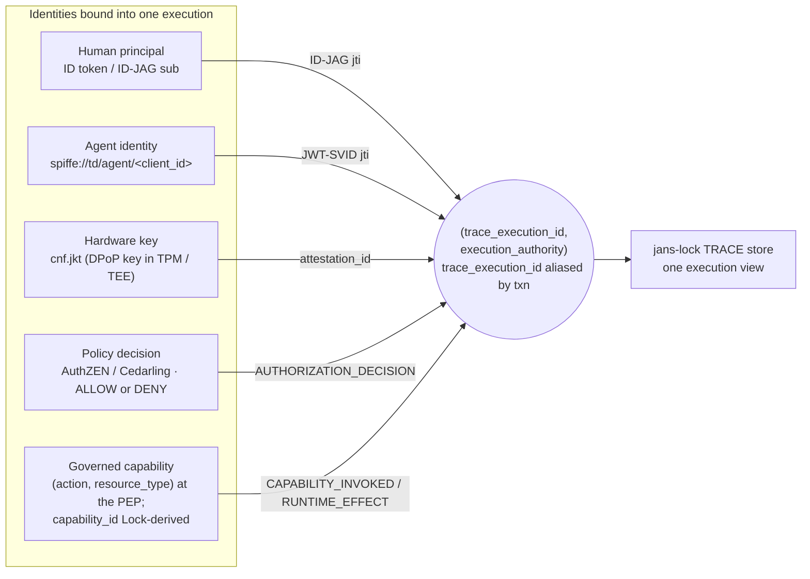
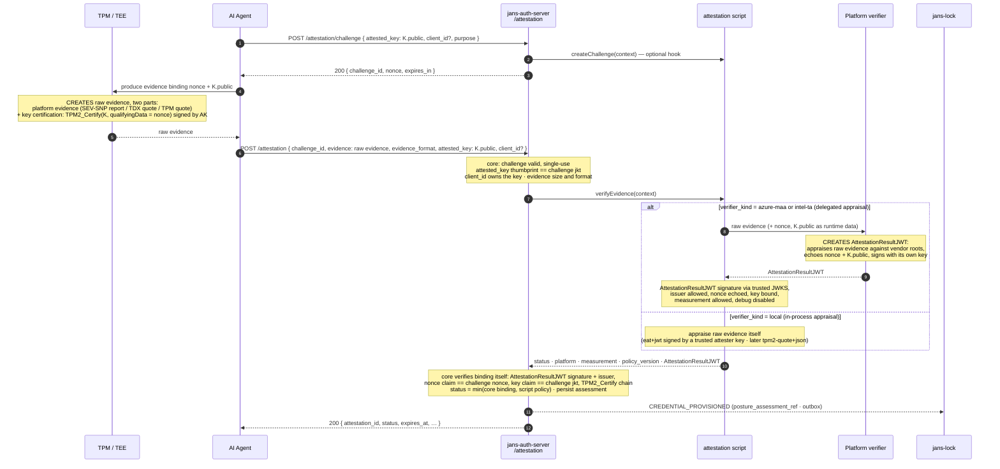
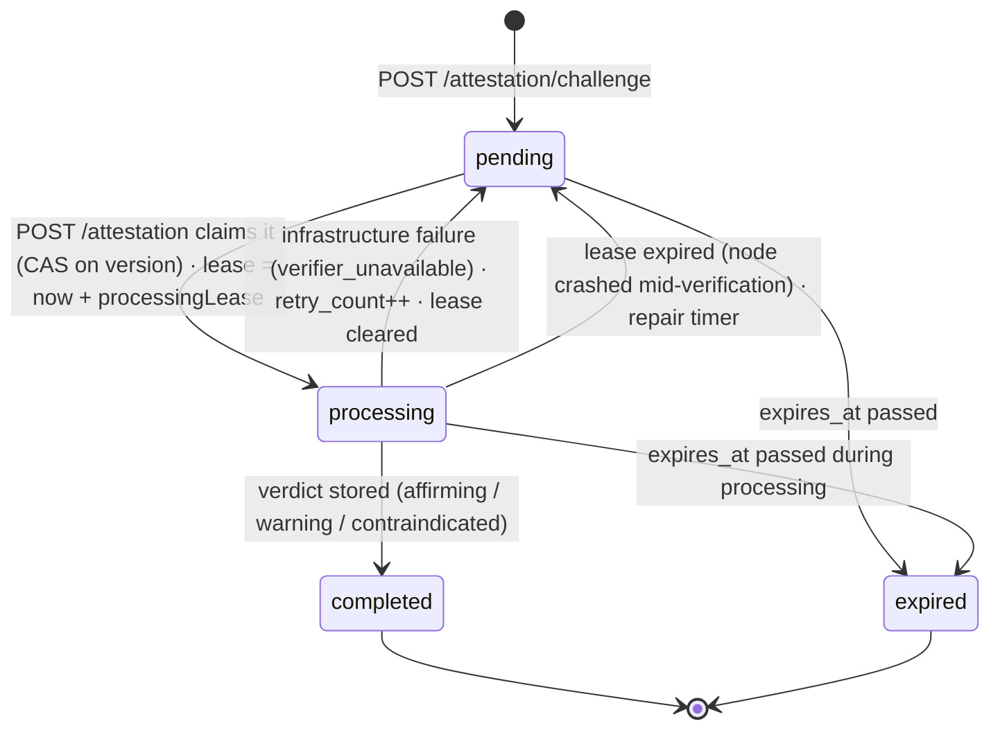
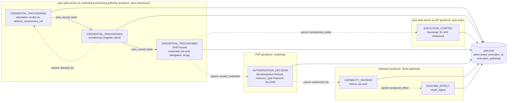
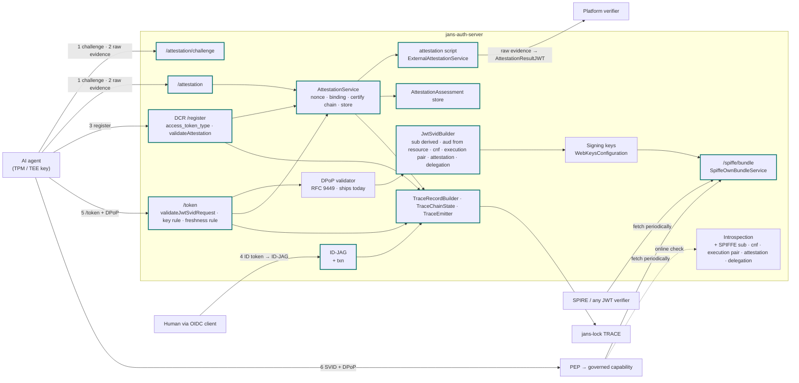

---
tags:
  - administration
  - auth-server
  - oauth
  - feature
  - spiffe
  - agent
  - attestation
  - trace
  - govops
  - design
---

# Hardware-Anchored Agent Identity with TRACE Evidence (Design Plan)

> **Status: design plan, not yet implemented.** This page is the single plan for giving AI agents
> a hardware-anchored identity in jans-auth-server and for producing TRACE evidence about how that
> identity is used. It supersedes and absorbs the earlier
> [Agent Identity via JWT-SVID](./agent-identity-jwt-svid.md) design: everything from that page
> that is still needed is restated here, nothing there is implemented, and this page is the one to
> build from. It follows the
> [Hardware-Anchored Agent Identity Demo Plan](https://github.com/JanssenProject/jans/wiki/Hardware%E2%80%90Anchored-Agent-Identity-Demo-Plan)
> and aligns with the OWASP GovOps architecture (capability as the unit of governance; access
> decisions visible, measurable, accountable). The scope is **jans-auth-server**; changes other
> components need are listed in the [implementation appendix](./hardware-anchored-identity-implementation.md)
> as dependencies.

## 1. The goal in one paragraph

Jans Auth Server enrolls an agent key and verifies evidence binding it to an approved platform. It
issues short-lived JWT-SVIDs bound to that key, and relying parties enforce possession through DPoP.
Signed TRACE records connect enrollment, appraisal, delegation, and issuance to later authorization
and runtime evidence. This establishes credential provenance and execution correlation; it does not
prove that the agent is uncompromised or that correlated records describe the same operation.

The detail behind each clause follows: the attestation endpoint and the hardware-key binding (§9),
SVID issuance and DPoP presentation (§6, §10), the TRACE producer model and record set (§11), and
the correlation model with its explicit limits (§3). The SVID is checkable offline against the
published SPIFFE bundle (§8); a full execution view is an online query against jans-lock in the
Phase-1 integration and becomes offline-verifiable only with the later Phase-4 Evidence Packet
(§11.1).

## 2. The trust chain at a glance

Each link answers one question a relying party or an auditor implicitly asks. Break any link and
trust stops there; the chain makes explicit what each party vouches for.

| # | Link | Who | What happens | Artifact |
|---|------|-----|--------------|----------|
| 1 | ROOT | TPM / TEE hardware | Non-exportable keypair; vendor-signed raw evidence over it | Raw evidence (quote / report) |
| 2 | ATTEST | `/attestation` + script | Single-use challenge; **jans** sends the raw evidence to the platform verifier and receives its `AttestationResultJWT`; measurement policy applied; **assessment stored with a validity window** | `attestation_id` (server-side assessment), `AttestationResultJWT` (verifier's) |
| 3 | ENROLL | DCR `/register` | Registration accepted only with a fresh `affirming` assessment for the registered key; `client_id` ↔ `jkt` ↔ `attestation_id` persisted; SPIFFE ID assigned | `spiffe://td/agent/<client_id>` |
| 4 | DELEGATE | Token exchange at the **IdP Authorization Server** (ID-JAG) | Human's ID token exchanged at the IdP AS for an ID-JAG naming the agent, `aud` = the Resource AS (jans), crossing a trust boundary (§5); it carries delegated authority, **not** per-execution human approval | ID-JAG (`iss` = IdP, `aud` = jans) |
| 5 | ISSUE | `/token` + DPoP at the **Resource AS** (jans) | jans **redeems** the ID-JAG (validates `iss` ∈ trusted IdPs, `aud` = jans), opens the execution and **mints** the `(trace_execution_id, execution_authority)` pair; `client_credentials` or JWT bearer; DPoP key must equal the enrolled key **and** have an assessment younger than the maximum age; else `attestation_required` | JWT-SVID with `cnf.jkt`, the `(trace_execution_id, execution_authority)` claims, `attestation` |
| 6 | PUBLISH | `/spiffe/bundle` | Signing keys served in SPIFFE bundle format at a stable HTTPS URL | JWKS, `use: jwt-svid` |
| 7 | DECIDE | PDP (AuthZEN / Cedarling) | May agent A (for human H) invoke capability C? | `AUTHORIZATION_DECISION` record |
| 8 | PRESENT & INVOKE | Agent → PEP → capability | SVID + fresh DPoP proof; PEP verifies via the bundle, enforces the decision | `CAPABILITY_INVOKED`, `RUNTIME_EFFECT` records |
| 9 | RECORD & VERIFY | jans-auth-server, PDP, PEP → jans-lock | Each producer signs and chains its records; Lock verifies, receipts, correlates by execution id | One correlated execution view (queried online against Lock; fully offline-verifiable only with the Phase-4 Evidence Packet — see §11.1) |

Links 1 to 3 happen once per agent deployment (and link 2 repeats on the attestation cadence).
Links 4 to 9 repeat continuously; tokens live 5 to 15 minutes, so possession of the hardware key,
not any long-lived secret, is the durable credential.

## 3. The correlation model

An **execution** is one unit of agent work: a task a human delegated, or an autonomous run. It is
identified by the canonical correlation **pair** `(trace_execution_id, execution_authority)` that
every TRACE record carries (see `Lock-Server-TRACE-MVP-Design.md` §7.1 and `design.md`: Audit
Context Propagation Profile). The two values **always travel together** — `execution_authority`
scopes the execution id, and a bare id is not resolvable without it.

jans stamps the pair into the tokens it issues using the canonical token claims, and continues to
set `txn` (RFC 8417 §2.2; jans already uses `txn` in transaction tokens) as an **application-level
alias** for the execution id so the existing transaction-token machinery keeps working:

| Carried value | Canonical token claim | Also as |
|---------------|-----------------------|---------|
| `trace_execution_id` | `https://jans.io/trace/execution_id` | `txn` (same value; the application alias jans already understands) |
| `execution_authority` | `https://jans.io/trace/execution_authority` | — (jans's issuer / configured authority) |

Everyone downstream (PDP, PEP, capability) reads the **pair** — never `txn` alone — and copies both
into its own records' `trace.trace_execution_id` and `trace.execution_authority` fields. The
Cedarling interface is specific (and §16.5 pins it): Cedarling **does** parse and validate the
JWTs it is handed as authentication tokens — the SVID and ID-JAG, checked against the trusted
issuers in its policy store — and reads the execution pair from *those validated claims*. What it
does **not** do is sniff arbitrary transport: the canonical HTTP headers
`Audit-Trace-ID` / `Audit-Execution-Authority` and OTel baggage `audit.trace_id` /
`audit.execution_authority` are **not** read by Cedarling; a host, sidecar, PEP, or gateway must
translate those carriers into Cedarling's normalized input model explicitly. Unsigned headers and
baggage are correlation hints only; the signed, Cedarling-validated token claims are the
authoritative binding. Correlation is then structural: an auditor queries one
`(execution_authority, trace_execution_id)` and gets the whole chain.

**Propagation integrity vs. disclosure are two different rules — stated together here so they are
not read as contradictory.** This "pair, never `txn` alone" rule is about *integrity*: wherever the
execution identity appears, both halves appear, and no consumer may act on a half. It is **not** a
claim that the raw pair is disclosed to every audience. What an SVID actually exposes to a given
relying party is governed by the per-audience disclosure profile in §10.10: within the execution's
own trust/evidence domain the raw pair propagates (correlation there is intended); to an audience
**outside** that domain the SVID carries a **pairwise/opaque per-domain execution reference** in
place of the raw `trace_execution_id`, so it cannot become a global cross-service tracker. In both
cases the integrity rule still holds — whatever is disclosed (raw pair, or opaque reference +
authority) travels as a unit and is never reduced to a bare `txn`. So: **integrity is always;
disclosure is per audience (§10.10).** The `JwtSvidBuilder` test's "the pair is always present
together" assertion is about integrity within a single minted token, not about unconditional
cross-domain propagation.

**What the shared execution id proves — and what it does not.** The pair groups records into one
execution; it is a **correlation** key, not an **operation** binding. Records that share a
`trace_execution_id` are asserted to belong to the same unit of work, but sharing it does **not**
prove that two records describe the *same operation*: an `AUTHORIZATION_DECISION` permitting
"transfer $50 to A", a `CAPABILITY_INVOKED` mediating "transfer $5000 to B", and a `RUNTIME_EFFECT`
confirming some transfer can all carry the same execution id and still be three different
operations. Proving *same-operation* requires the operation-binding commitments
(`request_digest` / `input_digest` / `tool_call_digest` / `result_digest`) and proof-of-possession
binding that `design.md` defines — which are a **Phase-3** feature (see the §11.1 phase mapping),
not delivered by this plan. Until then a consumer MUST treat a shared execution id as "these
records are claimed to belong to one execution," never as "these records provably refer to one
operation"; Lock does not infer causation from a shared id or close timestamps, and producers
express a causal relationship explicitly with `parent_record_ids`. This plan emits the signed
`(action, resource_type)` facts and the `parent_record_ids` edges that the Phase-3 binding check
consumes, but the binding assessment itself is deferred.

Execution scope is defined independently of credential lifetime:

| Scope | Identifier | Opened by | Closed by |
|-------|------------|-----------|-----------|
| **Execution** | `(trace_execution_id, execution_authority)` — `trace_execution_id` value `exe_…`, aliased by `txn` | jans (the Resource AS) when it **redeems** a human's ID-JAG at `/token`, or on the first `/token` call of an autonomous agent that carries no execution id; jans mints the pair and returns it in the token response so the agent reuses it. The ID-JAG itself is issued earlier by the IdP AS and does not open the execution (§5) | `traceExecutionMaxAgeSeconds` (default 24 h), or an explicit `txn_close=true` on a token request |
| **Token lifetime** | SVID `jti` | Each issuance | `exp` (minutes) |
| **Key lifecycle** (attestation, enrollment) | `attestation_id`, `client_id` | Before any execution exists | Key rotation / client removal |

A renewal inside an execution presents the same execution id — **the pair jans itself minted and
returned on the opening `/token` call**, carried back on the renewal as the prior SVID's
`https://jans.io/trace/execution_id` claim / `txn` alias, or as the `txn` request parameter. The
execution id does **not** come from the ID-JAG: the ID-JAG carries no `trace_execution_id`, and jans
mints the pair only when it redeems the ID-JAG (§5). The server accepts a presented id while the
execution is open **and** it belongs to the same `client_id`, and refuses foreign or expired values
with `invalid_request` (`txn_unknown`). The reissued token carries the same
`(trace_execution_id, execution_authority)` pair, so one execution spans many token renewals and
tokens never fragment it. Attestation and enrollment
records are **not** execution records: they happen before any execution and serve many later
ones. They keep their own identifiers, and every execution record that relies on them points at
them through `parent_record_ids` (section 11.2).



All five rows use the authoritative record schema: identities live in the `subject` object
(`workload_id`, `workload_instance_id`, `human_sponsor`) and in `attestation_ref`, never in ad-hoc
`agent` / `principal` / `hardware` sub-objects, and the hardware binding is carried as an
attestation reference rather than a signed capability label.

| Identity | Carried in | Bound by | Recorded as |
|----------|-----------|----------|-------------|
| Human | ID-JAG (`sub`, `email`, `acr`, `amr`, `auth_time`, `sid`) | OIDC login at the IdP (gated phishing-resistant by default, §10.9); the ID-JAG is issued by the IdP AS (`aud` = jans) and **redeemed** by jans at `/token` (§5) — delegated authority, not per-execution approval | `subject.human_sponsor` with the `acr`/`amr` **as asserted by the issuing IdP** (jans records them from the ID-JAG, it does not re-derive them); `sid` is the **IdP's** session id and ties the execution to a local `AUTHENTICATION_EVENT`/`FIDO_CEREMONY` **only when that IdP is this jans instance** — for an external IdP the `sid` is opaque and resolves to no local FIDO record (§10.9); `tokens[]` entry `token_type=id-jag` |
| Agent | JWT-SVID `sub` | Derived from `client_id` under the server's trust domain; never client-supplied | `subject.workload_id` (the SPIFFE ID); `tokens[]`/`credential_fingerprint` entry for the `jwt-svid` |
| Hardware key | JWT-SVID `cnf.jkt`; DPoP proof on every request | Attestation assessment binds `jkt` to platform + measurement | `attestation_ref` (verifier, `result_status`, `appraised_at`) and `posture_assessment_ref` (`jkt`, `attestation_id`, `platform`, `measurement`) |
| Policy decision | AuthZEN response | PDP evaluates agent + principal against the action/resource | `AUTHORIZATION_DECISION` signing `decision { action, resource_type, outcome }` (never a `capability_id`) by the PDP |
| Capability invocation | PEP log | PEP validates SVID + DPoP, checks decision, invokes | `CAPABILITY_INVOKED` signing `invocation { action, resource_type, outcome }` by the PEP; `RUNTIME_EFFECT` by the capability |

jans-auth-server produces the records for the first three rows. The last two are produced by the
PDP and the PEP; this plan only fixes what they must copy — the correlation pair
(`trace_execution_id` + `execution_authority`, carried as the `txn`-derived execution id) and
token `jti`s. Neither producer signs a `capability_id`: both sign `(action, resource_type)` facts,
and Lock resolves the governance label from them (section 11.5).

## 4. What jans-auth-server already has

This plan is smaller than it looks, because most of the machinery shipped with earlier features.

| Capability | Where | Reused for |
|------------|-------|------------|
| Inbound SPIFFE client auth (draft-ietf-oauth-spiffe-client-auth) | `SpiffeIdUtil`, `SpiffeBundleService` (fetch, cache, stale-serving, negative cache), `SpiffeJwtSvidAssertion`, `spiffe_id` / `spiffe_bundle_endpoint` client metadata, `spiffeTrustDomains` config, `SPIFFE_CLIENT_AUTH` flag | Trust-domain grammar; the bundle consumer doubles as the integration test for the bundle we will serve |
| DPoP (RFC 9449) | `DpopService.getDPoPJwkThumbprint()`, `ExecutionContext.setDpop()`, `cnf.jkt` stamping in `fillPayloadOfAccessTokenJwt()`, `ClientAttributes.dpopBoundAccessToken`, introspection returns `cnf` | Key binding at issuance; assessments are keyed by the DPoP thumbprint |
| JWT access-token minting | `AuthorizationGrant.createAccessToken()` → `createAccessTokenAsJwt()` → `fillPayloadOfAccessTokenJwt()`; `JwtSigner` over `WebKeysConfiguration` | SVID minting branches here |
| DCR + interception scripts | `RegisterCreateAction` / `RegisterUpdateAction`, `RegisterService.updateClientFromRequestObject()`, `ExternalDynamicClientRegistrationService`, `ClientRegistrationType.createClient()` / `updateClient()` (runs after request mapping, before `clientService.persist()`; `false` → `invalid_client_metadata`) | Enrollment gate |
| DCR attestation evidence plumbing | `RegisterRequestParam.EVIDENCE`, `ClientAttributes.evidence`, `AppConfiguration.dcrAttestationEvidenceRequired`, `RegisterValidator.validateEvidence()`, `RegisterErrorResponseType.STALE_EVIDENCE` with `nonce`, `DynamicClientRegistrationContext.getEvidence()` / `createStaleEvidenceWebApplicationException(nonce)` | One-step enrollment; model for the token endpoint's `attestation_required` error |
| Custom script framework | `CustomScriptType`, `BaseExternalType`, `External*Service` pattern, `CdiUtil` | New `attestation` script type |
| ID-JAG (draft-ietf-oauth-identity-assertion-authz-grant) | `IdJagService`, `IdJagValidatorService`, `TokenExchangeService`, `JwtGrantService`, `ExternalIdentityAssertionService`, `identity_assertion_authz_grant` flag | Human identity into the agent flow; `txn` minted here |
| AuthZEN | `AccessEvaluationRestWebServiceImplV1` (`/access/v1/evaluation`), `ExternalAccessEvaluationService` | Decision source when jans is the PDP |
| Introspection (RFC 7662) | `IntrospectionWebService` | Online verification path |
| Feature flags, endpoint registration, config revision | `ErrorResponseFactory.validateFeatureEnabled()`, `ResteasyInitializer`, `Conf.revision` | New endpoints; `spiffe_sequence` |
| Transaction id | `TxTokenService` sets `txn` | Same claim name reused as execution id |
| Audit | `OAuth2AuditLog`, `ApplicationAuditLogger` | Operational log stays; TRACE is a separate signed channel |

## 5. Lifecycle

```mermaid
sequenceDiagram
    autonumber
    participant TEE as TPM / TEE
    participant Agent as AI Agent
    participant Human as Human (OIDC client)
    participant IdP as IdP Authorization Server<br/>(issuer idp.example.org · issues ID-JAG)
    participant AS as Resource Authorization Server<br/>jans-auth-server (issuer op.example.org · SVID issuer)
    participant Verifier as Platform verifier<br/>(Azure Attestation / Intel TA)
    participant Lock as jans-lock<br/>TRACE store
    participant PEP as PEP / Relying Party

    Note over TEE,AS: ① ATTEST + ENROLL — once per deployment
    Agent->>TEE: generate non-exportable keypair K
    TEE-->>Agent: K.public (private half never leaves)
    Agent->>AS: POST /attestation/challenge { attested_key: K.public }
    AS-->>Agent: { challenge_id, nonce }
    Agent->>TEE: produce evidence binding nonce + K.public
    Note over TEE: TEE / TPM CREATES raw evidence<br/>(quote / report, signed by vendor-rooted platform key)
    TEE-->>Agent: raw evidence
    Agent->>AS: POST /attestation { challenge_id, evidence: raw evidence, evidence_format, attested_key: K.public }
    Note over AS: core: nonce single-use, attested key == K == challenge key<br/>then attestation script runs
    AS->>Verifier: raw evidence (script calls the verifier)
    Verifier-->>AS: AttestationResultJWT
    Note over Verifier: platform verifier CREATES AttestationResultJWT<br/>(its signed appraisal of the raw evidence · echoes nonce + K.public)
    Note over AS: core: AttestationResultJWT signature + issuer under the verifier profile,<br/>nonce echoed, key bound, TPM2_Certify chain · script: measurement policy<br/>core: persist assessment
    AS-->>Lock: CREDENTIAL_PROVISIONED (attestation verdict as posture_assessment_ref)
    AS-->>Agent: { attestation_id, status: affirming, expires_at }
    Agent->>AS: DCR /register { jwks: key, access_token_type: JWT-SVID, attestation: attestation_id }
    Note over AS: bind client_id ↔ jkt ↔ attestation_id<br/>assign spiffe://td/agent/#lt;client_id#gt;
    AS-->>Lock: CREDENTIAL_PROVISIONED (enrolled key · register-client)
    AS-->>Agent: client_id

    Note over AS,PEP: ② PUBLISH — on the bundle's own clock
    PEP->>AS: GET /spiffe/bundle (periodic, or via SPIRE federates_with)
    AS-->>PEP: { keys[use: jwt-svid], spiffe_sequence, spiffe_refresh_hint }

    Note over Human,AS: ③ DELEGATE — when a human starts an execution (crosses a trust boundary)
    Human->>IdP: token exchange at the IdP AS: ID token → requested_token_type=id-jag,<br/>audience = op.example.org (the Resource AS), not the IdP itself
    Note over IdP: ID-JAG draft: the IdP AS does NOT redeem its own ID-JAG;<br/>iss = idp.example.org, aud = op.example.org cross a trust (e.g. tenant) boundary
    IdP-->>Human: ID-JAG { iss: idp.example.org, sub: alice, aud: op.example.org,<br/>client_id: agent } — delegated access, NOT per-execution approval
    Human->>Agent: hand ID-JAG to the agent

    Note over TEE,AS: ④ ISSUE — every few minutes (Resource AS redeems the ID-JAG)
    Agent->>TEE: sign DPoP proof (+ private_key_jwt)
    TEE-->>Agent: signatures (key never leaves)
    Agent->>AS: POST /token grant=jwt-bearer assertion=ID-JAG (or client_credentials)<br/>DPoP proof · resource=#lt;PEP#gt;
    Note over AS: ID-JAG redeemed HERE, not at the issuer: validate iss ∈ trusted IdPs,<br/>aud == this Resource AS (op.example.org), sig/exp · then the hardware gate:<br/>jkt = DPoP proof key, a registered key of client_id · KeyAttestationState(client_id, jkt)<br/>affirming and within max age · commit under CAS on revision · else 400 attestation_required
    AS-->>Lock: EXECUTION_STARTED (token-exchange bootstrap · opens execution, mints the pair)
    AS-->>Lock: CREDENTIAL_PROVISIONED (SVID issued · posture_assessment_ref)
    AS-->>Agent: JWT-SVID { sub: spiffe id, aud, exp +10m, cnf.jkt,<br/>execution_id + execution_authority (txn alias), attestation, delegation }

    Note over TEE,PEP: ⑤ PRESENT & VERIFY — per request
    Agent->>TEE: fresh DPoP proof for the PEP
    TEE-->>Agent: proof
    Agent->>PEP: request + JWT-SVID + DPoP proof
    Note over PEP: Authorization: DPoP <SVID> + DPoP: <proof><br/>local: signature via bundle, sub, aud, exp<br/>full RFC 9449 DPoP proof (htm, htu, iat/age, jti-replay,<br/>required ath==hash(SVID), nonce when used) · proof key ↔ cnf.jkt<br/>· PDP decision · copy the pair (trace_execution_id + execution_authority)
    PEP-->>Lock: CAPABILITY_INVOKED / RUNTIME_EFFECT
    PEP-->>Agent: 200
```

Phase ① establishes the hardware binding; if the appraisal is not `affirming` no identity is ever
assigned. Phase ② runs on the bundle's refresh cadence, never per token. Phase ③ puts a human at
the root of the execution, and phase ④ is the steady state: every token is short-lived, pinned to
the hardware key via `cnf`, stamped with the assessment it was issued under, and recorded. Every
call into the TPM / TEE returns only a public key, a signature or a piece of evidence; the private
half of `K` never crosses that boundary.

**Two authorization servers, across a trust boundary (phases ③–④).** The diagram draws the
**IdP Authorization Server** (which authenticates the human and issues the ID-JAG, `iss =
idp.example.org`) and the **Resource Authorization Server** (this jans-auth-server, the SVID
issuer, `iss = op.example.org`) as **separate participants with distinct issuer and audience**. The
ID-JAG is minted with `aud = op.example.org` and is **redeemed by the Resource AS, never by the IdP
that issued it** — draft-ietf-oauth-identity-assertion-authz-grant builds on cross-domain identity
chaining (draft-ietf-oauth-identity-chaining), so the grant must cross a trust boundary (for example
a tenant boundary) rather than loop back to its issuer. One software installation MAY play both
roles, but only across such a boundary with distinct `iss`/`aud`; a genuinely single-domain
deployment with no boundary to cross must use a different delegation mechanism (e.g. a direct
token exchange or a local grant), not an ID-JAG redeemed by its own issuer.

**Artifacts available at each server.** Because the two roles sit on opposite sides of a trust
boundary, each sees a different set of artifacts, and no requirement may assume an artifact that
never reaches the server enforcing it:

| Artifact | IdP Authorization Server (`idp.example.org`) | Resource Authorization Server — this jans (`op.example.org`) |
|----------|----------------------------------------------|--------------------------------------------------------------|
| Human's **ID token** (and the login/FIDO ceremony behind it) | **Yes** — the IdP authenticated the human and holds the session/`sid` and any local FIDO records | **No** — the ID token is consumed at the IdP; it need not, and in the external-IdP case does not, reach jans. jans sees only what the ID-JAG asserts |
| **ID-JAG** (`iss=idp`, `sub=human`, `aud=op`, `client_id=agent`, `acr`/`amr`/`auth_time`/`sid`) | **Issues** it (token exchange of the ID token); does **not** redeem it | **Redeems** it at `/token` (validates `iss ∈` trusted IdPs, `aud == op`, sig/exp). This is jans's only view of the human |
| **`trace_execution_id` / `execution_authority`** (the execution pair) | **Not present** — the ID-JAG carries no execution id | **Minted here**, by jans, when it redeems the ID-JAG (or on an autonomous agent's first `/token`); returned in the token response and thereafter echoed by the agent |
| **Agent key / attestation** (`cnf.jkt`, `KeyAttestationState`, DPoP proof) | **Not involved** | **Yes** — the hardware gate runs here |
| **Local `AUTHENTICATION_EVENT` / `FIDO_CEREMONY`** resolving `sid` | Exists at whichever server authenticated the human | At jans **only when jans itself is the IdP**; for an external IdP, `sid` is an opaque IdP-scoped value and resolves to **no** local record (§10.9, §11.2) |

The rule that follows: jans's requirements and records are built from the **ID-JAG claims it
validates plus the key material it sees at `/token`** — never from the human's ID token or the IdP's
FIDO records, which it does not possess unless it is itself the IdP.

**An ID-JAG is delegated authority, not per-execution human approval.** The ID-JAG establishes that
*an IdP authorized delegated access on behalf of the human* at login time — it does **not** prove
that *the human explicitly approved this particular execution*. This plan treats it as the former:
it roots the execution in a human identity and records the login assurance (§10.9), but it makes no
claim of per-execution consent. Where a deployment needs explicit human approval of a specific
operation (a step-up confirmation, a signed approval of the exact request), that is a separate
mechanism the PDP/PEP enforces at the operation, not something the ID-JAG carries.

Reading the arrows: a **solid** arrow is a request the sender initiates and waits for; a
**dashed** arrow is either the reply to the solid arrow above it, or a one-way notification the
sender does not wait for (the records jans and the PEP send to jans-lock go through an outbox,
section 11.3). `K` is **a** hardware keypair of the agent: its private half signs the DPoP proofs
and the `private_key_jwt` client assertion, its public half (`K.public`) is the `attested_key` in
the challenge, a key in the registration `jwks`, and the thumbprint in the SVID's `cnf.jkt`. In the
steady state an agent uses one key; but a client's `jwks` MAY legitimately hold **more than one**
attested key during a rollover, and each key is independently attested, assessed, and bound. Which
key a given issuance talks about is fixed per request by the DPoP proof's thumbprint — attestation,
enrollment, and issuance always name a specific `jkt`. The full multiplicity, rotation, and
recovery rules are section 9.9.

## 6. Verification: how and where

Three verification paths: two offline (bundle-based) and one online. The two offline paths call the
auth server only periodically for the bundle, never per token; introspection is an online,
per-token call to the auth server.

| Path | Online/offline | Who it's for | How it works |
|------|----------------|--------------|--------------|
| **SPIRE federation** | Offline per token (bundle fetched periodically) | Relying parties in a SPIFFE/SPIRE ecosystem | SPIRE server adds `federates_with` pointing at the jans bundle endpoint (`https_web` profile), fetches on the refresh-hint cadence, distributes to its agents; workloads validate via `ValidateJWTSVID` |
| **Direct bundle fetch** | Offline per token (bundle fetched periodically) | Ordinary services, gateways | The bundle is a JWKS. Any JWT library verifies the signature and checks `sub`, `exp`, and that its own identifier is **a member of** `aud` (not equal to it): `aud` is a JWT array (RFC 7519), and a relying party accepts the token iff its identifier appears in the array. SPIFFE allows multiple audiences but recommends one in normal cases, and v1 issues exactly one (§10.2) — but verifiers MUST still use membership, not equality, so a future multi-audience token verifies correctly |
| **Introspection** | **Online** (per-token call to jans) | High-assurance checks and debugging | RFC 7662 at jans-auth-server for a live answer; the closest thing to revocation the short-TTL model offers |

SPIRE configuration on the relying party side (the entire integration):

```hcl
server {
    trust_domain = "rp-company.example"
    federation {
        federates_with "op.example.org" {
            bundle_endpoint_url = "https://op.example.org/jans-auth/restv1/spiffe/bundle"
            bundle_endpoint_profile "https_web" {}
        }
    }
}
```

**Bearer vs. bound.** Signature + claims checks alone treat the token as bearer. A verifier that
wants the hardware guarantee additionally demands a fresh DPoP proof signed by the key in `cnf`.
Plain SPIFFE verifiers ignore `cnf`, the `https://jans.io/trace/*` correlation claims, `txn`,
`attestation` and `delegation` (unknown claims are additive), so the token stays spec-valid for
both audiences. **A plain JWT-SVID validator that ignores `cnf` is bearer-only**: it gains no
hardware guarantee, and a stolen SVID works at it until `exp`. The hardware binding is only
realized by a PEP that performs the full proof-of-possession check below; this is why a
high-value RP MUST be `cnf`-checking and SHOULD require DPoP, not merely validate the JWT.

**Normative PEP DPoP-presentation requirements (RFC 9449).** "Fresh DPoP proof" is not a
single check. A PEP that relies on the hardware binding MUST, on **every** request, verify the
`DPoP` header proof as a complete RFC 9449 presentation — comparing the proof key to `cnf.jkt` is
necessary but far from sufficient:

| Check | Requirement |
|-------|-------------|
| Proof signature | The DPoP proof JWT (`typ: dpop+jwt`) verifies under the public key in its own `jwk` header, and that key's RFC 7638 thumbprint **equals the SVID's `cnf.jkt`** — this is the possession check, not the whole check |
| `htm` | Equals the HTTP method of the request the proof accompanies (e.g. `POST`) |
| `htu` | Equals the request URI with query and fragment removed, compared after normalization — the proof is bound to **this** endpoint, so a proof captured at one resource cannot be replayed at another |
| `iat` / proof age | Within a small configured window (seconds–low minutes) of now, rejecting both stale proofs and proofs from the future beyond allowed clock skew |
| `jti` + replay cache | Unique; the PEP keeps a **replay cache** of recently-seen `jti`s (at least the proof-age window) and rejects a repeat, so a single proof cannot be reused |
| `nonce` (when used) | When the PEP issues a DPoP nonce (`DPoP-Nonce` / `use_dpop_nonce` challenge), the proof's `nonce` MUST equal the most recently issued value; a missing/stale nonce is rejected with a fresh challenge. A PEP under replay pressure SHOULD require a server-provided nonce rather than rely on `iat`/`jti` alone |
| `ath` (**required** at the resource) | The proof **MUST** contain `ath`, and its value **MUST** equal the base64url-encoded SHA-256 of the presented access token (the SVID), binding this proof to this exact token. This is mandatory when a DPoP-bound access token is presented to a resource server (RFC 9449 §7.1), **not** optional: a proof with a missing or mismatched `ath` is rejected. (`ath` is absent only in the *token-request* proof at `/token`, where there is no access token yet — not here at the resource.) |
| audience | The SVID's `aud` MUST equal this PEP/resource (the ordinary JWT-SVID check), so a token minted for another resource is refused regardless of a valid proof |

The SVID is presented with the **DPoP** authorization scheme, not `Bearer`, so the resource sees
both the token and its bound proof on the request:

```text
POST /payments/transfer HTTP/1.1
Host: payments.example.com
Authorization: DPoP <JWT-SVID>
DPoP: <proof JWT: typ=dpop+jwt, htm=POST, htu=https://payments.example.com/payments/transfer,
       iat, jti, ath=base64url(SHA-256(JWT-SVID)), nonce when challenged>
```

A PEP that performs only the `cnf.jkt` thumbprint comparison and skips `htm`/`htu`/age/`jti`-replay/
`ath`/`nonce` is **not** sender-constrained in practice: a captured proof could be replayed against
a different method, a different endpoint, with a different token, or more than once. These
requirements are the same RFC 9449 checks jans already applies at its own DPoP-protected endpoints
(`DpopService`), restated here as the PEP's obligation; a PEP SHOULD reuse an RFC 9449 library
rather than re-implement them. The demo gateway's PEP implements the full table, and
`JwtSvidRoundTripHttpTest` exercises the negative cases (wrong `htu`, wrong `htm`, stale `iat`,
replayed `jti`, **missing `ath`, wrong `ath`**, and missing required `nonce`).


| Claim | Check | Roots in |
|-------|-------|----------|
| signature | verifies against a `jwt-svid` key | bundle cached from `/spiffe/bundle` |
| `sub` | `spiffe://op.example.org/agent/3f9c` authorised here? | relying party's identity policy |
| `aud` | equals this service | the service's own identifier |
| `iat`/`exp` | fresh (≤ 15 min) | clock |
| `cnf.jkt` | Full RFC 9449 DPoP presentation: proof signature, `htm`, `htu`, `iat`/age, unique `jti` against a replay cache, `nonce` when used, a **required** `ath` matching the presented SVID, **and** the proof-key thumbprint equals `cnf.jkt` (see "Normative PEP DPoP-presentation requirements" above) — not the thumbprint comparison alone | the hardware key, attested |
| `attestation` | `status=affirming`, `appraised_at` recent, `measurement` acceptable to *this* verifier | the appraisal, re-checkable in Lock |
| `delegation` | which human delegated, through which credential, at what authentication strength (`acr`/`amr`) and in which session (`sid`) | ID-JAG, recorded in Lock; the `sid` resolves to the Auth Server `AUTHENTICATION_EVENT` / FIDO `FIDO_CEREMONY` (§10.9) |

Checks 1 to 4 are standard SPIFFE JWT-SVID validation. Check 5 is the hardware binding. Checks 6
and 7 are optional and give a verifier the hardware state and the human behind the request without
any call to jans — **and they are present only when this audience's disclosure profile includes
them** (section 10.10). The minimized default SVID omits `attestation` and `delegation` entirely,
and discloses `delegation.principal_sub` as a pairwise identifier unless the audience is authorized
for the raw subject; an audience that needs the hardware state or the human identity is the one
whose token is *minted with* those claims — a different audience's token simply does not carry them
(minimization). This is about which claims a token contains, not confidentiality of a token once
issued: a signed SVID's claims are readable by anyone who holds it (§10.2, §10.10).

## 7. Access token type selection: `access_token_type` replaces `access_token_as_jwt`

No new `grant_type`. A grant type answers "on what basis is the client authorised to receive a
token"; for the agent flow that basis is unchanged (`client_credentials`, or JWT bearer with an
ID-JAG). Only the *format* of the issued token changes, and format is a registration-time client
property, the same model jans uses today to choose between bearer and JWT access tokens.

| `access_token_type` | Issued access token |
|---------------------|---------------------|
| `OPAQUE` | opaque reference token; **default** when absent |
| `JWT` | JWT access token; equivalent of today's `access_token_as_jwt=true` |
| `JWT-SVID` | SPIFFE JWT-SVID |

The value names the **serialization**, not the presentation: `OPAQUE` rather than `BEARER`,
because a JWT is also presented as a bearer token unless DPoP binds it, and `token_type` in the
token response (`Bearer` / `DPoP`) already says how a token is presented.

Rules:

- `access_token_type` present always wins over `access_token_as_jwt`; absent → fall back
  (`JWT` if `true`, else `OPAQUE`). Existing clients are unaffected.
- `access_token_as_jwt` is deprecated, removal in the next major release. Both are documented in
  swagger (all three client-metadata schema occurrences) during the window; config-api and TUI
  follow (outside this plan).
- `JWT-SVID` constraints at registration and update (`RegisterParamsValidator.validateAccessTokenType()`,
  `400 invalid_client_metadata`): `SPIFFE_SVID_ISSUANCE` flag enabled; `grant_types` ⊆
  {`client_credentials`, `urn:ietf:params:oauth:grant-type:jwt-bearer`}; asymmetric
  `token_endpoint_auth_method` (`private_key_jwt`, `tls_client_auth`, `self_signed_tls_client_auth`);
  `dpop_bound_access_token` not explicitly `false` (it is forced `true`); `jwks` or `jwks_uri`
  present; a valid `attestation` (section 9.5); a non-empty `allowed_resources` list (the
  audiences this agent may request SVIDs for, section 10.2); and a DPoP proof on the registration
  request signed by the attested key (section 9.5).

Implementation: `io.jans.as.model.common.AccessTokenType` enum (`fromString` accepts `JWT-SVID`
and `JWT_SVID`, case-insensitive); `RegisterRequestParam.ACCESS_TOKEN_TYPE`;
`ClientAttributes.accessTokenType` (stored in `jansAttrs`, no schema change);
`Client.getResolvedAccessTokenType()` / `isAccessTokenJwtFormat()` used everywhere the format is
decided (`AuthorizationGrant.createAccessToken()`, `AbstractAuthorizationGrant.getAccessTokenLifetimeInSeconds()`,
every other `isAccessTokenAsJwt()` reader); `RegisterRequest.accessTokenType` kept as a raw
`String` so an unknown value is rejected rather than ignored; `RegisterJsonService` echoes the
resolved value.

## 8. SPIFFE bundle endpoint (publish)

`GET /jans-auth/restv1/spiffe/bundle`, gated by `FeatureFlagType.SPIFFE_SVID_ISSUANCE`
(`spiffe_svid_issuance`, sibling of `SPIFFE_CLIENT_AUTH`).

```json
{
  "keys": [
    { "kty": "EC", "crv": "P-256", "x": "…", "y": "…", "kid": "7f3a", "alg": "ES256", "use": "jwt-svid" }
  ],
  "spiffe_sequence": 42,
  "spiffe_refresh_hint": 300
}
```

- `SpiffeOwnBundleService` (`@ApplicationScoped`) builds the bundle from
  `WebKeysConfiguration.getKeys()`: keep `use == SIGNATURE` keys whose `alg` is on the **JWT-SVID
  allowlist** — `RS256`/`RS384`/`RS512`, `ES256`/`ES384`/`ES512`, `PS256`/`PS384`/`PS512` (SPIFFE
  JWT-SVID §2.1) — which excludes HMAC (`HS*`), `none`, `EdDSA`, and `enc` keys; this allowlist is a
  stricter, explicit subset of `jwksAlgorithmsSupported` (a bundle key whose `alg` is not on it is
  dropped even if the OP otherwise supports it). Emit a minimal RFC 7517 JWK per key (`kty`, `kid`
  — **required** per §6.1, `alg`, `use: "jwt-svid"`, `n`/`e` or `crv`/`x`/`y`; no jans-specific
  members). An SVID is only ever signed by a key that appears in this bundle under an allowlisted
  `alg`, so a verifier applying the same allowlist (§10.5) and the bundle keys cannot be led into an
  alg-confusion acceptance. `spiffe_sequence` =
  `Conf.revision` (new `ConfigurationFactory.getLoadedRevision()`), `spiffe_refresh_hint` =
  `spiffeBundleRefreshHintSeconds`. An empty key list is a valid bundle.
- `SpiffeBundleRestWebService` / `Impl` in `io.jans.as.server.spiffe.ws.rs`, registered in
  `ResteasyInitializer`; headers `Cache-Control: public, max-age=<refresh hint>`.
- Discovery member `spiffe_bundle_endpoint` (OpenID configuration, client
  `OpenIdConfigurationResponse`, swagger), gated on the same flag.
- **Decision (v1 / demo-relaxable):** reuse the OIDC signing keys for v1 (relabelled `use: jwt-svid`
  only in the bundle output); SVID rotation stays coupled to OIDC rotation. This is an **expedience
  for v1, not the production posture**: §16.1 requires a production deployment to provision a
  **dedicated SVID signing key set**, distinct from the OIDC keys and from the two TRACE producer
  keys, so SVID and OIDC rotation decouple and a compromise of one does not implicate the other. The
  two statements are consistent — reuse is the v1 shortcut, dedicated keys are the production
  requirement (§16.1). During rotation the bundle serves old + new keys and bumps `spiffe_sequence`
  under either posture.
- **Trust domain:** `spiffeOwnTrustDomain` is permanent. `getSpiffeOwnTrustDomain()` returns the
  raw configured value; `getEffectiveSpiffeOwnTrustDomain()` applies the issuer-host fallback.
  `SpiffeTrustDomainService.pinTrustDomainIfNeeded()` (from `AppInitializer`) writes the derived
  value into `Conf` on first start with issuance enabled, logs a `WARN` that it is now permanent,
  logs an `ERROR` and continues if no valid trust domain can be derived, and adopts a value another
  node pinned first.
- Dogfood test: a second jans instance's existing `SpiffeBundleService` must accept this bundle.

Configuration: `spiffeOwnTrustDomain` (String), `spiffeBundleRefreshHintSeconds` (300),
`spiffeSvidLifetimeSeconds` (600), `spiffeSvidMaxLifetimeSeconds` (3600). All `@DocProperty`.

## 9. New: the attestation endpoint

### 9.1 Why an endpoint and not only a DCR script

A DCR script proves the key was in hardware *once*. The demo plan asks for "recent attestation for
issuance": the platform must have passed policy recently enough for *this* token. That needs a
challenge that can be issued and consumed outside DCR, an assessment with a validity window that
the token endpoint can look up, and a verdict that is itself evidence. A dedicated endpoint gives
all three; the DCR gate and the token-endpoint rule become callers of one service, so enrollment
and issuance apply exactly one policy.

### 9.2 Flow



The script never sees the nonce lifecycle, the key-binding check or persistence; those are core
and identical for every platform.

Reading the arrows: **solid** = a request the sender waits for; **dashed** = the reply to it, or a
one-way notification (the TRACE record to jans-lock is queued, not awaited). The `alt` box shows
the two appraisal backends a script can implement; which one runs is script configuration
(`verifier_kind`), not something the agent chooses.

**The agent never talks to the platform verifier.** Only jans-auth-server does, from inside the
attestation script, during `POST /attestation`. The agent's job ends at "ask the hardware for raw
evidence over the nonce and hand it to jans". Reasons:

- *Trust anchors stay server-side.* Which verifier is trusted, under which issuer and JWKS, with
  which API credentials, is jans configuration. An agent that could pick the verifier could pick a
  verifier it controls.
- *The verifier's answer is bound to the request jans made.* jans supplies the nonce and
  `K.public` as runtime data when it calls the verifier, so the `AttestationResultJWT` it gets back
  is about exactly the challenge it issued; there is no window in which an agent can swap results.
- *One credential set.* Intel Trust Authority needs an API key; Azure Attestation may need a
  tenant-specific endpoint. Those live in the script configuration, never on agent hosts.
- *Complete evidence trail.* jans sees, stores (digest and, by default, the full
  `AttestationResultJWT`) and records both the raw evidence and the verifier's appraisal, so an
  auditor can re-verify the verifier's signature later.
- *Simpler agents.* An agent needs one HTTP client and one hardware API, regardless of platform.

#### Who creates what: the RATS roles in this flow

RFC 9334 names three roles. Mapping them makes clear what the `evidence` parameter carries and who
signed it.

| RATS role | Played by | Creates | Signed with |
|-----------|-----------|---------|-------------|
| **Attester** | The hardware (TPM / TEE firmware / CPU) on the agent's host, driven by the agent process | **Raw evidence**, always two parts: (1) **platform evidence** (SEV-SNP report, TDX quote, or TPM `TPM2_Quote` over PCRs) and (2) **key certification**: a `TPM2_Certify` attestation over `K` with `qualifyingData = nonce`, signed by the attestation key (AK) that the platform evidence vouches for (section 9.3a). Bare SEV-SNP / TDX deployments without a vTPM put `SHA-256(nonce ‖ thumbprint(K.public))` in `REPORT_DATA` / `REPORTDATA` **and** must certify `K` by another platform mechanism; report data alone names bytes, it does not certify a key | A platform key rooted in the vendor: TPM / vTPM AK (certified by the EK CA, or — the binding Azure CVMs are *expected* to provide but which this repo has not yet proven, §9.3a AK-binding gap — committed in the SNP-measured HCL runtime data), AMD VCEK / VLEK, Intel PCK |
| **Verifier** (delegated, `verifier_kind=azure-maa` / `intel-ta`) | Azure Attestation or Intel Trust Authority, **called by jans-auth-server's attestation script** | **`AttestationResultJWT`**: a JWT stating "I verified this raw evidence against the vendor roots; the platform measured X; the report carried nonce N and key K.public" | The verifier's own published JWKS |
| **Verifier** (in-process, `verifier_kind=local`) | jans-auth-server's attestation script | The same appraisal, done locally over the raw evidence (`eat+jwt` signed by a trusted attester key; later `tpm2-quote+json`) | n/a; the verdict is signed by jans below |
| **Relying Party** | jans-auth-server core (`AttestationService`, then DCR and `/token`) | **Assessment** (server-side record, section 9.6): "I accept this verdict for key K until `expires_at`"; surfaced to others through the SVID `attestation` claim and the TRACE record | Not a separate token; the SVID and the TRACE record carry jans's signature |

So the request parameter named `evidence` always carries RATS *Evidence* (raw, hardware-signed);
the name matches the shipped DCR `evidence` parameter. *Attestation Results* exist in two layers
and are named to keep them apart: the platform verifier's **`AttestationResultJWT`** (obtained and
validated by jans, stored with the assessment, never seen by the agent unless jans chooses to echo
it) and jans's own **assessment**, a server-side record identified by `attestation_id` (section
9.6; no token is minted for it). The agent never creates evidence or results: it asks the
hardware for raw evidence and relays it. The agent's only cryptographic contribution to
attestation is owning `K`.

#### Why two requests: challenge first, evidence second

Remote attestation is a **challenge-response** protocol (RFC 9334 §8.1, "freshness"). The
verifier must prove that the evidence it receives was produced *after* it asked for it, by *this*
hardware, about *this* key; otherwise an attacker records one good attestation and replays it for
ever. The only way to get that property is for the verifier to pick an unpredictable value, hand
it to the attester, and require the hardware to sign over it. The hardware does exactly this:
a TPM `TPM2_Quote` / `TPM2_Certify` takes `qualifyingData`, a bare SEV-SNP report takes 64 bytes
of `REPORT_DATA`, a TDX quote takes `REPORTDATA`, and Azure Attestation / Intel Trust Authority
echo the nonce they find in the evidence into their `AttestationResultJWT`. In every case the
nonce has to exist before the evidence can be generated, so one HTTP request cannot carry both.

Freshness and key certification are two different properties, carried by two different signed
structures (section 9.3a): the nonce proves *when*, the key certification proves *where the
private key lives*. Report data alone does neither for an application key.

What each request does:

| | `POST /attestation/challenge` | `POST /attestation` |
|---|---|---|
| Who speaks | Agent asks, jans answers | Agent presents, jans judges |
| Input | The public key that will be attested, optionally `client_id` and `purpose` | The challenge id, the evidence, its format, the same public key |
| jans does | Generates ≥ 128 random bits, stores `{ nonce, jkt, client_id, purpose, expires_at }` under `challenge_id`, returns nonce + accepted formats | Consumes the challenge (single use), checks the key matches the challenge, runs the script, checks the script's answer, persists the assessment, signs the result token, emits the TRACE record |
| Agent does next | Asks its hardware to produce raw evidence with the nonce in the report data | Uses `attestation_id` at DCR; nothing at `/token` (looked up by `(client_id, jkt)`) |
| jans does behind the scenes | nothing external | For delegated backends the script calls the platform verifier with the raw evidence and validates the returned `AttestationResultJWT` |
| Binds | nonce ↔ key ↔ (client) ↔ purpose | evidence ↔ nonce ↔ key, plus the verdict |

Why the challenge is bound to the key and not only random: the evidence proves "this platform
holds key K and saw nonce N". If the challenge were not tied to K, an attacker with any attested
machine could request a challenge, attest *its own* key K′ and present the result for a
registration whose `jwks` contains K. The core check `key named in the verifier result ==
challenge.jkt == registered key` closes that gap and is deliberately outside the script
(section 9.3b).

Why `/attestation` is separate from `/register` and `/token` even though both call it:

- The same assessment is needed in two places (enrollment and every issuance) and by two kinds of
  caller (an unregistered agent and a registered one). One endpoint, one service, one policy.
- An agent can attest ahead of time, before the first `/token` of a burst, and re-attest on a
  timer, so attestation latency (which includes a round trip to a platform verifier) stays off
  the token path.
- The verdict is evidence in its own right. Negative verdicts must be recorded too; folding them
  into a `400` from `/register` would lose them.
- Operators can gate `/attestation` differently (rate limits, IP allowlists, a WAF rule for 64 KB
  bodies) from the OAuth endpoints.

The one-step DCR path (section 9.5) is the same protocol with the roles of the two messages played
by the `stale_evidence` error and the retried registration: the first `/register` without evidence
*is* the challenge request, the error body *is* the challenge, the second `/register` *is* the
evidence submission. It exists for compatibility with the shipped `evidence` parameter; new agents
should use the explicit endpoint.

### 9.3 Request and response definitions

Base path `/jans-auth/restv1/attestation`. Gated by new `FeatureFlagType.ATTESTATION`
(`attestation`). Both operations are `POST` with `application/json` and are rate-limited per source
IP and per `jkt` like `/register`.

**Authentication requirement, and why it is conditional.** A first-time attestation (no
`client_id`, `purpose=enroll`) needs **no** OAuth client authentication — the caller is not yet
registered, which is the whole point. But a submission that names an existing `client_id` must not
be allowed to affect that client's standing on anonymous input: an authenticated-negative verdict
(`measurement_not_allowed`, `nonce_mismatch`, `key_not_certified`, …) **supersedes** the client's
valid approvals (section 10.4), so if anyone who merely knows the public `client_id` and `K.public`
could drive a `contraindicated` result, replaying stale evidence would be a **denial-of-service**
against the agent. Therefore:

- **Proof of possession of `K` gates supersession.** A submission carrying a `client_id` MUST
  include a **DPoP proof signed by the attested key** (`htm=POST`, `htu=<attestation endpoint>`,
  fresh `iat`, unseen `jti`; validated by the existing `DpopService`), with the proof-key
  thumbprint equal to `attested_key`'s `jkt` and to a registered key of that `client_id` — the same
  proof the DCR gate already requires (section 9.5). Possession of `K` is what distinguishes the
  legitimate agent from a third party who only learned its public identifiers.
- A submission with a `client_id` but **no valid proof of possession** is still processed and its
  verdict is still **recorded as evidence** (negative verdicts are evidence), but it is marked
  **non-superseding**: it is stored with `supersedesEligible=false` in the `AttestationAssessment`
  evidence log and is **never written through to the authoritative `KeyAttestationState` row**
  (section 9.7). Because it never touches that single row, it can **never** overwrite a standing
  `affirming` state and can **never** block issuance for that client, even when it is the newest
  observation. The
  `attestationChallenge`'s `client_id` binding plus this proof requirement together mean "only the
  holder of `K` can cause a negative verdict to count against this client."
- A submission with **no** `client_id` (pre-enrollment) binds only to the key it attests; it has no
  client whose approvals it could supersede, so it needs no client authentication, and it is
  recorded `supersedesEligible=false`. That flag means "may not overwrite an existing client's
  standing state" — it does **not** prevent the assessment from **initializing** a client's *first*
  authoritative state at enrollment, which is authorized separately by the DCR DPoP proof over `K`
  (the enrollment transaction, §9.5). The pre-enrollment assessment is never mutated: enrollment
  records the client↔key↔assessment link in a separate `KeyEnrollment` binding and inserts the
  `(client_id, jkt)` `KeyAttestationState`, leaving the immutable evidence row untouched (§9.5,
  §9.7). Such an assessment can initialize **one** client only (§9.5).

Rate limiting (per source IP, per `jkt`) remains, but it is a throughput control, not an
authorization control — it does not decide whose approvals a verdict may invalidate; proof of
possession of `K` does.

#### `POST /attestation/challenge`

```json
{
  "attested_key": { "kty": "EC", "crv": "P-256", "x": "…", "y": "…" },
  "client_id": "3f9c…",
  "purpose": "enroll"
}
```

| Field | Required | Meaning |
|-------|----------|---------|
| `attested_key` | yes; JWK **or** `jkt` string | Public key the evidence will be about. Core computes the RFC 7638 thumbprint; everything downstream is keyed by it |
| `client_id` | no | Re-attesting an existing client. Core checks the key is one of the client's `jwks` / `jwks_uri` keys (same lookup as section 10.3) |
| `purpose` | no | `enroll` (default without `client_id`) or `issue`; lets the script pick a stricter policy for issuance |

Response `200`:

```json
{
  "challenge_id": "c0a8d4…",
  "nonce": "qH3kZ9…",
  "expires_in": 300,
  "evidence_formats_supported": ["azure-cvm-sev-snp+json", "tpm2-quote+json", "eat+jwt"]
}
```

Nonce ≥ 128 bits random, stored as a persistent `AttestationChallenge` entry (section 9.3c) with
`{ jkt, client_id, purpose, state: pending, expires_at, appraisalGeneration, lease: { holder, leaseEpoch, expires_at } }` under `challenge_id`
(TTL `attestationChallengeLifetimeSeconds`). A script may add response members via
`modifyChallengeResponse`.

**`appraisalGeneration` — a monotonic evidence order per key.** When a challenge is issued, the
server stamps it with a strictly increasing per-`jkt` generation number (a small CAS-incremented
per-key counter, `jansKeyGeneration`; challenge issuance is off the hot issuance path, so the extra
write is cheap). The number travels challenge → evidence → assessment → the authoritative-state
write, where it is the **precedence key** that decides which evidence may overwrite which (§10.4):
it orders appraisals by *when the evidence was solicited*, independent of wall-clock, so a slow
writer cannot win merely by finishing late. This is distinct from the state row's `revision`, which
orders *writes*; `appraisalGeneration` orders *evidence*. The counter is recovered from the highest
generation seen on the key's challenges/assessments if lost, and resuming at a higher value is
always safe (gaps are fine; only strict monotonicity matters).

Errors (`400`): `invalid_request` (malformed key), `invalid_client` (unknown `client_id`),
`key_not_registered`.

#### `POST /attestation`

```json
{
  "challenge_id": "c0a8d4…",
  "evidence": {
    "snp_report": "<base64url SEV-SNP attestation report>",
    "hcl_runtime_data": "<base64url HCL runtime data (contains the vTPM AK public key)>",
    "vcek_chain": "<base64url PEM chain>",
    "key_certification": {
      "certify_info": "<base64url TPMS_ATTEST from TPM2_Certify over K, extraData = nonce>",
      "signature": "<base64url TPMT_SIGNATURE by the AK>",
      "key_public": "<base64url TPMT_PUBLIC of K>",
      "ak_public": "<base64url TPMT_PUBLIC of the AK>"
    }
  },
  "evidence_format": "azure-cvm-sev-snp+json",
  "attested_key": { "kty": "EC", "crv": "P-256", "x": "…", "y": "…" },
  "client_id": "3f9c…"
}
```

| Field | Required | Meaning |
|-------|----------|---------|
| `challenge_id` | yes | From `/attestation/challenge`; consumed on use |
| `evidence` | yes | **Raw evidence from the hardware**, opaque to core: a JSON document with the platform evidence **and** the key certification (section 9.3a) for `azure-cvm-sev-snp+json` and `tpm2-quote+json`; a compact JWT for `eat+jwt`; base64url CBOR for `eat+cwt`. Never a verifier result: the agent does not talk to verifiers. Max `attestationMaxEvidenceBytes` |
| `evidence_format` | yes | Names the hardware evidence type and therefore which certification mechanism applies; must be in `attestationEvidenceFormatsSupported`. Which appraisal backend handles it (Azure Attestation, Intel Trust Authority, in-process) is script configuration, not a request choice |
| `attested_key` | yes | Must thumbprint to the challenge `jkt` |
| `client_id` | conditional | Must equal the challenge's `client_id` when one was given |

Core, before the script: flag; challenge exists, unexpired, and moves `pending → processing`
atomically (section 9.3c); thumbprint equals challenge `jkt`; `client_id` consistency; size and
format. Then `verifyEvidence(context)`, which returns the `AttestationResultJWT` (or, for
`verifier_kind=local`, the attester-signed EAT) plus the script's policy verdict. Core, after the
script, **verifies the binding itself** (section 9.3b): result signature against the server-
configured verifier profile, issuer and `exp`, nonce claim equals the challenge nonce, key claim
equals the challenge `jkt`, and the key certification chain. The final status is the minimum of
core's binding verdict and the script's policy verdict; a script cannot raise it. The challenge
then moves to `completed`.

Response `200` (also for negative verdicts; the verdict is the payload):

```json
{
  "attestation_id": "att_7b1e…",
  "status": "affirming",
  "attested_jkt": "9XKt…",
  "platform": "azure-cvm-sev-snp",
  "measurement": "sha384:c9e4…",
  "policy_version": "agent-tpm-policy-2026-09",
  "appraised_at": 1790000000,
  "expires_at": 1790000900,
  "verifier": "https://sharedeus.eus.attest.azure.net",
  "verifier_result_digest": "sha256:…",
  "reasons": [],
  "trace_record_id": "rec_01J…"
}
```

| Field | Meaning |
|-------|---------|
| `attestation_id` | Primary key of the stored assessment; used in DCR and `/token` (`attestation` parameter) and in TRACE |
| `status` | RATS EAR vocabulary (draft-ietf-rats-ar4si; same as TRACE `appraisal.status`): `affirming`, `warning`, `contraindicated`. Only `affirming` satisfies enrollment and issuance unless `attestationAcceptWarning=true` |
| `attested_jkt` | RFC 7638 thumbprint of the attested key as **core** extracted it from the verifier result and the key certification (never script-supplied) |
| `platform` | TRACE `runtime.platform` value (`tpm2`, `azure-cvm-sev-snp`, `intel-tdx`, `amd-sev-snp`, `aws-nitro`, `software-only`, …) |
| `measurement` | `sha256:…` / `sha384:…` (TPM PCR composite, TDX MRTD, SEV launch measurement) |
| `policy_version` | Identifier of the measurement / platform policy the script applied |
| `appraised_at`, `expires_at` | Validity window; length `attestationAssessmentLifetimeSeconds` unless the script shortens it |
| `verifier` | URI of the party that appraised the raw evidence: the platform verifier the script called, or this issuer for in-process appraisal |
| `verifier_result_digest` | SHA-256 of the `AttestationResultJWT` the script received (absent for in-process appraisal). The JWT itself is stored with the assessment (`attestationStoreVerifierResult`, default `true`) and is not returned to the agent unless `attestationEchoVerifierResult=true` |
| `reasons` | Stable codes for `warning` / `contraindicated` / `none`: `measurement_not_allowed`, `evidence_expired`, `nonce_mismatch`, `key_mismatch`, `untrusted_verifier`, `debug_enabled`, `verifier_unavailable`, … |
| `trace_record_id` | `record_id` of the `CREDENTIAL_PROVISIONED` TRACE record (carrying this verdict as its `posture_assessment_ref`) when emission is enabled |

Errors (`400`): `invalid_challenge` (unknown / expired / used; body carries a fresh `challenge_id`
+ `nonce` for a one-round-trip retry), `invalid_request`, `unsupported_evidence_format`,
`evidence_too_large`. `503 verifier_unavailable` when the script could not reach the platform
verifier (timeout, 5xx, TLS failure): no verdict about the hardware is implied, the challenge is
**not** consumed so the agent can retry with the same evidence, and a `CREDENTIAL_PROVISIONED`
record whose `posture_assessment_ref.status=none`, reason `verifier_unavailable`, is still emitted.
`500` is never used for a negative verdict.

### 9.3a Key certification: proving that `K` is a hardware-protected key

A key *named* in attestation evidence is not thereby a hardware key. Writing
`SHA-256(nonce ‖ thumbprint(K.public))` into a report's `REPORT_DATA` binds those 64 bytes to the
report; it says nothing about where the private half of `K` was generated or whether it can be
exported. The design therefore requires a **separate, platform-specific certification** of `K`
and treats the result as the hardware binding. The checks are performed by **core** (section
9.3b), not by the script; the script's role is to obtain the verifier result and apply measurement
policy.

#### The vendor-neutral binding contract (what every platform must satisfy)

The certification mechanism differs by platform, but the design does **not** hard-code any one
cloud's chain. Instead every platform profile — Azure, a bare TPM, Google, AWS, Oracle, or a future
one — must satisfy the **same three abstract obligations**, and the profile (section 9.3b) declares
*how* each is located in that vendor's attestation result. Core checks the obligations abstractly;
the profile supplies the claim paths:

| Obligation | What it proves | What the profile declares |
|------------|----------------|---------------------------|
| **Platform authenticity + measurement** | The hardware evidence is genuine and the runtime measured an acceptable image, with debug/TCB in policy | The verifier/issuer/JWKS that appraises the hardware evidence, and the claim paths to the measurement and the debug / TCB flags |
| **Freshness** | The evidence was produced *after* this challenge, for *this* key | The RATS freshness mechanism and where the challenge nonce is echoed (a result claim, or the key-certification `extraData`) |
| **Key certification** | The private half of `K` was generated in, and cannot be exported from, the hardware the measurement describes | The certification mechanism, the claim path to the attester/AK, and the certification artifact core must verify |

A platform's `key_binding_strength` records *how strongly* the third obligation is met, because it
genuinely differs across hardware and the difference is load-bearing for a relying party:

- **`certified`** — a hardware key (vTPM/TPM) `TPM2_Certify`s `K` as non-exportable; the guarantee
  is "the private half of `K` lives in and cannot leave this hardware."
- **`measured_guest`** — no TPM certifies an application key; a *measured, trusted guest image*
  reports it holds `K` (the key is bound to `REPORT_DATA`/`user_data`, not certified). Weaker, and
  stated as such; usable only where the measured image is itself trusted to protect `K`.

`key_binding_strength` is stored on the assessment and surfaced in `platform`/`posture_assessment_ref`,
so an auditor and the PDP can tell a TPM-certified key from a merely-measured one **across clouds**.

#### Platform profiles (each an instance of the contract)

Each row is a profile instance; the **Status** column is non-normative until the profile carries
the citations and conformance vectors required below. **The exact vendor claim paths in the Azure
and other cloud rows are documented best-effort and are not yet substantiated by captured vectors
in this repository — treat them as `experimental` pending validation (see "Platform references and
conformance vectors").**

| Platform (`evidence_format`) | Appraisal | Key certification / `key_binding_strength` | Status |
|------------------------------|-----------|---------------------------------------------|--------|
| **Azure confidential VM, SEV-SNP with vTPM** (`azure-cvm-sev-snp+json`), the demo platform | Delegated to Azure Attestation (`verifier_kind=azure-maa`) | `TPM2_Certify` of `K` by the vTPM AK with `qualifyingData = nonce` → `certified` — **conditional on an AK-binding step this repository has not yet substantiated (see "The Azure AK-binding gap" below).** Azure's HCL is documented to place HCL runtime data in the SNP report (`REPORT_DATA = SHA-256(hcl_runtime_data)`) and AMD signs the report with the VCEK, but **`x-ms-runtime.keys` is a JWK *set* of runtime-reported keys that need not be — and in Microsoft's own example is not only — the signing AK** (it includes an encryption key named `HCLTransferKey`). Selecting "some key from `x-ms-runtime.keys`" does **not** prove the key that *signed the `TPM2_Certify`* is the vTPM AK of the VM MAA appraised. Freshness comes from the `TPM2_Certify` `extraData` (the guest cannot choose SNP `REPORT_DATA`). **AK binding unproven; blocks `validated` until captured vectors demonstrate it.** | experimental |
| **Physical / generic TPM 2.0** (`tpm2-quote+json`) | In-process (`verifier_kind=local`), vendor-neutral | Same `TPM2_Certify` by an AK → `certified`. AK certified by a privacy CA, or bound to the EK via `TPM2_MakeCredential` / `TPM2_ActivateCredential` with the EK certificate chaining to the manufacturer CA | experimental |
| **Google Cloud Confidential VM / Confidential Space** (`gcp-confidential-space+jwt`) | Delegated to the Confidential Space attestation service (`verifier_kind=gcp-cs`), which issues an OIDC-style token | Where a vTPM is present, `TPM2_Certify` → `certified`; otherwise the measured-image model → `measured_guest`. Profile declares the token issuer/JWKS and the claim paths to the image/submod measurement and the echoed nonce. **Claim paths per GCP Confidential Space docs; pending captured vectors.** | experimental |
| **AWS Nitro Enclaves** (`aws-nitro+cbor`) | In-process (`verifier_kind=aws-nitro`): verify the COSE_Sign1 attestation document against the pinned AWS Nitro Attestation PKI root | No vTPM → `measured_guest`: the document's `public_key` / `user_data` carries `K`'s thumbprint and the `nonce` field carries freshness; PCRs are the measurement. **Structure per AWS Nitro docs; pending captured vectors.** | experimental |
| **Oracle Cloud (OCI) confidential VM** (`oci-cvm-sev-snp+json`) | Delegated or in-process per the OCI offering; same SEV-SNP/TDX substrate | `certified` when the OCI instance exposes a vTPM that certifies `K`; otherwise `measured_guest`. **Per OCI confidential-computing docs; pending captured vectors.** | experimental |
| **EAT** (`eat+jwt` / `eat+cwt`) — the preferred interop envelope | Delegated or in-process (`verifier_kind=local`); any platform able to emit an EAT | The EAT's `cnf.jwk`/`cnf.ckt` asserted by the trusted attester key, with `eat_nonce` for freshness. `key_binding_strength` is whatever the EAT's measurements justify (`certified` if it carries a hardware key-certification claim, else `measured_guest`); in CI with the test JWKS it is `software-only` and establishes **no** hardware guarantee | experimental (CI: software-only) |

Core's concrete checks for a **`certified`** (TPM) profile are: (1) the verifier result is valid
under the profile (issuer, signature, `exp`), the platform/attestation-type claim is as the profile
expects, the launch/image measurement is in policy, and debug is disabled; (2) **the AK that signed
the certification is the one the appraised platform vouches for** — not merely a key that appears in
a runtime-key set. This is the obligation the Azure profile does **not** yet meet (see "The Azure
AK-binding gap"): core must have a verifiable path from the signing AK of the `TPM2_Certify` to the
VM MAA appraised (an AK-certificate/`AKCert` chain, or the AK's public key committed inside the
SNP-measured HCL runtime data whose digest is `REPORT_DATA`), and it must select the AK by that
binding, never by position in `x-ms-runtime.keys`; (3) the AK signature over the certify structure
verifies; (4) the certification's `extraData`/nonce equals the challenge nonce; (5) the certified
key name equals `Name(key_public)`; (6) `key_public` attributes mark it non-duplicable (`fixedTPM`,
`fixedParent`, `sensitiveDataOrigin`, `sign`, not `restricted`/`decrypt`-duplicable); (7) the key
material inside `key_public` equals `attested_key`. For a **`measured_guest`** profile, (2) and
(5)–(7) are replaced by "the measured guest image is in policy **and** the report binds
`SHA-256(nonce ‖ thumbprint(K.public))`" — and that binding is a **precondition**, not a default: if
it is not demonstrated, the strength is **`none`** (`binding_unestablished`), not `measured_guest`,
and the verdict is not `affirming` for key custody (see "The Azure AK-binding gap"). `key_binding_strength`
is therefore a three-value outcome — `certified` / `measured_guest` / `none` — each requiring its
own evidence. These are the vendor-neutral checks; the generic-TPM instance is the one with captured
vectors targeted first (implementation appendix, PR 3), and check (2) is exactly what those vectors
must demonstrate.

#### The Azure AK-binding gap (unproven until vectors)

The Azure `certified` claim rests on one step this repository has **not** substantiated: that the
AK which signed the `TPM2_Certify` over `K` is the vTPM AK *of the specific VM Azure Attestation
appraised*. The documented MAA result does not hand this over for free:

- **`x-ms-runtime.keys` is a set, not "the AK".** It is a JWK set of keys the HCL reports at
  runtime, and Microsoft's own published example includes an **encryption** key named
  `HCLTransferKey` alongside any attestation key. "A key appears in `x-ms-runtime.keys`" is
  therefore *not* evidence that a given key is the signing AK, and picking a key by name or position
  is unsound — a confused or hostile guest could present a certify signed by a key it controls while
  a different key occupies the expected slot.
- **What must actually be shown.** The implementation needs a cryptographic chain from the
  `TPM2_Certify` **signer** to the appraised VM. Concretely, one of: (a) an AK certificate
  (`AKCert`) that chains to a root the MAA appraisal covers, with the certify verified under *that*
  AK; or (b) the signing AK's public key (or its digest/`Name`) committed inside the HCL runtime data
  that the SNP report measures (`REPORT_DATA = SHA-256(hcl_runtime_data)`), so AMD's VCEK signature
  over the report transitively binds the AK to the measured VM. Either way the AK is selected and
  trusted **by that binding**, never by its presence in a runtime-keys list.
- **Until a captured vector demonstrates (a) or (b)**, the Azure profile ships `experimental`, its
  `certified` strength is **provisional**, and a deployment that requires a genuine hardware binding
  for a high-risk capability MUST refuse it (the `experimental`-refusal switch, 9.3b). The profile
  config below carries `akClaimPath` only as a *candidate* location to inspect; it is not treated as
  proof of AK identity, and core's check (2) is what the Azure vector set must satisfy to earn
  `validated`.
- **A failed AK binding does not *automatically* become `measured_guest`.** `measured_guest` is not
  a free consolation strength — it has its **own** binding obligation (the report binds
  `SHA-256(nonce ‖ thumbprint(K.public))` to a *measured, trusted guest image*, checks (2)/(5)–(7)
  replaced accordingly). A result that establishes neither the AK-to-VM binding **nor** that
  measured-guest binding proves **no** key custody at all, and core MUST **not** silently relabel it
  `measured_guest`. The outcomes are explicit:
  - AK-to-VM binding shown → `certified`.
  - AK binding not shown, **but** the measured-guest binding is **independently** shown (the SNP/TDX
    report binds `SHA-256(nonce ‖ thumbprint(K.public))` under a measured image the profile trusts)
    → `measured_guest`, recorded as such with the reason it is not `certified`.
  - Neither shown → **binding unestablished**: core records `key_binding_strength=none` with reason
    `binding_unestablished` and the verdict is **not** `affirming` for key custody (it is
    `contraindicated`/`warning` per policy, or the profile is refused). Issuance never proceeds on
    an unestablished binding dressed up as `measured_guest`.
  So: downgrade to `measured_guest` **only if** its binding is independently demonstrated; otherwise
  reject and report the binding as unestablished — never an automatic relabel.

What a `certified` profile establishes, in words a relying party can rely on: *"The private half of
`K` was generated inside, and cannot be exported from, hardware whose launch/image measurement the
named verifier appraised at time T."* It does not establish which process inside that runtime is
allowed to use `K`; see the guarantee statement in section 15. A `measured_guest` profile
establishes the weaker "a measured, trusted guest image reports it holds `K`."

#### Platform references and conformance vectors

Because the repository does not yet contain authoritative vendor material for these claim paths, a
profile is **not** normative — and MUST ship as `maturity: experimental` (section 9.3b) — until it
carries both:

- **Vendor citations.** Each profile names the authoritative source for every claim path and
  structure it relies on: the MAA `x-ms-*` result schema and the AMD SEV-SNP ABI (`REPORT_DATA`,
  `PLATFORM_INFO`) for Azure; the TPM 2.0 spec for `TPM2_Certify` / `TPMS_ATTEST` / `TPMT_PUBLIC`;
  the GCP Confidential Space attestation-token schema; the AWS Nitro attestation-document / PKI
  spec; the OCI confidential-computing attestation docs. An uncited claim path is unverified by
  definition and blocks `validated`.
- **Captured interoperability vectors, positive and negative.** A recorded *positive* vector (real
  evidence + verifier result that core's checks accept) and a set of *must-fail* vectors — wrong
  nonce, wrong/forged attested key, debug-enabled, measurement-not-allowed, tampered AK signature,
  expired verifier result — that core MUST reject. **For any `certified` cloud profile (Azure
  first), the positive vector MUST demonstrate the AK-binding of check (2) — a verifiable chain from
  the `TPM2_Certify` signer to the appraised VM — and the must-fail set MUST include a certify
  signed by a key that merely *appears in* `x-ms-runtime.keys` (e.g. a stand-in for `HCLTransferKey`
  or any non-AK runtime key) but is not the bound AK; core MUST reject it. A profile whose captured
  result cannot exhibit this binding does not earn `certified` and is recorded `measured_guest`
  (9.3a AK-binding gap).** These follow the positive/negative/must-fail
  discipline of the TRACE accountability-conformance work and live beside the profile as test
  fixtures. Only when a profile has citations **and** passing positive/negative vectors is it
  promoted to `maturity: validated`; a deployment MAY refuse `experimental` profiles for a
  high-risk capability.

**Platform-state caveat (SNP).** A conformant attestation result has no field for SNP
`PLATFORM_INFO` (SMT enabled, the BadRAM DRAM-alias-check completion, ECC, ciphertext hiding), so a
verifier reading a conformant result cannot appraise those even where the producer checked them
(`research/trace-spec.txt`, LIMITATIONS). A profile that cares about those conditions MUST assert
them explicitly in its measurement policy rather than assume the result covers them.

### 9.3b Division of trust: what core verifies, what the script decides

The script is admin-installed code and is trusted to make **policy** decisions. It is not trusted
to assert **binding** facts, because a permissive or buggy script would otherwise be able to mint
an `affirming` verdict for a key the evidence never named. Core therefore validates the signed
material itself and derives the binding from it; the script only hands the material over.

| Concern | Who | How |
|---------|-----|-----|
| Call the platform verifier; choose endpoint, credentials, request shape | Script | `callVerifier()` |
| `AttestationResultJWT` signature, `iss`, `exp`, `nbf` | **Core** | Against a server-configured **verifier profile** (`attestationVerifierProfiles`, below), never against script-supplied keys |
| Extract nonce and attested key from the result | **Core** | Claim paths come from the verifier profile (per-vendor, e.g. Intel TA: `nonce`, `cnf`; GCP/AWS/OCI per their profiles — see 9.3a); the script cannot redirect them. **For Azure, `akClaimPath: x-ms-runtime.keys` names a JWK *set* to inspect, not "the AK" — core must bind the certify signer to the appraised VM, not trust a key by its presence there (the AK-binding gap, 9.3a)** |
| Nonce equals the challenge nonce | **Core** | Compared to the persisted challenge |
| Attested key equals the challenge `jkt` and a registered key of `client_id` | **Core** | RFC 7638 thumbprint of the key core extracted |
| Key certification chain (`TPM2_Certify` parse, AK match, signature, `extraData`, name, attributes) | **Core** | `TpmCertifyVerifier` in `io.jans.as.server.attestation` (small, self-contained TPM 2.0 structure parsing; no external library) |
| Platform measurement allowlist, TCB / firmware policy, debug flag, `policy_version`, `platform` label | Script | Reads the already-verified result claims through `context.getVerifiedResultClaims()` |
| Final `status` | **Core** | `min(coreBinding, scriptPolicy)`: `affirming` only when both are; a script may lower to `warning` / `contraindicated`, never raise |

`attestationVerifierProfiles` (`AppConfiguration`, list). Each entry is **one instance of the
vendor-neutral binding contract** (section 9.3a): it names the verifier trust anchor and the
per-vendor claim paths, declares the `keyBindingStrength` it achieves (`certified` /
`measured_guest`), and carries a `maturity` (`experimental` default, `validated` only once the
profile has vendor citations and passing positive/negative conformance vectors — section 9.3a). A
deployment MAY refuse `experimental` profiles for a high-risk capability. **How much work a new
platform is depends on whether it reuses a verification mechanism core already has.** A platform
whose evidence core can already verify — a JWT verifier result under a profile, a `TPM2_Certify`
chain, the EAT envelope — may need only a new profile entry (trust anchor, claim-path map) plus
conformance fixtures: configuration, not core code. A platform that introduces a mechanism core
does not implement — an unfamiliar evidence format, a different certificate-chain or
key-certification scheme, COSE/CBOR verification (as AWS Nitro needs), a new signature algorithm —
requires a **verifier adapter**: real code in `io.jans.as.server.attestation` that parses and
cryptographically checks that format, sitting behind the same binding contract. Claim paths are a
projection over *already-verified* material; they cannot stand in for the verification itself.
Prefer the standards-based `eat+jwt` / `eat+cwt` envelope where a platform can emit one, precisely
because it keeps a new platform on the configuration-only path rather than needing an adapter.

```json
[
  {
    "kind": "azure-maa",
    "jwksUri": "https://sharedeus.eus.attest.azure.net/certs",
    "issuers": ["https://sharedeus.eus.attest.azure.net"],
    "evidenceFormats": ["azure-cvm-sev-snp+json"],
    "measurementClaimPath": "x-ms-sevsnpvm-launchmeasurement",
    "debugClaimPath": "x-ms-sevsnpvm-is-debuggable",
    "akClaimPath": "x-ms-runtime.keys",
    "akBindingProven": false,
    "akBindingNote": "x-ms-runtime.keys is a JWK SET (includes HCLTransferKey, an encryption key); it is NOT proof of the signing AK. Core must bind the TPM2_Certify signer to the appraised VM via AKCert chain or AK committed in SNP-measured HCL runtime data (9.3a AK-binding gap). Candidate inspection path only.",
    "platform": "azure-cvm-sev-snp",
    "keyBindingStrength": "certified",
    "keyBindingStrengthProvisional": true,
    "maturity": "experimental"
  },
  {
    "kind": "gcp-cs",
    "jwksUri": "https://confidentialcomputing.googleapis.com/.well-known/jwks",
    "issuers": ["https://confidentialcomputing.googleapis.com"],
    "evidenceFormats": ["gcp-confidential-space+jwt"],
    "measurementClaimPath": "submods.container.image_digest",
    "nonceClaimPath": "eat_nonce",
    "platform": "gcp-confidential-space",
    "keyBindingStrength": "measured_guest",
    "maturity": "experimental"
  },
  {
    "kind": "aws-nitro",
    "trustAnchor": "aws-nitro-attestation-pki-root",
    "evidenceFormats": ["aws-nitro+cbor"],
    "measurementClaimPath": "pcrs",
    "keyClaimPath": "public_key",
    "nonceClaimPath": "nonce",
    "platform": "aws-nitro",
    "keyBindingStrength": "measured_guest",
    "maturity": "experimental"
  },
  {
    "kind": "local",
    "jwksUri": "https://ci.example.org/attester-jwks.json",
    "issuers": ["https://ci.example.org/attester"],
    "evidenceFormats": ["eat+jwt"],
    "nonceClaimPath": "eat_nonce",
    "keyClaimPath": "cnf.jwk",
    "platform": "software-only",
    "keyBindingStrength": "measured_guest",
    "maturity": "experimental"
  }
]
```

`measurementClaimPath` / `debugClaimPath` / `akClaimPath` / `keyClaimPath` / `nonceClaimPath` are
the contract's three obligations expressed as this vendor's claim paths; `trustAnchor` names a
pinned root for in-process (`local` / `aws-nitro`) appraisal where there is no JWKS to fetch. Core
reads only these declared paths — a script cannot redirect them (9.3b). A new platform that reuses
an existing verification mechanism (a profile-verified JWT result, a `TPM2_Certify` chain, an EAT)
is onboarded by configuration and fixtures alone; a platform whose evidence needs a verification
mechanism core does not yet have (e.g. the COSE/CBOR path behind `aws-nitro`, a novel cert chain or
key-certification scheme) needs a verifier adapter in core first, after which its profile is again
declarative.

The script's `verifier_kind` must name a profile; a script result whose `AttestationResultJWT`
does not verify under that profile is `contraindicated` with `untrusted_verifier` regardless of
what the script reported. This split is what makes "a script cannot mint `affirming` for a key the
evidence does not name" true, under one assumption: every binding input (verifier-result signature
and issuer, nonce, derived attested key, `TPM2_Certify` chain) is checked by core against the
server-configured verifier profile, and the script result API exposes no setter for any of those
facts (§9.3b). The claim holds as long as that API boundary holds — a script that could write a
binding fact directly would break it, which is why the result object is read-only for binding
fields.

### 9.3c Challenge lifecycle: an atomic state machine

A challenge is a persistent entry (`AttestationChallenge`, `jansAttestChallenge`) rather than a
cache item, because the transitions below need compare-and-set semantics across cluster nodes.



Rules:

- `pending → processing` is a conditional update on the entry's version; the loser of a race
  gets `400 invalid_challenge` with reason `challenge_in_progress` and **no** fresh challenge
  (so a replay attempt cannot farm new nonces).
- `completed` is terminal: a second submission gets `invalid_challenge`, reason `challenge_used`,
  plus a fresh challenge for the legitimate retry case.
- `processing → pending` happens only for infrastructure failures that produced no verdict
  (`verifier_unavailable`, script runtime error), at most `attestationChallengeMaxRetries` (3)
  times; the original nonce and `expires_at` are kept so the agent can resubmit the **same**
  evidence. Beyond the limit the challenge is `expired`.
- A node that crashes in `processing` leaves a lease (`attestationProcessingLeaseSeconds`, 30); the
  repair timer (same pattern as Lock's receipt repair timer) returns leased-out entries to
  `pending` with `retry_count++`.
- **The verifier worker is fenced by its lease, and the outcome is written as recoverable
  transitions — not "one operation."** The `pending → processing` CAS stamps the challenge with a
  lease `{ holder, leaseEpoch, expires_at }` (`leaseEpoch` increments on every claim, as the journal
  lease does, §11.3). The worker then does the slow work (call the verifier, verify the binding),
  and **every** write it makes afterward — the immutable `AttestationAssessment`, the challenge's
  `processing → completed`, and (only for a `supersedesEligible` eligible verdict) the
  `KeyAttestationState` overwrite — is **conditioned on the challenge still carrying this worker's
  `leaseEpoch`**. A worker whose lease expired and was repaired (the challenge went back to
  `pending`, possibly reclaimed by another node at a higher `leaseEpoch`) therefore **cannot** write
  any of them: its guarded writes are rejected as fenced-off, so a slow or zombie worker never
  records a verdict for a challenge another worker has taken over. This is the same fence as the
  journal writer (§11.3): the authoritative write checks the epoch, it is not checked after the
  fact.
- These are **separate entities written in order** (assessment → `completed` → optional state
  overwrite): the assessment is immutable evidence written first, the `completed` flag closes the
  challenge, and the state overwrite is a conditional CAS that lands only for an eligible verdict —
  distinct writes with distinct conditions, not one blind atomic write. They are made recoverable
  the same way the issuance path is (§11.3): each is
  keyed and idempotent, and the challenge's state is the journal. On recovery / re-submission the
  transitions resolve as follows, all keyed by `challenge_id`:
  - **assessment written, `completed` not yet set** → the worker (or a resumer holding the current
    lease) finishes: it finds the assessment by `challenge_id`, sets `completed`, and applies the
    state overwrite if eligible. Re-doing is safe — the assessment is immutable and the state write
    is generation-guarded (§10.4), so a replay cannot double-apply or regress.
  - **`completed` set, state overwrite not yet applied** (eligible verdict, crash between the two)
    → the state overwrite is redone from the assessment the `completed` challenge names; the
    `appraisalGeneration` guard (§10.4) makes it idempotent and prevents a stale re-apply.
  - **neither written, lease expired** → repaired to `pending`; a fresh submission re-runs under a
    new `leaseEpoch`. The old worker is fenced out of all three writes above.
  The assessment carries `challengeId` and `leaseEpoch`, so "which challenge, under which worker,
  produced this verdict" is always answerable, and a verdict from a fenced worker is never
  authoritative.
- Expired entries are removed by the ORM TTL.

### 9.4 The interception script: `attestation`

New `CustomScriptType.ATTESTATION("attestation", "Attestation", AttestationType.class, …)` in
jans-core with `io.jans.model.custom.script.type.attestation.AttestationType` and
`DummyAttestationType`; `ExternalAttestationService` in jans-auth-server following the
`ExternalAccessEvaluationService` pattern (script selected by `attestationScriptName`, or enabled
scripts tried in `level` order until one claims the `evidence_format`).

```java
public interface AttestationType extends BaseExternalType {

    /** Optional: customise the challenge (nonce encoding, TTL, extra response members). */
    boolean createChallenge(Object attestationContext);

    /** Mandatory: appraise evidence; fill AttestationResult on the context. Return false to reject outright. */
    boolean verifyEvidence(Object attestationContext);

    /** Optional: add/remove members of the /attestation response. */
    boolean modifyResponse(Object responseAsJsonObject, Object attestationContext);
}
```

`AttestationContext` (`io.jans.as.server.service.external.context`) exposes `httpRequest`,
`appConfiguration`, `script` (`configurationAttributes`), `challenge` (nonce, `jkt`, `client_id`,
`purpose`), `client` (nullable), `evidenceFormat`, `evidenceRaw`, `evidenceJwt` (parsed for
`*+jwt`), `evidenceJson`, `getVerifiedResultClaims()` (the `AttestationResultJWT` claims after
core verified them under the profile; `null` until the script has set `verifierResultJwt` and
called `context.verifyResult()`), and a mutable `AttestationResult` (`status` as the script's
**policy** verdict, `verifierResultJwt`, `platform`, `measurement`, `policyVersion`, `verifier`,
`reasons`, `lifetimeSeconds`, `claims` copied into the SVID `attestation` claim). There are no
`attestedJwk` / `nonceVerified` / `keyCertified` setters: binding facts are computed by core
(9.3b), not reported by the script. Helpers:
`callVerifier(url, body, headers, timeoutMs)` (outbound HTTPS with the server's trust store, size
and time bounded, no redirects; throws `VerifierUnavailableException`, which core maps to `503
verifier_unavailable`), `verifyJwtAgainstJwks(jwt, jwksUri)`, `thumbprint(jwk)`, `cacheGet` /
`cachePut`. The script is the **only** place in jans-auth-server that talks to a platform
verifier; core never does, and the agent never does.

Reference script `docs/script-catalog/attestation/AgentAttestation.py` (+ `.md`):

| Attribute | Purpose |
|-----------|---------|
| `formats` | Comma list of `evidence_format` values handled, e.g. `azure-cvm-sev-snp+json` |
| `verifier_kind` | Names an `attestationVerifierProfiles` entry and selects how `verifyEvidence` appraises: `azure-maa` / `intel-ta` / `gcp-cs` (call the cloud's attestation service), `aws-nitro` / `local` (verify in-process against a pinned root or trusted JWKS). A platform reusing an existing mechanism adds only a profile entry (9.3b); one needing a new verification mechanism (unfamiliar format, COSE/CBOR, a new cert chain) also needs a verifier adapter in core |
| `verifier_url` | Attestation endpoint of the platform verifier, for the delegated kinds (e.g. `https://<tenant>.attest.azure.net/attest/SevSnpVm?api-version=…`, `https://api.trustauthority.intel.com/appraisal/v1/attest`, the GCP Confidential Space attestation endpoint); unused for in-process kinds (`local`, `aws-nitro`), which verify against a pinned `trustAnchor` |
| `verifier_api_key` | Credential for verifiers that need one (Intel TA). Stored as an encrypted script property; never logged, never returned, redacted in TRACE records |
| `verifier_timeout_ms` | Outbound call timeout; default `5000` |
| `trusted_verifier_jwks_uri` | JWKS used to validate the returned `AttestationResultJWT` (Azure Attestation `…/certs`, Intel TA JWKS). For `verifier_kind=local` with `eat+jwt`: the trusted attester key set (the test JWKS in CI) |
| `trusted_verifier_issuers` | Allowed `iss` values in the `AttestationResultJWT` |
| `nonce_claim_path`, `attested_key_claim_path`, `measurement_claim_path`, `platform_claim_path` | Dotted claim paths in the `AttestationResultJWT`; verifiers differ (Azure: `x-ms-runtime.keys`, `x-ms-sevsnpvm-launchmeasurement`; Intel TA: `tdx_mrtd`, `nonce`) |
| `allowed_measurements` | Allowlist; empty means "record, do not enforce" → `warning`, never `affirming` |
| `policy_version` | Echoed into the result; bump when the allowlist changes |
| `require_debug_disabled` | SEV-SNP `debug` flag, TDX `debug` attribute |

Delegate, don't parse: v1 ships `verifier_kind=azure-maa` and `intel-ta`, which forward the raw
evidence and verify the returned `AttestationResultJWT`, plus `verifier_kind=local` for `eat+jwt`
(used in CI). In-process TPM 2.0 quote verification (`tpm2-quote+json` under `local`) is a second
script, after v1. Additional cloud backends (`gcp-cs`, `aws-nitro`, OCI) are **further profile
instances of the same contract** (section 9.3a). Those whose evidence reuses a mechanism core
already has (e.g. `gcp-cs`, a profile-verified JWT) are configuration + fixtures; those introducing
a new mechanism are not — `aws-nitro`'s COSE_Sign1/CBOR attestation document needs a verifier
adapter in core before its profile is declarative. All ship `experimental` until their vectors
exist. In all cases the script runs inside
jans-auth-server during `POST /attestation`; the agent is never on the path to the verifier.

### 9.5 Where the gate is enforced

**At DCR.** Attestation is required when any of: `access_token_type=JWT-SVID`;
`dcrAttestationEvidenceRequired=true` (existing property, now meaning "every registration"); the
request carries `attestation` or `evidence`. Two equivalent paths end in
`AttestationService.verifyForEnrollment()`:

- *Two-step (preferred).* Agent calls `/attestation/challenge` + `/attestation`, then registers
  with new `RegisterRequestParam.ATTESTATION` (`attestation`: the `attestation_id`) **and a
  `DPoP` header** carrying a proof signed by `K` (`htm=POST`, `htu=<register endpoint>`, fresh
  `iat`, unseen `jti`; validated by the existing `DpopService` logic).
  `RegisterValidator.validateAttestation()` (next to `validateEvidence()`) requires
  `status=affirming`, `expires_at` in the future, `purpose=enroll`, `attested_jkt` equal to the
  thumbprint of one key in `jwks` / `jwks_uri`, **and** the DPoP proof key thumbprint equal to
  `attested_jkt`. The proof is what ties the registrant to the key: a public key plus an
  `attestation_id` proves only that someone saw both, and without it a third party who learned
  an `attestation_id` could register a client around a key it does not control and claim an
  assessment it cannot possess. The `KeyEnrollment` binding and the `(client_id, jkt)` state are
  created only after the proof verifies (the enrollment transaction below); the assessment itself is
  never modified.
- *One-step (existing `evidence`).* First request without evidence gets `400 stale_evidence` with
  `nonce` **and** `challenge_id` (existing error, one member added); the second request carries
  `evidence` + `evidence_format` and is routed through `AttestationService.verify()` exactly like
  `/attestation`, then continues as above.

#### The enrollment transaction: from a pre-enrollment assessment to authoritative state

Enrollment is the one place a `(client_id, jkt)` authoritative state (`KeyAttestationState`, §9.7)
is **created** rather than overwritten, and it needs its own transition because the pre-enrollment
assessment that justifies it was, by construction, taken **before** any `client_id` existed:

- A pre-enrollment `/attestation` (no `client_id`, `purpose=enroll`) needs no OAuth auth and carries
  no DPoP proof binding it to a client, so it is recorded `supersedesEligible=false` (§9.3). That
  flag governs whether an assessment may **overwrite an existing client's standing state** — a
  denial-of-service concern that only applies once a client *has* standing state. It does **not**
  govern **initialization**: creating the *first* state for a key at enrollment is authorized by a
  different, stronger proof — the **DPoP proof over `K` presented at `/register`** — not by the
  assessment having been eligible to supersede. Conflating the two was the gap: a pre-enrollment
  assessment is never `supersedesEligible`, yet enrollment must still be able to initialize state.

The resolution is an explicit, recoverable **enrollment transaction** (`AttestationService.enrollKey`),
ordered so a crash at any point leaves a state recovery can complete or safely redo. The transaction
has two distinct keys: the **claim** (step 1) is keyed by `attestation_id` and is the single
serialization point that makes "this assessment is spoken for" atomic; the remaining writes are
keyed by `(client_id, jkt)` and are idempotent. A lookup of "is this `attestation_id` already
enrolled?" followed by an insert is **not** sufficient — two concurrent registrations naming the
same `attestation_id` for different client IDs would both read "not yet enrolled" and both proceed.
The claim replaces the lookup with a write that one and only one enroller can win:

| Step | What | Property |
|------|------|----------|
| 1 | **Claim the assessment atomically by `attestation_id`.** Insert a `KeyEnrollmentClaim` entity (`ou=keyEnrollmentClaims`, `jansEnrollClaim`; **key `attestationId`**) recording `{ attestationId, claimingClientId, operationId, claimedAt }` as an **insert conditioned on absence** (a unique constraint on `attestationId`), as the first write of the enrollment transaction. It makes "this assessment is bound to exactly one enrollment" a uniqueness guarantee the transaction cannot violate: if a row already exists for this `attestation_id`, the insert fails the constraint, the whole transaction rolls back, and enrollment is refused (`invalid_client_metadata`, `assessment_already_enrolled`) — *unless* the existing claim names this same `operationId`, in which case this is an idempotent retry of our own committed enrollment. Two concurrent enrollers naming the same `attestation_id` therefore race on this one insert; exactly one transaction commits | Uniqueness is enforced by the write that conflicts, not by a lookup that can be stale under concurrency — the race cannot produce two bindings |
| 2 | **Verify the registration proof against the assessed key.** `validateAttestation()` has already checked `status=affirming`, unexpired, `purpose=enroll`, `attested_jkt ∈ jwks`, and the `/register` **DPoP proof key == `attested_jkt`**. This proof — not the assessment's `supersedesEligible` — is the authorization to initialize state for this key | The registrant demonstrably holds `K`; a third party who merely learned an `attestation_id` cannot enroll around it |
| 3 | **Preserve the original assessment unchanged.** The `AttestationAssessment` is **immutable** (§9.7); `clientId` is **not** written back onto it | The evidence log stays append-only and re-verifiable exactly as appraised |
| 4 | **Create a separate enrollment binding.** A new `KeyEnrollment` entity (`ou=keyEnrollments`, `jansKeyEnroll`; key `(clientId, jkt)`) records `{ clientId, jkt, attestationId, operationId, enrolledAt, enrolledByProofJti }` — the durable link from this client+key to the assessment that justified it, kept **outside** the immutable assessment. It carries the same `operationId` as the claim so recovery can match binding to claim | The client↔key↔assessment binding lives in its own mutable-by-append record, not by mutating evidence |
| 5 | **Initialize `(client_id, jkt)` authoritative state.** Insert `KeyAttestationState` for `(clientId, jkt)` at `revision = 0` with `status`/`appraisedAt`/`expiresAt`/`assessmentId` copied from the assessment — an **insert conditioned on absence** (§10.4 first-write). This is the enrollment-authorized initialization; it is the only `KeyAttestationState` write that does not require the writing appraisal to be `supersedesEligible`, because the DCR proof (step 2) supplies the equivalent possession guarantee | Issuance (§10.4) finds a state row for the key, so a freshly enrolled client can issue |
| 6 | **Record the client attribute and emit evidence.** Set `ClientAttributes.attestation = { attestationId, jkt, platform, measurement, policyVersion, appraisedAt }` (a copy for display/introspection, not the authority); force `dpopBoundAccessToken` `true`; emit the enrollment TRACE record via the §11.3 path. Steps 1–6 commit as one transaction | The whole enrollment is atomic; enrollment is itself accountable evidence |

**Recovery across the writes (steps 1–6).** On SQL the whole enrollment — the `KeyEnrollmentClaim`
insert (step 1), the `KeyEnrollment` binding, the `KeyAttestationState` initialization, and the
claim-commit — is **one native SQL transaction in the issuer-side transaction domain** (§11.3: all
of these are `jans-orm` SQL entities in the one database jans-auth-server owns, reached through one
datasource), so it is atomic: either all of it commits or none of it does, and a crash
mid-transaction rolls back cleanly with no half-enrolled state. There is no `pending` intermediate
state to reconcile. The two concerns the transaction keeps separate are:

- **Concurrency / uniqueness** is enforced by the `KeyEnrollmentClaim` insert-conditioned-on-absence
  (a unique constraint on `attestation_id`, step 1). Two concurrent enrollments naming the same
  `attestation_id` both try to insert the claim inside their own transactions; the first to commit
  wins, and the second's insert violates the unique constraint and its whole transaction rolls back
  (`invalid_client_metadata`, `assessment_already_enrolled`). Uniqueness is decided by the
  conflicting write, not by a lookup.
- **Idempotence** on retry: because the claim carries the `operationId`, a client that re-registers
  after a committed enrollment finds the claim already present with its own `operationId` and the
  transaction is a no-op success; a crash before commit left nothing, so the client simply
  re-registers and the transaction runs fresh.

Existing `ClientRegistrationType` scripts still run after the gate and can read
`context.getAttestationAssessment()`.

**Can one assessment enroll multiple clients?** **No.** An `affirming` pre-enrollment assessment for
a key may initialize state for **exactly one** `(client_id, jkt)`. This is enforced by the atomic
claim keyed by `attestation_id` (step 1), not by a lookup: the first enrollment to insert a
`KeyEnrollmentClaim` for the `attestation_id` wins, and any concurrent or later enrollment naming
the *same* `attestation_id` for a *different* `client_id` fails the conditional insert and is refused
(`invalid_client_metadata`, `assessment_already_enrolled`). Because uniqueness is decided by the
write that conflicts rather than by read-then-insert, two simultaneous registrations cannot both
succeed. This prevents one appraisal from being fanned out to many client identities (which would
let a single hardware check back several distinct agents). Re-attestation is cheap; each client
enrolls with its own assessment. (A key legitimately appearing in two clients is out of scope and
would itself require a fresh assessment per client.)

#### Adding or replacing a key uses the same transaction

`updateClient` adds a key through the **same enrollment transaction** (steps 1–6 for the new
`(client_id, jkt)`, including the atomic `attestation_id` claim), so a replacement/rollover key gets
its own `KeyEnrollment` binding and its own initialized `KeyAttestationState` — the assessment that
justified it is never mutated, and the new key's authoritative state is initialized exactly as at
first enrollment. A key replacement therefore requires **two distinct proofs**, each presented in a
different part of the request and validated by `DpopService`:

- **New-key proof (initializes the added key).** A DPoP proof **over the key being added** (`K_new`),
  carried as the `DPoP` header on the `updateClient` request exactly as at first enrollment:
  `htm=POST`, `htu=<register/configuration endpoint>`, fresh `iat`, unseen `jti`, and a `jwk` whose
  thumbprint equals the new key's `attested_jkt`. This is step 2 of the enrollment transaction for
  `(client_id, jkt_new)`; it proves possession of `K_new` and authorizes initializing its state.
  Each newly added key also needs its own fresh `affirming` assessment (else
  `invalid_client_metadata`, `attestation_required_for_new_key`).
- **Old-key authorization (authorizes the mutation).** Separately, the `updateClient` operation
  itself must be **old-key-authorized**: a proof over a key **already trusted for the client**
  (`K_old`), demonstrating that the current key holder sanctions the change. This is the
  authentication on the configuration request — either the DPoP proof binding the
  registration-management access token to `K_old` (`htm`/`htu`/`iat`/`jti` as above, plus the `ath`
  claim over the access token), or, for clients using `private_key_jwt`, a `private_key_jwt`
  client assertion signed by `K_old`. Without it the update is refused; only the current key holder
  can add or remove a key.

Outside the administrative recovery paths (destroyed/compromised `K_old`, §9.9) both proofs are
mandatory. Removing a key retires its `KeyEnrollment` and its `KeyAttestationState` (the evidence log
entries remain, and its `KeyEnrollmentClaim` stays as the record that its assessment was consumed).
The full multiplicity, dual-key rollover, and destroyed-key / emergency recovery rules are section
9.9.

**At `/token`** (section 10.4).

### 9.6 The assessment is a server-side record, not a token

jans does **not** issue a signed "assessment token" of its own. The verdict lives in three places
that already exist, and each consumer has one of them:

| Consumer | How it learns jans's verdict |
|----------|------------------------------|
| The agent | The `/attestation` response (`attestation_id`, `status`, `reasons`, `expires_at`) |
| DCR | The `attestation` parameter is the `attestation_id`; the server reads its own store |
| `/token` | Looks the assessment up by `(client_id, jkt)` (10.4); an `attestation_id` is only needed for the inline retry path |
| Relying parties | The issued SVID's `attestation` claim, signed with the SVID |
| Auditors | The `CREDENTIAL_PROVISIONED` TRACE record, signed with the producer key, whose `posture_assessment_ref` holds `verifier_result_digest` and `evidence_digest` |

One signed object remains in the attestation flow, the platform verifier's
**`AttestationResultJWT`** (obtained and validated by jans, stored with the assessment, digest in
the response and in TRACE; not given to the agent unless `attestationEchoVerifierResult=true`).
A portable, jans-signed assessment becomes useful only when another system must consume the
verdict independently of jans (for example a second authorization server accepting this server's
appraisal). That is not a requirement of this plan; if it appears, the natural shape is an EAT
(RFC 9711) with `eat_nonce`, `cnf`, `measurements` and an EAR `status`, and it can be added as a
new response member without changing anything above.

#### The `status` vocabulary and why a verdict is not a boolean

`status` uses the RATS Attestation Results for Secure Interactions vocabulary
(draft-ietf-rats-ar4si, "EAR"), which is also what TRACE puts in `appraisal.status`. jans uses
three of its values; the fourth exists in the vocabulary and is listed for completeness.

| `status` | Meaning | Produced when | At DCR / `/token` | Recorded |
|----------|---------|---------------|-------------------|----------|
| `affirming` | Evidence verified **and** every policy check passed: trusted verifier signature, nonce echoed, `K` certified as a hardware key (9.3a) and equal to the challenge key, measurement in `allowed_measurements`, debug disabled | All checks green | Accepted | Yes |
| `warning` | Evidence verified and key-bound, but policy could not be fully applied or a non-fatal condition exists: `allowed_measurements` empty (no measurement policy configured), measurement allowed but `firmware_version` below a recommended level, verifier result close to its own expiry | Script reports a soft finding | Rejected by default; accepted when `attestationAcceptWarning=true` (demo and staging). Introspection and the SVID `attestation` claim show `warning`, so a relying party can still apply its own stricter rule | Yes |
| `contraindicated` | Evidence rejected: untrusted or invalid signature, expired, nonce missing or wrong, attested key differs from the challenge key, key not certified, measurement not allowed, debug enabled | Any hard failure; core's binding checks (`untrusted_verifier`, `nonce_mismatch`, `key_mismatch`, `key_not_certified`) apply regardless of the script's verdict | Rejected, always | Yes |
| `none` | No appraisal happened: the platform verifier could not be reached (`verifier_unavailable`), or the script returned no status (`no_verdict`) | Infrastructure failure, not a judgement about the hardware; the HTTP response is `503 verifier_unavailable` and the challenge is kept for a retry | Rejected | Yes (so outages are visible in the evidence trail) |

`reasons` carries the stable codes behind a `warning` or `contraindicated`, so an operator can tell
"wrong policy" from "wrong hardware" from "replay" without reading logs.

Why keep a status instead of returning `200` only for success:

- **Negative verdicts are evidence.** The demo plan's accountability story is "this token was
  issued after this key and environment passed this policy at this time". The complementary story,
  "this environment was refused at this time for this reason", is equally important for an
  auditor and for an operator debugging an agent that cannot get tokens. A `400` is not
  recordable in the same way as a signed, stored verdict.
- **Policy and cryptography are different failures.** `warning` separates "the hardware is real
  and the key is bound, but you have not told me which measurements to accept" from "the evidence
  is forged". Collapsing both into "false" hides a misconfiguration behind a security error.
- **Relying parties see it.** The SVID carries `attestation.status`; introspection returns it; the
  TRACE record carries it. A payments PEP can refuse `warning` while a logging PEP accepts it,
  without jans knowing either policy.
- **It is the industry vocabulary.** EAR, Azure Attestation's and Intel Trust Authority's result
  tokens, and TRACE all speak in appraisal statuses. Using the same words means the attestation
  result token maps one-to-one into `appraisal.status` of an agentrust record and needs no
  translation table.

The gates themselves stay simple: enrollment and issuance require `affirming` (or `warning` when
explicitly allowed); everything else is a refusal with the `reasons` list in the response.

### 9.7 Persistence

Attestation state is split into **two entities with different jobs**: an append-only **evidence
log** of every verdict ever appraised, and a **single authoritative state row per
`(client_id, jkt)`** that issuance reads and that supersession writes. The split is what makes the
concurrency guarantee hold: there is exactly one row whose revision serializes rejection against
issuance, so there is no multi-entry update to make atomic and no cross-entry ordering to tie-break.

**`AttestationAssessment` — the evidence log (append-only, never mutated).** New entity
(`ou=attestations`, `jansAttest`): `attestationId` (primary), `jkt` (indexed), `clientId` (indexed,
the `client_id` *present on the submission* — `null` for a pre-enrollment submission, and **never
back-filled**: enrollment does not mutate this row, it records the client↔key link in a separate
`KeyEnrollment` binding, §9.5), `status`, `platform`, `measurement`, `policyVersion`, `verifier`,
`verifierResultJwt` (the `AttestationResultJWT`, stored when `attestationStoreVerifierResult=true`,
default), `verifierResultDigest`, `evidenceFormat`, `evidenceDigest`, raw evidence only when
`attestationStoreEvidence=true`, `keyCertified` (core-computed, 9.3b), `challengeId`,
`appraisalGeneration` (the monotonic per-key evidence order from the challenge, §9.3 — the
precedence key for state writes, §10.4), `appraisedAt`,
`expiresAt` (**a logical authorization-validity timestamp, *not* a deletion trigger** — see
"Authorization expiry vs. retention deletion" below), `retentionExpiresAt` (the ORM TTL attribute
that actually deletes the row, set to `appraisedAt + attestationRetentionSeconds`),
`supersedesEligible` (whether this verdict was entitled
to change authoritative state — `true` only when the submission carried a valid DPoP proof of
possession of the attested key, section 9.3), `traceRecordId` and `traceOperationId` (the §11.3
commit receipt — the `operation_id` that wrote this row, so recovery can confirm *this* appraisal
operation committed rather than inferring it from the row's identifiers), `reasons`. Once written, a
row is
**immutable**: it is a dated observation, not a mutable status. Appraising a new verdict never
rewrites an earlier one. Lookups: `byId`, `byKey(clientId, jkt)` (for the evidence trail and
introspection).

**`KeyAttestationState` — the authoritative state (one row per key, mutated under CAS).** New
entity (`ou=keyAttestationStates`, `jansKeyAttestState`): primary key is the pair
**`(clientId, jkt)`** (one row per attested key — not one per attempt); `revision` (a monotonic
counter ordering *writes* to this row); `appraisalGeneration` (the evidence order of the appraisal
that currently occupies the row — the precedence key, below); `status` (the current authoritative
verdict: `affirming` / `warning` / `contraindicated` / `none`); `appraisedAt`, `expiresAt` (copied
from the assessment that set this state); `assessmentId` (the evidence-log row that produced the
current state); `consumed` / `consumedByJti` (for `attestationRequireFreshPerIssuance`); `reasons`. There
is no `supersededBy`/`supersededAt` and no cross-entry `(appraisedAt, version)` tie-break anymore:
supersession is simply the next CAS that overwrites this one row, and `revision` is a total order by
construction. Schema in `jans-linux-setup` (SQL), the ORM entry alongside
`AttestationAssessment`. Lookups: `getKeyState(clientId, jkt)` (section 10.4), and the evidence
trail joins the log's `attestationId` to this row's `assessmentId`.

Every state transition is an **optimistic compare-and-set (CAS) on `revision`** of this single row
— the same mechanism the challenge state machine already uses (section 9.3c). Keeping all of a key's
state in one row means a single-entry CAS is all a state transition *needs*: there is one
authoritative row to order, so no transition ever has to update two entries atomically, and
`revision` is a genuine total order over writes to it.

| Transition | Who writes it | The CAS |
|------------|---------------|---------|
| **Initialize** the first state for a key | the **enrollment transaction** (`/register` or `updateClient` adding a key, §9.5), authorized by the DCR DPoP proof over `K` — **not** by the assessment's `supersedesEligible` | **Insert** `KeyAttestationState(clientId, jkt)` at `revision = 0` with `appraisalGeneration`/`status`/`appraisedAt`/`expiresAt`/`assessmentId` from the `affirming` assessment, **conditioned on absence**. If the row already exists it is a no-op success (idempotent re-enrollment). This is the only first-write, and the only state write an eligible-to-supersede appraisal is *not* required for |
| **Overwrite** with a new authoritative verdict (section 10.4 write side) | `/attestation`, only for a `supersedesEligible == true` appraisal, **against an already-initialized row** | Read the row at `revision = r`, current generation `g`. Apply **only if the incoming appraisal's `appraisalGeneration` g′ > g** (newer evidence); write `status`/`appraisedAt`/`expiresAt`/`assessmentId`/`appraisalGeneration = g′`, reset `consumed = false`, **conditioned on `revision` still being `r`**, setting `revision = r + 1`. On a lost CAS the writer re-reads and **re-checks the generation**: if the row now holds `g′′ ≥ g′` it **drops** (does not overwrite newer evidence). So the `revision` CAS orders *writes* and the `g′ > g` guard orders *evidence* — a stale appraisal that finishes late can never overwrite a newer verdict, even by retrying |
| Claim the state for one issuance (section 10.4 read/commit side) | `/token`, when `attestationRequireFreshPerIssuance` | CAS `consumed = false → true, consumedByJti = :svidJti` **conditioned on `revision` still being the `r` the issuance evaluated**. Succeeds for exactly one concurrent `/token`; a loser (another issuance, or a rejection that bumped `revision`) gets `attestation_required`. |

The CAS is a SQL `UPDATE … WHERE revision = :r`. A lost CAS means another node advanced the row
first; the loser re-reads and re-evaluates against the new state rather than overwriting it. Because
there is only one row per key, `revision` is a genuine total order — the earlier `(appraisedAt,
version)` tie-break across separate assessment entries, which was **not** a total order (two entries
could share both fields), is gone.

**Authorization expiry vs. retention deletion are two different clocks.** An assessment / state
stops being usable *for issuance* long before its evidence row is *deleted*, and conflating the two
would either keep issuing on stale posture or destroy evidence an auditor still needs:

- **`expiresAt` — authorization validity (a comparison, never a delete).** `/token` and the DCR
  gate reject a state whose `expiresAt <= now` (§10.4). This is a logical field the code *reads*; it
  does not drive any backend TTL. An "expired" assessment is still fully present in the evidence
  log — it simply no longer authorizes issuance.
- **`retentionExpiresAt` — retention deletion (the ORM TTL).** The only field wired to the
  backend's TTL/expiry mechanism on the `AttestationAssessment` row, set to
  `appraisedAt + attestationRetentionSeconds` (§9.9, default long — the deployment's evidence
  retention). The row survives — expired, superseded, or consumed — until *this* time, so "auditor
  re-checks a historical `AttestationResultJWT`" (§15) works for the whole retention window.

The `KeyAttestationState` row carries only `expiresAt` (the authorization clock); it is overwritten
in place on each new verdict, so it has no independent retention concern — the *history* lives in
the append-only evidence log, which `retentionExpiresAt` governs. Nothing in the issuance path ever
depends on a row disappearing; expiry is always a read-time comparison, and deletion is always the
separate retention TTL.

### 9.8 Configuration and discovery

| Property | Default | Meaning |
|----------|---------|---------|
| `attestationChallengeLifetimeSeconds` | 300 | Challenge TTL |
| `attestationAssessmentLifetimeSeconds` | 900 | Default `expires_at - appraised_at` |
| `attestationMaxAgeForIssuanceSeconds` | 300 | Oldest `appraised_at` accepted at `/token`; a client attribute `attestationMaxAgeSeconds` may lower it |
| `attestationRequireFreshPerIssuance` | `false` | Every issuance consumes an assessment |
| `attestationAcceptWarning` | `false` | Accept `warning` verdicts |
| `attestationEvidenceFormatsSupported` | `["azure-cvm-sev-snp+json","tpm2-quote+json","eat+jwt"]` | Advertised and enforced |
| `attestationMaxEvidenceBytes` | 65536 | |
| `attestationStoreEvidence` | `false` | Keep raw evidence |
| `attestationStoreVerifierResult` | `true` | Keep the `AttestationResultJWT` with the assessment |
| `attestationEchoVerifierResult` | `false` | Also return the `AttestationResultJWT` to the agent |
| `attestationScriptName` | — | Pin one script |
| `attestationVerifierProfiles` | `[]` | Server-side verifier trust anchors and claim paths (9.3b); a script's `verifier_kind` must match a profile |
| `attestationChallengeMaxRetries` | 3 | `processing → pending` transitions allowed per challenge (9.3c) |
| `attestationProcessingLeaseSeconds` | 30 | Lease a node holds on a `processing` challenge |
| `traceExecutionMaxAgeSeconds` | 86400 | Open-execution lifetime (section 3) |
| `idJagDelegationMaxLifetimeSeconds` | 3600 | Maximum time an agent may keep issuing SVIDs against one human delegation, independent of SVID renewal (§10.8); `delegationExpiresAt = min(openedAt + this, ID-JAG exp)` and is never extended by a renewal |
| `traceOutboxMaxEntries` / `traceOutboxMaxAgeSeconds` | 100000 / 604800 | Outbox bounds (11.3) |
| `traceOutboxFullPolicy` | `fail-closed` | `fail-closed` or `fail-open` when the outbox is full |
| `traceCheckpointIntervalSeconds` | 300 | Idle checkpoint record cadence per producer chain (11.1) |

Discovery members (gated on the flag): `attestation_endpoint`, `attestation_challenge_endpoint`,
`attestation_evidence_formats_supported`.

### 9.9 Key lifecycle: multiplicity, rotation, and recovery

An agent is not "one key forever." Keys are destroyed with their hardware, rotated for hygiene, and
replaced after compromise, and a rollover inherently needs two live keys at once. The design
therefore treats a client's key set as a small, attested, per-key-assessed collection, not a
singleton, and specifies the transitions.

#### Multiple keys are allowed, and each is bound on its own

`jwks` / `jwks_uri` MAY contain more than one key. The model is **per-key**, not per-client:

- Every key the client presents for SVID use must have its **own** authoritative `affirming` state
  (there is one `KeyAttestationState` row per `(client_id, jkt)`, section 10.4) — a fresh
  assessment for key A does not vouch for key B. `updateClient` runs the DCR attestation gate (section 9.5) for each
  **newly added** key and rejects any added key that lacks a fresh `affirming` assessment
  (`invalid_client_metadata`, `attestation_required_for_new_key`).
- Issuance is always about the single key that signed the request's DPoP proof. A `jwks` with two
  keys means the agent *may* present either; it does not weaken the binding, because the
  `(client_id, jkt)` assessment and the `cnf.jkt` on the issued SVID both name the exact key used.
- An operator MAY cap the set with `clientMaxAttestedKeys` (default 2 — enough for a rollover
  overlap, not an unbounded fan-out); an update exceeding it is rejected.

So "exactly one key" is the common runtime state, not an invariant the server enforces; what the
server enforces is that **every** usable key is independently attested and that no key enters the
set without passing the gate.

#### Rotation is old-key-authorized (dual-key overlap)

A planned rotation never drops the old key before the new one is trusted:

1. The agent generates `K2` in hardware and attests it (`/attestation`, `purpose=enroll`), getting
   an `affirming` assessment for `jkt(K2)`.
2. The agent calls `updateClient` adding `K2` to `jwks` **while `K1` is still present**, and the
   request is authenticated by a `private_key_jwt` / DPoP proof signed by **`K1`** (the existing
   trusted key). This is the **old-key-authorized** step: the party that controls the current key
   is the only one who can enroll an additional key, so a stolen `attestation_id` or a third party
   who attested some unrelated key cannot graft a key onto the client (the same proof-of-possession
   principle as section 9.3's supersession gate).
3. Both keys are now usable; the agent migrates its issuance to `K2` at its own pace.
4. The agent calls `updateClient` removing `K1`, again authenticated by a proof over a still-trusted
   key (`K1` or `K2`). Removing `K1` immediately stops new issuance under it; outstanding
   `K1`-bound SVIDs expire within their minutes-long TTL.

Lock's producer-side `IDENTITY_ROTATED` lifecycle event (where TRACE emission is enabled) records
the rotation, linking the old and new `jkt`s, so the key change is itself evidence.

#### Recovery when the old key cannot authorize the new one

Old-key-authorized rotation assumes `K1` is still usable. The destroyed-hardware and compromise
cases break that assumption and are handled by an **administrative** path, never by anonymous
self-service (which would reintroduce the hijack the old-key rule prevents):

| Situation | What happened to `K1` | Recovery |
|-----------|----------------------|----------|
| **Destroyed / lost TPM** (hardware failure, decommissioned node) | `K1`'s private half is gone; no proof over it is possible | An operator (admin scope) authorizes a **re-enrollment**: the agent attests a fresh `K2` and an administrative `updateClient` (not old-key-authorized — the admin is the authority) binds `K2` and removes the dead `K1`. Recorded as `IDENTITY_ROTATED` with reason `key_lost`, so the break in key continuity is explicit rather than silent |
| **VM rebuild / re-image** (same logical agent, new runtime instance) | A new vTPM means a new key and a new `workload_instance_id` | Treated as re-enrollment of the same logical `client_id` with a new attested key and instance; the `workload_instance_id` change is visible in the evidence (and is exactly why instance binding is a separate assessment — section 15). No old-key authorization is possible or expected |
| **Suspected compromise / emergency replacement** | `K1` may still be usable, but must not be trusted | An operator **revokes** `K1` out of band: an administrative action overwrites the `(client_id, K1)` `KeyAttestationState` row to `contraindicated` under CAS (`supersedesEligible=true`, admin-authorized) and removes `K1` from `jwks`, so issuance under `K1` stops at once and outstanding SVIDs die within the TTL. A fresh `K2` is enrolled by the normal attested path. Recorded as `IDENTITY_ROTATED` reason `emergency` |

#### Clone and snapshot detection (a limit)

A VM snapshot/clone can carry a *copy* of the runtime but, for a non-exportable hardware key,
**not** a copy of `K`'s private half — so a clone cannot produce DPoP proofs for `K1` and simply
has no usable key until it enrolls its own, which goes through the gate. Where the key lives in a
**vTPM whose state is included in a snapshot**, that protection is only as strong as the platform's
snapshot handling; this plan does not detect two live instances sharing one `jkt` beyond what the
platform measurement and the per-instance `workload_instance_id` surface. Detecting concurrent use
of one key from two runtimes is a behavioural / instance-binding concern (section 15, Phase-4
instance binding), explicitly out of scope here and stated so rather than implied.

#### Client lifecycle: suspension, transfer, decommission, and tombstones

Keys rotate under the rules above, but the **enrolled client** — the agent identity itself — also
has a lifecycle, and leaving it implicit is the gap the key rules alone do not close. The client
carries an explicit `agentLifecycleState` (a `ClientAttributes` field), and issuance consults it on
every `/token` the same way it consults the attestation freshness rule (section 10.4):

```text
          ┌─────────── suspend ──────────┐
          ▼                              │
active ──────────── suspend ──────────► suspended ──── resume ──┐
  │                                        │                    │
  │ decommission                           │ decommission       │ (back to active)
  ▼                                        ▼                    │
decommissioned ─────────── (terminal) ◄────┘◄───────────────────┘
  │
  │ retention window elapses
  ▼
tombstoned (terminal; identity preserved, no issuance ever)
```

| State | Issuance at `/token` | How it is entered | Notes |
|-------|----------------------|-------------------|-------|
| `active` | Allowed (subject to the attestation and lifecycle checks) | Enrollment; `resume` from `suspended` | The normal operating state |
| `suspended` | **Refused** (`403 client_suspended`); outstanding SVIDs die within their minutes-long TTL | Admin action, or an automated risk/SSF signal (a later phase) | **Reversible.** Keys and assessments are retained; a `resume` returns the client to `active` without re-enrollment. Used for "stop this agent now, decide later" |
| `decommissioned` | **Refused** (`403 client_decommissioned`), permanently | Admin action when the agent is retired | **Terminal for issuance.** Keys are removed from `jwks` so no proof can be produced; the `client_id` is **not** reused. The record of the client and its history is retained |
| `tombstoned` | Refused, permanently | Automatic, once a decommissioned client's retention window elapses | A **tombstone**: the operational client entity is reduced to its stable identity plus a retention marker, but the `client_id` remains permanently reserved so it is never re-issued to a different agent and historical evidence stays resolvable |

Two rules make transfer and reuse safe:

- **Owner transfer is an attributed administrative action, never a silent re-bind.** Handing an
  agent to a new operator/owner changes the client's ownership metadata through the admin path and
  is recorded (an `IDENTITY_ROTATED`-adjacent lifecycle note with reason `owner_transfer`); it does
  **not** rotate the SPIFFE `sub` (still derived from `client_id`) and does not, by itself, grant
  the new owner the ability to issue — the key rules (section 9.9) still apply, so a transfer
  typically pairs with an old-key-authorized or admin re-enrollment.
- **`client_id` is never recycled.** A decommissioned or tombstoned `client_id` is permanently
  reserved. Reuse would let new activity inherit an old agent's evidence trail — the recycled-NHI
  hazard — so the identity is preserved as a tombstone rather than freed.

Expiry is the time-bounded form of this: a client MAY carry an `agentExpiresAt`, after which
issuance is refused exactly as for `suspended` (configurable whether expiry suspends or
decommissions), so a short-lived agent cannot keep minting tokens past its intended life.

#### Retention of evidence and trust material after assessment expiry

An assessment's `expiresAt` (section 9.7) bounds how long it can **authorize issuance**; it does
**not** bound how long the assessment, its verifier result, and the key material needed to
*verify past records* are kept. These are different clocks, and conflating them would make old
evidence unverifiable:

- An expired, superseded, or consumed `AttestationAssessment` is **retained** (not TTL-deleted
  while any record references it) so an auditor can later resolve a `CREDENTIAL_PROVISIONED`
  record's `posture_assessment_ref`/`attestation_id` and re-check the stored
  `AttestationResultJWT`. Authorization expiry and retention deletion are **separate clocks**
  (§9.7): `expiresAt` is a read-time comparison that stops *issuance*, while the ORM TTL that
  actually deletes the evidence row is `retentionExpiresAt = appraisedAt + attestationRetentionSeconds`
  (default long — the deployment's evidence-retention policy). An expired assessment therefore
  remains fully available for historical re-verification until its retention deletion.
- A **retired producer key or hardware key** (rotated out, revoked, or belonging to a
  decommissioned client) is kept available for **historical verification** of records it signed,
  independent of whether it may still be *used* — the same "a later revocation never retroactively
  invalidates an already-verified record" discipline the TRACE design applies to producer keys.
  The SPIFFE bundle stops serving a rotated-out *signing* key for new verification once it ages out,
  but the key's thumbprint and the records' signatures remain verifiable from the retained evidence.
- A **tombstoned client** keeps its stable identity and the evidence/trust material bound to it for
  the retention window, so "what did this agent do, under what posture, before it was retired?"
  stays answerable after the client can no longer issue anything.

The rule, stated once: **authorization lifetime ≠ evidence lifetime.** Issuance is gated by the
short clocks (assessment `expiresAt`, lifecycle state); verifiability is gated by the long
retention clock, and the two never share a timer.

#### Configuration

| Property | Default | Meaning |
|----------|---------|---------|
| `clientMaxAttestedKeys` | 2 | Maximum attested keys in a client's `jwks` (one steady-state key plus a rollover overlap) |
| `attestationAllowAdminReEnrollment` | `true` | Whether the admin re-enrollment / revocation recovery path is enabled |
| `agentExpiryAction` | `suspend` | Whether reaching `agentExpiresAt` moves the client to `suspended` or `decommissioned` |
| `clientTombstoneAfterSeconds` | — (long) | Retention window after `decommissioned` before the client is reduced to a `tombstoned` identity marker; the `client_id` stays reserved forever |
| `attestationRetentionSeconds` | — (long) | How long an expired/superseded `AttestationAssessment` and its stored verifier result are kept for historical verification; it sets the row's `retentionExpiresAt` ORM TTL (`appraisedAt + this`), which is the **only** deletion clock — distinct from `expiresAt`, the read-time authorization-validity comparison that stops issuance (§9.7) |

## 10. JWT-SVID issuance at `/token`

### 10.1 Request

```text
POST /jans-auth/restv1/token
DPoP: <proof JWT signed by the hardware key>

grant_type=client_credentials
&client_id=3f9c…
&client_assertion_type=urn:ietf:params:oauth:client-assertion-type:jwt-bearer
&client_assertion=<private_key_jwt signed by the hardware key>
&resource=https://rp.example.com
```

or, with a human behind the agent:

```text
grant_type=urn:ietf:params:oauth:grant-type:jwt-bearer
&assertion=<ID-JAG>
&resource=https://rp.example.com
```

### 10.2 Validation

In `TokenRestWebServiceImpl.requestAccessToken()` after `validateGrantType`, when
`client.getResolvedAccessTokenType() == JWT_SVID`, call new
`TokenRestWebServiceValidator.validateJwtSvidRequest(gt, client, request, dpopJkt, auditLog)`:

| Check | Error |
|-------|-------|
| `gt` not `client_credentials` or JWT bearer | `400 unsupported_grant_type` |
| `SPIFFE_SVID_ISSUANCE` disabled | `400 invalid_request` |
| No `resource`, or a value is not an absolute URI without fragment (RFC 8707 §2) | `400 invalid_target` (new `TokenErrorResponseType.INVALID_TARGET`) |
| **More than one `resource` value on a single request (v1)** | `400 invalid_target` (`multiple_audiences_unsupported`). **v1 mints one SVID per audience** so the per-audience disclosure profile (§10.10) is unambiguous — see the note below |
| A `resource` value is not permitted for this client: not in `ClientAttributes.allowedResources` (exact match, or prefix match when an entry ends with `/`) | `400 invalid_target`. A well-formed URI is not an authorisation to mint a token for that service; the operator decides at registration which audiences an agent may address, and an update-token or client-registration script may narrow (never widen) the list |
| No DPoP thumbprint | already `invalid_dpop_proof` because `dpopBoundAccessToken` is forced |
| DPoP key not a registered key (10.3) | `400 invalid_dpop_proof` |
| Client `agentLifecycleState` not `active` (suspended / decommissioned / tombstoned, or past `agentExpiresAt`) — see section 9.9 | `403 client_suspended` / `403 client_decommissioned` |
| No fresh affirming assessment for `(client_id, dpopJkt)` (10.4) | `400 attestation_required` |
| A presented `txn` names an execution not bound to this grant: wrong client, wrong `execution_authority`, or a principal/delegation that does not match the opener (§10.8) | `400 invalid_grant` (`execution_binding_mismatch`) |
| A presented `txn` is bound correctly but its delegation has expired (`now >= delegationExpiresAt`, §10.8), even if SVIDs would still be in lifetime | `400 invalid_grant` (`delegation_expired`) |

`resource` is read with `request.getParameterValues("resource")` (as `TokenExchangeService` does)
and carried on `ExecutionContext` (new `List<String> resources`).

**One audience per token in v1.** RFC 8707 permits multiple `resource` values, and the reader
accepts a list, but **v1 requires exactly one** (a second value is `multiple_audiences_unsupported`).
The reason is the per-audience disclosure profile (§10.10): `attestation`, `delegation`, and the
execution-id granularity are chosen *per audience*, so a single token carrying two audiences would
have no well-defined profile — it would either over-disclose to the stricter audience or
under-disclose to the looser one. Rather than silently pick one, v1 mints a **separate, minimally
scoped SVID per audience**, each with that audience's profile applied. Each token is **intended for
one resource server**, but it is a signed JWT, not an encrypted one: audience restriction controls
*acceptance*, not *readability* — **anyone who obtains the signed JWT can read its claims.** The
privacy benefit is therefore minimization (a per-audience token carries only that audience's
claims), not confidentiality of what it does carry. The `List<String>`
carrier and the RFC 8707 multi-value parse are kept so a later version MAY lift this to per-audience
claim sets within one token (e.g. a nested/`aud`-keyed disclosure map) without reworking the request
path; until then the one-audience rule is enforced at validation.

### 10.3 Key binding rule

New `DpopService.validateDpopKeyIsRegistered(Client, String jkt)`: load the client's JWKS with
`CommonUtils.getJwks(client)` (handles `jwks` and `jwks_uri`, as `MTLSService` does), compute
`JSONWebKey.getJwkThumbprint()` for each key, require the proof thumbprint to be one of them, else
`400 invalid_dpop_proof` ("DPoP proof key is not a registered key of this client"). This is what
makes "the DPoP key equals the enrolled key" true; the attestation gate then proves that same key
lives in hardware.

### 10.4 Attestation freshness rule

Issuance reads the **single authoritative state row** for the key (`KeyAttestationState`, one per
`(client_id, jkt)`; section 9.7), capturing its `revision`, and commits the issuance with a CAS
conditioned on that same `revision`. The CAS is the linearization point: a rejection takes effect
against an issuance if, and only if, it advances the row's `revision` before that issuance's commit
lands.

```text
state = attestationService.getKeyState(client_id, dpopJkt)   // the ONE authoritative row, or null
r     = state?.revision                                      // the revision this issuance evaluates against
maxAge = min(attestationMaxAgeForIssuanceSeconds, client.attestationMaxAgeSeconds)

// --- evaluate the gate against the authoritative state ---
if state == null
   or state.status == none                                   // never a real verdict, or last write was an outage
   or state.status == contraindicated                        // the authoritative verdict is a rejection
   or (state.status == warning && !attestationAcceptWarning)
   or state.expiresAt <= now                                 // the state's own validity window has closed
   or state.appraisedAt < now - maxAge                       // older than the issuance freshness bound
   or (attestationRequireFreshPerIssuance && state.consumed)
then
   return 400 attestation_required

// --- commit, conditioned on the state not having changed since it was read ---
if attestationRequireFreshPerIssuance:
   // claim this state for exactly one issuance AND confirm no rejection slipped in
   ok = attestationService.compareAndConsume(client_id, dpopJkt, r, svidJti)
        // atomic on the single row:
        //   WHERE clientId = :c AND jkt = :j AND revision = :r AND consumed = false
        //   SET consumed = true, consumedByJti = :svidJti, revision = r + 1
else:
   // no per-issuance consume, but still confirm the evaluated revision is current
   ok = attestationService.stillCurrent(client_id, dpopJkt, r)
        // atomic read-check: the row still exists at revision = :r
if not ok:
   return 400 attestation_required   // a rejection or a competing issuance advanced revision; re-attest/retry
```

Both an expired state (`expiresAt <= now`) and one older than the issuance freshness bound
(`appraisedAt < now - maxAge`) are rejected — the two are distinct: `expiresAt` is the validity
window the appraisal was stored with (section 9.7), `maxAge` is the stricter per-issuance bound,
and either closing is sufficient to require re-attestation.

**When a rejection takes effect relative to an in-flight issuance.** A rejection (a
supersession-eligible `contraindicated`/`warning`) takes effect the instant its write commits the
CAS that advances the key's `revision` from `r` to `r + 1` (section 9.7). Relative to an issuance
that read the state at `revision = r`:

- If the rejection's `r → r + 1` commits **before** the issuance's final CAS, the issuance's CAS
  (which still names `revision = r`) **fails** and the issuance returns `attestation_required`. The
  rejection wins.
- If the issuance's CAS commits **first**, it advances the row to `r + 1` itself; the rejection's
  CAS (also naming `r`) then fails, re-reads, and re-applies against `r + 1` (its generation is
  newer, so the precedence guard admits it), landing as the authoritative verdict for every
  subsequent issuance. The in-flight SVID(s) already past their commit point were issued against the
  then-current approval; their short TTL bounds the exposure, and the recorded rejection stops the
  next issuance.

**Evidence precedence: a newer rejection is never undone by an older approval.** `revision` orders
*writes*, but it does **not** say which *evidence* should win — and without a second rule an older
`affirming` appraisal could finish slowly, lose its CAS to a newer `contraindicated`, retry against
the bumped revision, and overwrite the rejection, silently restoring approval from stale evidence.
The precedence key `appraisalGeneration` (§9.3, monotonic per key at challenge issuance) closes
this: a state write lands only if its appraisal's generation is **strictly newer** than the one the
row currently holds (§9.7 write-side). A stale `affirming` that lost the race carries an *older*
generation, so on retry the guard **rejects** it — it cannot overwrite the newer `contraindicated`.
Newer evidence wins regardless of which writer's CAS happens to commit first; the slow writer gains
nothing by finishing late.

**Default-mode exposure.** The two commit modes differ, and the flag-off case admits **plural**
in-flight issuance:

- With `attestationRequireFreshPerIssuance` **on**, the commit is a mutating CAS that also consumes
  the state (`consumed = false → true`), so it succeeds for **exactly one** concurrent issuance and
  contends on the *same single row* as any rejection; a rejection that commits first makes every
  such issuance fail. There is no stale-read window.
- With the flag **off**, the commit is a `stillCurrent(r)` read-check, not a mutating CAS.
  **Multiple** concurrent issuances can each read `revision = r`, each pass `stillCurrent(r)`, and
  each proceed to mint — so a rejection that commits just after they pass the check does **not**
  retract them. A rejection is authoritative for every issuance whose authorization point has **not
  yet passed**, but issuances **already authorized and in flight — potentially several — complete.**
  Their exposure is bounded only by the short
  SVID TTL and by the rejection stopping all *subsequent* issuance. An operator who cannot tolerate
  plural in-flight issuance after a rejection sets `attestationRequireFreshPerIssuance=true` (or a
  `critical`-tier policy, §16.9), which collapses the window to the single-CAS case.

**Where the authorization point sits relative to persistence and evidence (§11.3).** The issuance's
authorization point is its commit step — the `compareAndConsume`/`stillCurrent` above. It is
**independent of** the credential-entity persistence and the evidence commit, which happen after
(§11.3 steps): an SVID that passes its authorization point is authorized *even if* its
`TokenEntity` write or its TRACE record is still in flight. Consequently a rejection that lands
after an issuance's authorization point but before that issuance's entity/evidence commit does
**not** un-authorize the already-authorized SVID; the evidence chain records it as a committed
provisioning (or, if the entity never persisted, as an aborted position — §11.3), and the rejection
stands as the authoritative state for the next issuance. "Authorized," "persisted," and "evidenced"
are three ordered points, and a rejection only governs issuances that have not passed the first.

The model rests on a single row per key with two orders: `revision` for write order and
`appraisalGeneration` for evidence order.

**Recorded observation vs. authoritative issuance state.** The denial-of-service defence rests on
the same single-row model, split from the evidence log:

- An appraisal with `supersedesEligible == false` (an anonymous submission naming someone else's
  `client_id`, no proof of possession of `K`; section 9.3) is written **only to the
  `AttestationAssessment` evidence log**. It **never touches `KeyAttestationState`** — the write
  side skips the state CAS entirely for a non-eligible verdict (section 9.7). So it cannot change
  the authoritative `status`, cannot advance `revision`, and therefore can neither supersede a
  standing approval nor, by its mere existence as the newest record, cause a
  `400 attestation_required`. A third party who knows only the public `client_id`/`K.public` writes
  a dated observation and nothing more.
- Only a `supersedesEligible == true` appraisal is written **through to `KeyAttestationState`**: it
  overwrites the single authoritative row under CAS, which *is* the supersession — a
  supersession-eligible `contraindicated`/`warning` replaces the prior approval in place, so there
  are no other entries to mark.

**Authoritative, not latest-affirming.** Because there is one authoritative row, an agent just
refused by an eligible `contraindicated` cannot fall back to an older approval still inside the age
window: the older approval no longer exists as state — it was overwritten. The evidence log still
holds both the old approval and the new rejection for the auditor, but issuance reads only the one
authoritative row. An anonymous replay of stale evidence by a third party is recorded in the
evidence log and is inert against that row. Which outcomes overwrite the authoritative row with a
rejection (all conditional on `supersedesEligible == true`):

| Outcome of a new attestation attempt | Authenticated? | Effect on the key's authoritative `KeyAttestationState` row |
|--------------------------------------|----------------|-----------------------------------------------------------|
| `contraindicated` with `measurement_not_allowed`, `debug_enabled`, `untrusted_verifier` (verifier rejected the platform), `key_not_certified` | Yes: a verifier-signed or hardware-signed statement about **this** platform and key | **Overwritten to `contraindicated`** under CAS. Issuance stops immediately; the agent must obtain a new `affirming` appraisal |
| `contraindicated` with `nonce_mismatch`, `evidence_expired` | Partly: valid evidence, wrong challenge (replay or a stale report) | **Overwritten to `contraindicated`.** A replay attempt against this key is a signal; the legitimate agent can simply re-attest |
| `contraindicated` with `key_mismatch` (evidence is about some other key) | About a different key | **No change**; the verdict is logged against the key the evidence named, not against this `jkt`, so it never reaches this row. Prevents a third party from knocking out an agent by attesting an unrelated key under its `client_id` |
| `none` with `verifier_unavailable` | No: nothing was appraised | **No change, and not extended either** — a `none` outage is logged as evidence but is **not** written through to the state row, so the prior `affirming` row stands until its own `expiresAt`. The outage is visible in the evidence trail |
| `warning` | Yes | **Overwrites** the row as the current verdict; accepted at issuance only with `attestationAcceptWarning` |
| `supersedesEligible == false` (any status, no proof of possession) | No | **No change**; written to the evidence log only, never to the state row (section 9.7). This is the DoS guard |
| `invalid_challenge`, `invalid_request`, `unsupported_evidence_format` (HTTP `400`) | No appraisal | No assessment stored; no effect |

The DCR gate (9.5) reads the same single `KeyAttestationState` row, and `updateClient`
re-evaluates it when keys change.

```json
{
  "error": "attestation_required",
  "error_description": "No affirming attestation younger than 300 seconds for the DPoP key.",
  "challenge_id": "c0a8d4…",
  "nonce": "qH3kZ9…",
  "expires_in": 300
}
```

How the server finds the state: the token request carries **no** `attestation_id`. The DPoP proof
carries the public key; its RFC 7638 thumbprint is `jkt`. That `jkt` was the challenge key at
`/attestation`, is the primary key of the `KeyAttestationState` row together with `client_id`, and
the enrollment bound the same key to `client_id`. So `(client_id, jkt)` names exactly one
authoritative row: the server reads it directly and never needs the agent to name an assessment.
The `attestation_id` recorded on that row (`assessmentId`, pointing at the evidence-log entry that
set the state) is stamped into the SVID's `attestation.id` so verifiers and auditors can reference
the appraisal that backed issuance; the inline paths below let an agent supply an `attestation_id`
it just obtained so the write-through and this read happen in one round trip.

New `TokenErrorResponseType.ATTESTATION_REQUIRED("attestation_required")`. The agent satisfies it
in one of three ways, in order of preference:

1. Re-attest out of band (`/attestation/challenge` with `client_id`, `purpose=issue`, then
   `/attestation`), retry `/token`; the assessment is found by `(client_id, jkt)`.
2. Inline `attestation=<attestation_id>` on the token request, for an agent that attested a
   moment ago on another node and does not want to depend on replication lag; verified exactly
   as at DCR, and the assessment's `jkt` must equal the DPoP proof key.
3. Attest-and-issue in one call: `evidence`, `evidence_format` and the `challenge_id` from the
   error on the token request; core runs `AttestationService.verify()` inline. This keeps the
   "fresh assessment for every issuance" mode at two round trips.

### 10.5 Minting

`AuthorizationGrant.createAccessToken()` branches on the resolved type:

```java
JwtSigner jwtSigner = null;
switch (getClient().getResolvedAccessTokenType()) {
    case JWT:      jwtSigner = createAccessTokenAsJwt(accessToken, context); break;
    case JWT_SVID: jwtSigner = jwtSvidBuilder.build(this, accessToken, context); break;
    default:       /* OPAQUE */
}
```

New `io.jans.as.server.model.token.JwtSvidBuilder` produces, **for an audience whose disclosure
profile opts into the full claim set** (the minimized default is in section 10.10):

```json
{
  "iss": "https://op.example.org",
  "sub": "spiffe://op.example.org/agent/3f9c…",
  "aud": "https://rp.example.com",
  "iat": 1790000100,
  "exp": 1790000700,
  "jti": "svid_…",
  "cnf": { "jkt": "9XKt…" },
  "https://jans.io/trace/execution_id": "exe_01J9…",
  "https://jans.io/trace/execution_authority": "https://op.example.org",
  "txn": "exe_01J9…",
  "attestation": {
    "id": "att_7b1e…",
    "status": "affirming",
    "platform": "azure-cvm-sev-snp",
    "measurement": "sha384:c9e4…",
    "policy_version": "agent-tpm-policy-2026-09",
    "appraised_at": 1790000000
  },
  "delegation": {
    "principal_iss": "https://idp.example.com",
    "principal_sub": "ppid:7Qd2…",
    "credential_type": "urn:ietf:params:oauth:token-type:id-jag",
    "credential_id": "550e8400-…"
  }
}
```

The **minimized default SVID** (what an ordinary audience receives) carries only
`iss`, `sub`, `aud`, `iat`, `nbf`, `exp`, `jti`, and `cnf` — the claims a plain SPIFFE/PEP
verifier needs. The `attestation`, `delegation`, and correlation claims above are **opt-in per
audience** (section 10.10), and both `delegation.principal_sub` (`ppid:…`) and the delegation
`credential_ref` are **pairwise per audience** unless the audience is authorized for the raw
values — so two unrelated relying parties cannot join on *the human's identity or the delegation
credential*. They can still tell it is the **same agent** (`sub` and `cnf.jkt` are stable across
audiences by design); the SVID is a signed JWT whose claims are readable by anyone holding it, so
the guarantee is minimization and reduced human-correlation, not agent anonymity or confidentiality
(section 10.10).

| Part | Value | Rule |
|------|-------|------|
| header `alg`, `kid`, `typ` | `alg` MUST be one of the **JWT-SVID allowlist** — `RS256`/`RS384`/`RS512`, `ES256`/`ES384`/`ES512`, `PS256`/`PS384`/`PS512` (SPIFFE JWT-SVID §2.1; RFC 7518 §§3.3–3.5). Chosen from the client `access_token_signing_alg` if it is on the allowlist, else `defaultSignatureAlgorithm` if on the allowlist, else registration/issuance is refused. **"Not HMAC" is insufficient** — `none`, HMAC (`HS*`), `EdDSA`, and any value off the allowlist are rejected (an explicit allowlist, not a denylist, to block alg-confusion). `kid` is set (and MUST match a bundle JWK, §8). `typ` is omitted, or if present MUST be `JWT` or `JOSE` (§2.3). **No other JOSE header** — registered or private — is emitted; JWS Compact Serialization only (§2). Key from `WebKeysConfiguration` (the set the bundle publishes). The verifier side applies the same allowlist and header restriction, rejecting anything else | existing `JwtSigner`, header-allowlist guard |
| `iss` | `appConfiguration.getIssuer()` | |
| `sub` | `SpiffeIdUtil.buildAgentSpiffeId(trustDomain, clientId)` → `spiffe://<td>/agent/<client_id>`. The trust-domain grammar is validated first, so a `/` in the configured domain cannot silently become path segments. | **Derived** by the server from the authenticated `client_id` and the pinned trust domain, never taken from the `spiffe_id` client attribute (which means the opposite thing — an external identity the client authenticates *in* with). Because the client never supplies `sub` and `client_id` is unique per client, a client cannot spoof another's SPIFFE ID or collide with it: the only way to change `sub` is to be a different authenticated client. |
| `aud` | the single validated `resource` value (v1 is one audience per token, §10.2); `removeClaim` first so neither `client_id` nor `additionalAudience` leak in | **required**; the reverse of the inbound validator where `aud` must equal our issuer. A single-element `aud` keeps the §10.10 disclosure profile unambiguous |
| `iat`, `nbf`, `exp` | from `accessToken`; lifetime per 10.6 | |
| `jti` | `context.getTokenReferenceId()` | |
| `cnf.jkt` | `context.getDpop()` | always present here |
| `https://jans.io/trace/execution_id` + `https://jans.io/trace/execution_authority` | The canonical correlation **pair** (§3). `execution_id` is the ID-JAG's execution id for a JWT-bearer grant; otherwise the `txn` request parameter when it names an open execution this grant is **bound to** — same client, same execution authority, same principal/delegation, and inside the delegation-validity window (§10.8); otherwise freshly minted. `execution_authority` is this server's configured authority (its issuer by default). Both are returned in the token response so renewals reuse them. | *Role:* the authoritative correlation binding PDP/PEP read. *Rule:* the two MUST travel together — one pair per execution, not per token. A presented `txn` that fails the §10.8 binding is `invalid_grant` (`execution_binding_mismatch`), never silently re-minted as a fresh execution. *Disclosure (§10.10):* raw only to a same-domain audience; a cross-domain audience gets a pairwise/opaque reference, never the global id. |
| `txn` | Same value as `execution_id`, kept for the existing transaction-token machinery. | An application alias for `execution_id`, not a separate correlation key. Shares the execution id's per-audience disclosure rule (§10.10). |
| `attestation` | The assessment that satisfied 10.4 — the hardware state the token was issued under. | *Disclosure (§10.10):* **omitted by default** — it is emitted only to an audience whose profile opts in. When an audience opts in, the granularity defaults to `status_only` (`{status, appraised_at}`); `platform` / `measurement` / `policy_version` / `id` go only to an audience whose profile is `full`, since raw measurements are fingerprinting material. The minimized default SVID (`svidDefaultClaims`) carries no `attestation` at all. |
| `delegation` | *Contains:* `principal_iss` / `principal_sub` from the ID-JAG, `credential_type` (the ID-JAG token-type URI), and an **audience-specific** `credential_ref`. Omitted for pure `client_credentials`. | *Role:* ties the human to the agent inside the token. *Why not `act`:* RFC 8693 `act` names the *current actor* acting for `sub` (that would read as "Alice acts for the agent"), and `may_act` names a party allowed to *become* an actor — neither means "the principal who delegated." So the SPIFFE agent stays `sub`, and the delegator is a separate, explicit reference to the credential that carried the delegation. *Disclosure (§10.10):* omitted unless the audience opts in; `principal_sub` is **pairwise** per `(audience, human)`. **The delegation credential reference is also per-audience:** the raw ID-JAG `jti` is **not** placed in the token (a single `jti` repeated across audiences would re-link the human that the pairwise `principal_sub` was meant to unlink); instead `credential_ref` is a per-`(audience, ID-JAG)` opaque value that an audited resolver maps back to the ID-JAG, so two audiences cannot join on it. The raw `jti` and raw identity live only in the access-controlled TRACE evidence, resolved by `sid`. |
| `client_id`, `scope`, `token_type` | as today | harmless additive claims |

Everything else in `createAccessToken()` (`externalUpdateTokenService.modifyAccessToken()`,
`statusListService`, `TokenEntity` persistence, stats) is unchanged, so introspection, revocation
and the update-token script keep working. The update-token script may add claims to an SVID, but
`iss`, `sub`, `aud`, `exp`, `jti`, `cnf`, the `https://jans.io/trace/execution_id` and
`https://jans.io/trace/execution_authority` claims, `txn`, `attestation` and `delegation` are **protected**:
core snapshots them before `modifyAccessToken()` runs and re-applies the snapshot afterwards, so
a script can neither remove nor alter them; an attempt is logged at `WARN` with the claim names
and the script name, and the issuance proceeds with the protected values. A script that needs a
different audience or lifetime uses the inputs that feed those claims (`allowed_resources`,
`getAccessTokenLifetimeInSeconds`) rather than the output.

### 10.6 Lifetime

`AbstractAuthorizationGrant.getAccessTokenLifetimeInSeconds()`: for `JWT_SVID` start from
`spiffeSvidLifetimeSeconds` instead of `accessTokenLifetime`, honour the client-specific lifetime
and the update-token override, clamp to `spiffeSvidMaxLifetimeSeconds`, and keep the
key-regeneration adjustment (an SVID must not outlive its signing key's presence in the bundle).

**Clamp the SVID `exp` to the delegation's expiry.** For a human-delegated SVID (one bound to an
execution, §10.8), the computed lifetime is **additionally clamped so `exp ≤ delegationExpiresAt`**
— the SVID can never outlive the delegation it was issued under. Without this clamp, `delegationExpiresAt`
would stop *new* issuance while an SVID minted just before it still granted access for its full TTL
afterward — a residual window of up to one SVID lifetime of access on an expired delegation. With
the clamp, a delegated SVID's `exp` is `≤ delegationExpiresAt`, so **outstanding delegated SVIDs
expire no later than the delegation, subject to the verifying resource server's clock tolerance**
(the usual `exp`-skew allowance any bearer-token verifier applies). This is the same bound as any
short-lived bearer token between its mint and a verifier's clock — not a stronger "zero" guarantee.
Two limits are worth stating plainly: delegation expiry stops *new* issuance and causes outstanding
SVIDs to expire at a verifier on its next check, but it does **not** terminate an operation a
resource server has **already admitted** — a request accepted while the SVID was still valid runs to
completion; revoking in-flight work needs a separate mechanism the PEP/resource enforces. (A
`client_credentials` SVID has no delegation and is clamped only by its own lifetime bounds.) So
"delegation expiry revokes *further* access" holds without a revocation channel, within clock
tolerance; it is not a claim that already-granted operations are interrupted.

### 10.7 Response and introspection

Token response shape is unchanged: `access_token` = the SVID, `token_type: DPoP`, `expires_in`, no
refresh token. `IntrospectionWebService` returns `sub` = the SPIFFE ID, `cnf.jkt`, the
`https://jans.io/trace/execution_id` / `https://jans.io/trace/execution_authority` pair (with the
`txn` alias), `attestation` and `delegation` for SVID grants. The token response for an SVID also
carries top-level `execution_id` + `execution_authority` members (and the `txn` alias) so an agent
that did not supply an execution learns the pair it is in and reuses both on renewal.

### 10.8 The execution pair in the ID-JAG and the execution registry

The execution pair is minted by the **Resource Authorization Server** (this jans-auth-server, the
SVID issuer) when it **redeems** an ID-JAG at `/token` — not by the IdP Authorization Server that
*issued* the ID-JAG. The ID-JAG arrives with `iss` = a trusted IdP and `aud` = this Resource AS
(§5, two authorization servers across a trust boundary); the Resource AS validates `iss`/`aud`/sig,
opens the execution, and stamps the canonical correlation pair:
`https://jans.io/trace/execution_id` (fresh unless the request carries `txn` / `execution_id`
naming an open execution this grant is bound to: same client, same `execution_authority`, same
principal as the redeemed ID-JAG's subject, and inside the delegation-validity window — the §10.8
binding below, not merely the same client) and `https://jans.io/trace/execution_authority` (the
Resource AS's configured authority), with `txn` set to the same execution-id value as the
compatibility alias. The two claims travel together.

This roots the execution in the human's login: the ID-JAG `jti` appears in `tokens[]` and its `sub`
in `subject.human_sponsor` of every later record. **It records delegated authority, not
per-execution approval** — an IdP authorized access on the human's behalf; the ID-JAG does not
assert that the human approved this specific execution (§5). Per-operation human consent, where a
deployment requires it, is enforced by the PDP/PEP at the operation, not carried by the ID-JAG.

Open executions are tracked in a small persistent registry (`jansTraceExecution`: `txn`,
`clientId`, `principalIss`, `principalSub`, `principalTenant`, `delegationCredentialId`, `executionAuthority`, `sid`,
`sessionIssuer`, `acr`, `amr`, `authTime`, `openedAt`, `expiresAt`, `delegationExpiresAt`,
`closed`) so that an auditor can list executions per client and so that `/token` can validate a
presented `txn` — and the validation is **not** merely "same client."

**Why "same client" is not enough.** A single `client_id` can be a *shared, multi-tenant agent*
serving many humans. If continuing an execution required only that the presented `txn` belongs to
this `client_id`, then any request from that agent — carrying a **different** human's ID-JAG, or no
human at all — could continue an execution a different human opened. Attribution would then be a
lie: the records on that execution name the opener's `human_sponsor`, but the continuation acted for
someone else. So continuation of a human-rooted execution requires a **consistent principal,
delegation, and authority binding**, not just a client match. `/token` accepts a presented `txn`
only when **all** of these hold (otherwise `invalid_grant`, `execution_binding_mismatch`):

| Must match the registry entry | Against | Why |
|-------------------------------|---------|-----|
| `clientId` | the requesting client | The agent is the one that opened it |
| `executionAuthority` | this server's configured authority | An execution id is only meaningful under the authority that minted it; a `txn` from another authority is not this execution |
| `principalIss` + `principalSub` + **`principalTenant` (where the issuer scopes subjects by tenant)** | the delegation of the **current** grant (the presenting ID-JAG's `iss`/`sub`, and the issuer's tenant/org claim), compared on the *raw* subject, not a pairwise alias | The human continuing the execution must be the same human **in the same tenant**. An `iss`+`sub` pair is unique only within a tenant for issuers that scope subjects per tenant (the ID-JAG draft explicitly addresses tenant-scoped subjects); a multi-tenant IdP can reuse a `sub` across tenants, so matching `(iss, sub)` alone could let a same-named subject in a *different* tenant continue the execution. `principalTenant` is read from the issuer's tenant claim per its registered profile, is **required** for an issuer marked tenant-scoped (absence → `invalid_grant`, `tenant_scope_required`), and is recorded on the execution registry alongside `principalIss`/`principalSub` |
| `delegationCredentialId` | the presenting ID-JAG `jti`, **or** a renewal within the same `sid` + `sessionIssuer` + unbroken delegation chain (below) | Ties the continuation to the same delegation act, not merely the same person re-authenticating into an unrelated session |
| execution not `closed`, `now < expiresAt`, **and `now < delegationExpiresAt`** | the registry entry | Freshness, and the delegation-validity bound below |

A `client_credentials` (no-human) grant may continue only a `client_credentials`-opened execution
(both `principalSub` null); it can never continue a human-rooted one, and a human-delegated grant
can never continue a `client_credentials` execution. Mixing the two is `execution_binding_mismatch`.

**Delegation validity is bounded independently of token renewal.** An SVID is short-lived and
renewed often; the *delegation* behind it must not become immortal just because the agent keeps
minting fresh SVIDs against the same open execution. The registry records `delegationExpiresAt` =
`min(openedAt + idJagDelegationMaxLifetimeSeconds, the ID-JAG's own exp)` at the time the execution
is opened (and it is **never extended by an SVID renewal**). Once `now >= delegationExpiresAt`,
`/token` stops issuing against that execution with `invalid_grant`, `delegation_expired`, even if
individual SVIDs would still be inside their own lifetime and the execution's
`traceExecutionMaxAgeSeconds` has not elapsed. Continuing requires a **fresh human delegation** (a
new ID-JAG from a current authentication), which opens a new execution (or, where policy allows
continuation across re-authentication, refreshes `delegationExpiresAt` only when the new ID-JAG
carries the same `principalIss`/`principalSub` and `sid`). This makes "how long may an agent keep
acting for a human on one delegation" an explicit, policy-set bound rather than an emergent
property of token TTLs. Entries expire by ORM TTL at `traceExecutionMaxAgeSeconds`;
`delegationExpiresAt` is the stricter, delegation-scoped bound inside that window.

**`delegationExpiresAt` bounds *further* access, not just new issuance**, because each delegated
SVID's `exp` is clamped to `≤ delegationExpiresAt` at mint (§10.6). So when the delegation expires it
both stops new issuance (`delegation_expired`) **and** makes the outstanding SVIDs issued under it
expire no later than the delegation at a verifying resource server — subject to that verifier's
`exp` clock tolerance. It does not interrupt an operation a resource server has already admitted
(§10.6).

### 10.9 Human assurance: establish it, don't just correlate it

The ID-JAG names a human (`sub`), but naming is not assurance: a `sub` claim alone does not say
*how* that human authenticated, and nothing in the agent flow re-verifies it. The agent's hardware
posture (sections 9, 15) and the human's authentication strength are **independent** assurances,
and this plan must not let a strong hardware binding paper over a weak human login. Three things
make the human side explicit.

**1. A configurable human-assurance policy, phishing-resistant by default — with no assumption that
`acr` values are ordered.** Human assurance is enforced at **two distinct points by two distinct
roles**, and this plan is careful not to conflate them:

- **Issuer-side login policy (at the IdP AS).** Whether an ID-JAG is *issued at all* depends on how
  the human logged in, and that decision belongs to the Authorization Server that authenticated the
  human and holds the login/FIDO ceremony. Following AIMS §10.4.1 ("Users SHOULD be authenticated
  using phishing-resistant authentication mechanisms such as a passkey"), the recommended login bar
  is a phishing-resistant `amr`. **When this jans instance is itself acting as the IdP AS**, it
  enforces that bar at login (`idJagRequirePhishingResistant`) and declines to issue the ID-JAG
  otherwise. When the human authenticates at an **external** IdP, jans does not run this login gate
  — it never saw the login — and `idJagRequirePhishingResistant` applies only to the issuer path.
- **Redemption-side acceptance check (at the Resource AS — this jans at `/token`).** jans receives
  an **already-issued** ID-JAG that asserts the human's `acr`/`amr`. It cannot re-run the login, so
  it does not "gate issuance"; it decides whether to **accept this delegation for SVID issuance** by
  mapping the *asserted* `acr`/`amr` to its own assurance level and comparing that. A delegation
  that is accepted-but-insufficient is refused here, before any SVID is minted.

The subtle point on the redemption side is **`acr` has no universal ordering.** An `acr` is an
opaque, issuer-defined string (an authentication-context-class *reference*); `"2"` from one IdP is
not "stronger than" `"1"` from another, and `"urn:...:loa3"` and `"phr"` are not comparable at all.
A `idJagMinAcr` "floor" compared with `>=` is therefore meaningless across issuers. Instead the
redemption policy maps each **trusted issuer's** `acr` (and/or `amr`) values to a small,
server-defined **assurance level** via `idJagAssuranceMappings`, and the acceptance check compares
*that*:

| Property | Role | Default | Meaning |
|----------|------|---------|---------|
| `idJagRequirePhishingResistant` | **issuer-side** (jans-as-IdP only) | `true` | At login, the human's `amr` must include a phishing-resistant method (passkey / WebAuthn) for jans to issue the ID-JAG. Inapplicable when the ID-JAG comes from an external IdP |
| `idJagAssuranceMappings` | **redemption-side** | — | Per-issuer map from the issuer's *asserted* `acr`/`amr` values to a server assurance level (e.g. `low` / `substantial` / `high`). Keyed by the ID-JAG's `iss`; an issuer with no mapping is treated as `unknown` → below any floor |
| `idJagMinAssuranceLevel` | **redemption-side** | `substantial` | The minimum *mapped* level the delegation must reach to be accepted at `/token`; compared on the server's own ordered levels, never on raw `acr` strings |
| `idJagAllowedAmr` | **redemption-side** | — | Allowed asserted `amr` values; empty means "any that satisfies the mapping" |

So a deployment that trusts two IdPs declares, per issuer, which of *their* asserted `acr`/`amr`
values count as `substantial` or `high`; the comparison is then over the server's own ordered
levels, which do have a defined order, rather than over the issuers' incomparable strings. At
**redemption**, an ID-JAG whose issuer is unmapped, or whose mapped level is below
`idJagMinAssuranceLevel`, or whose asserted `amr` is not in `idJagAllowedAmr`, is refused
(`invalid_grant`, `human_assurance_insufficient`) **before an SVID is issued** — not discovered
later at audit. The raw asserted `acr`/`amr`/`iss` and the **mapped level** are both recorded
(item 2), so an auditor sees both what the issuer asserted and how this deployment graded it. jans
records the asserted values; it does **not** re-derive them, because it did not perform the login.

**2. The achieved assurance is carried and recorded, not inferred.** The ID-JAG carries the
subject authentication's `acr`, `amr`, and `auth_time`, and the `sid` (OIDC session id) and session
issuer (`sessionIssuer` = the ID-JAG `iss`) of the browser session the human authenticated in.
These travel into `subject.human_sponsor` and the execution registry (`sid`, `sessionIssuer`, `acr`,
`amr` above), and the `EXECUTION_STARTED` bootstrap records them as **asserted by that issuer**, so
an auditor sees the *strength and session* of the human login behind an execution, not merely that
some `sub` was present. The `sid` is an **issuer-scoped** join key: it resolves to a local
`AUTHENTICATION_EVENT` / `FIDO_CEREMONY` — the Auth Server and FIDO Server producers, telling an
auditor *which ceremony, with which authenticator* established the session — **only when the issuing
IdP is this jans instance**, so that the `sid` names a session and FIDO record jans actually holds.
When the ID-JAG comes from an **external** IdP, jans has **no** local FIDO record for that `sid`:
the `sid`/`sessionIssuer` are recorded as an opaque reference to the external session, and resolving
"which ceremony" is the external IdP's own evidence, reachable only if that IdP is itself a TRACE
producer (a cross-producer `parent_record_ids` link, §11.2), never by matching against this
instance's FIDO records. The records therefore state the asserted login, and point at where its
ceremony evidence lives, without fabricating a local resolution that does not exist.

**3. Synced vs device-bound passkeys are materially different, and the distinction is drawn from the
right signal.** Jans FIDO supports hardware security keys, platform authenticators, and
**synchronized** passkeys (`research/fido-docs.txt`), and a synced passkey (copied across a vendor
cloud) carries weaker device-binding assurance than a device-bound authenticator. The common mistake
is to infer this from `authenticator_attachment` (`platform` vs `cross-platform`) — but **that field
does not say whether a credential is synchronized.** A `platform` authenticator can hold a synced
passkey, and a `cross-platform` security key can be device-bound; attachment describes *how the
authenticator connects*, not *whether the private key is replicated to a cloud*.

The signal that actually distinguishes them is the WebAuthn **backup eligibility (BE)** and **backup
state (BS)** flags in the authenticator data (WebAuthn Level 3, §6.1): `BE=1` means the credential
*may* be backed up / synchronized (it is a multi-device/"passkey" credential), and `BS=1` means it
*currently is* backed up. `BE=0` means the credential is a **single-device credential** — it cannot
be backed up or synced. **`BE=0` is not, by itself, evidence of hardware protection:** BE/BS
describe *backup* properties, not *where the key lives or how it is protected*. Hardware-bound
assurance (a discrete secure element, a non-exportable key) requires **additional authenticator
assurance** — attestation with a trusted AAGUID / FIDO MDS metadata — which is separate from the
backup flags. So this plan carries, on the `FIDO_CEREMONY` evidence and in what the policy reads,
the **BE/BS** flags **and**, separately, the attestation/AAGUID/MDS trust detail (the FIDO full
design) — not `authenticator_attachment` as a proxy, and not `BE=0` as a stand-in for hardware. A
high-risk capability's policy can then demand `BE=0` (**single-device**, not synced) **and/or**
attested hardware-backed authenticators, while a low-risk one accepts `BE=1`/`BS=1` synced passkeys;
"single-device" and "hardware-backed" are two distinct requirements the policy states separately.
The grading is the verifier's / PDP's to apply from the recorded BE/BS and attestation facts; this
plan's job is to
carry them honestly, never to assert "MFA" generically or to read sync-state off the wrong field.
(`authenticator_attachment` is still recorded as context, but it is not the sync signal.)

**What is in scope here vs. deferred to the companions.** This plan establishes and records the
human-assurance *inputs* at delegation: the policy gate, the `acr`/`amr`/`auth_time`, and the
`sid`/`sessionIssuer` that tie the execution to a browser session. It does **not** itself produce
the signed human-authentication evidence — the `AUTHENTICATION_EVENT` is the Auth Server producer's
record (`auth-server-trace-design.md`) and the `FIDO_CEREMONY` is the FIDO Server producer's record
(`fido-trace-design.md` / `fido-trace-design-MVP.md`), both **deferred past the Lock MVP** (the MVP
catalog is three kinds and defers authentication/FIDO events). Likewise, **human credential
recovery and revocation** — lost/replaced passkey, backup authenticator, synced-vs-device-bound
policy, and the effect of revoking a human credential on in-flight ID-JAGs and executions — are the
FIDO/Auth Server lifecycle concern, not this plan's; this plan bounds the blast radius only through
the ID-JAG's short lifetime and the execution's `traceExecutionMaxAgeSeconds`. In scope: this plan
makes the human assurance *checkable and recorded*, and gates delegation on it; the
*signed ceremony evidence* and *credential-lifecycle* for the human are the companion producers'
deferred work, correlated back to this execution by `sid`.

### 10.10 Privacy: claim minimization and audience-specific disclosure

An SVID is a bearer-presentable JWT that **every** relying party the agent calls can read. If it
embeds the human's issuer/subject, the raw platform measurement, and one long-lived cross-service
correlation id, then every unrelated service the agent touches learns who the human is, what the
agent runs on, and a handle that links all the agent's activity together — exactly the exposure
AIMS §10.9 warns against (minimize claims, prefer audience-restricted/short-lived/opaque tokens,
use down-scoped tokens across services, and keep delegated user identity away from unrelated
services). The TRACE evidence is the second surface, but it is access-controlled and
evidence-domain-scoped, so its bar is "minimize and scope," not "stop disclosing." This section
fixes both.

#### The SVID is minimized by default; the rich claims are opt-in per audience

The default SVID carries only what a plain SPIFFE/PEP verifier needs: `iss`, `sub`, `aud`,
`iat`/`nbf`/`exp`, `jti`, `cnf`. Everything else — `attestation`, `delegation`, and the
correlation pair/`txn` — is emitted **only to an audience whose disclosure profile opts into it**.
Because a plain SPIFFE verifier ignores unknown claims, minimizing the default costs nothing for
interop (section 6, bearer-vs-bound): the token stays spec-valid, and only a `cnf`-checking
high-assurance RP that is *authorized* for the richer claims ever receives them.

The disclosure profile hangs off the audiences an agent is already restricted to
(`ClientAttributes.allowedResources`, section 10.2). Because **v1 mints one SVID per audience**
(§10.2), each issued token has exactly one audience and therefore exactly one applicable profile —
there is no ambiguity about which profile governs a token. Each `resource` entry MAY carry a
profile:

```json
{
  "resource": "https://payments.example.com",
  "disclose": {
    "attestation": "full",        // status_only (default) | full | none
    "delegation":  "pairwise",    // none (default) | pairwise | raw
    "execution_id": "same_domain" // none | same_domain (default) | always
  }
}
```

| Claim | Default (no profile) | `none` | middle | widest |
|-------|----------------------|--------|--------|--------|
| `attestation` | **omitted** (not in `svidDefaultClaims`) | omitted | `status_only` → `{status, appraised_at}` (the granularity default **when an audience opts in** without naming one) | `full` adds `platform`/`measurement`/`policy_version`/`id` (fingerprinting material — only for an audience that must apply its own measurement policy) |
| `delegation` | `none` (omitted) | omitted | `pairwise` → `principal_sub` is a PPID per `(audience, human)`, `principal_iss` omitted or generalized, and `credential_ref` is a per-`(audience, ID-JAG)` opaque value (**never** the raw ID-JAG `jti`, which would re-link across audiences) | `raw` → the real `principal_iss`/`principal_sub` and the raw ID-JAG `jti` (only for an audience explicitly authorized for the human's identity) |
| execution id / `txn` | **omitted** (not in `svidDefaultClaims`) | omitted | `same_domain` → raw pair only when the audience is in the execution's own trust domain (the granularity default **when an audience opts in** without naming one) | `always` (discouraged; see cross-domain rule) |

An operator sets these per audience; an update-token or client-registration script may **narrow**
a profile (never widen it), the same monotonic rule `allowed_resources` already follows.

#### Pairwise human subject: reduces one correlation path, does not promise unlinkability

When `delegation` is disclosed at `pairwise`, `principal_sub` is a **pairwise pseudonymous
identifier** derived per `(audience, human)` (reusing jans's existing OIDC PPID machinery), and the
delegation `credential_ref` is likewise per-audience (§10.5). This **reduces a particular
correlation path** — two unrelated RPs cannot join the agent's activity *on the human's subject or
on the ID-JAG credential id*. It does **not** deliver general unlinkability, and this plan does not
claim it does. Two correlation handles remain, by construction, in any SVID an agent presents to
multiple RPs:

- **The agent `sub` is stable.** The SPIFFE ID `spiffe://<td>/agent/<client_id>` is the same to
  every audience (it is the agent's identity, and plain SPIFFE verifiers key on it). Any two RPs the
  agent calls can tell it is the *same agent*.
- **The `cnf.jkt` is stable.** The hardware key thumbprint is the same across audiences for the life
  of the key, so it too links an agent's tokens across RPs.

So the honest scope is: pairwise `principal_sub` and per-audience `credential_ref` keep *the human's
identity and the specific delegation* from being joined across audiences, while the *agent* remains
linkable across the services it calls (which is generally intended — the agent is one identity). An
RP set that colludes can still observe "the same agent acted at all of us"; it cannot, from the
tokens alone, resolve *which human* or join on the delegation credential. The **raw** human identity
(`iss`/`sub`/`email`) is disclosed in an SVID only to an audience explicitly set to `raw`, and
otherwise lives only in the **access-controlled TRACE evidence**, resolved from the execution via
`sid` (§10.9) rather than copied into every token. This is the AIMS rule — "user identity
information delegated to agents is not exposed to unrelated services" — applied to the human
identity specifically, not a claim of agent-level anonymity (which the stable `sub`/`cnf` preclude).

#### The correlation id does not become a global cross-service tracker

A single `trace_execution_id` in a bearer SVID handed to every service is the
"one identifier through independent domains" risk `design.md` calls out (Privacy of a
globally-propagated correlation id / Privacy-Preserving Cross-Domain Correlation). So:

- Within one trust/evidence domain the raw pair propagates as section 3 describes — correlation
  there is intended and acceptable.
- For an audience **outside** the execution's domain, the SVID carries a **pairwise/opaque
  per-domain execution reference**, not the raw `trace_execution_id`; the raw-to-reference binding
  lives in the `TRUST_BOUNDARY_CROSSED` record's `boundary_correlation` (the `design.md`
  privacy-preserving boundary profile), visible only to a party the domains authorize. An
  unrelated downstream service therefore cannot use the correlation id to link the agent's activity
  across domains.

#### TRACE evidence: minimize and commit, never duplicate in the clear

The evidence surface reuses the design's existing privacy discipline rather than inventing one:

- The human identity is carried **once**, in the access-controlled Auth Server authentication
  evidence, and referenced elsewhere by `sid`/pairwise subject — not re-emitted in plaintext in
  every `CREDENTIAL_PROVISIONED`/decision/invocation record.
- Low-entropy or sensitive values that must appear (a human `sub`/`email`, a raw `measurement`)
  SHOULD be carried by **salted commitment / detached reference** where a profile allows, so an
  evidence reader — and, especially, any external anchor — cannot guess-check them (`design.md`:
  Operation Binding Digests' `salted_commitment`/`selective_disclosure`; Anchor only
  confidentiality-safe commitments).
- Evidence-domain isolation already prevents one domain's records from being read or correlated by
  another; the pairwise cross-domain execution reference extends that to the correlation id itself.

#### Configuration

| Property | Default | Meaning |
|----------|---------|---------|
| `svidDefaultClaims` | `iss,sub,aud,iat,nbf,exp,jti,cnf` | The minimized default claim set; richer claims are opt-in per audience |
| `svidPairwiseHumanSubject` | `true` | `delegation.principal_sub` is a pairwise PPID per audience unless the audience's profile is `raw` |
| `svidAttestationDisclosureDefault` | `status_only` | Default `attestation` **granularity** applied when an audience opts in without naming one. It does **not** add `attestation` to a token whose audience has no profile — the token-level default is omission (`svidDefaultClaims`). |
| `svidExecutionIdDisclosureDefault` | `same_domain` | Default execution-id **granularity** applied when an audience opts in without naming one (a same-domain audience gets the raw pair, a cross-domain audience gets a pairwise reference). It does **not** add the execution id/`txn` to a token whose audience has no profile — the token-level default is omission (`svidDefaultClaims`), matching `svidAttestationDisclosureDefault` |

None of this changes what Lock stores or how the SVID is verified; it changes only **which claims
reach which audience**, so the hardware guarantee and the correlation model are intact while the
disclosure is minimized.

## 11. TRACE evidence from jans-auth-server

### 11.1 Producer model

jans-auth-server becomes a TRACE **producer** towards jans-lock.

> **Lock-side dependency, not reused infrastructure.** This plan targets the TRACE ingestion,
> verification, producer-key registry, receipt ledger, and execution-retrieval design specified in
> `design.md` and `Lock-Server-TRACE-MVP-Design.md` — **none of which ships on the current branch.**
> The Lock source today exposes only the ordinary audit endpoints (`/audit/health`, `/audit/log`,
> `/audit/telemetry` and their `/bulk` variants); there is no `/api/v1/audit/trace` ingestion or
> retrieval, no TRACE record store or verifier, no producer-key API, and no receipt ledger. Those
> are **implementation dependencies this plan assumes Lock will add** (tracked in the dependency
> inventory in the [implementation appendix](./hardware-anchored-identity-implementation.md)), not
> completed components to call. The producer work below (sign, chain,
> outbox, emit) can be built and unit-tested against the record schema independently, but the
> end-to-end flow is gated on Lock delivering that subsystem.

#### What each TRACE phase delivers, and what this plan may claim

The TRACE subsystem is delivered in phases (`phased-implementation-plan.md`). The emission work
here spans several of them, so this plan must not describe the Phase-1 integration as if it already
produced Phase-4 assurance. The mapping:

| This plan's feature | TRACE phase | What it delivers |
|---------------------|-------------|------------------|
| Signed record ingestion, producer-key registration, producer chains, the Lock receipt **hash** chain, correlation by `(evidence_domain_id, execution_authority, trace_execution_id)`, ingestion-time integrity flags, `AUTHORIZATION_DECISION` / `CAPABILITY_INVOKED` / `RUNTIME_EFFECT` facts, record/execution retrieval | **Phase 1 (MVP)** | Attributable, tamper-evident, correlatable evidence — a *submitted claim* Lock received and signature-checked |
| Lock-signed **settlement**, signed **receipt checkpoints**, trust-tier assignment, `kid`-rotation/revocation handling | **Phase 2** | Lock standing behind a record as *settled*, and a ledger commitment a verifier can check |
| `CREDENTIAL_PROVISIONED` posture/`attestation_ref`, token enrichment, operation-binding, evidence-origin classification, execution **completeness** (incl. AIMS), capability resolution | **Phase 3** | Context and completeness over the Phase-1 facts |
| RATS **attestation binding** + the **instance-binding assessment**, the **`EXECUTION_STARTED` token-exchange bootstrap**, the **WIMSE Agent Identifier / credential-lifecycle** features (`CREDENTIAL_PROVISIONED` as a lifecycle kind, `workload_authentication`), **authenticated lineage checkpoints / full-history validation**, **Evidence Packets** and external anchoring | **Phase 4** | End-to-end, cross-domain, independently (offline) verifiable assurance |

Consequences this plan honours:

- The **initial integration is a Phase-1 producer**: it signs and ships records that Lock
  *receives, verifies, chains, and correlates*. That is attributable, tamper-evident, correlatable
  evidence — **not** settled, complete, or independently offline-verifiable evidence.
- Several record shapes this plan emits (`CREDENTIAL_PROVISIONED` with `posture_assessment_ref` /
  `attestation_ref`, the `EXECUTION_STARTED` token-exchange bootstrap, WIMSE/credential-lifecycle
  metadata) are **Phase 3/4 features**. A producer MAY emit them earlier for forward-compatibility,
  but their *assurance value* — RATS instance binding, lineage completeness, portable offline
  verification — does not exist until Lock delivers those phases. Emitting the field is not the
  same as delivering the guarantee.
- "Offline-verifiable" and "without calling the server" describe the **Phase-4 end state**
  (Evidence Packets carrying producer-key authorization statements, capability mappings, and
  checkpoints), not what the Phase-1 integration produces. Until then, verifying a full execution
  view is an online query against Lock, and only the **SVID itself** is offline-verifiable (against
  the SPIFFE bundle, section 6).
- The agent's hardware attestation is about the agent's **credential**, not about the **producers**
  that sign the evidence (`jans-auth`, `jans-svid-issuer`, Cedarling, the PEP — all different keys
  from the agent's `K`). Attested-tier assurance for a *record* is the Phase-4 **instance-binding
  assessment** (`design.md`: Deployment-Instance Binding Assessment), which requires an
  instance-bound producer key and Lock confirming the attested-instance ↔ `workload_instance_id` ↔
  producer-key ↔ record chain. This plan emits the `attestation_ref`/`posture_assessment_ref`
  inputs but does not deliver that assessment; see the guarantee statement in section 15.

**Which profile this plan emits, and why.** Records are emitted under the **Lock/Jans profile**
`eat_profile: tag:jans.io,2026:trace-v1` — the profile Lock itself accepts and verifies
(`design.md`: Token Modeling / Alignment with TRACE v0.2). That is a **distinct, deliberate
choice**, not a default:

- It is **not** the base agentrust profile `tag:agentrust-io.com,2026:trace-v0.2`. The Jans profile
  *extends* v0.2 (a verifier declares the profiles it accepts, v0.2 §3.3); interop with a plain
  v0.2 verifier is by the field mapping in `design.md`'s Alignment section, not by emitting v0.2
  directly.
- It is **not** the OWASP GovOps profile `tag:govops.owasp.org,2026:trace-v1`. GovOps is a
  **separate, vendor-neutral** EAT profile (`govops-trace-profile.md`) describing the same
  capability-governance *shape* without naming Jans/Lock components. This plan targets a concrete
  jans-auth-server → jans-lock deployment, so it emits the Jans/Lock profile Lock verifies; the two
  are schema-compatible siblings (same envelope, same event kinds, same signed-facts/collector-
  derived split), and a record is tagged with exactly one profile — this one. A deployment that
  must emit GovOps-tagged records instead would change only the `eat_profile` tag and any
  GovOps-specific field names, not the architecture here.

The profiles are **never mixed in one record**: every record this plan emits carries
`tag:jans.io,2026:trace-v1` and nothing else.

Under that profile: event kinds `AUTHORIZATION_DECISION`,
`CAPABILITY_INVOKED`, `RUNTIME_EFFECT`, `CREDENTIAL_PROVISIONED`, `EXECUTION_STARTED`; envelope
`producer`, `kid`, `record_id`, `trace`, `producer_chain`, `parent_record_ids`, `signature`;
Ed25519 producer keys registered administratively (the planned `/api/v1/audit/trace` admin key
API). Records are signed with **dedicated Ed25519 producer keys** (not the OIDC keys: producer
keys are to be registered and revoked in Lock's registry, with revocation anchored to chain
position). jans-auth-server registers **two** such producer identities and keys — one per role (see
the next subsection) — and each node keeps a separate chain per role (`producer_instance_id` = node
id, monotonic `sequence_number`, `prev_record_hash`, zero hash first).

#### Two producer roles, two keys — the Auth Server does not sign credential-provisioning evidence under its authentication key

jans-auth-server plays **two distinct TRACE producer roles**, and the design's key-separation rule
(a key is authorized only for the `event_kind`s its Producer-Key Authorization Statement names)
means they get **two separately registered producer identities and keys**, not one widened key:

| Producer identity | Role | `authorized_event_kinds` | Emits |
|-------------------|------|--------------------------|-------|
| `jans-auth` | The OP resolving human authentications and originating executions — the role `auth-server-trace-design.md` specifies | `["AUTHENTICATION_EVENT", "EXECUTION_STARTED"]` | `AUTHENTICATION_EVENT` (human auth, not in this plan's scope) and the `EXECUTION_STARTED` token-exchange bootstrap (human delegation, link 4) |
| `jans-svid-issuer` | jans-auth-server acting as a **WIMSE / SPIFFE credential-provisioning authority** — the `design.md` "provisioning authority" role for `CREDENTIAL_PROVISIONED` (the SPIFFE server / WIMSE issuer / credential-provisioning service) | `["CREDENTIAL_PROVISIONED"]` | The attestation-appraisal, enrollment, and SVID-issuance records (links 2, 3, 5) |

This **intentionally does not widen** the `jans-auth` key's authorized set. `auth-server-trace-design.md`
states that `AUTHENTICATION_EVENT` and `EXECUTION_STARTED` are the only kinds the Auth Server
authentication producer emits, and nothing here changes that — a `CREDENTIAL_PROVISIONED` record
signed under the `jans-auth` key would be correctly rejected by `producer_authorized_for_claim`.
Instead, credential provisioning is a **separate role with its own key**, matching both
`design.md`'s definition of the provisioning authority and the design's mandatory key-separation
discipline (the same reason a PDP and a co-located PEP sign with different keys). The two roles may
run in the same process and even on the same node; they are distinct *producers* because they hold
distinct, separately-authorized keys and chains. Each role keeps its own chain
(`producer_instance_id` = node id, monotonic `sequence_number`, `prev_record_hash`, zero hash
first); the two chains are independent.



The two Auth-Server producers keep **separate `prev_record_hash` chains** — `jans-svid-issuer`
chains E1→E2→E4, `jans-auth` chains its own `EXECUTION_STARTED`/`AUTHENTICATION_EVENT` records —
and cross-role causality (e.g. the delegated SVID in E4 pointing at the bootstrap E3) is expressed
as a `parent_record_ids` edge across producers, never as a hash-chain link spanning two producers.

Reading the diagram: **solid** arrows are the per-producer hash chain (`prev_record_hash`) that
Lock verifies; **dashed** arrows are `parent_record_ids` cross-references between producers,
which Lock stores and shows but which carry no ordering guarantee of their own. Everything
sharing one `(trace_execution_id, execution_authority)` pair (the `trace_execution_id` aliased by
`txn`) is claimed to belong to one execution — a *correlation*, not a proof that any two of those
records describe the same *operation* (that needs the Phase-3 operation-binding commitments; see
the same-operation caveat in §3).

What the hash chain does and does not prove: within the records Lock holds, it detects any
reordering, removal or insertion between two retained records (`chain_link_failure`) and any
gap in sequence numbers (`coverage_gap`). It does **not** by itself prove that the producer
emitted a record for every event, nor that the newest records were not withheld: a producer that
silently stops at record *n* leaves a chain that verifies perfectly up to *n*. Two measures narrow
that gap: (1) each producer emits a **checkpoint record** at a fixed cadence
(`traceCheckpointIntervalSeconds`, default 300) even when idle, so a withheld tail becomes a
missing checkpoint that Lock's lateness check flags; (2) the fail-closed rule in 11.3 makes
`JWT-SVID` issuance impossible without a committed record, so "event without record" cannot
happen for the actions this plan governs. Proving completeness against a dishonest producer
beyond that requires an external anchor (SCITT, section 19), which is out of scope.

### 11.2 Records emitted

Every record uses the authoritative GovOps/Jans record schema, not a bespoke shape: `subject`
carries `workload_id` / `workload_instance_id` / `human_sponsor` (not ad-hoc
`agent` / `principal` / `hardware` sub-objects), hardware/appraisal evidence
travels in `attestation_ref` and `posture_assessment_ref`, and **no record signs a
`capability_id`** — that label is Lock-derived from the signed facts (section 11.5). The four
server events map onto existing event kinds rather than inventing one:

Note on credentials vs. `tokens[]`: `CREDENTIAL_PROVISIONED` carries **no** `tokens[]` — the
credential it provisions is named in `event.credential_fingerprint`, and any related credential
(e.g. the ID-JAG behind a delegated SVID) is referenced through `parent_record_ids`. Only the
`EXECUTION_STARTED` bootstrap carries `tokens[]`, and it carries the **ID-JAG that jans actually
redeemed** (`jti` + fingerprint) — that is the grant jans saw. It does **not** carry the human's
original **ID token**: that token was consumed by the IdP AS at token-exchange time and need not
reach jans at all (in the external-IdP case it does not). A record never fingerprints a token the
producer did not hold. The source ID token appears only when **this jans instance is itself the IdP
AS** that performed the exchange and therefore held the ID token.

Note on producer: the three `CREDENTIAL_PROVISIONED` records are signed by the
**`jans-svid-issuer`** credential-provisioning producer key; the `EXECUTION_STARTED` bootstrap is
signed by the **`jans-auth`** OP producer key (the two-role split above). The key scope is enforced
per record, so a `CREDENTIAL_PROVISIONED` can only be accepted under the `jans-svid-issuer` key and
the bootstrap only under the `jans-auth` key.

#### Outcome is part of the wire contract (success / aborted)

Every journaled operation resolves to one of two outcomes (§11.3), and **each outcome is a signed
record delivered at the operation's allocated sequence position** — a never-committed position is
not dropped. The outcome is **not** a new `event_kind`; it is an `event.operation_outcome`
discriminator on the *same* kind the success record uses, so the producer key authorization is
unchanged per outcome. This matters for the two producers:

- A failed **issuance, enrollment, or appraisal** emits its aborted record as a
  `CREDENTIAL_PROVISIONED` under the **`jans-svid-issuer`** key — the same kind and key as its
  success record.
- A failed **bootstrap** emits its aborted record as an `EXECUTION_STARTED` under the
  **`jans-auth`** key — **not** a `CREDENTIAL_PROVISIONED`. Emitting a `CREDENTIAL_PROVISIONED` for a
  bootstrap would be rejected by Lock because the `jans-auth` key is not authorized for that kind
  (the per-record scope above). The abort rule is therefore stated per producer, not as a single
  hard-coded `CREDENTIAL_PROVISIONED` abort.

`event.operation_outcome` takes `committed` (the default when absent, preserving the existing
success shape) or `aborted`. (The field is named `operation_outcome`, not `provisioning_outcome`,
because it also applies to `EXECUTION_STARTED`, which starts an execution rather than provisioning a
credential. On the SQL-only backend an operation's commit is always decidable — the `IssuanceLog`,
the entity, and the flip are one transaction, §11.3 — so there is no third "could-not-decide"
outcome.)

**The required identifying artifact is defined by event kind × operation subtype × outcome, not by
outcome alone.** A single "`committed` ⇒ `credential_fingerprint` present" rule would be *wrong* for
two legitimate success shapes already defined above: a bare-key appraisal provisions no credential,
and an `EXECUTION_STARTED` bootstrap carries its source grant in `tokens[]` and provisions nothing.
Each committed success therefore carries the identifying artifact proper to *its* operation, and
`aborted` carries none (the operation produced nothing to identify):

| Operation (kind · subtype) | `committed` — required identifying artifact | `aborted` |
|----------------------------|----------------------------------------------|-----------|
| **SVID issuance** — `CREDENTIAL_PROVISIONED`/`jans-svid-issuer`, `provisioning_kind=initial_issuance`\|`renewal` | `credential_fingerprint` = the SVID (`jti`, `cnf_key_thumbprint`) | no `credential_fingerprint` |
| **Key enrollment** — `CREDENTIAL_PROVISIONED`/`jans-svid-issuer`, `provisioning_kind=initial_issuance` | `credential_fingerprint` = the enrolled-key thumbprint (`jkt`) | no `credential_fingerprint` |
| **Bare-key appraisal** — `CREDENTIAL_PROVISIONED`/`jans-svid-issuer`, `provisioning_kind=initial_issuance`, no credential bound | **no `credential_fingerprint`**; identified by `posture_assessment_ref.attestation_id` + the assessed-key thumbprint (`jkt`) | no `credential_fingerprint`; `posture_assessment_ref` present but `status`-less / aborted |
| **Execution bootstrap** — `EXECUTION_STARTED`/`jans-auth` | **no `credential_fingerprint`**; identified by the execution pair (`trace_execution_id` + `execution_authority`) and the source-grant reference (`tokens[]` ID-JAG `jti`/fingerprint, `bootstrap.redeemed_id_jag_fingerprint`) | no `credential_fingerprint`; execution pair + source-grant reference present |

Every outcome also carries the chain/identity fields: `operation_outcome`, `trace_execution_id`,
`execution_authority`, `subject`, `sequence_number`, `prev_record_hash`, and the `parent_record_ids`
the success record would have carried; `aborted` additionally carries `reason = not_committed`.

Three invariants make these validatable rather than free-form, **keyed by (kind, subtype, outcome)**:

1. **`credential_fingerprint` is required exactly for the two credential-provisioning subtypes when
   `committed`** — SVID issuance and key enrollment. It MUST be **absent** for a bare-key appraisal,
   for an `EXECUTION_STARTED` bootstrap, and for **any** `aborted` record. A validator that applies
   "`committed` ⇒ fingerprint" uniformly is wrong; the rule is per the matrix above.
2. **The subtype's own identifying artifact is required when `committed`:** the enrolled-key `jkt`
   for enrollment, `attestation_id` + assessed-key `jkt` for a bare-key appraisal, the execution
   pair + source-grant reference for a bootstrap. A `committed` record missing its subtype's artifact
   is rejected.
3. **`operation_outcome` ∈ `{committed, aborted}`**, `reason` is present iff `aborted` (`= not_committed`),
   and the `event_kind`/producer is the operation's own (per §11.2 producer scope).

**Lock compatibility is a confirmation item, not an assumption.** Lock "enforces event schemas" and
validates "the complete TRACE schema and the `trace.event_kind` discriminated union" server-side
(`jans-trace-core`, §4.1/§6.2 of the TRACE-core design); the core library checks only
cryptographically-relevant structure. Adding `operation_outcome` and allowing an **absent
`credential_fingerprint`** on `CREDENTIAL_PROVISIONED` / `EXECUTION_STARTED` is therefore a change
Lock's per-kind schema must accept, even though **no new `event_kind` is introduced**. Before the
demo this plan verifies against Lock's actual `CREDENTIAL_PROVISIONED` and `EXECUTION_STARTED`
schema and validation rules that: (a) `operation_outcome` is an accepted member (or is added),
(b) an absent `credential_fingerprint` is accepted wherever the matrix allows it — every `aborted`
record, **and** committed bare-key appraisals and `EXECUTION_STARTED` bootstraps — and not rejected
as malformed, and (c) the producer-key scope rejects a bootstrap abort sent as `CREDENTIAL_PROVISIONED`.
If Lock's current schema requires `credential_fingerprint` unconditionally on `CREDENTIAL_PROVISIONED`,
that is itself the contradiction this fix resolves (a committed bare-key appraisal already has none):
the gap is closed by a Lock-side schema update keyed to (kind, subtype, outcome), never by
fabricating a fingerprint for an operation that provisioned nothing.

| Event | `event_kind` | Producer | Signed facts | Credential / tokens | `subject` + scope |
|-------|--------------|----------|--------------|---------------------|-------------------|
| Attestation appraised | `CREDENTIAL_PROVISIONED` (`provisioning_kind=initial_issuance`, no credential yet bound; the appraisal is carried as `posture_assessment_ref` + `attestation_ref`) | `jans-svid-issuer` | `posture_assessment_ref { attestation_id, status, platform, measurement, policy_version, verifier, verifier_result_digest, evidence_digest }`, `assessment_policy` | no `tokens[]`; no `credential_fingerprint` yet (bare-key appraisal) | `workload_id` (the enrolling client where known; absent for a bare key appraisal), `attestation_ref`. **Lifecycle record**: `trace_execution_id = "att:" + attestation_id` |
| Client enrolled | `CREDENTIAL_PROVISIONED` (`provisioning_kind=initial_issuance`) | `jans-svid-issuer` | `workload_id`, `validity_period`, `provisioning_authority`, `posture_assessment_ref`, `credential_attributes { trust_domain, spiffe_id }` | `credential_fingerprint` = the enrolled key `jkt`; no `tokens[]` | `workload_id`, `attestation_ref`. **Lifecycle record**: `trace_execution_id = "enroll:" + client_id`; `parent_record_ids → attested_by` the appraisal |
| Human delegated | `EXECUTION_STARTED` (token-exchange bootstrap form) | `jans-auth` | `bootstrap { redeemed_id_jag_fingerprint, initial_capability_constraints }` — the fingerprint of the **ID-JAG jans redeemed**, the only grant it held | `tokens[]`: `id-jag` (`jti` + fingerprint). The source `id_token` appears **only when this jans is the IdP AS** that did the exchange; for an external-IdP ID-JAG it is absent (jans never received it) | `workload_id` (agent), `human_sponsor` (with the ID-JAG's asserted `acr`/`amr`/`iss`). Opens the execution `txn` and mints the pair |
| SVID issued | `CREDENTIAL_PROVISIONED` (`provisioning_kind=initial_issuance` or `renewal`) | `jans-svid-issuer` | `workload_id`, `validity_period`, `provisioning_authority`, `posture_assessment_ref`, `credential_attributes { audiences }` | `credential_fingerprint` = `jwt-svid` (`jti`/`fingerprint`, `cnf_key_thumbprint`); the ID-JAG is linked via `parent_record_ids`, not `tokens[]` | `workload_id`, `human_sponsor`, `attestation_ref`. Correlated to the execution `txn` |

The SVID-issuance decision ("may this agent receive this credential?") is a genuine policy
decision, but it is recorded the way AIMS §8 models credential provisioning: the authority signs
*that it provisioned a credential under an evaluated posture*, with the attestation verdict carried
as the posture assessment, rather than a synthetic `AUTHORIZATION_DECISION` whose `(action,
resource_type)` would be a made-up capability. Where a deployment genuinely wants a separate
decision record for the issuance policy, it emits an `AUTHORIZATION_DECISION` signing a real
`decision { action, resource_type, outcome }` (e.g. `action = Jans::Action::"IssueSvid"`,
`resource_type = Jans::AgentCredential`) and links it to the `CREDENTIAL_PROVISIONED` by
`parent_record_ids` — it never signs a `capability_id`.

SVID issuance record (`CREDENTIAL_PROVISIONED`; the attestation verdict is the posture assessment,
`provisioning_authority` is this server as the SPIFFE/SVID issuer):

```json
{
  "producer": "jans-svid-issuer",
  "kid": "jans-svid-issuer-trace-2026q4",
  "record_id": "rec_01J9…",
  "trace": {
    "eat_profile": "tag:jans.io,2026:trace-v1",
    "event_kind": "CREDENTIAL_PROVISIONED",
    "signed_at": 1790000100,
    "trace_execution_id": "exe_01J9…",
    "execution_authority": "https://op.example.org",
    "subject": {
      "workload_id": "spiffe://op.example.org/agent/3f9c…",
      "workload_instance_id": "04bbe9ef-…",
      "human_sponsor": "alice"
    },
    "attestation_ref": {
      "binding_kind": "attestation_result",
      "attester": "spiffe://op.example.org/agent/3f9c…",
      "verifier": "https://sharedeus.eus.attest.azure.net",
      "result_digest": { "scheme": "plain_digest", "algorithm": "sha-256", "value": "sha256:…" },
      "result_status": "affirming",
      "appraised_at": 1790000000,
      "freshness": { "mechanism": "nonce", "freshness_limit_seconds": 300 }
    },
    "runtime": { "pdp_id": "https://op.example.org" },
    "event": {
      "provisioning_kind": "initial_issuance",
      "workload_id": "spiffe://op.example.org/agent/3f9c…",
      "credential_fingerprint": {
        "credential_type": "jwt_svid",
        "jti": "svid_…",
        "cnf_key_thumbprint": "9XKt…"
      },
      "validity_period": { "valid_from": 1790000100, "valid_until": 1790000700 },
      "provisioning_authority": "https://op.example.org",
      "posture_assessment_ref": {
        "attestation_id": "att_7b1e…",
        "status": "affirming",
        "platform": "azure-cvm-sev-snp",
        "measurement": "sha384:c9e4…",
        "verifier": "https://sharedeus.eus.attest.azure.net",
        "verifier_result_digest": "sha256:…"
      },
      "assessment_policy": { "policy_version": "agent-tpm-policy-2026-09", "bundle_hash": "sha256:…" },
      "credential_attributes": {
        "trust_domain": "op.example.org",
        "audiences": ["https://rp.example.com"]
      }
    }
  },
  "producer_chain": {
    "producer_id": "jans-svid-issuer",
    "producer_instance_id": "node-a",
    "producer_chain_id": "jans-svid-issuer/node-a/2026q4",
    "sequence_number": 4182,
    "prev_record_hash": "sha256:…"
  },
  "parent_record_ids": [
    { "producer_id": "jans-svid-issuer", "record_id": "rec_attest…", "relationship_type": "attested_by" },
    { "producer_id": "jans-svid-issuer", "record_id": "rec_enroll…", "relationship_type": "enrolled_as" },
    { "producer_id": "jans-auth", "record_id": "rec_idjag…", "relationship_type": "delegated_by" }
  ],
  "signature": "…"
}
```

The `attested_by` and `enrolled_as` parents are `jans-svid-issuer` records (the same provisioning
producer, earlier in its chain); the `delegated_by` parent is the `jans-auth` `EXECUTION_STARTED`
bootstrap — a cross-producer `parent_record_ids` edge, which is exactly why each entry names its
own `producer_id`.

`CREDENTIAL_PROVISIONED` carries **no** `tokens[]`, `capability_ids`, or `trace.policy` (those are
not applicable to the kind — see `design.md`: Event-Kind-Specific Schemas); the credential it
provisions is named by `event.credential_fingerprint`, and the SVID's own `jti` appears there, not
in a `tokens[]` decision context. The ID-JAG the human delegation used is referenced through the
`EXECUTION_STARTED` bootstrap and `parent_record_ids`, not by presenting it as a token here.

`bundle_hash` is the SHA-256 of the RFC 8785 canonical JSON of **every input that can change
whether this issuance is accepted**, so that any such change shows up as a policy change:

| Input group | Members |
|-------------|---------|
| Server configuration | `attestationMaxAgeForIssuanceSeconds`, `attestationRequireFreshPerIssuance`, `attestationAcceptWarning`, `attestationEvidenceFormatsSupported`, `spiffeSvidLifetimeSeconds`, `spiffeSvidMaxLifetimeSeconds`, `spiffeOwnTrustDomain`, the relevant feature flags |
| Verifier trust configuration | The full `attestationVerifierProfiles` entry used (`kind`, `jwksUri`, `issuers`, claim paths, `platform`) and the SHA-256 of the JWKS document fetched from it at the time |
| Attestation script | `name`, `revision` (the `CustomScript.revision` jans increments on every save), SHA-256 of the script source, and all `configurationAttributes` (`allowed_measurements`, `policy_version`, `require_debug_disabled`, `verifier_url`, …; `verifier_api_key` is replaced by its SHA-256) |
| Update-token and client-registration scripts in force for this client | `name` + `revision` + source digest of each |
| Client overrides | `attestationMaxAgeSeconds`, `allowedResources`, `accessTokenLifetime`, `accessTokenSigningAlg` |

This digest is carried as the `assessment_policy` of the `CREDENTIAL_PROVISIONED` record (its
`policy_version` is the script's `policy_version` for readability; its `bundle_hash` is the
authoritative identity of the issuance ruleset). It is the posture-assessment policy the credential
was provisioned under, not a `trace.policy` block — `CREDENTIAL_PROVISIONED` carries no
`trace.policy`. Credential fingerprints never carry token material, only `jti` or a SHA-256
`fingerprint`, as Lock's validator enforces.

### 11.3 Emission path

New package `io.jans.as.server.trace`:

- `TraceRecordBuilder`: envelope, RFC 8785 canonicalisation, Ed25519 signature, and
  `content_digest` — all produced by the **shared `jans-trace-core`** library, not a jans-local
  reimplementation. **The builder finalizes and signs a record exactly once, at resolution** —
  after the record's `sequence_number`, `prev_record_hash`, and `operation_outcome` are all
  known — never at intake. The signature therefore covers the complete record including its chain
  position and predecessor link; there is no earlier "partial" signature over a record missing those
  fields (the intake content it starts from is **unsigned**, §11.3). Signing is deterministic, so
  the canonical signed bytes are persisted once and reused unchanged on every delivery retry. Canonicalization/signing/digest are exactly the deterministic operations that
  crate owns (`jans-trace-core-mvp-design.md`), and the production path uses it directly (via its
  Java/JNI binding) or, if native packaging is unacceptable for a deployment, a Java implementation
  that **passes `jans-trace-core`'s normative cross-language test vectors byte-for-byte** — the same
  conformance bar Lock's own ingestion is held to, so a record this producer signs and a record
  Lock verifies canonicalize and digest identically. "Move Lock's `JcsCanonicalizer`" is therefore
  *not* the plan: the plan is to **depend on `jans-trace-core`** (or prove vector-identical output),
  so there is one canonical implementation, not two that can drift. The builder selects the
  producer key by **role**: the
  `jans-svid-issuer` key alias (`trace-svid-issuer`) for `CREDENTIAL_PROVISIONED` records, and the
  `jans-auth` key alias (`trace-producer`) for the `EXECUTION_STARTED` bootstrap (and, in the
  companion Auth Server design, `AUTHENTICATION_EVENT`). Both are dedicated producer keys from
  `AuthCryptoProvider`, generated at startup when missing and rotated manually; neither is an OIDC
  signing key. The builder never signs a `CREDENTIAL_PROVISIONED` with the `jans-auth` key or vice
  versa — the role→key mapping is fixed.
- `TraceChainState`: per-chain position `{ producer_id, chain_id, sequence_number, prev_record_hash }`,
  **one chain per producer role** (`jans-svid-issuer` and `jans-auth` keep independent chains). The
  **authoritative** chain lives in the outbox: the entry that holds record *n* also holds its
  producer, sequence number, and the hash of record *n-1*. Positions are assigned by a **single
  fenced journal writer per chain** (the append protocol below), so sequence numbers are never
  contended; the unique index on `(producer_id, chain_id, sequence_number)` is kept only as a
  backstop invariant, not as the contention mechanism. The writer tracks the next sequence number in
  a per-chain lease entry, which can be rebuilt from the outbox's highest sequence at any time. How
  the sequence number and predecessor hash are chosen is the append protocol below, not an implicit
  side effect of "insert".

  **The chain is over durable *operation* records, and every allocated position is delivered —
  including aborted outcomes.** A sequence number is allocated when an issuance is *attempted*
  (stage time), before the outcome is known, so the chain Lock receives must account for every
  attempted position or it would read a gap. This design therefore chooses the **"chain the
  operation, with explicit aborted outcomes"** model, not the "assign the position only after the
  outcome is known" model: once position *n* is allocated it is **always** emitted to Lock, either
  as the committed `CREDENTIAL_PROVISIONED` (the operation succeeded) or as an explicit
  **aborted-outcome record** at that same `sequence_number` (the operation never committed). A
  position is never silently dropped. Each delivered record is built and signed once at resolution
  (below), so `prev_record_hash` chains over real, signed, delivered records and an aborted position
  is a genuine link, not a hole. The position is **assigned** early (fixing chain order under
  concurrency), but the record is **finalized and signed** late, once its outcome and predecessor
  are known; so sequence allocation stays on the append protocol while the signature still covers
  the complete record.

#### The outbox append protocol: a per-chain single-writer journal

A chain has no concurrent writers: one fenced writer appends to it, and issuance threads enqueue
work rather than append. This removes position contention, ownership ambiguity, and the fence-timing
problem a multi-writer scheme would carry.

**One writer appends to a chain at a time; issuance threads never append directly.** Each
`(producer_id, chain_id)` chain (`chain_id` identifies the chain; by default the originating node)
has at any instant a **single journal writer** — the current `epoch`-fenced lease holder — that is
the only code that assigns a `sequence_number` and inserts into `jansTraceOutbox`. Normally that is
a thread on the originating node; on failover the lease (and thus the sole-writer role) moves to
another node, but the fence guarantees only one writer is ever *effective* at once. Issuance threads
do not touch the chain; they record their intent and hand it to the journal writer.

- **Operation identity and ownership.** Every issuance allocates an `operation_id` (a fresh UUID,
  distinct from the record's eventual `record_id`) at the **Intake** transition and writes a durable **intake row**
  (`jansTraceIntake`, keyed by `operation_id`, carrying the entity locator, the producer role, and
  the **unsigned** event content the record will assert — *not* a signed record, and with no
  `sequence_number`, `prev_record_hash`, or final outcome yet) **before** anything touches the
  chain. The intake row is *unordered* — it has no sequence number — so two concurrent issuances
  never contend for a chain position; they only insert their own `operation_id`-keyed row, which
  cannot collide. Ownership is
  explicit: a chain entry records the `operation_id` it was created for, so "is there a position for
  my operation?" is answered by an `operation_id` lookup, never by inspecting or adopting a record
  some other thread wrote.
- **The single writer, holding a fenced lease, assigns positions serially.** The journal writer
  acquires a per-chain lease (`jansTraceChainLease`: `{ holder_node, holder_thread, epoch,
  expires_at }`) via CAS and renews it; `epoch` increments on every acquisition. It then loops:
  pick the oldest unprocessed intake row, assign it the next `sequence_number`, and insert the
  outbox entry **in a single authoritative write that carries the lease `epoch`** (below). Because
  exactly one lease holder assigns numbers, no two entries ever compute the same `sequence_number`;
  the unique index on `(producer_id, chain_id, sequence_number)` is a backstop invariant, not the
  mechanism that resolves contention.
- **The fence is enforced at the authoritative append, not after it.** The outbox insert is
  **conditional on the writer's `epoch` still being the current chain epoch** — one atomic
  store operation, not insert-then-check. Concretely: the insert is guarded by a compare against
  `jansTraceChainLease.epoch` (a SQL `INSERT … WHERE (SELECT epoch FROM lease …) = :myEpoch`, or the
  equivalent conditional in the ORM). A writer whose lease was revoked
  (its `epoch` is stale) **cannot insert at all** — the guarded write is rejected before any
  authoritative row exists, so there is no fenced-but-committed record to undo. The unique index on
  `(producer_id, chain_id, sequence_number)` remains as a backstop invariant, but it is never the
  primary contention mechanism; a healthy chain never relies on it to reject a duplicate, because
  the single writer never produces one.
- **The record is finalized and signed once, at resolution — predecessor and outcome included.**
  The writer assigns `sequence_number` eagerly (so chain order is fixed early), but the record is
  **not built or signed** until the **Finalize-and-sign** transition (below), when its outcome has
  resolved and its predecessor's delivered digest is known. The signature therefore covers position,
  linkage, and outcome with no qualification — there is nothing signed before those fields exist.
- **Optional signed intent (not the record's signature).** A deployment that wants a producer-signed
  artifact *at attempt time* — e.g. to prove "this issuer intended to provision credential `jti`
  under `operation_id`" before the outcome is known — MAY carry a separate **signed intent object**
  on the intake row (`intent`: a small signed statement over `operation_id` + entity locator +
  timestamp, with its own type, never an `eat_profile` TRACE record). It is explicitly **not** the
  record's signature and never stands in for it: the delivered chain record is always the
  **Finalize-and-sign** signature over the complete record. v1 does not emit an intent object; the
  hook exists so an early signature, if ever needed, is a distinct object with distinct semantics
  rather than a premature signature over an incomplete record.
- **Lease loss / failover.** If the writer's node dies or its lease expires, another node's journal
  writer acquires the lease (bumping `epoch`) and resumes draining the same durable `jansTraceIntake`
  — so the chain has a writer again without any shared-position race, because the old holder's stale
  `epoch` now fails the guarded insert. A lease is never two-held effectively: even if both believe
  they hold it, only the one matching the stored `epoch` can append.

Recovery after a crash is an idempotent intake-drain keyed by `operation_id`; the per-transition
**Recovery action** column in the durability table below is the authoritative specification of what
each incomplete state resolves to. The outbox is the single source of truth for which positions
exist, and a record is matched to an operation only by its recorded `operation_id`.
- `TraceEmitter`: durable outbox (`jansTraceOutbox`) + timer posting to Lock's planned
  `POST /api/v1/audit/trace` ingestion endpoint (a Lock dependency, not a current endpoint — see
  section 11.1) with a `trace.write` client-credentials token from this server; retry with backoff;
  never drops silently. `traceEmissionMode=inline` posts before the HTTP response (demo mode) — but
  only after the commit point, never before (the staging rule in the durability subsection applies
  to both modes).

#### Durability: the commit relationship between an action and its record

**Issuer-side transaction boundary (a deployment requirement).** The **Commit** transition below
depends on the issuer's own entities and its local evidence tables committing **atomically together**.
That atomicity is an **issuer-side (jans-auth-server) property** — it happens before anything is
delivered to Lock — so it is **not** established by Lock being SQL-only. The requirement is explicit:

> **Hardware-anchored issuance requires the participating jans-auth-server entities
> (`TokenEntity` / `Client`+`KeyEnrollment` / `AttestationAssessment`+`KeyAttestationState`) and the
> local evidence tables (`jansTraceOutbox`, `jansIssuanceLog`, `jansTraceIntake`,
> `jansTraceChainLease`) to reside in one supported SQL transaction domain — the same database,
> reached through one datasource, so a single local transaction spans all of them. Lock ingestion
> remains asynchronous and is explicitly outside that transaction.**

Concretely:

- **Supported database / API.** The transaction domain is the jans **`jans-orm` SQL persistence
  layer** (`PersistenceEntryManager` over the SQL backend) on a supported RDBMS — **MySQL 8+** or
  **PostgreSQL** — using that engine's **native local (single-connection) transaction**
  (`BEGIN … COMMIT`/`ROLLBACK` on one JDBC connection). It is deliberately **not** a distributed /
  two-phase (XA) transaction across heterogeneous stores: all participating tables live in the one
  SQL schema jans-auth-server owns, so one local transaction suffices. (A clustered database is
  supported; the boundary is one transaction on one logical database, not one physical node.)
- **Does this restrict Jans deployments?** For **this feature**, yes: a jans-auth-server that issues
  hardware-anchored SVIDs MUST run its token/client/attestation persistence on the SQL backend, so
  that the entity and the evidence tables share a transaction domain. It does **not** globally
  restrict Jans — deployments that do not enable `SPIFFE_SVID_ISSUANCE` / attestation are unaffected
  — and it introduces **no separate persistence path**: the evidence tables are ordinary `jans-orm`
  SQL entities in the same schema, not a second datastore or a side-channel. An operator running a
  non-SQL primary store for other reasons therefore cannot enable this feature on that node without
  moving its persistence to SQL; the gate (`SPIFFE_SVID_ISSUANCE`) fails closed at startup if the
  active `PersistenceEntryManager` is not the SQL backend.
- **Lock is outside the boundary.** Delivery to Lock (**Deliver**) reads the already-committed
  `jansTraceOutbox` rows and posts them asynchronously; Lock's own persistence choice is irrelevant
  to the issuer-side atomicity and never participates in the issuer's transaction.

Two facts must not be conflated, and the protocol keeps them separate:

- **Credential persisted** — the action's own entity (`TokenEntity`, enrolled `Client` key +
  `KeyEnrollment`, `AttestationAssessment` + its `KeyAttestationState` write-through) is durably
  committed **by this operation**, witnessed by the operation's own `operation_id` receipt embedded
  in that entity — not merely "an entity with these identifiers exists." This is what a
  `CREDENTIAL_PROVISIONED` record attests: *"the issuer committed this credential in operation X."*
- **Response received by the client** — the agent actually got the token in the HTTP response. The
  server **cannot** observe this (the response can be lost in flight), so no record ever claims it.
  A persisted-but-never-delivered credential is a real, benign outcome: the credential is valid, the
  agent simply retries and may receive the same or a fresh one. The record's truth is "persisted,"
  not "delivered."

The invariant the plan guarantees is stated over *persistence*, not delivery, in two directions:
**no persisted issuance, enrollment or appraisal exists without a durable, eventually-delivered
record of it; and no `CREDENTIAL_PROVISIONED` is delivered to Lock unless the credential it names was
persisted.** How the protocol establishes each direction is specified by the transition table below;
the table's **What it establishes** list states the resulting guarantees once, rather than asserting
them here.

The protocol is one sequence of named transitions. Each is a single durable write (or SQL
transaction) with an explicit precondition, durable result, and recovery action; the guarantees are
*derived from the table*, stated once below it rather than reasserted per step. `operation_id`
identifies one operation end to end; the `(producer_id, chain_id)` chain has a single `epoch`-fenced
journal writer that alone assigns `sequence_number` and inserts into `jansTraceOutbox`; the entity's
embedded `operation_id` + `record_id` receipt is the commit witness, bound into the same SQL
transaction as the `operation_id`-keyed `IssuanceLog` and the `staged → committed` flip.

| Transition | Atomic write | Precondition | Durable result | Recovery action |
|------------|--------------|--------------|----------------|-----------------|
| **Intake** | Insert `jansTraceIntake` keyed by `operation_id`: the entity locator (`jti`/`client_id`/`jkt`/`kind`), producer role, and the **unsigned** event content (no `sequence_number`, `prev_record_hash`, or outcome yet) | A fresh `operation_id` not already present | The operation is recorded as *attempted*; no chain position yet, so concurrent operations do not contend | If this write never landed, nothing is owed to the chain and the client simply retries. If present, proceed to **Stage** |
| **Stage** | Journal writer inserts a `jansTraceOutbox` entry `state=staged` with the next `sequence_number`, stamped with `operation_id`, **guarded by `WHERE lease.epoch = :myEpoch`** | Writer holds the current lease `epoch`; this `operation_id` has no outbox entry | A chain position is reserved; a writer whose `epoch` is stale is rejected by the guard, so no fenced-but-committed row exists | An `operation_id` with no outbox entry under the live/advanced epoch is (re)staged by the current lease holder under its own `epoch` — journaled late, never lost or duplicated (`operation_id` is idempotent) |
| **Commit** | **One SQL transaction in the issuer-side transaction domain** (the requirement above — all these tables in one `jans-orm` SQL database, one datasource): persist the entity with its `operation_id` + `record_id` receipt (`TokenEntity` / `Client`+`KeyEnrollment` / `AttestationAssessment`+`KeyAttestationState`); write the `operation_id`-keyed `IssuanceLog`; flip the entry `staged → committed`. The entity write is conditioned on the entry's `fence` still matching the writer's `fenceToken` | The `staged` entry exists and its `fence` is unchanged (not cancelled by recovery) | Entity, `IssuanceLog`, and `committed` flip are durable together or not at all — "this operation committed" ⇔ "its `operation_id`-keyed `IssuanceLog` exists" | Probe the `operation_id`-keyed `IssuanceLog`: **present** → promote to `committed` |
| **Resolve-abort** | Recovery **cancels** the entry first (CAS its `fence`, invalidating the writer's `fenceToken`), then flips `staged → aborted` | Entry still `staged`; `operation_id`-keyed `IssuanceLog` absent **past `resolutionWaitSeconds`**; writer fenced | The position is terminally `aborted`; a cancelled writer's later Commit is rejected, so it cannot land behind recovery | Idempotent: re-running finds the entry already `aborted` (or already `committed` if the writer won the fence race before cancellation) |
| **Finalize-and-sign** | Build the complete record (resolved `operation_outcome` = committed/aborted with the per-(kind, subtype) identifying artifact of §11.2, `sequence_number`, `prev_record_hash` over position *n-1*'s delivered `content_digest`), sign **once**, persist the canonical signed bytes on the entry | The entry is resolved (`committed` or `aborted`) and *n-1* is delivered | Exactly one signature, covering position + linkage + outcome; the stored bytes are authoritative | Idempotent and deterministic: re-finalizing a resolved entry produces byte-identical bytes |
| **Deliver** | Post the stored signed bytes to Lock in `sequence_number` order; mark `delivered` on `202` or idempotent replay | The entry is resolved and signed; predecessors delivered | The record is at Lock; retries re-send identical bytes | At-least-once; Lock is keyed by `record_id`, so a retry is idempotent. A `409` (same `record_id`, different content) is an error — it cannot arise from a retry |

Returning the HTTP response to the agent is **not** a transition in this table: the server cannot
observe whether the agent received it, so no record ever claims delivery to the client — a
persisted-but-undelivered credential is benign (the agent retries). The record attests
*persistence*, never client receipt.

**What the table establishes** (each claim follows from a single row, not from repetition):

- **No false success.** A `committed` position exists only after the **Commit** transaction, whose
  witness is the `operation_id`-keyed `IssuanceLog`; a success record is signed (**Finalize-and-sign**)
  and delivered (**Deliver**) only for a `committed` entry. A position that never committed is
  **Resolve-abort**'d, so no success record names an uncommitted credential.
- **No lost evidence.** Once **Intake** lands, the journal writer owes the chain a position
  (**Stage**) and a resolved outcome; a `staged` entry is never TTL-expired, only resolved to
  `committed` or `aborted`, and both are delivered — so a committed operation always yields a
  delivered record.
- **No chain gap.** Every reserved `sequence_number` is delivered — as the success record or an
  explicit aborted-outcome record (same `sequence_number`/`prev_record_hash`, the operation's own
  kind/producer per §11.2). Lock never sees a hole.
- **Non-commit is decidable, not guessed.** Because **Commit** binds entity + `IssuanceLog` + flip
  into one SQL transaction, the `IssuanceLog` survives the token and a committed operation *always*
  left it. **Resolve-abort**'s precondition — `IssuanceLog` absent past `resolutionWaitSeconds`, after
  fencing — is therefore proof of non-commit, not "witness unavailable." Token absence is never read
  as failure; the decision rests on the `IssuanceLog`. The decision is made on the `operation_id`
  receipt, never on a same-identifier entity from another operation.
- **A paused writer cannot race recovery.** **Resolve-abort** cancels (fences) the entry before
  declaring a terminal outcome, and **Commit** is conditioned on the unchanged `fence`; a writer that
  committed before cancellation leaves the `IssuanceLog` (→ `committed`), and one cancelled before
  committing can never commit afterward (→ safe to abort).

**The aborted record, so the chain is honest about what happened.** It is a signed record at the
allocated position whose event states the operation did not complete, with
`operation_outcome=aborted` (no `credential_fingerprint`, reason `not_committed`), carrying the
same `trace_execution_id` and `parent_record_ids` the success record would have. **It uses the same
`event_kind` and producer key as that operation's success record** (§11.2): an issuance, enrollment,
or appraisal aborts as a `CREDENTIAL_PROVISIONED` under `jans-svid-issuer`; a **bootstrap aborts as
an `EXECUTION_STARTED` under `jans-auth`**, never as a `CREDENTIAL_PROVISIONED` (whose kind the
`jans-auth` key is not authorized to sign — Lock would reject it). The abort rule is per producer,
not a single hard-coded `CREDENTIAL_PROVISIONED`. The record occupies sequence *n* with its
`prev_record_hash` over *n-1*'s delivered digest, and *n+1* chains over the aborted record's digest
— so Lock receives an unbroken chain in which position *n* truthfully says "attempted, not
provisioned" rather than silently vanishing (which would show as a
`coverage_gap`/`chain_link_failure`). This is the difference between *this* case — a staged position
whose outcome is known *before* first delivery — and the orphan-compensation case below, which
repairs an *already-delivered* success record found inconsistent later.

**Retention preserves the witness until reconciliation completes.** The `IssuanceLog` and the
`staged`-entry are retained `≥ resolutionWaitSeconds + maxExpectedDowntimeSeconds +
reconciliationIntervalSeconds`, so the witness is never garbage-collected while its operation is
unresolved or while the node that could resolve it is down. A `staged` entry is **never** expired by
TTL — only transitioned to `committed` or `aborted` by resolution, and in either case delivered — so
an unresolved operation can neither be silently dropped nor leave a gap in the chain.
`resolutionWaitSeconds` (default a few minutes, ≥ the longest entity-write + replication latency)
bounds only the unresolved→terminal wait, absorbing write/replication latency so a still-landing
commit is not mistaken for a non-commit.

A genuine orphan — a `committed`/`delivered` record whose `IssuanceLog` is later found missing when
it should exist (a storage-layer anomaly, since **Commit** writes it in the entity transaction) — is
corrected with a compensating, separately-signed `CREDENTIAL_PROVISIONED`
(`provisioning_kind=rotation`, `supersedes_credential_fingerprint` pointing at the orphan,
`credential_attributes` marking it never-activated, reason `not_persisted`) with a
`parent_record_ids` link to the orphan — the original record is never rewritten, and the
compensation is a new provisioning fact rather than a misused `AUTHORIZATION_DECISION` DENY.

Outbox exhaustion: the outbox is bounded (`traceOutboxMaxEntries`, default 100 000, and
`traceOutboxMaxAgeSeconds`). When full, behaviour follows `traceOutboxFullPolicy`:

- `fail-closed` (default for `access_token_type=JWT-SVID` clients): the action is refused with
  `503 evidence_unavailable`; accountability is a precondition of issuance for agents.
- `fail-open` (default for other traffic when `traceRecordAllIssuance=true`): the action proceeds,
  the record is dropped, a `trace_outbox_dropped` metric and an `ERROR` log line are raised, and
  the next successfully emitted record carries a `GapDisclosure`-style `coverage_gap=true` marker
  so Lock flags the chain rather than silently showing it as complete.

`traceEmissionMode=inline` moves **Deliver** to **before** the HTTP response, but **not** before the
commit point: inline mode still waits for **Commit** (`staged → committed`) and **Finalize-and-sign**,
so it posts only a committed, true record. It changes delivery timing, not the resolve-before-deliver
rule. If the inline post fails, the entry stays `committed` in the outbox and the timer delivers it
later — inline is a latency optimization, never a weakening of the hold-until-commit guarantee.
- Hooks: `AttestationService.verify()`, `RegisterCreateAction` / `RegisterUpdateAction` (attested
  clients), `IdJagService`, `TokenRestWebServiceImpl.requestAccessToken()` for `JWT-SVID` clients
  (both outcomes). Other OAuth traffic produces no records unless `traceRecordAllIssuance=true`.

| Property | Default | Meaning |
|----------|---------|---------|
| `traceEnabled` | `false` | Master switch |
| `traceLockServerUrl` | — | Lock base URL |
| `traceAuthProducerId` | `jans-auth` | Lock `producer_id` for the **OP role** (`EXECUTION_STARTED` bootstrap, `AUTHENTICATION_EVENT`); scoped `authorized_event_kinds: ["AUTHENTICATION_EVENT", "EXECUTION_STARTED"]`; must be allowed by Lock's `clientDomainBindings` |
| `traceAuthProducerKeyAlias` | `trace-producer` | Keystore alias for the `jans-auth` producer key |
| `traceSvidIssuerProducerId` | `jans-svid-issuer` | Lock `producer_id` for the **credential-provisioning role** (`CREDENTIAL_PROVISIONED`); scoped `authorized_event_kinds: ["CREDENTIAL_PROVISIONED"]`; separately registered |
| `traceSvidIssuerProducerKeyAlias` | `trace-svid-issuer` | Keystore alias for the `jans-svid-issuer` producer key, distinct from the `jans-auth` key |
| `traceEvidenceDomainId` | — | Lock evidence domain |
| `traceClientId` | — | Client used to obtain `trace.write` tokens |
| `traceEmissionMode` | `outbox` | `outbox` or `inline`; `inline` posts after the commit point, never before (11.3) |
| `traceRecordAllIssuance` | `false` | Also record non-SVID issuance |
| `traceEmitIssuanceDecision` | `false` | Also emit a separate `AUTHORIZATION_DECISION` (real `(action, resource_type)`) alongside the `CREDENTIAL_PROVISIONED`, for deployments that want an explicit issuance-policy decision record |
| `traceChainLeaseSeconds` | 30 | Per-chain single-writer lease duration; the journal writer renews within it, a failover holder may acquire (bumping `epoch`) once it expires (11.3) |
| `traceIntakeMaxAgeSeconds` | 604800 (7 d) | Age at which a `jansTraceIntake` row that has been **processed** (its outbox position assigned) is eligible for cleanup. An **unprocessed** (not-yet-journaled) intake row is **never** expired by this TTL merely because it has aged past `maxExpectedDowntimeSeconds` — doing so would silently drop an attempted operation and leave a gap. It is retained until a writer assigns it a position (acknowledged processing); the value is the **bounded durability guarantee**, i.e. the minimum age a processed row is kept, not a deadline that discards unprocessed work. An unprocessed row still pending past this age is surfaced (`trace_intake_stuck` metric + `ERROR`) for operator attention, never deleted (11.3) |
| `resolutionWaitSeconds` | 300 | Minimum age before an unresolved `staged` entry (writer already fenced) is given a terminal outcome. Absence of the `operation_id`-keyed `IssuanceLog` past this wait is decidable non-commit → `aborted` (the `IssuanceLog`/entity/flip are one SQL transaction, so a committed operation always left the witness). Bounds only the unresolved→terminal wait, absorbing write/replication latency (11.3) |
| `issuanceLogRetentionSeconds` | 2592000 (30 d) | How long the TTL-independent `operation_id`-keyed `IssuanceLog` receipt is kept, independent of SVID lifetime; MUST be ≥ `resolutionWaitSeconds + maxExpectedDowntimeSeconds + reconciliationIntervalSeconds` so a receipt is never collected while its operation is unresolved or its resolver is down (11.3) |
| `maxExpectedDowntimeSeconds` | 86400 (1 d) | Planning input to the retention lower bound above — the longest outage after which a node must still be able to resolve its `staged` entries from the surviving `IssuanceLog` (11.3) |

### 11.4 Mapping to the agentrust TRACE v0.2 record

Lock's profile is an event model; the agentrust Trust Record is a per-run summary. A gateway that
publishes an agentrust record for a run reads one Lock execution and fills: `subject` ←
`subject.workload_id`; `cnf.jwk` ← the attested key; `runtime.platform` / `measurement` /
`nonce` and `appraisal.*` ← the `CREDENTIAL_PROVISIONED` `posture_assessment_ref` /
`attestation_ref`; `policy.bundle_hash` ← the PDP decision's `trace.policy`;
`tool_transcript.hash` ← digest over the ordered `CAPABILITY_INVOKED` records;
`references[rel=authorized-intent]` ← the PDP decision record; `references[rel=approval-outcome]`
← the ID-JAG (`jti`, IdP as resolver); `delegation.credential_id` ← the ID-JAG `jti` (read from the access-controlled TRACE evidence, which holds the raw `jti` — **not** from an SVID, whose `credential_ref` is a per-audience opaque value, §10.5);
`transparency` ← Lock receipt URI. Export concern, not auth-server code; listed so the demo can
show both views from one set of facts.

### 11.5 Capability resolution is Lock-derived, never signed

No record this server emits signs a `capability_id`, and neither do the PDP and PEP. Producers sign
the **facts** — a `CREDENTIAL_PROVISIONED` provisioning event, an `AUTHORIZATION_DECISION` signing
`decision { action, resource_type, outcome }`, a `CAPABILITY_INVOKED` signing
`invocation { action, resource_type, outcome }`. Lock resolves the governance label
`capability_id` from `(policy_store_id, policy_store_version, action, resource_type)` against the
versioned capability mapping in the policy store and stores it as the Lock-derived
`capability_resolution`, outside the signed assertion (see `govops-trace-profile.md` §9 and
`design.md`: Capability Resolution). This plan therefore does **not** define
`urn:jans:capability:*` values as signed fields; where this server acts as the PDP for an issuance
policy and wants a decision record, it signs a real `(action, resource_type)` pair (e.g.
`Jans::Action::"IssueSvid"` / `Jans::AgentCredential`) and lets Lock map it to a capability.
Records therefore carry no `capability_ids` array and no `urn:jans:capability:*` identifier.

## 12. What's new inside jans-auth-server



Reading the diagram: boxes with the thick outline are new in this plan; **solid** arrows are
request paths inside the server, calls the agent and human make to it, and the one outbound call
jans makes (the attestation script to the platform verifier); the **dashed** arrow is a relying
party's optional online check at introspection. The agent has no edge to the platform verifier.

Deliberately absent: a CA or X.509-SVID issuance; the SPIFFE Workload API (agents are ordinary
OAuth clients over HTTPS); in-process parsing of SEV-SNP / TDX quotes; any dependency on agentrust
SDKs.

### Dependencies, PR sequencing, hardware platform, and test design

The rest of §12 — the dependency inventory outside jans-auth-server — together with §13
(implementation phases and pull requests, the demo hardware platform) and §14 (test design) now
live in the [implementation appendix](./hardware-anchored-identity-implementation.md), so this
document stays a specification rather than a work plan. Section numbers below are unchanged; §13 and
§14 are intentionally brief pointers.

## 13. Implementation phases and pull requests

Moved to the [implementation appendix](./hardware-anchored-identity-implementation.md): PR
sequencing (PR 1–7), the dependency inventory, and the demo hardware-platform recommendation.

## 14. Test design

Moved to the [implementation appendix](./hardware-anchored-identity-implementation.md): the unit-test
class-by-class coverage table and the integration-test suite.

## 15. Failure modes

**The guarantee, stated narrowly.** A JWT-SVID issued under this plan proves exactly two things,
and relying parties and auditors should expect no more:

1. **Recent appraisal of specified platform properties.** At a time no older than
   `attestationMaxAgeForIssuanceSeconds` before issuance, a trusted verifier confirmed that the
   platform holding `K` had an acceptable launch measurement, acceptable TCB / firmware versions,
   debug disabled, and (where measured) acceptable runtime PCRs, under the policy named by
   `policy_version`.
2. **Possession of the enrolled key.** The caller, at the moment of each DPoP proof, could obtain
   a signature from the hardware-certified key `K` that was bound to this `client_id` at
   enrollment.

It does **not** prove that the process invoking the signing operation is the intended agent code,
that the agent's memory or prompts are intact, or that no other process on the same platform can
use `K`. Those need runtime measurement of the agent itself or behavioural evidence, which this
plan records (TRACE) but does not attest.

**A hardware-bound credential is not an attested TRACE producer.** The hardware binding proved
above is a property of the agent's *credential*: the agent's key `K` lives in a secure element,
and DPoP proofs and the SVID presentation demonstrate possession of it. The TRACE **evidence
records**, by contrast, are signed by entirely different keys — the `jans-auth` and
`jans-svid-issuer` producer keys, Cedarling's producer key, the PEP's enforcement-point key — none
of which is `K`, and none of which the agent's attestation says anything about. So the SVID's
`attestation` claim and a record's `attestation_ref` describe the *agent runtime*, not the runtime
of the producer that signed the record. By itself that gives those records **no** attested-producer
assurance: per `design.md`'s **Deployment-Instance Binding Assessment**, attested-tier uplift
requires Lock to confirm the full four-way chain

```text
attested instance  ↔  subject.workload_instance_id  ↔  producer signing key  ↔  the record
```

— i.e. that the *attested* instance is the one the record *names*, that the *producer signing key*
is bound to *that instance* (not merely to the logical producer), and that the record verified
under that key. Until an instance-bound producer-key registration and that Lock-side
`instance_binding` assessment exist, the chain's `producer signing key ↔ instance` link is
`indeterminate`, Lock grants no attestation-derived uplift, and the records carry only the
`trust_tier` their producer key class and collection path already justify. Concretely:

- The attestation this plan produces establishes the **agent's** platform posture and the
  **credential's** hardware binding; it does **not** establish that the Auth Server, the PDP, or
  the PEP ran in an attested runtime when they signed their evidence.
- Making the evidence itself attested-tier is the Phase-4 **RATS attestation binding +
  instance-binding assessment** (see the §11.1 phase mapping and `design.md`: Attestation Binding
  (RATS) / Deployment-Instance Binding Assessment). It needs each producer to attest *its own*
  runtime and register an **instance-bound** signing key, so Lock can tie that key to the
  `workload_instance_id` the record names. This plan does not deliver that; it emits the
  `attestation_ref`/`posture_assessment_ref` fields that a later phase's instance-binding
  assessment consumes, nothing more.
- Where this plan wants the *agent's* attestation to raise assurance for a *producer's* record, the
  producer and the agent would have to be the same attested runtime holding an instance-bound
  producer key — which, for the Auth Server and a separate PEP/PDP, they are not. Treat the
  hardware posture as assurance about the credential, and the record's trust tier as a separate,
  producer-key-and-instance-binding question.

| Event | Outcome |
|-------|---------|
| JWT-SVID stolen in transit or from a log | Replay fails at any PEP that performs the full RFC 9449 presentation check (§6): no valid DPoP proof without the hardware key. At a **bearer-only** verifier that ignores `cnf` it works until `exp`, which is why the TTL is minutes and a high-value RP MUST be `cnf`-checking and require DPoP |
| Captured DPoP proof replayed (different method/endpoint, or reused) | Rejected by the PEP's `htm`/`htu` binding and its `jti` replay cache (§6); a proof is bound to one method, one endpoint, and one use, and a nonce challenge closes the window further. A PEP that only compares the proof-key thumbprint to `cnf.jkt` and skips these is not sender-constrained — the §6 requirements are normative for that reason |
| Agent host compromised, key exfiltration attempted | Key is non-exportable; the attacker can only ask the hardware to sign while resident. Proof freshness windows and short SVID TTLs bound the abuse; disabling the client ends it. **Re-attestation does not by itself detect this**: a compromised process can keep calling the vTPM while the VM's launch measurement stays acceptable (see the guarantee statement below). Detection needs something that measures the agent runtime (PCR extension of the agent image, IMA, confidential containers) included in `allowed_measurements`, or behavioural evidence in the TRACE chain |
| Evidence replayed from an earlier session | Challenge is single-use and bound to `jkt`; `nonce_mismatch` → `contraindicated`; the negative appraisal is itself recorded |
| Attacker submits stale/forged evidence under a victim's `client_id` to force a `contraindicated` and knock the agent offline | Blocked: a submission naming a `client_id` is written through to the authoritative `KeyAttestationState` row only when it carries a valid DPoP proof of possession of `K` (section 9.3). Without the proof the verdict is logged (`supersedesEligible=false`) but never reaches that single row, so it overwrites nothing and — even as the newest observation — is never authoritative and blocks no issuance. Knowing the public `client_id`/`K.public` is not enough to deny service; only the holder of `K` can drive a counting negative verdict |
| Evidence about a different key than the DPoP / registration key | Core extracts the attested key from the verifier result and the certify structure, compares it to the challenge `jkt` and to the registered keys; `key_mismatch`; the script has no input into this comparison |
| Platform state changes after enrollment (measurement no longer allowed, debug enabled, TCB downgraded) | Re-attestation yields `contraindicated`, which **overwrites** the key's authoritative state row at once (10.4); issuance stops with `attestation_required` immediately, not when the old approval ages out; outstanding SVIDs die within the TTL; introspection shows the stale `attestation`. Only properties the platform actually measures are covered |
| Agent receives `contraindicated`, retries `/token` hoping an older approval still counts | Refused: the one authoritative `KeyAttestationState` row now reads `contraindicated`; the old approval was overwritten in place, not left alongside. A racing `/token` on another node either reads the new state or has its commit CAS on `revision` fail (10.4), so it can never settle on the overwritten approval. The agent must obtain a new `affirming` appraisal |
| A slow older `affirming` appraisal finishes after a newer `contraindicated` and tries to overwrite it | **Rejected by evidence precedence (§10.4):** the stale appraisal carries a lower `appraisalGeneration`, so the write-side guard admits it only if its generation is strictly newer than the row's. It is not, so it is dropped — a stale positive can never restore approval over a newer rejection, even by losing and retrying the CAS. `revision` orders writes; `appraisalGeneration` orders evidence |
| Flag off (`attestationRequireFreshPerIssuance=false`): rejection lands while issuances are in flight | **Plural in-flight issuances already past their authorization point complete** — the flag-off commit is a read-check, so several concurrent `/token` calls can each pass it before the rejection and each mint. This is stated exposure, not a bug: it is bounded by the short SVID TTL, and the rejection stops all *subsequent* issuance. A deployment that needs the window collapsed to one sets `attestationRequireFreshPerIssuance=true` / a `critical` tier (§10.4, §16.9) |
| Platform verifier unreachable from jans | `/attestation` returns `503 verifier_unavailable`, keeps the challenge for a retry, and records `status=none`; existing assessments stay valid until `expires_at`, so issuance continues inside the window, then stops with `attestation_required`. Lengthening the window is visible as a new `bundle_hash`. The agent never needed network access to the verifier, so nothing changes on the agent side. **How this resolves is the capability-risk tier's choice (§16.9):** `critical` fails closed once no fresh appraisal remains; `low` MAY proceed under a recorded degraded posture if its policy opts in |
| Agent suspended, decommissioned, or expired | The client's `agentLifecycleState` gates issuance (§9.9): `suspended` refuses `/token` reversibly (`403 client_suspended`), `decommissioned` refuses permanently and removes the keys, and reaching `agentExpiresAt` does one or the other per `agentExpiryAction`. In all cases outstanding SVIDs die within the TTL and introspection reports `active: false`. The `client_id` is never recycled; a decommissioned client becomes a `tombstoned` identity after `clientTombstoneAfterSeconds`, with its evidence retained |
| Agent's hardware key `K` destroyed, lost, or compromised | No old-key-authorized rotation is possible, so recovery is the administrative path (section 9.9): an operator authorizes re-enrollment of a fresh attested key (destroyed/lost) or revokes `K` and enrolls a replacement (compromise). Issuance under `K` stops at once; a VM rebuild additionally changes `workload_instance_id`, which stays visible in the evidence. Recorded as `IDENTITY_ROTATED` (`key_lost` / `emergency`) |
| Agent VM cloned or snapshotted | A clone cannot export the non-exportable `K`, so it holds no usable key and must enroll its own through the gate; detecting two live runtimes sharing one `jkt` (vTPM-in-snapshot case) is a Phase-4 instance-binding concern, out of scope here and stated so (section 9.9) |
| Bundle endpoint unreachable | Verifiers keep their cached bundle (SPIRE natively; jans's own `SpiffeBundleService` serves stale with negative cache). Degrades only after cached keys rotate out. **SLO:** bundle reachable at least once per `spiffeBundleRefreshHintSeconds`; a `critical`-tier RP MAY cap the accepted cached-bundle age tighter (§16.9) |
| Signing key rotated | Bundle serves old + new for an overlap window and bumps `spiffe_sequence`. An **emergency** rotation drops the old key at once at jans, but this is **not** instant revocation at verifiers: a verifier keeps accepting tokens signed by the dropped key until its cached bundle expires. The revocation delay is bounded by the verifier's max bundle cache age — ≤ `spiffeBundleRefreshHintSeconds`, or the tighter `bundleMaxCachedAgeSeconds` for a `critical`-tier RP (§16.1); the short SVID TTL and DPoP binding cover the interval |
| Client registers its own SPIFFE ID or a foreign trust domain | Prevented by the issuance path: `sub` is derived server-side from the authenticated `client_id` under jans's pinned trust domain, and the inbound `spiffe_id` client attribute is never read during issuance, so a client has no input that reaches `sub` |
| jans-lock unreachable | Records queue in the outbox; auth continues. In `inline` mode the request fails, which is correct for a demo of accountability |
| TRACE producer key compromised (`jans-auth` or `jans-svid-issuer`) | Revoke the affected role's key via Lock's planned producer-key admin API (a Lock dependency, section 11.1/12); later records under that key rejected; rotate that alias. The two roles' keys are independent, so revoking one does not disturb the other |
| Attestation script accepts everything | Core verifies the `AttestationResultJWT` against the server-configured verifier profile, extracts nonce and key itself, verifies the `TPM2_Certify` chain, and caps the status at its own binding verdict (9.3b); a permissive script can only make policy looser, never name a different key or skip the nonce |
| ID-JAG stolen | Audience- and client-bound, short-lived (existing); the SVID carries `delegation.credential_id` and the records show which agent used it |
| Outbox full or evidence store unavailable | `JWT-SVID` issuance refused with `503 evidence_unavailable` (`fail-closed`); other traffic per `traceOutboxFullPolicy`, with a `coverage_gap` marker on the next record so the chain is visibly incomplete rather than silently short |
| Crash between record staging and credential persistence | The outbox entry is `staged` = **unresolved** and owns a sequence position. Recovery **fences the writer**, then probes **for this operation's receipt**: if the `TokenEntity` carrying this entry's `operation_id` (or the `operation_id`-keyed `IssuanceLog`) is present → `committed`, success record delivered — a credential that persisted never loses its evidence; both absent within the wait → stays unresolved, retried; both absent past the wait → `aborted` **only because the `operation_id`-keyed `IssuanceLog` is absent past the resolution wait** — and because the `IssuanceLog`/entity/flip are one SQL transaction, that absence is decidable non-commit, not mere uncertainty; a committed operation always left the witness, so absence is never read as abort by mistake. Every position is delivered (success / aborted), so the chain has no gap (11.3) |
| Crash **after** the credential persisted but **before** the commit flip | Resolved to `committed` and delivered: recovery finds the `TokenEntity` whose embedded receipt carries the `staged` entry's **`operation_id`** (or the `operation_id`-keyed `IssuanceLog`) and promotes it — a same-identifier entity from another operation does not count. A `staged` entry with no matching operation receipt is *unresolved* and retried, never silently treated as "nothing happened" (11.3) |
| SVID issued, persisted, then expired or revoked before reconciliation | **Not** flagged as a failed issuance. Token absence is not failure evidence; the TTL-independent `IssuanceLog` marker (retained `issuanceLogRetentionSeconds`) records the commit, so reconciliation sees a real past issuance that simply aged out, not an orphan (11.3) |
| Auditor doubts jans itself | Every claim is a signed record in a hash chain with Lock receipts (**once Lock ships the TRACE subsystem — see section 11.1**); the appraisal is traceable to the platform verifier's own signature (the stored `AttestationResultJWT`, its digest in the record), and with `attestationStoreEvidence=true` the raw evidence can be re-submitted to the verifier independently. The chain proves integrity and order of what Lock holds and, via checkpoints, that the tail is not silently withheld for longer than one interval; it does not prove that a dishonest producer emitted every event (11.1) |

### 15.1 Residual trust assumptions

The limits above are stated where each mechanism is defined; this table consolidates them so the
**trust surface is auditable at a glance**. Each row is something a relying party or auditor must
*assume* (or separately verify) because this plan does not prove it. "Mitigation / where detailed"
points at the section that bounds or addresses it.

| # | What must be trusted / is not proven | Why it is residual | Mitigation / where detailed |
|---|--------------------------------------|--------------------|-----------------------------|
| 1 | **The platform verifier** (Azure MAA, Intel TA, GCP CS, …) appraises honestly and its signing keys are uncompromised | jans delegates appraisal of raw hardware evidence to it; a dishonest verifier could affirm a bad platform | Verifier trust anchors are server config (`attestationVerifierProfiles`); core re-checks the result signature/issuer/nonce/key binding (9.3b); raw evidence can be re-appraised independently when stored (§15, "Auditor doubts jans") |
| 2 | **The named platform claim paths are correct, and — for a `certified` cloud profile — the `TPM2_Certify` signing AK is cryptographically bound to the appraised VM** | Not substantiated by captured vectors in-repo. In particular, Azure's `x-ms-runtime.keys` is a JWK *set* (includes a non-AK encryption key, `HCLTransferKey`) and does **not** by itself identify the signing AK | Profiles ship `experimental` until citations + positive/negative vectors — including a must-fail vector for a non-AK runtime key — promote them to `validated`; absent a demonstrated AK-to-VM binding, the Azure profile is `measured_guest`, not `certified` (9.3a AK-binding gap) |
| 3 | **The right process inside the attested runtime uses `K`** | Attestation proves the platform and key custody, not which process signs (and not that agent memory/prompts are intact) | Needs agent-runtime measurement (IMA, confidential containers) in `allowed_measurements`, or behavioural TRACE evidence (§15 guarantee) |
| 4 | **A `measured_guest` key is actually protected by its guest image** | On bare SEV-SNP/TDX/Nitro without a vTPM, `K` is reported-by-a-measured-image, not TPM-certified | `key_binding_strength` records `measured_guest` vs `certified` so a verifier can tell them apart (9.3a) |
| 5 | **The relying-party PEP performs the full RFC 9449 check** | A `cnf`-ignoring (bearer-only) or thumbprint-only PEP gets no hardware guarantee | Normative PEP presentation requirements; high-value RPs MUST be `cnf`-checking and require DPoP (§6) |
| 5a | **Signing-key revocation is not instantaneous at verifiers** | A verifier accepts SVIDs signed by a removed key until its *cached* bundle expires; removal from the bundle does not reach verifiers immediately | Revocation delay is bounded by the verifier's max bundle cache age — ≤ `spiffeBundleRefreshHintSeconds`, or the tighter `bundleMaxCachedAgeSeconds` for a `critical` RP; the short SVID TTL and DPoP binding cover the interval (§16.1, §16.9) |
| 6 | **SNP `PLATFORM_INFO` conditions** (SMT, BadRAM alias check, ECC) | A conformant attestation result has no field for them, so a verifier cannot appraise them | A profile that cares MUST assert them in its measurement policy explicitly (9.3a) |
| 7 | **The TRACE evidence producers ran in an attested runtime** | The agent's attestation binds its *credential*, not the Auth Server / PDP / PEP producer runtimes | Attested-tier evidence is the Phase-4 RATS + instance-binding assessment, not delivered here (§15, "A hardware-bound credential is not an attested TRACE producer") |
| 8 | **Lock and its operator are honest about completeness** | A producer chain + receipts prove order/integrity of what Lock holds, not that every event was emitted or the tail not withheld; and Lock is a dependency, not yet shipped | Checkpoints bound tail-withholding to one interval; full collusion-resistance needs external SCITT anchoring (Phase 4, out of scope); Lock subsystem status (§11.1) |
| 9 | **A shared `trace_execution_id` does not prove same-operation** | It is a correlation key, not an operation binding | Phase-3 operation-binding commitments prove same-operation; until then treat as correlation only (§3) |
| 10 | **The human authenticated as strongly as policy intends** | The ID-JAG names a human; its strength depends on the gate and the IdP | Phishing-resistant gate by default, `acr`/`amr`/`sid` recorded; signed `AUTHENTICATION_EVENT`/`FIDO_CEREMONY` are deferred companion evidence (§10.9) |
| 11 | **Current revocation / non-staleness** cannot be established offline | Signature validity is permanent; a since-revoked key still verifies offline | Short SVID TTL + client disable + introspection; key/client revocation is administrative (9.9); offline verification reports non-revocation as "not checked" |
| 12 | **The clock is roughly correct** | Freshness windows depend on time agreement | `allowedClockSkewSeconds` bounds every window; the challenge nonce — not a timestamp — carries the actual replay guarantee (16.4) |
| 13 | **Deployment/operational controls are in place** | Verifier egress, quotas, per-backend durability, metrics, policy-store lifecycle are the operator's | Specified as normative operational requirements (§16) |

Rows 7, 8, 9, and the attested-producer uplift are **phase-gated**: they become provable as the
later TRACE phases ship (§11.1 phase mapping). The rest are inherent trust anchors a deployment
accepts or verifies out of band; none is hidden, and each is surfaced in the evidence rather than
silently assumed.

## 16. Operational requirements

The sections above specify the protocol; this one collects the **deployment and operational
requirements** a production rollout must satisfy. They are gathered here so they are not scattered
or implied. Each is normative for a production deployment; a demo MAY relax the ones marked
*demo-relaxable*.

### 16.1 Key sets, rotation, and compromise

- **Dedicated key sets, never the OIDC keys.** The SVID *signing* keys (the bundle's `jwt-svid`
  keys) and the two TRACE *producer* keys (`jans-auth`, `jans-svid-issuer`, section 11.1) are
  distinct key sets from each other and from the OP's OIDC token-signing keys. v1 relabels the OIDC
  signing keys in the bundle output for expedience (section 8), but a production deployment SHOULD
  provision a **dedicated SVID key set** so SVID and OIDC rotation are decoupled and a compromise of
  one does not implicate the other. The agent hardware key `K` is a fourth, separate thing (the
  credential, not a signing key).
- **Rotation.** Bundle/SVID signing keys rotate with an overlap window (old + new served, section
  8); TRACE producer keys rotate via Lock's producer-key admin path with an `IDENTITY_ROTATED`
  record; the agent key `K` rotates old-key-authorized (section 9.9). Each rotation is independent.
- **Compromise response, and the revocation delay it does *not* beat.** A compromised SVID signing
  key is removed from the bundle immediately. **Removal is not instantaneous revocation at
  verifiers.** A relying party verifies an SVID against its *cached* copy of the bundle, so it keeps
  accepting tokens signed by the removed key until it next refetches the bundle and sees the key
  gone. The worst-case window during which a stolen key can still mint verifiable SVIDs is therefore
  bounded by the **maximum bundle cache age at the verifier**, not by the moment of removal:
  - For a verifier honoring the published refresh hint, the bound is **`spiffeBundleRefreshHintSeconds`**
    (§8) — the maximum age it will serve a cached bundle before refetching. A verifier that caches
    longer than the hint is outside this bound and is non-conformant.
  - A `critical`-tier relying party SHOULD set a tighter **`bundleMaxCachedAgeSeconds`** (§16.9) and
    reject verification against a bundle older than it, shrinking the window accordingly.
  - Two independent shorter bounds also cap exposure: an SVID's own **short lifetime**
    (`spiffeSvidLifetimeSeconds`, minutes — §10.6) expires existing tokens regardless of the bundle,
    and a `cnf`-checking RP additionally requires a valid DPoP proof, so a stolen *signing* key
    alone does not let an attacker present a token against a hardware key it does not hold.

  Key removal stops **new** issuance at jans at once and stops verification at a given RP within
  that RP's maximum bundle cache age (≤ `spiffeBundleRefreshHintSeconds`, or the tier's
  `bundleMaxCachedAgeSeconds`); it is **not** instantaneous at verifiers. A deployment
  that needs a hard upper bound sets the refresh hint and the critical-tier max cached age to the
  longest acceptable revocation delay, and relies on the short SVID TTL and DPoP binding to cover
  the interval. A compromised TRACE producer key is revoked in Lock's registry so later records
  under it are rejected while historical records stay verifiable; a compromised agent key is revoked
  administratively (section 9.9). Each path is specified in its own section; this is the index.

### 16.2 Cryptographic agility and canonicalization migration

- Every digest and signature carries an explicit algorithm (`sha256:`/`sha384:` prefixes; Ed25519
  for producer keys; the SVID's `alg`). A migration to a new hash or signature algorithm, or a new
  canonicalization, is a **new TRACE protocol profile** (a new `eat_profile` tag), never an
  in-place change to `tag:jans.io,2026:trace-v1` — the `jans-trace-core` versioning rule (section
  11.3) governs this, so existing records keep verifying under the profile they were signed with.
- Historical verification material (retired keys, old profile vectors) is retained per section 9.9,
  so records signed under a superseded algorithm remain checkable after migration.

### 16.3 Verifier egress hardening

The attestation script is the only component that calls a platform verifier (section 9.2). A
production deployment MUST bound that outbound path:

- **Egress allowlist.** Outbound calls go only to the verifier URLs named in the configured
  `attestationVerifierProfiles` (section 9.3b); the script's HTTP client refuses other hosts, with
  no redirects (DNS-rebinding / SSRF containment).
- **Circuit breaker + timeouts.** `verifier_timeout_ms` bounds each call; repeated verifier
  failures trip a circuit breaker so a slow/flapping verifier does not exhaust attestation threads —
  a tripped breaker surfaces as `503 verifier_unavailable` (status `none`), the same honest-outage
  path as a single failure (section 9.3).
- **Quotas and cost control.** Per-source-IP and per-`jkt` rate limits (section 9.3) plus a
  global/tenant quota bound verifier call volume and cost; the unauthenticated challenge/attestation
  endpoints additionally enforce body-size limits before parse.

### 16.4 Clock-skew policy (first-class)

Several freshness windows depend on time agreement: the challenge TTL (9.3c), assessment
`appraisedAt`/`expiresAt` and `maxAge` (10.4), the DPoP `iat`/proof-age (section 6), the SVID
`iat`/`exp`, and verifier-result `exp`. A single configured **`allowedClockSkewSeconds`** (default
small, e.g. 30–60 s) applies to every "within a window of now" comparison on both sides (past and
future), and the attestation challenge nonce — not a timestamp — is what actually establishes
freshness for the hardware evidence, so clock skew never weakens the replay guarantee, only the
acceptance windows. Producers and verifiers SHOULD run NTP; a deployment with untrusted clocks
tightens the windows rather than widening them.

### 16.5 Cedarling / PDP integration

When Cedarling is the PDP, the deployment MUST configure:

- **Trusted issuers (the token-validation interface).** The Jans SVID issuer and the ID-JAG issuer
  are registered as trusted issuers in Cedarling's policy store. Cedarling **does** parse and
  validate these JWTs itself — signature against the issuer JWKS, `exp`/`nbf`, and token status —
  before any of their claims become policy input; this is the standard Cedarling authentication-token
  path, not a bypass. The precise division (consistent with §3): **Cedarling validates and reads
  token claims (SVID, ID-JAG); it does not read non-token carriers** (HTTP `Audit-*` headers, OTel
  baggage), which the PEP/gateway must supply in Cedarling's input model if a policy needs the
  execution pair from a non-token source. So "Cedarling validates the SVID/ID-JAG" and "Cedarling
  does not sniff headers/baggage" are the same interface stated from two sides — the token is
  parsed, the transport is not.
- **Claim-to-entity mapping.** A mapping from the SVID/ID-JAG claims this plan mints — the SPIFFE
  `sub`, `delegation`/`human_sponsor`, `attestation`/`posture_assessment_ref`, `cnf`, the
  `(action, resource_type)` of the request, and the execution pair — to the Cedar entities and
  context the policies evaluate. Unknown additive claims are **not** automatically policy input;
  only mapped claims are.
- **DPoP handling.** Whether the PEP validates the DPoP presentation (section 6) and passes an
  already-authenticated principal to Cedarling, or Cedarling is handed the verified thumbprint, is
  fixed per deployment; either way the full RFC 9449 check (section 6) happens at the PEP, not
  inside policy evaluation.

### 16.6 Policy-store lifecycle

The issuance-policy inputs digested into `bundle_hash` (section 11.2) and any Cedarling policy
store MUST have a defined **activation, rollback, and stale-policy** behavior: a policy/bundle
change is staged and activated atomically (a version bump, not a mutate-in-place), a rollback
re-activates a prior version, and a producer/PDP that cannot confirm it loaded the current version
records the version it *did* use (so a decision is always attributable to a concrete policy
version) and fails closed for high-risk capabilities rather than evaluating against a stale store.
This plan owns only the jans-auth-server issuance ruleset (expressed as `bundle_hash`); the
Cedarling/AuthZEN policy-store lifecycle is the PDP's, referenced here so the requirement is not
lost.

### 16.7 Per-backend durability and fault tests

The CAS/lease mechanisms (challenge state 9.3c, the single-row `KeyAttestationState` revision CAS
for supersession and issuance 9.7/10.4) and the outbox-before-action commit (11.3) MUST be
validated on **SQL** — the backend this feature requires, since the **Commit** transition needs the
issuer's entities and local evidence tables in one transaction domain (§11.3 issuer-side
transaction-boundary requirement) — including clustered deployments. Attestation state uses a
single-entry `revision` CAS because all of a key's state lives in one row (so no transition updates
two entries), and the issuance/enrollment journal binds its multi-entry commit (`IssuanceLog` +
entity + flip) into one native local SQL transaction over that single datasource (11.3). Fault tests MUST cover: a node crash between the outbox write and entity persistence
(reconciliation emits the compensating record, 11.3); the **rejection-vs-in-flight-issuance race**
— a `contraindicated` and a concurrent `/token` contending for the same `(client_id, jkt)` row,
asserting the issuance's `revision` CAS fails when the rejection commits first and that no
interleaving issues an SVID against an overwritten approval (10.4); a lost supersession/consume CAS
under concurrency (retry converges against the new `revision`, 10.4); a node crash mid-`processing`
on a challenge (lease repair, 9.3c); and Lock unreachable (outbox backlog, then at-least-once
delivery, 11.3).

### 16.8 Operational metrics

The deployment SHOULD expose metrics so the honest-failure paths are observable rather than silent:

| Metric | Why it matters |
|--------|----------------|
| Verifier call latency and error class (timeout / 5xx / TLS / breaker-open) | Detects a failing platform verifier before it starves issuance |
| Stale-appraisal use / `attestation_required` rate | How often agents hit the freshness wall; a spike signals a verifier or policy problem |
| DPoP replay-cache rejections | Replayed proofs at the PEP — an attack or a buggy client |
| Bundle age at verifiers / `spiffe_sequence` skew | A relying party verifying against an aged bundle after rotation |
| Outbox depth and oldest-entry age | TRACE delivery falling behind; approaching `traceOutboxFullPolicy` |
| Coverage-gap / chain-link-failure / equivocation counts | Chain-integrity findings surfaced by Lock |
| Revocation-to-remediation lag | Time from a key/client revocation to issuance actually stopping — the window an attacker still has |
| Native `jans-trace-core` self-test / load failures | Fails closed for ingestion (11.3); must be alerted, not silent |

### 16.9 Availability posture: SLOs and fail-open/closed per capability-risk tier

A verifier, bundle, or Lock outage must not silently turn accountability or posture into stale
trust. The failure mechanisms are defined in section 15 (verifier-unavailable → `503`, status
`none`; bundle-unavailable → cached-bundle serving; Lock-unavailable → outbox backlog); **which way
each resolves is not global — it is a per-capability-risk-tier policy.** This subsection makes that
policy concrete.

**Capability-risk tiers.** Each governed capability is assigned a risk tier (the operator's
classification, the same tier the PDP/PEP already reason about). A convenient default set:

| Tier | Example | Posture requirement |
|------|---------|---------------------|
| `critical` | payments, privilege changes, data exfiltration-capable tools | Strictest: only a currently-fresh `affirming` appraisal and a live, `cnf`-checking PEP; no degraded path |
| `standard` | ordinary business actions | Fresh appraisal required; bounded tolerance for a transient verifier outage within the assessment's own window |
| `low` | read-only / logging / telemetry | May proceed under a degraded posture (e.g. `warning`, or a recently-expired-but-not-stale appraisal) if the operator opts in |

**Availability SLOs (the budget the windows encode).** The freshness windows already *are* an
availability budget, and the tier chooses how much of it may be spent:

- The **attestation verifier** may be unreachable for up to the assessment's remaining validity
  without blocking issuance — existing `affirming` assessments stay usable until `expiresAt` /
  `attestationMaxAgeForIssuanceSeconds`, so a verifier outage shorter than that window is invisible
  to issuance (section 15, "Platform verifier unreachable"). A `critical` capability MAY set a
  *tighter* per-issuance max age (even `attestationRequireFreshPerIssuance`), spending less of the
  budget and tolerating a shorter outage, in exchange for stronger freshness.
- The **bundle** may be unreachable for up to the relying party's cache lifetime / refresh hint
  (`spiffeBundleRefreshHintSeconds`); SPIRE and jans's own `SpiffeBundleService` serve the stale
  bundle with a negative cache, so verification degrades only after cached keys rotate out (section
  15, "Bundle endpoint unreachable"). The SLO is therefore "bundle reachable at least once per
  refresh-hint interval," not per request.
- **Lock** may be unreachable for up to the outbox bound (`traceOutboxMaxEntries` /
  `traceOutboxMaxAgeSeconds`); records queue and deliver at-least-once on recovery (section 11.3).

**How each outage resolves per tier.** The operator's tier policy picks a column:

| Outage | `low` (fail-open allowed) | `standard` | `critical` (fail-closed) |
|--------|---------------------------|------------|--------------------------|
| **Verifier unavailable**, existing appraisal still inside its window | Issue | Issue | Issue (unless a tighter max age has already expired it) |
| **Verifier unavailable**, no fresh appraisal left | MAY issue under `warning`/degraded **only if** the capability's policy opts in; recorded as degraded | `attestation_required` (fail closed) | `attestation_required` (fail closed) |
| **Bundle unreachable** at the RP | Accept a stale-but-cached bundle within the refresh hint | Accept within the refresh hint | Accept within the refresh hint; reject once cached keys are older than a tier-set max bundle age |
| **Lock (TRACE) unreachable, outbox healthy** | Proceed; record queues in the outbox | Proceed; outbox | **Proceed.** A durable local outbox commit *is* the committed evidence record (§11.3); Lock acceptance is asynchronous at-least-once delivery, not a precondition of issuance. A `critical` action is accountable the moment its record is durably committed locally — it need not wait for Lock to be reachable |
| **Outbox cannot durably accept the record** (full, or the local evidence store is down) | MAY proceed under `fail-open` with a `coverage_gap` marker if policy opts in | `fail-closed` by default | **Fail closed**: no durable local commitment is possible → no SVID (`503 evidence_unavailable`), because a `critical` action must be committed-as-accountable before it happens (§11.3 `fail-closed`, the default for `JWT-SVID`) |

Two rules keep this honest:

- **The default is fail-closed; fail-open is an explicit per-capability opt-in, never a global
  switch.** A capability with no tier assigned is treated as `critical`.
- **A degraded issuance is recorded as degraded.** When a `low`-tier capability proceeds under a
  `warning` posture or a bundle/Lock outage, the condition is visible in the evidence (the SVID's
  `attestation.status`, a `coverage_gap` marker on the next record, section 11.3), never silently
  upgraded to a clean result — so "we proceeded despite an outage" is an auditable fact, not a
  hidden one.

Configuration:

| Property | Default | Meaning |
|----------|---------|---------|
| `capabilityRiskTierDefault` | `critical` | Tier applied to a capability with no explicit assignment — fail-closed by default |
| `capabilityRiskTiers` | — | Per-capability (or per-`allowed_resources` audience) tier assignments and whether each may fail open on a verifier/bundle/Lock outage |
| `bundleMaxCachedAgeSeconds` (per tier) | — | For a `critical`-tier RP, the maximum age of a cached bundle it will still verify against before rejecting (tighter than the refresh hint) |

The availability tier reuses the capability-risk classification the PDP/PEP already hold; this plan
does not introduce a second risk taxonomy, it consumes the existing one to choose the outage
resolution.

## 17. Specs to follow

| Spec | Role | Status in jans |
|------|------|----------------|
| SPIFFE JWT-SVID, Trust Domain & Bundle, Federation (`https_web`) | Token format; bundle format; how SPIRE federates with us | Validated / consumed inbound; **new**: issue and serve |
| RFC 9449 DPoP | Proof of possession at issuance and presentation | **Implemented** |
| RFC 7800 `cnf`, RFC 7638 thumbprint | Key binding | Thin layer over DPoP |
| RFC 8707 Resource Indicators | `resource` carries the SVID audience | New usage |
| RFC 9711 EAT, RFC 9334 RATS, draft-ietf-rats-ar4si (EAR) | Evidence envelope, roles, `status` vocabulary | **New** (attestation endpoint) |
| draft-ietf-oauth-attestation-based-client-auth | Where IETF is heading for presenting attestation to an AS; align the `attestation` parameter and result-token shape as it stabilises; also the WIT-SVID prerequisite | Track |
| draft-ietf-wimse-s2s-protocol (WIT) | **Not** what this plan issues. A WIT has `typ: wit+jwt`, no `aud`, a mandatory `cnf` and mandatory proof of possession (WPT or mTLS); a JWT-SVID has `aud`, no `typ` requirement and bearer semantics for plain SPIFFE verifiers. The two are different token profiles even though both bind a workload identity to a key | Track; a separate `access_token_type=WIT` is possible later; verify the current draft text before designing it |
| draft-ietf-oauth-identity-assertion-authz-grant (ID-JAG) | Human → agent delegation. **Issued by the IdP AS, redeemed by a different Resource AS across a trust boundary** (distinct `iss`/`aud`); the IdP does not redeem its own ID-JAG (§5). Carries *delegated authority*, not per-execution human approval | **Implemented**; `txn` minted on redemption; a single-domain deployment with no boundary to cross must use another delegation mechanism |
| RFC 8417 §2.2 `txn` | Execution correlation claim | New usage |
| RFC 8693 §4.1 `act` / §4.4 `may_act` | Considered and **not** used for the delegator (semantics are current actor / future actor, not delegating principal); a dedicated `delegation` claim is used instead | Not used |
| RFC 7662 Introspection | Online verification | **Implemented**; new claims |
| OpenID AuthZEN 1.0 | Decision API the PEP calls | **Implemented** |
| TRACE v0.2 (agentrust) | Base record semantics, `references` registry, RFC 8785 canonicalisation, Ed25519 | This plan emits the **Lock/Jans profile `tag:jans.io,2026:trace-v1`**, which *extends* v0.2 (not emitted as base v0.2); the Lock TRACE subsystem is **designed, not yet shipped** (section 11.1); v0.2 export is a gateway concern |
| `jans-trace-core` | Shared canonicalization / Ed25519 signing / `content_digest` library and its **normative cross-language vectors** | Producer path depends on it (JNI) or passes its vectors byte-for-byte (section 11.3); one canonical implementation, no jans-local fork |
| OWASP GovOps | Vendor-neutral sibling profile `tag:govops.owasp.org,2026:trace-v1` (same shape: `subject.workload_id`, signed `(action, resource_type)` facts, collector-derived `capability_id`), capability-catalogue naming | This plan emits the Jans/Lock profile, **not** the GovOps tag (section 11.1); the two are schema-compatible, and records carry exactly one profile |

## 18. Resolved decisions and open questions

### Resolved — decision log

Each decision is defined authoritatively in the linked section; this log is an index, not a second
copy of the rules. Where a decision carries a non-obvious limit, the limit lives with the mechanism
in the cited section.

| Decision | Where defined |
|----------|---------------|
| No new `grant_type`; SVID format is a client property (`access_token_type=JWT-SVID`, `access_token_as_jwt` deprecated); `accessTokenType`/`attestation` live in `ClientAttributes` (no schema change) | §7 |
| v1 reuses OIDC signing keys in the bundle (relabelled); production provisions a dedicated SVID key set | §8, §16.1 |
| Attestation is an endpoint **plus** a script; DCR and `/token` call the same service; only jans talks to the platform verifier | §9.1, §9.4, §9.5 |
| Core verifies the signed binding (verifier-result signature/issuer/nonce, derived attested key, `TPM2_Certify` chain); the script decides measurement policy only; final status = `min(core, script)` | §9.3b |
| Vendor-neutral attestation: one binding contract, per-cloud profiles. Reusing an existing verification mechanism is config + fixtures; a new mechanism (unfamiliar format, COSE/CBOR, new cert chain) needs a verifier adapter in core | §9.3a, §9.3b |
| Profiles ship `experimental` until cited + vectored, then `validated`; a deployment MAY refuse `experimental` for a high-risk capability | §9.3a |
| Azure `certified` has an unproven AK-binding gap (`x-ms-runtime.keys` is a set, not the AK); `measured_guest` unless a vector proves AK-to-VM binding | §9.3a |
| `key_binding_strength` (`certified` vs `measured_guest`) is recorded per platform | §9.3a |
| No jans-signed assessment token; the assessment is a server-side record; the only signed attestation object is the verifier's `AttestationResultJWT` | §9.6 |
| Challenges are a persistent `pending → processing → completed` state machine, not a cache entry | §9.3c |
| Proof of possession of `K` gates negative-verdict supersession; an anonymous negative verdict is evidence (`supersedesEligible=false`) but never reaches issuance state, so it cannot deny service | §9.3, §10.4 |
| Single authoritative `KeyAttestationState` row per `(client_id, jkt)` with **two orders**: a monotonic `revision` orders *writes* (CAS), and a per-key `appraisalGeneration` (stamped at challenge issuance) orders *evidence* — a state write lands only if its evidence generation is strictly newer, so a stale `affirming` can never overwrite a newer `contraindicated`. Issuance commits under the `revision` CAS; expired state is a read-time check, not deletion | §9.3, §9.7, §10.4 |
| Default mode (`attestationRequireFreshPerIssuance=false`) commits on a read-check, so **plural** already-authorized in-flight issuances can complete after a rejection; stated exposure, bounded by SVID TTL. The flag (or a `critical` tier) collapses it to one via a mutating consume-CAS. Authorized / persisted / evidenced are three ordered points; a rejection governs only issuances not yet past the first | §10.4, §11.3 |
| Enrollment is an explicit idempotent transaction that **initializes** the first `KeyAttestationState` for a key — authorized by the DCR DPoP proof over `K`, not by the assessment's `supersedesEligible` (which only governs *overwriting* an existing client's state). The pre-enrollment assessment is left immutable; the client↔key↔assessment link is a separate `KeyEnrollment` binding, never a mutation of the evidence row. One assessment enrolls exactly one client, enforced by an **atomic `KeyEnrollmentClaim` keyed by `attestation_id`** (insert-conditioned-on-absence — concurrent same-`attestation_id` enrollers race on one insert, not a lookup). A replacement key uses the same transaction and requires **two proofs**: a new-key DPoP proof over the added key and old-key authorization of the `updateClient` mutation | §9.5, §9.7, §10.4 |
| Authorization lifetime is separate from evidence lifetime: `expiresAt` bounds issuance; `retentionExpiresAt` (the only deletion TTL) keeps evidence for `attestationRetentionSeconds` | §9.7, §9.9 |
| A client may hold up to `clientMaxAttestedKeys` attested keys; rotation is old-key-authorized; destroyed/compromised keys use an administrative re-enrollment/revocation path (`IDENTITY_ROTATED`) | §9.9 |
| Client lifecycle `active → suspended → decommissioned → tombstoned`, consulted on every `/token`; `client_id` never recycled; owner transfer is an attributed admin action | §9.9, §10.2 |
| Signing-key revocation is not instantaneous at verifiers; the delay is bounded by the verifier's max bundle cache age (≤ `spiffeBundleRefreshHintSeconds`, or the tier's `bundleMaxCachedAgeSeconds`) | §16.1 |
| One audience per token in v1 (`multiple_audiences_unsupported`), so each token has one disclosure profile | §10.2, §10.10 |
| SVID is minimized by default; `attestation`/`delegation`/correlation id are opt-in per audience; cross-domain audiences get a pairwise execution reference. An SVID is a **signed, not encrypted** JWT — audience restriction controls acceptance, not readability; the guarantee is minimization, not confidentiality | §10.2, §10.10 |
| Pairwise `principal_sub` **and** a per-audience delegation `credential_ref` (never the raw ID-JAG `jti`) reduce the *human-identity* correlation path across audiences; they do **not** promise general unlinkability — the stable agent `sub` and `cnf.jkt` remain cross-audience handles by design (the agent is one identity) | §10.5, §10.10 |
| A shared execution id is correlation, not same-operation proof (which is the Phase-3 operation-binding commitments) | §3, §11.1 |
| Continuing an execution requires matching client + `execution_authority` + raw principal/delegation (not just client); delegation validity is bounded by `delegationExpiresAt`, independent of token renewal | §10.8 |
| Human assurance is enforced at two roles and recorded, not inferred: an **issuer-side login bar** (`idJagRequirePhishingResistant`, only when this jans is the IdP AS) vs a **redemption-side acceptance check** at `/token` that maps the ID-JAG's *asserted* `acr`/`amr` to a server assurance level (issuer-specific mappings, no `acr` ordering) and refuses an insufficient delegation before issuing; WebAuthn BE/BS for **synced-vs-single-device** (not `authenticator_attachment`); **`BE=0` means single-device, not hardware-protected** — hardware assurance is a separate attestation/AAGUID/MDS signal | §10.9 |
| JWT-SVID signing is restricted to the SPIFFE **algorithm allowlist** (`RS*`/`ES*`/`PS*`) with **no non-permitted JOSE headers** — an explicit allowlist, not "not HMAC"; the bundle and the verifier apply the same list | §8, §10.5 |
| Delegated SVID `exp` is clamped to `≤ delegationExpiresAt`, so outstanding SVIDs expire no later than the delegation (subject to the verifier's `exp` clock tolerance), not merely stopping new issuance; expiry does not terminate an operation already admitted by a resource server | §10.6, §10.8 |
| Principal binding for execution continuation includes `principalTenant` where the issuer scopes subjects per tenant (`(iss, sub)` is unique only within a tenant); required for tenant-scoped issuers | §10.8 |
| `key_binding_strength` is a three-value outcome (`certified`/`measured_guest`/`none`); a failed AK binding does **not** auto-downgrade to `measured_guest` — that needs its own independent binding evidence, else the binding is `none` (`binding_unestablished`) and issuance does not proceed | §9.3a |
| The verifier worker is fenced by its challenge lease epoch; the assessment / `completed` / state writes are separate, recoverable, epoch-guarded transitions, not "one operation" | §9.3c |
| No-profile execution-id disclosure default is **omitted** (aligned with `svidDefaultClaims`); `same_domain` is the granularity once an audience opts in | §10.10 |
| The ID-JAG is issued by the IdP AS and redeemed by a distinct Resource AS across a trust boundary (distinct `iss`/`aud`); the IdP never redeems its own ID-JAG, and a single-domain deployment with no boundary uses another delegation mechanism | §5 |
| An ID-JAG is delegated authority, not per-execution human approval; per-operation consent, where required, is enforced by the PDP/PEP at the operation | §5, §10.8 |
| Delegator is a dedicated `delegation` claim, not RFC 8693 `act`/`may_act` | §10.5 |
| The hardware guarantee requires the full RFC 9449 PEP check (including a mandatory `ath`), not a thumbprint comparison; a `cnf`-ignoring PEP is bearer-only | §6 |
| Two TRACE producer roles/keys (`jans-auth` for auth/bootstrap, `jans-svid-issuer` for provisioning); the authentication key is not widened to cover `CREDENTIAL_PROVISIONED` | §11.1 |
| One profile per record (`tag:jans.io,2026:trace-v1`); canonicalization/signing/digest from the shared `jans-trace-core` (or byte-identical to its vectors), no jans-local fork | §11.1, §11.3 |
| Evidence before action: a durable local outbox commit is the accountable record (Lock delivery is async at-least-once); `JWT-SVID` issuance fails closed when evidence cannot be durably committed | §11.3 |
| The staged outbox entry is the operation journal with a **three-valued** outcome (committed / not-committed / **unresolved**); recovery answers **"did *this* `operation_id` commit?"** by matching an **operation commit receipt** (`operation_id` + `record_id`) embedded in the entity (`TokenEntity`/`KeyEnrollment`/`AttestationAssessment`) or an `operation_id`-keyed `IssuanceLog` — **never** by a same-identifier entity's existence or a separate marker's absence, so a crash after the entity committed cannot void its evidence and a stray same-identifier entity cannot fake a commit. Receipt/journal retention ≥ resolution-wait + downtime + reconciliation interval | §11.3 |
| **Chain the operation, with explicit aborted outcomes** (not "assign the position only after the outcome is known"): every allocated sequence position is delivered — a committed one as the success record, a never-committed one as a signed aborted-outcome record at the same position — so the chain Lock receives has no gap. The outcome is an `event.operation_outcome` ∈ `{committed, aborted}` discriminator on the operation's **own `event_kind`/producer** (`CREDENTIAL_PROVISIONED`/`jans-svid-issuer`, or `EXECUTION_STARTED`/`jans-auth` for a bootstrap); the required identifying artifact is defined per **event kind × operation subtype × outcome** (§11.2 matrix), **not** by outcome alone — `credential_fingerprint` only for committed SVID issuance / key enrollment, while a committed bare-key appraisal (`attestation_id` + assessed-key `jkt`) and a committed bootstrap (execution pair + source-grant reference) carry none; `prev_record_hash` is bound at resolution over the predecessor's delivered digest; delivery is strictly in sequence order | §11.2, §11.3 |
| Append is a **per-chain single-writer journal**, not multi-writer CAS: issuance threads write unordered `operation_id`-keyed intake rows; one fenced-lease journal writer per chain assigns sequence numbers serially; the `epoch` fence is enforced **in the authoritative guarded insert** (a stale writer cannot create a row at all); records are matched to operations by stored `operation_id`, never "adopted" from a colliding row | §11.3 |
| Availability posture is per-capability-risk tier, fail-closed by default (untiered = `critical`); degraded issuance is recorded as degraded | §16.9 |
| Trust domain is pinned on first start and never re-derived | §8 |
| Update-token script may add but not remove the SVID's identity, binding, and correlation claims | §10.5 |

### Open

- **Attestation freshness defaults.** `attestationMaxAgeForIssuanceSeconds=300`,
  `attestationRequireFreshPerIssuance=false`. Per-issuance attestation doubles token-endpoint
  latency on Azure Attestation; decide per capability class via the client attribute.
- **Execution closing.** Executions close by age or by an explicit `txn_close`. Whether a PDP or
  PEP should be able to close one (end of task observed downstream) is open.
- **`resource` multiplicity.** RFC 8707 allows several; `aud` then becomes an array. Restrict to
  one value in v1 unless relying parties confirm array `aud` is fine.
- **Discovery member name.** `spiffe_bundle_endpoint`; confirm against SPIFFE Federation
  terminology before shipping (renaming later breaks consumers).
- **SPIFFE ID path shape.** `spiffe://<td>/agent/<client_id>`. If operators need
  human-meaningful paths, allow an admin-approved segment while keeping the `client_id` suffix
  mandatory.
- **Separate issuance-decision record.** Resolved: issuance is recorded as `CREDENTIAL_PROVISIONED` (the attestation verdict is its `posture_assessment_ref`); no new `ATTESTATION_APPRAISED` kind is introduced and there is no `AUTHORIZATION_DECISION` fallback. Open only whether a deployment also emits a *separate* `AUTHORIZATION_DECISION` (signing a real `(action, resource_type)`) for the issuance policy — gated by `traceEmitIssuanceDecision`, default off.
- **Storing raw evidence.** SEV-SNP / TDX reports can contain platform identifiers; default off,
  digest always stored.
- **Revocation story.** Short TTL + disable client + introspection for *token* revocation, plus the
  administrative key revocation / re-enrollment path for a compromised or lost **key** (section
  9.9). Confirm this is acceptable before promising anything stronger (e.g. SSF/CAEP push).

## 19. What this plan deliberately excludes

- **X.509-SVID issuance / a CA.** JWT-SVIDs cover the agent use case. Revisit only with a concrete
  mTLS-between-agents requirement.
- **The SPIFFE Workload API.** Agents fetch tokens over HTTPS from `/token`; we do not replace
  SPIRE Agent.
- **A jans-hosted verifier for raw SEV-SNP / TDX / Nitro evidence.** The script forwards raw
  evidence to a platform verifier and validates its `AttestationResultJWT`; TPM 2.0 quotes are
  the one in-process exception, after v1.
- **Coupling to agentrust-io.** We target the IETF standards it profiles (EAT / RATS) and jans-lock's
  TRACE profile; the agentrust record is an export (11.4). An agent manifest could later be one
  accepted *input* at enrollment, never a protocol dependency.
- **Node / workload attestation plugins à la SPIRE.** EAT plus platform verifiers is the single
  envelope.
- **Changes to PDP / PEP record formats** beyond copying the correlation pair (`trace_execution_id` + `execution_authority`) and token `jti`s; they sign `(action, resource_type)` facts, and Lock derives `capability_id`.
- **SCITT transparency logging.** Lock's receipt chain is the anchor for now; a receipt URI can be
  added to records later without changing producers.

## 20. Review history

The review questions raised against this plan and the change each one produced are kept in a
separate document, [`hardware-anchored-identity-review-history.md`](./hardware-anchored-identity-review-history.md),
so this specification stays current rather than carrying its own changelog. The authoritative
behaviour is in the numbered sections above; the review history points back to them.


## 21. Glossary

This plan spans six vocabularies. The short definitions below are scoped to how each term is used
*here*; the authoritative definition is the cited spec or design document.

### SPIFFE / workload identity

| Term | In this plan |
|------|--------------|
| **SPIFFE ID** | A URI `spiffe://<trust-domain>/<path>` naming a workload. Here the agent's identity, derived as `spiffe://<td>/agent/<client_id>` and carried as the SVID `sub` (§5, §10.5). |
| **JWT-SVID** | A SPIFFE Verifiable Identity Document in JWT form — the short-lived agent credential this plan mints (§10). Bearer unless `cnf`-bound (§6). |
| **Trust domain** | The SPIFFE scoping authority (`<td>`); pinned once per server (§8). |
| **SPIFFE bundle** | The JWKS of SVID signing keys, published at `/spiffe/bundle` so relying parties verify offline (§8). |
| **SPIRE** | A common SPIFFE runtime; one federation consumer of the bundle (§6). |
| **`workload_id` / `workload_instance_id`** | The stable workload identity vs. the rotating per-runtime-instance id (the TRACE `subject` fields; §11.2). |

### OAuth / DPoP / tokens

| Term | In this plan |
|------|--------------|
| **DPoP** (RFC 9449) | Demonstrating Proof-of-Possession: a per-request signed proof that the caller holds the key in the token's `cnf`. The hardware binding at presentation (§6). |
| **`cnf` / `jkt`** | The confirmation claim (RFC 7800) and the RFC 7638 thumbprint of the bound key; `cnf.jkt` pins the SVID to the hardware key (§6, §10.5). |
| **ID-JAG** | Identity Assertion JWT Authorization Grant (draft-ietf-oauth-identity-assertion-authz-grant): a grant that carries the human's delegated identity into the agent flow. Issued by the **IdP Authorization Server** and redeemed by a **Resource Authorization Server** across a trust boundary (distinct `iss`/`aud`); it establishes *delegated authority*, not per-execution human approval (§5, §10.8). |
| **IdP AS / Resource AS** | The two ID-JAG roles: the IdP Authorization Server issues the ID-JAG (`iss` = IdP, `aud` = Resource AS); the Resource AS (this jans-auth-server, the SVID issuer) redeems it. One installation may play both, but only across a trust boundary (§5). |
| **DCR** | Dynamic Client Registration — the `/register` path where a key is enrolled and attestation is gated (§9.5). |
| **`txn`** | RFC 8417 transaction claim; here an **application alias** for the execution id, not a separate correlation key (§3). |
| **PPID / pairwise subject** | A per-audience pseudonymous identifier for the human (and a per-audience delegation `credential_ref`), which **reduces** the human-identity correlation path across audiences — it does not deliver general unlinkability, since the agent `sub` and `cnf.jkt` stay stable across audiences (§10.5, §10.10). |
| **Signed, not encrypted** | An SVID is a signed JWT: audience restriction governs *acceptance*, not *readability*. Anyone who obtains the token can read its claims; the privacy lever is claim minimization, not confidentiality (§10.2, §10.10). |

### RATS / attestation

| Term | In this plan |
|------|--------------|
| **RATS** (RFC 9334) | Remote ATtestation procedureS; the Attester / Verifier / Relying-Party role model the attestation flow follows (§9.2). |
| **Attester / Verifier / Relying Party** | The hardware producing evidence / the platform service appraising it (Azure MAA, Intel TA, …) / jans accepting the verdict (§9.2). |
| **Evidence vs. Attestation Result** | Raw hardware-signed evidence vs. the verifier's signed appraisal (`AttestationResultJWT`) of it (§9.2). |
| **EAR / EAT** | EAT Attestation Result (draft-ietf-rats-ar4si) status vocabulary — `affirming` / `warning` / `contraindicated` (§9.6); EAT (RFC 9711) is the preferred cloud-neutral evidence envelope (§9.3a). |
| **`TPM2_Certify` / AK / vTPM** | The TPM operation that certifies a key as non-exportable, the attestation key (AK) that signs it, and the virtual TPM on a confidential VM. `certified` requires the AK to be bound to the appraised VM, not merely present in a runtime-key set (§9.3a). |
| **AK-binding gap (Azure)** | The unproven step in the Azure profile: `x-ms-runtime.keys` is a JWK set (includes the non-AK `HCLTransferKey`), so it does not identify the `TPM2_Certify` signing AK; `certified` is provisional until a captured vector shows an AKCert chain or an AK committed in the SNP-measured HCL runtime data (§9.3a). |
| **`key_binding_strength`** | `certified` (AK-certified, non-exportable, AK bound to the appraised VM) vs. `measured_guest` (a measured image reports it holds the key). Azure `certified` is provisional pending the AK-binding gap (§9.3a). |
| **`attestation_ref` / `posture_assessment_ref`** | The producer-signed RATS binding, and the credential-provisioning posture reference carrying the attestation verdict (§11.2; `design.md`). |

### TRACE / Lock evidence

| Term | In this plan |
|------|--------------|
| **TRACE** | The signed, hash-chained evidence-record model Lock ingests; Lock emits the profile `tag:jans.io,2026:trace-v1` (§11.1). |
| **Lock (jans-lock)** | The evidence collector/verifier this plan produces records toward — a dependency, not yet shipped (§11.1). |
| **Producer / producer key / producer chain** | The signer of a record, its registered Ed25519 key, and its per-node hash chain; this plan uses two producer roles, `jans-auth` and `jans-svid-issuer` (§11.1). |
| **`trace_execution_id` / `execution_authority`** | The canonical correlation **pair** identifying one execution; a correlation key, not an operation binding (§3). |
| **`CREDENTIAL_PROVISIONED` / `EXECUTION_STARTED` / `AUTHORIZATION_DECISION` / `CAPABILITY_INVOKED` / `RUNTIME_EFFECT`** | The event kinds this plan emits or references (§11.2). |
| **`capability_id`** | The governance label Lock *derives* from signed `(action, resource_type)` facts — never signed by a producer (§11.5). |
| **Settlement / Evidence Packet / lineage checkpoint** | Lock-side assurance layers (Phase 2/4), referenced for phase scoping (§11.1). |
| **`jans-trace-core`** | The shared Rust library for canonicalization / Ed25519 signing / digest, with normative cross-language vectors (§11.3). |
| **Outbox append protocol** | A per-chain **single-writer journal**: issuance threads enqueue unordered `operation_id`-keyed intake rows; one fenced-lease journal writer per chain assigns sequence numbers serially; the `epoch` fence is enforced in the authoritative guarded insert, so a stale writer never creates a record (§11.3). |
| **`operation_id` / journal lease** | The per-issuance identity that ties an intake row to its chain entry (ownership is never inferred from a colliding record), and the per-chain `epoch`-fenced lease that makes exactly one writer append at a time (§11.3). |
| **Record states `staged` / `committed` / `aborted` / `delivered`** | The outbox lifecycle: `staged` = position allocated, outcome unresolved, not yet posted; `committed` = entity confirmed, success record will be delivered; `aborted` = positive evidence of non-commit, an aborted-outcome record is delivered **at the same sequence position** so the chain has no gap; `delivered` = Lock accepted whichever record occupies the position. Every allocated position is delivered (§11.3). |
| **`operation_outcome`** | The `event.operation_outcome` discriminator ∈ `{committed, aborted}` (default `committed`), on `CREDENTIAL_PROVISIONED` **and** `EXECUTION_STARTED` — named `operation_outcome` (not `provisioning_outcome`) because a bootstrap starts an execution rather than provisioning a credential. The required identifying artifact for a `committed` record is defined by **event kind × operation subtype × outcome** (§11.2), not by outcome alone: `credential_fingerprint` for SVID issuance / key enrollment only; `attestation_id` + assessed-key `jkt` for a bare-key appraisal; execution pair + source-grant reference for a bootstrap (§11.2, §11.3). |
| **Aborted-outcome record** | A signed record with `operation_outcome=aborted` (reason `not_committed`, no `credential_fingerprint`) delivered at an allocated sequence position whose operation never committed, so the hash chain Lock receives is gapless. It uses the operation's **own `event_kind` and producer key** — `CREDENTIAL_PROVISIONED`/`jans-svid-issuer` for issuance/enrollment/appraisal, `EXECUTION_STARTED`/`jans-auth` for a bootstrap — never a cross-producer kind (§11.2, §11.3). |
| **`IssuanceLog`** | A TTL-independent witness (**keyed by `operation_id`**) proving a specific operation committed; it outlives the SVID so **token absence is never read as failed issuance**, and recovery matches it by `operation_id` rather than by credential identifiers (§11.3). |
| **Persisted vs. delivered** | "Credential persisted" (committed by the issuer, what a record attests) vs. "response received by the client" (unobservable by the server, never asserted) (§11.3). |
| **Operation binding** | `request_digest` / `input_digest` / `tool_call_digest` / `result_digest` + proof-of-possession binding — the Phase-3 same-operation proof (§3; `design.md`). |

### AIMS / WIMSE

| Term | In this plan |
|------|--------------|
| **AIMS** | IETF Agent Identity Management System (draft-ietf-wimse-aims-00); the agent-identity/credential/posture/observability model this plan aligns with. |
| **WIMSE** | Workload Identity in Multi-System Environments; the identifier/credential family AIMS builds on (SPIFFE is one instance). |
| **Credential provisioning / posture assessment** | AIMS §8: credential issuance is the point posture is evaluated — modeled here as `CREDENTIAL_PROVISIONED` (§11.2). |
| **WPT / HTTP Message Signature** | AIMS §9 application-layer proof-of-possession mechanisms; referenced for `workload_authentication` / `pop_binding` (Phase 3). |
| **`human_sponsor` / `sid`** | The authenticated human behind an agent (recorded from the ID-JAG's asserted `sub`/`acr`/`amr`/`iss`), and the **issuer-scoped** OIDC session id. The `sid` ties the execution to a local `AUTHENTICATION_EVENT`/`FIDO_CEREMONY` **only when the issuing IdP is this jans instance**; for an external IdP it is an opaque reference whose ceremony evidence lives at that IdP, not in this instance's FIDO records (§10.9, §11.2). |
| **`acr` / assurance mapping** | `acr` is an opaque, issuer-specific authentication-context reference with **no universal ordering**; the gate maps each trusted issuer's `acr`/`amr` to a server assurance level (`idJagAssuranceMappings`) and compares *that*, never raw `acr` with `>=` (§10.9). |
| **WebAuthn BE / BS** | Backup Eligibility and Backup State flags (WebAuthn L3 §6.1): `BE=1` = the credential may be synced/backed up (a multi-device passkey), `BS=1` = currently backed up; `BE=0` = **single-device credential**. The correct signal for synced-vs-single-device — **not** `authenticator_attachment`. BE/BS describe *backup* properties only; **hardware protection is a separate assurance** (attestation / AAGUID / FIDO MDS), not implied by `BE=0` (§10.9). |
| **Delegation validity (`delegationExpiresAt`)** | The bound on how long an agent may keep issuing SVIDs against one human delegation, `min(openedAt + idJagDelegationMaxLifetimeSeconds, ID-JAG exp)`, independent of SVID renewal (§10.8). |
| **Execution-continuation binding** | Continuing an open execution requires matching client, `execution_authority`, and raw principal/delegation — not just the same `client_id` — so a shared agent cannot continue another human's execution (§10.8). |

### GovOps / policy

| Term | In this plan |
|------|--------------|
| **GovOps** | The OWASP agent-governance architecture (capability as the unit of governance); its vendor-neutral TRACE profile `tag:govops.owasp.org,2026:trace-v1` is a schema-compatible sibling of the Jans profile (§11.1). |
| **PDP / PEP** | Policy Decision Point (Cedarling / AuthZEN) and Policy Enforcement Point (the gateway mediating a capability); distinct TRACE producers (§11.2). |
| **Cedarling** | The embeddable Cedar-based PDP; consumes the normalized correlation pair and signs `AUTHORIZATION_DECISION` (§3, §16.5). |
| **AuthZEN** | The decision API a PEP calls; the `(action, resource_type)` facts map to a `capability_id` via the policy store (§11.5). |
| **Capability / `(action, resource_type)`** | The governed unit — a Cedar action on a resource type; producers sign the facts, Lock derives the `capability_id` (§11.5). |

### This plan's own terms

| Term | In this plan |
|------|--------------|
| **`K`** | The agent's hardware keypair — the durable credential; its private half never leaves the secure element (§5). |
| **`AttestationAssessment` (`attestation_id`)** | An immutable, append-only evidence-log entry: one attestation verdict as appraised at a point in time. Never mutated; not read for issuance (§9.7). |
| **`KeyAttestationState`** | The **single authoritative row per `(client_id, jkt)`**, carrying the current verdict and a monotonic `revision`. **Initialized** by the enrollment transaction (authorized by the DCR proof over `K`); thereafter **overwritten** only by a supersession-eligible verdict under CAS; issuance reads it, and the `revision` CAS serializes rejection against in-flight issuance (§9.5, §9.7, §10.4). |
| **`KeyEnrollment`** | The separate binding `(clientId, jkt) → attestationId` created at enrollment, recording which client+key the assessment justified — kept outside the immutable `AttestationAssessment` so evidence is never mutated (§9.5). |
| **`KeyEnrollmentClaim`** | The **atomic uniqueness mechanism** for enrollment: a row keyed by `attestation_id` (not `(clientId, jkt)`), inserted conditioned on absence as step 1 of the enrollment transaction. It is the single serialization point that makes "this assessment is spoken for" a write that one and only one enroller can win, so concurrent registrations naming the same `attestation_id` for different clients cannot both succeed (the second's insert violates the unique constraint and its transaction rolls back). Carries `operationId` so a crash-free retry of the same committed enrollment is an idempotent no-op (§9.5). |
| **`supersedesEligible`** | Whether a verdict may **overwrite** an existing client's authoritative `KeyAttestationState` — true only with proof of possession of `K`. It does **not** govern enrollment **initialization** of a key's first state, which the DCR proof authorizes instead; a non-eligible verdict is evidence only and can never overwrite state or block issuance (§9.3, §9.5, §10.4). |
| **`appraisalGeneration`** | A strictly monotonic per-key number stamped on each challenge, carried to the assessment and state row. It orders *evidence* (which appraisal is newer), as distinct from `revision` which orders *writes*. A state overwrite lands only with a strictly newer generation, so a slow stale appraisal cannot restore approval over a newer rejection (§9.3, §10.4). |
| **`revision` vs `appraisalGeneration`** | Two orders on `KeyAttestationState`: `revision` serializes concurrent *writes* (the CAS token); `appraisalGeneration` is the precedence of the *evidence* a write carries. Both are needed — CAS alone orders writes but not which evidence should win (§10.4). |
| **`agentLifecycleState`** | The client lifecycle — `active` / `suspended` / `decommissioned` / `tombstoned` (§9.9). |
| **Capability-risk tier** | `critical` / `standard` / `low`; chooses how a verifier/bundle/Lock outage resolves (§16.9). |
| **Lifecycle vs. execution record** | Appraisal/enrollment (lifecycle, own identifiers) vs. delegation/issuance (carry the execution pair) (§3). |
